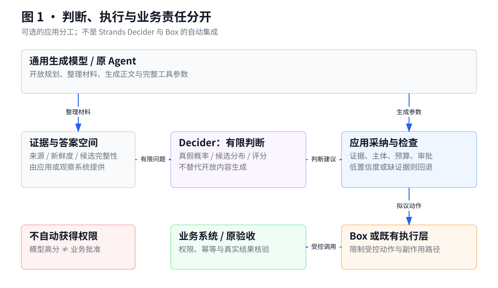
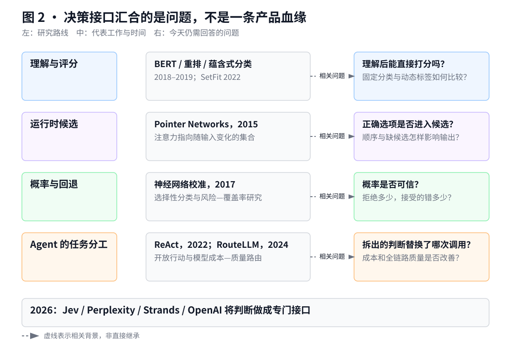
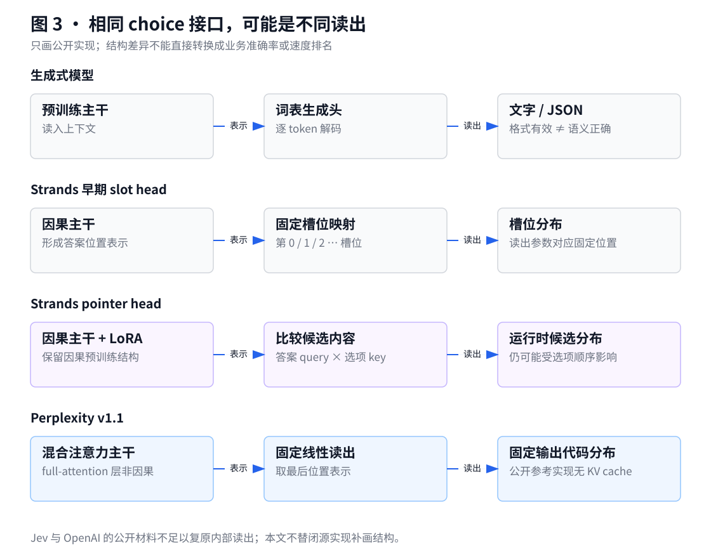
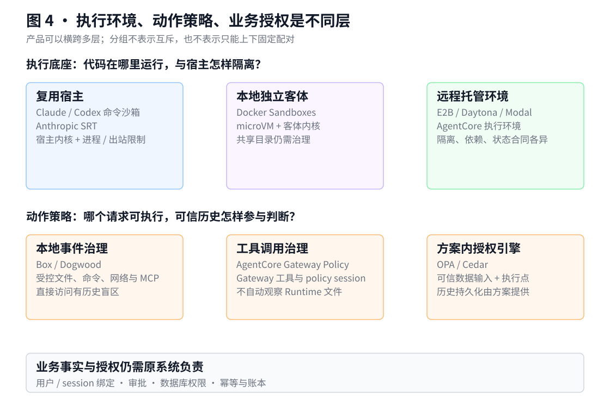
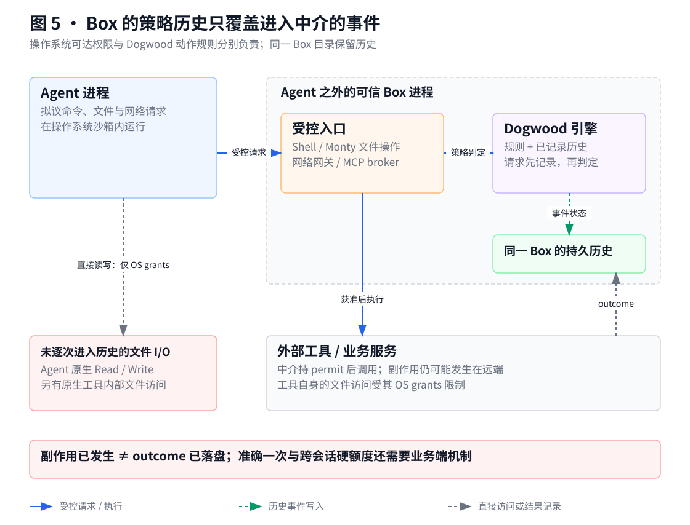

# Strands Decider 与 Box：原理与实测

从真实模型与策略引擎的输入输出说起，再看发展路径与主流方案。完整 Box 沙箱尚未实测。

2026-10-13 · 技术研究 · 原理与实证版（公开版）

## 1. 先看一条真的跑过的工单

客户说：“我的付款已经失败三天了，请尽快修复。”软件需要把它交给账单组、销售组还是商品售后组。Strands Decider 可以接下这个小判断：把工单、问题和三个组的职责一起交给模型，直接得到选项和概率。它不先写一段客服回复，也不自己发送工单。

本次在 Linux CPU 上运行了固定版本的真实权重。实际输入为：

```text
Help! My payouts have been failing for three days. Please fix the payment issue urgently.

问题：Which team should handle this customer request?
选项：
billing = Payments, invoices, refunds and payouts
sales   = Product pricing, plans and buying a subscription
retail  = Physical goods, store delivery and damaged products
```

模型返回的是一个有类型的对象，关键字段如下。这些数值来自本次运行，不是说明书示例。[^1]

```json
{
  "choice": "billing",
  "probabilities": {
    "billing": 0.9926,
    "sales": 0.0046,
    "retail": 0.0027
  },
  "confidence": 0.9889
}
```

程序直接读取 `response.answers["department"].choice` 就能得到 `billing`，不用从模型生成的文字里提取标签。`confidence` 是由选项分布算出的集中程度，并不是另一个模型给出的“正确率保证”。三个选项时，它等于 `(3 × 最大概率 − 1) / 2`；代入 0.9926，正好得到约 0.9889。[^2]

这个例子也展示了它的局限。将 `billing` 从候选中删除后，模型改选 `sales`，其概率是 0.7031、confidence 是 0.4062。正确答案不在菜单里时，接口仍要从剩下的选项中选择。因此，系统需要提供“无合适选项 / 转人工”，或在证据和置信度不足时回退，而不是把“模型返回了一个标签”当成业务问题已解决。[^1]

Box 处理的是接下来另一件事：假设 Agent 已决定读取客户文件并发送出去，谁真正限制它？Box 在本机用操作系统约束文件、程序和网络的可达范围，再让 Agent 外部的 Dogwood 策略引擎检查受控动作。规则可以规定“完成敏感读取之后，不再允许某个导出动作”。它不猜意图，而是检查明确动作和已记录的历史。当前机器不能运行完整 Box 沙箱；本次对其真实策略引擎的测试，与完整 Box 运行明确分开。[^3][^4]

两个组件的区别可以落到代码调用上：Decider 收到 `state + questions`，返回判断；Dogwood 收到 `action + context + history`，返回允许或拒绝。应用决定是否采纳判断，也负责在拒绝后不执行动作。Box 进一步把这种检查放在它能中介的实际操作路径上。它们没有自动集成：一个高分的 `billing` 建议不会获得读文件、导出或付款的权限。

下面先讲决策模型为什么发展成今天这样，再解释不同执行方案。第 7 节集中给出可重跑代码、实际计算路径和本机性能，便于先看实验再回读技术背景。



图 1 · 这是一种可选的职责分工，不是两件产品的自动集成。Decider 给建议，应用决定是否采纳；Box 或既有执行层约束动作，业务授权与结果核验仍由原系统完成。[^5][^3]

## 2. 决策模型并非突然出现：几条路线在这里汇合

### 分类和重排：理解之后，不一定要生成文字

在聊天式 LLM 流行之前，文本分类模型就能判断一段内容属于哪个类别。BERT 在 2018 年发布预印本、2019 年发表于 NAACL，展示了复用预训练表示、增加输出层完成分类和语言推断等任务的方法。SetFit 在 2022 年进一步说明，在一些少样本分类任务上，句子表示加一个分类头仍是有竞争力的工程路线。它不需要先生成一段解释，再从解释中取标签。[^6]

重排解决的是相邻问题：系统先召回一批材料，再判断哪份与请求更相关。2019 年的 Passage Re-ranking with BERT 将查询与候选段落一起送入模型打分。这一分工至今仍有价值，因为召回负责把正确材料找进来，重排负责在材料之间比较；如果召回漏掉正确答案，重排不会凭空补回它。[^7]

运行时提供标签也不是这轮产品才有的能力。Yin、Hay 和 Roth 在 2019 年将零样本文本分类统一成文本蕴含问题：把标签描述写成待判断的陈述，模型检查输入是否支持它。因此不能把“标签不用每次重训”当作所有新 Decider 独有的创新。新产品要证明的，是它在更多问题形态、推理成本、概率质量与接口维护上的增量。[^8]

“从输入集合里指向一个元素”也有更早的研究。2015 年 Pointer Networks 的输出字典随输入长度变化，模型以注意力指向输入位置。这与今天的候选读出有概念上的联系，但原论文使用循环网络、逐步生成索引序列，并不是 Strands 今天的一次前向判断。相似机制不能被写成相同架构，更不能据此认定某个产品的直接技术祖先。[^9]

这些历史意味着，客户如果只做稳定的分类任务，又有可用标签，应该把专用分类器列入基线；如果只是比较已有文档，应比较重排器。采用通用决策模型不是默认最优解。

### 生成式 Agent：灵活性来自模型，也带来重复判断

生成式模型改变了另一端：不用为每个问题预先设计固定处理逻辑，模型可以组织计划、提出工具调用并生成参数。2022 年的 ReAct 展示了把推理与行动交替起来的方式，工具结果又成为后续判断的材料。这里的模型不仅在菜单里选择，还参与产生下一步要做什么。[^10]

这使 Agent 能处理开放任务，也容易把一系列很小的判断放进较大的生成过程。例如，“需要查资料还是执行计算”“信息是否足够”“是否应当澄清”，都可能伴随一次完整模型调用。部分工作因此有重新拆开的空间。

Structured Outputs 和 function calling 改善了接口可靠性，但处理的是另一层问题。前者约束输出符合 schema，后者让模型提出带参数的工具调用；两者仍可能给出语义错误的内容。官方文档也明确承认 Structured Outputs 会犯错。能稳定解析一个 JSON，不等于其订单号、坐标或结论正确。[^11]

因此，决策模型的机会不是取代整个 Agent，而是把已经形成明确问题和答案空间的部分判断抽出来。开放任务规划，以及生成要填写的正文、SQL、解释和报告，未必符合这种形状；这里受约束的是输出，不是模型只能接受结构化文本。

### 路由：先决定哪种智能值得付费

模型路由进一步把“判断”和“生成”分开。2024 年 RouteLLM 学习在较强、较贵模型和较弱、较便宜模型之间选择，训练使用偏好数据，优化成本与质量的取舍。它的输出不是业务答案，而是下一次生成请求该交给谁。[^12]

Semantic Router 代表另一种实现：用语义表示将输入与路由描述或示例匹配，再交给对应处理器。这里通常不需要先让聊天模型撰写路由结果，但相似度也不能直接解释成业务正确率。当前项目还有稳定版本与重写中的版本线之分，不能把仓库 main 的说明当成已安装包的全部能力。[^13]

这两类组件和 Decider 有交集，却不等价。RouteLLM 针对模型间的成本—质量选择；语义路由针对既定处理路径；有类型的决策模型（typed decision model）希望同一接口能回答分类、选择、充分性与等级评价等问题。它扩大了可调用判断的范围，也增加了问题设计与业务校准责任。

| 时间节点 | 代表工作 | 与今天的问题有什么关系 |
|---|---|---|
| 2015 | Pointer Networks | 输出可以指向运行时输入集合，但原实现仍逐步生成 |
| 2017 | 神经网络校准研究 | 准确率和概率可信程度需要分别测量 |
| 2018–2019 | BERT、重排、蕴含式零样本分类 | 预训练理解能力可用于非生成判断与运行时标签 |
| 2022 | SetFit、ReAct | 专用分类与开放 Agent 两条路线继续发展 |
| 2024 | RouteLLM | 将成本—质量选择从主生成模型中拆出 |
| 2026 年 9–10 月 | Jev、Perplexity Decider、Strands Decider、OpenAI Decisions | 判断能力被做成通用 typed 接口、专门读出或独立服务 |

这是相关能力的时间线，不是“前一项直接演化出后一项”的血缘树。另一个名字相近的 Decision Transformer 在 2021 年把离线强化学习写成条件序列建模，仍以回报、状态和历史动作为条件生成行动；本文不把它混入这轮专用判断 API 的产品史。[^14]



图 2 · 按解决的问题阅读发展脉络。BERT、零样本分类与 SetFit 解释“理解之后如何判别”；Pointer Networks 解释动态输出集合的早期思路；校准与选择性分类解释如何管理错判；ReAct 和 RouteLLM 解释判断为何有机会从主 Agent 中拆出。这里没有声称各产品由某篇论文直接派生。[^6][^7][^8][^9][^10][^12][^15][^16]

## 3. 这轮专用决策模型到底改变了什么

### 相似接口背后，是不同的技术选择

TypeSafe 在 2026 年 9 月公开 Jev 的 early access。它的产品目标是把理解、选择、打分变成软件可组合的原语，而不是另一个聊天助手。厂商将训练路线称为 RLCD，强调校准决策；但当前公开材料还不足以独立复现其奖励设计、训练数据和消融。Jev 是文字决策产品，不能直接接收手机截图；公开版本记录也不足以重建每个 1.x 的改动。它适合作为托管文字判断的比较对象，不宜凭训练名称推断内部架构。[^17]

Perplexity 走的是较大、多模态、开放权重的路线。v1 和 v1.1 都复用 Qwen3.8-27B，使用独立决策读出，而不是完整词表生成头。深读代码后，它并不是 Strands 那种“逐候选内容作 key”的 pointer：其读出是固定输出代码对应的线性头，取最后位置的表示。[^18]

v1.1 的一项变化，是取消 full-attention 层的因果遮罩，让这些层能够利用整个输入；线性注意力层并没有因此全部变成双向 encoder。数据也同时扩充，因此模型卡报告的改进不能只归因于注意力变化。其公开参考实现明确拒绝启用 KV cache，不能直接继承因果前缀复用的成本假设。这个限制影响自托管设计，但不足以证明托管服务采用相同实现，也没有单独测定其性能代价。[^18]

Strands 的公开研究记录则让另一组取舍可以被检查。早期 slot head 将最终表示映射到固定槽位；后来的 pointer head 比较“答案标记位置”的表示与“每个选项末尾”的表示，前者是 query，后者是 key，以共享映射打分。简单说，评分依据来自选项的内容，而不是为“第一个选项”“第二个选项”各训练一套参数。这更利于运行时定义标签，但仍不是严格的选项顺序无关模型。它保留预训练主干的因果结构，通过低秩适配（LoRA）与读出头训练，而不是先把整个主干改成双向。[^19]

这次运行把这段解释落实到了张量。单问题的主干输入是 `[1, 102]`：一行、102 个 token。主干输出中，答案位置取出一个 2048 维向量，三个候选各取出一个 2048 维向量。PointerHead 将两类向量分别投影到 768 维，做点积、按 `sqrt(768)` 缩放，再经温度调整和 softmax 变成三个概率。实际读出头共有 3,151,360 个参数；主干及适配参数约 19.32 亿。代码并没有逐 token 生成最终标签。[^19][^1]

这种结构还允许同一份 state 编码后供多个独立问题使用。对于一个工具调用，同时判断参数是否有来源、是否需要澄清、应归哪类风险，通常比把完整上下文反复发给模型更有意义。但问题之间不是一个联合推理链，回答也可能互相矛盾；增加问题的代价更不能推广成所有厂商都“免费”。[^19]

Strands 的 v19、v21、当前 Qwen v1 也说明，架构之外，训练分布影响很大。v19 增补回答充分性数据；v21 使用核验过的问句改写与有条件蒸馏；Qwen v1 扩大代码和规则应用等数据，换用更强 teacher、保留已发布模型的能力锚点，并平均多个训练种子的适配更新和读出结果，再校准。这些变量一起变化，公开成绩并不是某一因素的干净消融。公开权重与配置，也不等于最新数据构建过程已能从 main 完整重建。[^20]

OpenAI 则在其官方日历 2026 年 10 月 6 日发布 Decisions beta。当前官方支持 `gpt-6-luna`，提供图文 predicate、choice、score，并可返回 refusal。可核验的是独立接口及其契约，而不是开放的模型读出、训练配方或与其他家的技术继承关系。同名 Luna 的生成式调用也不是 Decisions 调用。[^21]

因此，这轮变化可以概括为：让自然语言判断成为更容易被程序调用和评测的组件。它既包含模型结构创新，也包含训练目标、批处理和产品接口设计。不能把所有产品统称为“小模型”，也不能因都返回 choice 就认为内部实现和速度相同。



图 3 · 相似接口不意味着相同读出。Strands 的变化是从固定槽位到候选内容比较；Perplexity 的公开实现仍是固定线性读出。图只描述已公开机制，不替 Jev 或 OpenAI 的闭源实现补画内部结构，也不按图推断速度排名。[^18][^19][^21]

### 概率可被管理，不等于不确定性消失

2017 年的校准研究已经指出，神经网络即使分类更准确，也可能对错误答案过度自信。温度缩放能调整分布的尖锐程度，却不改变普通分类的 argmax；因此“校准改善”与“选对更多样本”不是同一个目标。[^15]

这在决策接口里更重要。Choice 的概率是在给定候选之间比较，若正确候选没有提供，剩余候选仍可能形成很尖的分布。confidence 又可能是对该分布的派生量，而不是单次答案正确的概率。Score 是等级分布的期望，两个极端等级各占一半也能得到中间值；只消费一个平均分，会丢掉这种分歧。[^19][^2]

Strands 的公开验证提供了一个直观区分：严格输出结构可以全部有效，语义判断却仍有错误；其视觉评测也记录了移除图片后准确率下降而置信度仍偏高的情况。所以模型外必须检查材料是否存在、是否可解码、是否新鲜；这不是再写一句提醒就能取代的执行责任。[^20]

应当把“接受多少判断”与“这些判断中错多少”一起测量，这与 selective classification 的风险—覆盖率问题相近。用很高阈值只接受少量样本，零误放行并不能说明系统整体可用。阈值在校准集上选择，在独立业务测试集上验，才可能成为有意义的回退策略。[^16]

### 多模态决策也没有自动补齐感知和动作

文字决策模型可以消费业务 API、游戏 SDK、文字识别（OCR）或无障碍控件树（a11y）提供的结构化材料；多模态模型则能直接利用图像。后者减少一部分外部解释步骤，但没有自动获得完整控件菜单或可执行参数。选择一个已编号按钮，与从像素中发现按钮、生成坐标、判断它未被遮挡，仍是不同工作。

所以“单次前向”也不等于“整个 Agent 很快”。输入编码、图像预处理、网络、排队、候选生成与执行核验都仍存在。若先运行原多模态 Agent 产生候选，再额外调用一个 Decider，首先增加的是一次判断；只有它真的替换某个原调用或减少后续轮次，才有降本空间。

## 4. 执行治理的主流路线：从进程限制到托管工作区

模型给出一个合理判断之后，执行风险仍在。命令可能启动子进程，工具可能访问文件或网络，远端服务可能改变业务状态。审批、隔离、出站限制和业务授权处理的是不同问题，不能把其中一项写成另外几项的替代。

### 本地 OS 路线：保留开发环境，限制实际访问

Claude Code 和 Codex 的本地沙箱都将客户端审批与操作系统限制分开。审批决定某次请求是否启动、是否扩大权限；OS 边界限制进程及其子进程能做什么。自动批准并不天然移除隔离，反复弹窗也不说明已经控制了命令内部的每一次操作。[^22][^23]

Anthropic 的 sandbox-runtime（SRT）把这种包装能力抽成 CLI 和库，可用于包围整个 Agent 或本地 MCP 服务。macOS 路径用 Seatbelt，Linux 路径用 bubblewrap 等机制；当前还有独立 Windows alpha 路径，不能将其写成 Claude 内置沙箱的相同支持矩阵。SRT 已有文件和环境遮罩、网络代理及凭证替换能力，不能将它概括成“只有基础隔离”。[^22]

这一路线的吸引力是保留本地语言运行时、编译器和项目工具，不必每次搬进远程机器。代价是仍依赖宿主内核，配置中的广泛读权、允许目的地、Unix socket 和例外路径都需要审查。

还有一个覆盖问题：Claude 内置命令沙箱只包围 shell 及其子进程，不自动包围 Read/Edit、MCP、hooks 等全部能力；SRT 包围整个程序的部署形态又不同。Codex 的命令 sandbox、permission profiles、网络代理与 MCP 授权也有各自范围。其网络开关不自动启动代理，profile 域名规则须在相应代理启用时才约束命令网络；也不能将该代理覆盖面扩展为所有 MCP、浏览器和模型认证请求。比较时必须画出“哪些进程和请求在里面”，而不是看到客户端写了 sandbox 就算完成。[^22][^23]

### 本地 microVM 路线：把整个开发环境放进客体

Linux Docker 的 namespaces、cgroups 与安全配置属于容器隔离，通常仍共享宿主内核。gVisor 在用户态承接 Linux 系统调用，减少应用直接面对宿主内核的接口；Firecracker 则借助 KVM 运行精简 VM，使用独立客体内核。它们是不同隔离机制，并不自行理解“这次发布是否已审批”。[^24]

当前 Docker Sandboxes 是另一个具体产品，不能套用普通 `docker run` 的认识。它为每个 sandbox 提供独立 Linux microVM 和私有 Docker Engine，并可用模板扩展环境。代码 Agent 在 VM 内需要较广工具能力时，这条路线保留了完整开发环境，同时改变了与宿主的内核边界。[^25]

但共享工作目录仍能成为影响宿主的通道。默认共享模式可直接修改宿主文件；clone 模式把编辑放在客体克隆中，原仓库只读，却不因此隐藏其中的 `.env`。当前产品也有出站网络规则、HTTP 方法/路径控制和宿主凭证代理，不是“把程序关进 VM 后就不再治理”。[^25]

凭证代理还应与其他通路分开：SSH-agent 转发允许客体请求签名，并不等于把私钥值交给它；OAuth passthrough 则可能让真实 token 进入客体。注册的本地 stdio MCP 在宿主执行，也不自动受到这台 microVM 保护。需要逐项评审这些可信出口。[^25]

因此，对本地 coding agent，SRT 与 Docker Sandboxes 是两种不同设计选择：前者倾向复用宿主环境，后者倾向完整客体环境。客户需要比较的是工具兼容、文件共享、性能和信任面，而不是抽象地问哪个“更安全”。

### 托管执行路线：E2B、Daytona、Modal 的区别在运行时与状态

E2B 采用每沙箱一台 Firecracker microVM，支持模板、系统依赖和完整代码工具。它的暂停恢复可以保留文件与内存，另有只保磁盘的选项；按当前合同，成功暂停的环境会保留到显式删除。持续运行仍有上限，默认运行超时会 kill，暂停也会断开连接。要运行多步 Python 或工具进程，持久状态、重连和输出转存都是适配的一部分。[^26]

E2B 也已加入出站配置、请求转换和沙箱外秘密注入。域名规则和秘密绑定不能当成完整 API 授权；公开 URL 默认无认证，尤其解释器端口需要主动限制。其私网和链路本地出口阻断不可通过沙箱配置取消，这会直接影响私网数据库与 ADB 接入。对客户而言，它是通用远程执行层的候选，但装了 ADB 或数据库驱动没有解决网络归属问题；不应为引入新沙箱而暴露原有私网。[^26]

Daytona 当前有 Container、Linux VM、Windows 和 GPU 等类别，不能继续统一写成容器方案。普通容器停止后保留文件，但内存不保留；VM 有另一套暂停、快照和运行状态合同；GPU 类停止即删除，结果须另写外部存储。它比较适合围绕仓库、服务和交互工具维护工作区，但相同 SDK 不代表每种 sandbox 有相同隔离与恢复语义。[^27]

其 Secrets 代理可以在沙箱外替换 HTTPS 请求头，管理操作也有 audit logs。这里同样要区分隐藏值和限制使用权：一个组件拿不到真实 token，不等于它不能向已允许的目标发起高权限请求。管理日志也不同于逐条 shell 或业务动作的实时授权。[^27]

Modal Sandboxes 更值得从计算和依赖需求来看。它当前同时提供 gVisor 与 VM 运行时，自定义镜像、包和数据卷可承载完整数据处理栈；GPU 当前只支持 gVisor，不能与 VM 类组合。快照的存活、TCP 连接和后台 exec 恢复也有边界，不能由“支持快照”推出所有状态都能透明续跑。[^28]

它已提供外部秘密注入和网络策略，但一些 Beta/Alpha 能力不能同时组合。当前秘密注入不能与 `block_network`、域名/CIDR allowlist 或内存快照组合。如果客户同时要求封网和外部注入，就不能直接把这两页功能拼成方案；需要另选组合或设计可信工具代理。选择时要核对最终配置，而不是把几个功能页上的优点加起来。[^28]

这三家都是实际的执行平台候选，不只是 Box 的简化版。它们负责环境、依赖、会话、文件与连接；是否需要另加历史动作治理，取决于业务操作在哪里被执行。

### AWS 路线：托管运行、代码工具和授权分别组合

AgentCore Runtime 托管 Agent 或工具服务；Code Interpreter 是独立的代码执行工具；Policy 的执行点则是 Gateway 工具调用。三个组件不能揉成一个“AgentCore 沙箱”。Runtime 的 microVM 会话与 Instances 模式也有不同隔离语义：同一 Instances 环境内多个 Agent 可能共享资源并需要互信。[^29]

Code Interpreter 已有常见 Python 数据库和分析库，适合数据计算；需要 Bun、自定义系统依赖或特殊进程时，应比较自定义 Runtime 或其他执行底座，而不是因为它支持 JavaScript 就假定等于 Bun。文件持久化、会话身份和取消也要按所选服务配置。[^29]

会话隔离还不等于用户归属验证。后端用共享 IAM principal 服务多个用户时，必须绑定并校验谁能使用哪个 Runtime session ID；不能让一台独立 microVM 自动成为用户授权证明。这与 Gateway Policy 下基于认证主体的 session 绑定也不是同一合同。[^29][^30]

已经采用 AWS 托管运行时的系统，不意味着还缺一个完整执行平台；它可能只缺某条具体工具规则。这个判断会直接影响 Box 是否值得叠加。



图 4 · 先选执行底座，再判断是否缺动作治理。上排解决代码在哪里运行、与宿主怎样隔离；中排解决哪个受控动作可执行、历史怎样参与判断；业务身份、数据库权限和幂等仍是独立责任。这些路线有交叉能力，图不是互斥产品分类。[^22][^23][^24][^25][^26][^27][^28][^29][^31][^30]

## 5. Box 的特点是中介化动作与历史，而非包办所有安全

Box 在操作系统访问许可（OS grants）之外，把 Strands Shell、Monty Python、网络网关与 MCP broker 放入 Agent 外的可信进程，共用一个 Dogwood 引擎。它不是要求 Agent 自己记住规则，而是在这些中介处理请求时执行规则。[^3][^32]

Dogwood 在 Cedar 风格规则上增加时序条件，并维护记录到的事件。例如，某个受控文件读取可以影响后来是否允许出站请求，测试结果可以影响后续推送。Box 将 request 先持久化再判定，重开同一 Box 目录会复用历史；这减少了自己维护跨工具时序状态的工作。[^33]

它与 SRT 的差别因此不只是有没有代理或能否隐藏 secret。SRT 已有丰富的 OS 和网络控制；Box 押注的是让多种中介采用共同动作词汇，并把这些事件放到一个持久历史里。如果客户恰好需要关联文件、命令、网络和 MCP，这个设计值得试。

这种优势也受覆盖面限制。Agent 自带文件工具的直接访问只受 OS grants 约束，不自动形成 Dogwood 文件事件；原生工具在自己的 sandbox 中访问文件，也不逐次进入这份历史。于是“读敏感文件后禁止联网”的规则，只能对进入策略历史的读取成立。要得到预期结果，需要改变工具路径与直接 grants，不是多写一条规则就完成。[^32][^33]

OPA 与 Cedar 提供的是另一种成熟分工：授权组件读入请求、主体、资源及数据，由执行组件消费结果。历史也可以由可信外部状态作为输入提供，不能说它们原则上无法表达跨步骤约束；只是历史维护、并发、恢复与事件完整性不会自动由一个静态许可规则解决。Dogwood 将其中一部分做成一等语言和运行机制。[^31]

时间策略也不是 Box 独有。AgentCore Policy 当前已有 Dogwood 与 policy session，能够约束 Gateway 工具顺序与 session 内累计值。对已走 Gateway 的应用，这是应当比较的托管路径；它不自动看见 Runtime 内部文件访问，Box 也不自动获得所有云端事件。相同语言还不意味着相同事件合同，规则不能未经核验直接移植。[^30]

最容易造成过度承诺的例子是“审批后只能支付一次”。引擎可以检查已记录的审批与完成事件，但审批事实要来自可信系统、绑定主体和操作。外部付款与 outcome 记录若不在同一事务，崩溃或并发就可能留下差异；调用方可换 session 的计数也不能成为跨会话硬额度。业务端的审批、幂等与账本仍有独立责任。[^33][^30]

Box 的凭证也有明确边界：真实值在外部 gateway，使用许可却以整个 Box 为范围；同一 Box 的工具和本地 MCP 可使用其绑定。网络目的地获准之后，Agent 仍可能把可读内容发过去。隐藏凭证值、限制凭证用途和防数据外送，是三个不同目标。[^32]

| 客户真正缺少的能力 | 应先比较的路线 | Box 是否直接对应 |
|---|---|---|
| 在开发者电脑上约束代码 Agent | 客户端 OS sandbox、SRT、本地 microVM | 是相关候选，但要比工具路径和平台 |
| 远程运行完整代码与依赖 | E2B、Daytona、Modal、AgentCore 执行环境 | 不是完整托管平台的直接替代 |
| 为已接入业务工具规定权限与顺序 | 服务端授权、OPA/Cedar、AgentCore Policy | 可以互补，也可能已有更近的执行点 |
| 把本地文件、命令、网络和 MCP 的事件关联起来 | 受控 broker 与统一历史策略 | 是 Box 较明确的研究位置 |

当日 Box 仍是开发者预览，可核验发行包为 Apple silicon Mac；Linux ARM64 有实验性源码，固定版本拒绝 x86_64。Monty 也不是完整 CPython，网关的响应缓冲、协议与体积限制会影响流式和工具兼容。它不提供租户隔离、全局资源配额或完整防篡改审计。因此今天应比较一个具体可执行规则的收益，而不是把 Box 当成云端 Agent 的默认外壳。[^32][^33]



图 5 · 策略看得见的是进入中介的事件。直接文件访问仍受操作系统权限限制，但不能自动成为时序规则的依据。允许动作后，外部副作用与结果记录不是共同事务；需要准确一次、跨会话硬额度或防篡改审计时，还必须依靠业务端机制。[^32][^33][^30]

## 6. 选型最终要回答的两个问题

决策模型方面，先找出它替换哪一个判断。固定证据、候选和业务标签，将规则、分类/重排或路由基线、当前生成模型与 Decider 比较；分别统计误接受、弃权、覆盖率、完整请求耗时和全链路费用。新模型如果只是多给一个分数，价值应先写成诊断或质量观察，不预先承诺降本。

执行治理方面，先画出产生副作用的路径。规则在哪个组件执行、关键事件由谁记录、有什么直接访问或远端路径看不见、哪个主体拥有凭证，这些要能解释清楚。用成对的允许/拒绝用例检查实际副作用，再测正常流程是否仍可完成。一个 deny 日志、一台 microVM 或一个批准弹窗，都不能单独替代这次验证。

对这两类问题有了数据，再决定是否扩大采用范围。这样得到的是可解释的技术选择，而不是一张把新产品都标成“高适配”的表。

## 7. 代码实证：到底算了什么，耗时在哪里

本轮新增了独立实验，不修改任何业务代码。主机为 Linux x86_64、Xeon 8375C，8 个物理核 / 16 个逻辑 CPU、约 61 GiB RAM，全部模型调用走 CPU。使用 Python 3.12.12、PyTorch 2.7.1+cpu、Transformers 5.18.0、PEFT 0.21.0。源码和模型版本固定，权重已下载后再测加载与推理；没有调用收费 API。

### 一个可复制的最小调用

准备独立环境，安装固定源码，而不是假设 PyPI 包与仓库最新功能相同：

```bash
uv venv --python 3.12 .venv
uv pip install --python .venv/bin/python torch==2.7.1 --index-url https://download.pytorch.org/whl/cpu
uv pip install --python .venv/bin/python \
  "strands-decider @ git+https://github.com/strands-labs/strands-decider@b9fc83626bcca822d00f822d6c2e151b8d244ee9" \
  transformers==5.18.0 peft==0.21.0
```

将下面保存为 `demo.py`，然后运行 `.venv/bin/python demo.py`。这是核心调用的完整示例；首次会下载固定适配权重和约 4.5 GB 底座。完整实验程序还增加了哈希核验、计时、原始记录和反例。

```python
import torch
from huggingface_hub import snapshot_download
from strands_decider.infer import load_engine
from strands_decider.schema import ChoiceQuestion, NoulQuestion, ScoreQuestion

torch.set_num_threads(8)
torch.set_num_interop_threads(1)
checkpoint = snapshot_download(
    "StrandsAgents/strands-decider-2B-qwen3.5-v1-2610",
    revision="216d1ccb46a9e9b036eb9187b248db98480f77d4",
    token=False,
)
engine = load_engine(checkpoint, device="cpu")
state = "Help! My payouts have been failing for three days. Please fix the payment issue urgently."
questions = {
    "department": ChoiceQuestion(
        instructions="Which team should handle this customer request?",
        criteria={
            "billing": "Payments, invoices, refunds and payouts",
            "sales": "Product pricing, plans and buying a subscription",
            "retail": "Physical goods, store delivery and damaged products",
        },
    ),
    "urgent": NoulQuestion(instructions="Does the customer request urgent help?"),
    "frustration": ScoreQuestion(
        instructions="How frustrated is the writer?",
        criteria=["Calm", "Frustrated", "Very angry"],
    ),
}
response = engine.ask(state, questions)
print(response.model_dump_json(indent=2))
print(response.answers["department"].choice)
```

这个调用在本机得到 `billing`、紧急性概率 `0.9429`、情绪等级期望 `1.1096`。情绪分布是 `0: 0.1759、1: 0.5386、2: 0.2855`，因此 `0 × 0.1759 + 1 × 0.5386 + 2 × 0.2855 = 1.1096`。这说明 `score` 的小数来自等级分布，不是模型任意写出的数字。[^1]

初始化仍是完整模型加载。CPU 引擎将主干转为 float32，不能因为下载配置写着 bfloat16，就用半精度内存估计运行占用。本次模型进程峰值 RSS 为约 11,513 MiB，即 11.24 GiB；包括加载、临时张量和框架，不只是权重。首轮计量的模块导入约 7.03 秒，缓存权重加载约 3.65 秒，加载后的首个单问题约 924 ms。另一次最小 demo 进程的模型加载为 9.29 秒、首个三问题请求为 1.76 秒；没有清理 OS 页缓存、没有重复冷启动，不能把其中较小的数当稳定启动 SLA。实际使用应保持模型进程常驻，而不是每条工单重新启动脚本。

### 插桩看到的计算路径

调用过程中记录主干和读出头的真实输入形状，结果如下。插桩单独执行，不放入性能计时。

| 调用方式 | 实际主干 forward | 读出头输出 | 如何理解 |
|---|---|---|---|
| 一个问题 | `[1, 102]`，一次 | `[1, 3]` | 一行完整输入，直接得到三个候选分数 |
| 三问题共享材料 | 先 `[1, 27]`，再 `[3, 75]` | `[3, 3]` | 材料先读一次，缓存复制给三个独立问题 |
| 三问题普通批处理 | `[3, 102]`，一次 | `[3, 3]` | 三行各自含完整材料，没有共享前缀 |

102 是这一条完整请求的 token 数；27 是共享材料 token 数；75 是该组最长的问题后缀长度。批处理会补齐到最长行，`usage.input_tokens` 记录有效 token，不等于实际填充后的计算规模。三问题的有效 token 计数分别为共享路径 236、普通或独立路径合计 290；`output_tokens=3` 是三项判别的接口计数，不是模型逐字生成了三个回答 token。

所以“一个问题不生成文字”和“一组问题只执行一次 forward”不是一回事。本轮单问题确实是一次主干 forward；共享三问题则是一次材料编码加一次后缀批处理。没有标签生成循环，最后用程序将分数映射回 `billing` 等字符串。本轮配对实验中，三种路径的 API 四位小数输出一致。模型仍需要读完输入，并不是查一张很小的类别表。

### 预热后单问题：长度和线程数会改变结果

固定分类问题，前面添加明确标为无关的合成日志，产生 102、262、742-token 请求。每个条件先预热，再记录 8 次完整 `engine.evaluate` 调用。全部样本保留；下表不是最低一次耗时。

| 完整输入 token | 4 线程 P50 | 8 线程 P50 / P95 | 16 线程 P50 |
|---|---|---|---|
| 102 | 852 ms | 501 / 603 ms | 547 ms |
| 262 | 1,757 ms | 1,078 / 1,324 ms | 1,262 ms |
| 742 | 4,719 ms | 2,891 / 3,190 ms | 3,749 ms |

这组数据有两项直接意义。输入变长，推理仍明显变慢；去掉生成头并没有去掉输入编码成本。线程数也不是越多越快：本轮 8 线程优于 16 线程的中位数，但测试没有隔离主机其他活动，顺序是 4、8、16，不据此认定所有负载的最优线程数。每条件仅 8 次，P95 是小样本描述，不是生产尾延迟保证。

框架在 CPU 上使用 Gated DeltaNet 的参考 PyTorch 路径，没有 CUDA/Triton 加速。本次既没有 GPU 对照，也没有同机生成式 LLM 对照，因此不报告“比大模型快多少”或实际云费用节省比例。它测的是当前 SDK 在当前 CPU 上的真实路径，而不是硬件极限。[^1]

### 三个问题共享材料：只在长材料上看到明显收益

保持同样的三个问题，交错执行共享前缀、普通批处理和三个独立请求，每种条件 8 次。独立方式的时间是三次调用之和。

| 材料 / 方式 | 有效 token 计数 | P50 | P95 |
|---|---|---|---|
| 短材料，共享前缀 | 236 | 1.40 秒 | 1.63 秒 |
| 短材料，普通批处理 | 290 | 1.21 秒 | 1.51 秒 |
| 短材料，三次独立请求 | 290 | 1.44 秒 | 1.63 秒 |
| 较长材料，共享前缀 | 1,036 | 4.13 秒 | 4.23 秒 |
| 较长材料，普通批处理 | 2,690 | 10.18 秒 | 13.61 秒 |
| 较长材料，三次独立请求 | 2,690 | 10.11 秒 | 11.83 秒 |

短材料上，共享方式比普通批处理慢，与额外一次主干 forward 的固定开销相符；这里没有做单因素硬件消融。较长材料上，共享方式相对三个独立请求的中位数约快 2.45 倍。收益来自少读重复材料，不代表增加问题没有成本，也不代表三个独立 HTTP 请求会自动共享缓存。

这个结论可以反过来指导 Agent Building：找同一大段材料上的多个独立判断，才有更明确的共享收益；对于很短的路由问题，应连普通批处理、规则或小分类器一起比较。完整调用成本还要算候选生成、传输、排队与回退，本次没有测那些环节。

### 功能反例比“8/8”更值得记住

八条事先定义的合成工单包含中英文、明确类别和需要人工澄清的输入。本轮选项判断为 8/8，但这是很小、很清楚的验证集，不是 held-out 客户评测，也不是校准测试。候选顺序变化时，`billing` 仍被选中，概率从 0.9926 到 0.9946 略变，不能称严格顺序不变。

删除正确候选后，选择 `sales` 的例子已在第 1 节给出。本轮还验证了显式严格窗口模式：9,084-token 请求被拒绝，错误说明窗口为 4,096。默认模式会截短材料；严格模式才拒绝。材料完整性必须由应用管理，而不是凭一次模型高分推定证据都在。这里没有运行视觉输入，因此 501 ms 的文字结果不能代表截图路径的耗时，更不能作为设备动作或自动验收的成绩。[^1]

### 真正跑过的 Dogwood：规则如何让同一动作从允许变成拒绝

Linux 实验链接的是 `dogwood-local-engine=1.0.0`、`dogwood-language=1.0.0`、`cedar-policy=4.11.0`、`redb=4.2.0`，与 Box 固定版本的直接依赖相同；完整传递依赖另由本次 Cargo.lock 固定。编译使用 digest 固定的官方 Rust 1.98.1 镜像，执行阶段禁用网络。Docker 只提供编译和运行包装，不替代 Box 沙箱。

规则只有一个条件：一小时内记录了 `sensitive.txt` 的读取完成事件，就禁止 `Export`。保留常规读和导出的 permit，再叠加下面的 forbid：

```text
@id("no_export_after_sensitive_read")
forbid (principal, action == Demo::Action::"Export", resource)
when temporal {
    formerly within 1h
    Demo::Action::"Read"::response{ input.path: "sensitive.txt" }
};
```

这是独立 demo 的 `Demo::Action`，不是已经接入 Box 的 `Box::Action`。测试包装器调用真实引擎 `submit`；收到允许才执行一个无害的本地文件写入。它不向外上传数据，也不阻止任意系统调用。实际结果为：

| 本轮步骤 | 引擎结果 | 实际文件结果 | 说明 |
|---|---|---|---|
| 尚未读取敏感文件，尝试导出 | 允许 | `before.txt` 创建 | 普通允许路径成功 |
| 直接读了文件，但未向引擎报告 | 允许 | 对照文件创建 | 真实读发生了，但引擎不知道 |
| 仅报告读取 request，没有 response | 允许 | 对照文件创建 | 请求不等于已完成的读取 |
| 将真实读取完成记为 response，再导出 | 拒绝 | 目标文件未创建 | 时序规则生效，包装器没有执行副作用 |
| 新进程打开同一存储，不重新 install | 拒绝 | 目标文件未创建 | 历史恢复后仍然生效 |

两个运行进程属于不同容器；每个容器内 PID 都是 1，不能仅凭这个 PID 判断是否重启。日志保留不同容器 ID、事件 offset 与时间戳；新进程的恢复约 6.8 ms。重开时不重新 install 很重要：恢复已有策略状态与重新安装策略不是同一操作。

随后交错测了 1,000 次允许、1,000 次拒绝。最后一轮允许路径 P50 / P95 为约 1.26 / 3.03 ms，拒绝路径为约 1.19 / 2.71 ms；前一轮也保存，允许路径 P50 为约 2.01 ms，说明存储与环境会影响结果。计时包括事件构造、durable append 和判定，可能包含每 1,000 个事件触发的自动快照；不含镜像拉取、编译、启动、恢复和测试文件写入。不要把 1.19 ms 写成完整 Box、网络网关或云工具的延迟。[^4][^34]

性能阶段的允许样本是 `Read` 请求，拒绝样本是已触发规则后的 `Export` 请求；两条路径动作不同，因此不能把时间差归因于 permit 与 deny 本身。它们测到的是这个示例的两种实际提交路径，而不是策略引擎的公平胜负排名。

这里最重要的不是毫秒数，而是因果链可观察：同一个动作、同一条规则，改变的是历史；规则拒绝后，受控包装器确实没有执行写入。直接读却不报告的对照又表明，仅调用策略库不会自动获得完整事件覆盖。这正是完整 Box 需要 OS 约束与可信中介的原因。

### 完整 Box：有代码，但本机不能填写“已验证”

当前 Linux x86_64 的完整 Box 测试明确标为 `Blocked`，没有启动产品沙箱，没有执行其 OS 拦截断言。已准备 Apple silicon / macOS 15+ 的独立用例：原生读取应被 OS 拒绝，中介读取应获准，敏感读取后写入应拒绝，并检查真实文件和日志。该 Mac 用例没有在本机验证，不能给它填入性能数字。

本轮十项实验中，六项 Decider、三项独立引擎的命名断言通过，一项完整 Box 受阻；另四个辅助单元测试通过。第一次 Rust demo 构建因错误类型转换失败，包装器修复后复跑成功，失败日志保留；那次编译失败不是一次“安全拒绝”。原始模型记录含 181 次请求 / 返回及每次计时。通过表示这些实验断言成立，不是客户方案已可上线。

完整代码包保留最小调用、固定版本下载器、性能程序、Rust 源码与规则、Mac 用例、Cargo.lock 和原始数据。运行包需要安装依赖、下载权重；阅读本文不需要打开包或旧报告。下一步真正缺的证据，是客户分布上的误接受 / 覆盖率，以及支持平台上完整 Box 的副作用拦截，而不是再补一张“高适配”清单。

## 附录：如何核验这份研究

本文面向 Agent Building 的技术负责人，按“运行一个例子、看清计算和执行、理解技术演进”展开。公开产品依据一手文档、论文和源码。本轮新增的本地实验单独列在第 7 节；未做客户设备闭环。研究日期按 Asia/Shanghai 记录。

本文按技术问题选择代表文献，不是系统综述，也没有按引用量排名。BERT 的初稿年与正式发表年、产品公告日与权重提交日分别处理；“较快”“校准更好”若来自作者记录，不作为本次复测。部分闭源训练细节、发行支持和相互兼容性尚不能由公开材料证明。

### 版本与实验归属

公开资料核验日为 2026-10-13。Decider 代码固定到 `b9fc83626bcca822d00f822d6c2e151b8d244ee9`；Box 固定到 `223e3959d539110eaacfacb6f973c03928dc39b0`，发行包查到 `v0.1.0`。SRT 按 `v0.0.79` README 核对；Claude 内置沙箱、Codex、Docker、E2B、Daytona、Modal 与 AgentCore 按核验日官方文档阅读，不把动态文档当成固定源码版本。支持状态与各自限制已写在第 4、5 节，不要求读者另开一份报告理解结论。

### 阅读与携带说明

五张图是依据所引资料绘制的机制示意，不是新增实测结果；每张图都有替代文字与随图解释。外部链接只用于追溯证据，不是阅读前提。

文中的 P50 是请求耗时的中位数；置信度与校准讨论的是模型输出，不是业务权限。SSO 是应用单点登录，IAM 是 AWS 身份与访问管理，MCP 是 Agent 调用工具的协议；这几个身份或连接机制需要显式映射，不能视作天然同一主体。术语只说明技术职责，本文不提供金融业务准入或合规结论。

本轮在独立实验目录安装了模型依赖、下载公开权重并运行本地测试；未改业务仓库、访问客户设备、调用收费模型或对外发布材料。模型下载和依赖安装不是推理计时的一部分。

### 关键论文与公开实现

| 工作 | 作者与时间 | 文献形态 / 标识 | 全文与实现 |
|---|---|---|---|
| Pointer Networks | Vinyals、Fortunato、Jaitly；2015 初稿 | arXiv:1506.03134 | [公开全文](https://arxiv.org/pdf/1506.03134) |
| On Calibration of Modern Neural Networks | Guo、Pleiss、Sun、Weinberger；2017 | ICML / arXiv:1706.04599 | [全文与记录](https://proceedings.mlr.press/v70/guo17a.html) |
| BERT | Devlin、Chang、Lee、Toutanova；2018 初稿、2019 发表 | NAACL / 10.18653/v1/N19-1423 | [正式全文](https://aclanthology.org/N19-1423/) |
| Passage Re-ranking with BERT | Nogueira、Cho；2019 初稿 | arXiv:1901.04085 | [公开全文](https://arxiv.org/pdf/1901.04085)、[作者实现](https://github.com/nyu-dl/dl4marco-bert) |
| 蕴含式零样本分类 | Yin、Hay、Roth；2019 | EMNLP-IJCNLP / 10.18653/v1/D19-1404 | [正式全文](https://aclanthology.org/D19-1404/)、[作者实现](https://github.com/yinwenpeng/BenchmarkingZeroShot) |
| SetFit | Tunstall 等；2022 初稿 | arXiv:2209.11055 | [公开全文](https://arxiv.org/pdf/2209.11055) |
| ReAct | Yao 等；2022 初稿 | arXiv:2210.03629 | [公开全文](https://arxiv.org/pdf/2210.03629)、[作者项目](https://react-lm.github.io/) |
| RouteLLM | Ong 等；2024 初稿 | arXiv:2406.18665 | [公开全文](https://arxiv.org/pdf/2406.18665)、[作者实现](https://github.com/lm-sys/RouteLLM) |

引用数未查询；没有以其作为选择依据。正文推论与实验提议不代表这些论文或产品已经验证了具体客户场景。

### 来源注释

[^1]: 本轮本地实验，运行目录标识 `2026-10-13_130834`。使用固定 Decider 源码 `b9fc83626bcca822d00f822d6c2e151b8d244ee9`、权重 `216d1ccb46a9e9b036eb9187b248db98480f77d4`，底座 `Qwen/Qwen3.5-2B-Base` 固定到 `b1485b2fa6dfa1287294f269f5fb618e03d52d7c`。原始请求、返回、forward 插桩和每次计时均记录；本篇第 7 节保留读懂结论所需的数据与代码。合成工单不代表客户业务准确率。
[^2]: [TypeSafe Confidence](https://docs.typesafe.ai/confidence)与[Strands 问题/回答定义](https://github.com/strands-labs/strands-decider/blob/b9fc83626bcca822d00f822d6c2e151b8d244ee9/src/strands_decider/schema.py)。供应商、类型及置信度度量不同，不能直接共用阈值。
[^3]: [AWS Box 官方发布](https://aws.amazon.com/blogs/opensource/introducing-strands-box-ai-agent-sandboxes-powered-by-dogwood/)与[官方用户指南](https://strandsagents.com/docs/user-guide/box/)。本文区分隔离、策略与执行路径。
[^4]: Box 固定版本的[策略引擎依赖](https://github.com/strands-agents/box/blob/223e3959d539110eaacfacb6f973c03928dc39b0/crates/policy/Cargo.toml)与 Dogwood 官方固定版本的[Local Engine API](https://github.com/dogwood-policy/dogwood-local-engine/blob/d2cba92a6d33119c1f76e2b01b80802b331c7830/dogwood-local-engine/README.md)、[持久化实现](https://github.com/dogwood-policy/dogwood-local-engine/blob/d2cba92a6d33119c1f76e2b01b80802b331c7830/dogwood-local-engine/src/durable.rs)。独立引擎不提供 Box 的 OS containment；重复 install 与恢复既有状态不是同一操作。
[^5]: [Strands Decider 官方发布](https://strandsagents.com/blog/introducing-strands-decider/)与[固定架构说明](https://github.com/strands-labs/strands-decider/blob/b9fc83626bcca822d00f822d6c2e151b8d244ee9/docs/architecture.md)。决策 API 不直接提供完整 Agent loop。
[^6]: [BERT 正式论文](https://aclanthology.org/N19-1423/)及[2018 初稿记录](https://arxiv.org/abs/1810.04805)；[SetFit 论文](https://arxiv.org/html/2209.11055v1)。后者是特定任务研究结果，不是通用性能保证。
[^7]: [Passage Re-ranking with BERT 全文](https://arxiv.org/html/1901.04085v5)。其查询—段落评分与 Agent 的完整动作生成是不同任务。
[^8]: [Yin、Hay、Roth，EMNLP-IJCNLP 2019](https://aclanthology.org/D19-1404/)。零样本标签与文本蕴含的先例，非当前产品的直接谱系证明。
[^9]: [Pointer Networks 全文](https://arxiv.org/html/1506.03134v2)与[初稿日期](https://arxiv.org/abs/1506.03134)。原论文为逐步序列输出，不将其误述为一次前向 Decider。
[^10]: [ReAct 全文](https://arxiv.org/html/2210.03629v3)。交替 reasoning/acting 的研究，不意味着所有当前 Agent 都采用相同实现。
[^11]: [OpenAI Structured Outputs 官方指南](https://developers.openai.com/api/docs/guides/structured-outputs)。包含结构约束与仍可能出错的边界。
[^12]: [RouteLLM 全文](https://arxiv.org/html/2406.18665v4)与[官方实现](https://github.com/lm-sys/RouteLLM)。作者报告的降本数字未在本文复用。
[^13]: [Semantic Router 官方仓库](https://github.com/aurelio-labs/semantic-router)及[说明](https://github.com/aurelio-labs/semantic-router/blob/main/docs/get-started/introduction.md)。main 与稳定版本线不同；本文只讨论路线，不执行其安装示例。
[^14]: [Decision Transformer 论文记录](https://arxiv.org/abs/2106.01345)。另一个“决策”语境，不是本次 typed API 的直接前身。
[^15]: Guo 等，[On Calibration of Modern Neural Networks，ICML 2017](https://proceedings.mlr.press/v70/guo17a.html)及[正文](https://proceedings.mlr.press/v70/guo17a/guo17a.pdf)。温度缩放改变分布而不改变普通分类 argmax，结论不自动迁移到所有业务分布。
[^16]: [Calibrated Selective Classification](https://arxiv.org/abs/2208.12084)。本文使用其风险/覆盖率问题作为相关背景，没有将论文应用结果外推到手机 QA。
[^17]: TypeSafe 的[创始人发布说明](https://typesafe.ai/blog/introducing-system-one-models-and-jev)、[发行人署名新闻稿，2026-09-15](https://www.businesswire.com/news/home/20260915525333/en/TypeSafe-AI-Emerges-From-Stealth-With-%2440M-in-Funding-With-New-Model-for-Composable-AI)、[RLCD primer](https://docs.typesafe.ai/introduction/machine-learning-primer)、[当前 Models](https://docs.typesafe.ai/models)和[失效边界](https://docs.typesafe.ai/model-jaggedness/jev-1.13)。发行人声明不作独立验证。
[^18]: Perplexity [v1 模型卡](https://huggingface.co/perplexity-ai/pplx-decider-v1-27b/blob/d8c3bd18e31dc1804433d38528b3e770019bf00c/README.md)、[v1.1 模型卡](https://huggingface.co/perplexity-ai/pplx-decider-v1.1-27b/blob/14c9d90137962d300f3de95633f7b6535e80c5ce/README.md)、[v1.1 读出与非因果实现](https://huggingface.co/perplexity-ai/pplx-decider-v1.1-27b/blob/14c9d90137962d300f3de95633f7b6535e80c5ce/source/src/autojev/model.py)及[训练 manifest](https://huggingface.co/perplexity-ai/pplx-decider-v1.1-27b/blob/14c9d90137962d300f3de95633f7b6535e80c5ce/training/data-manifest.json)。架构与数据共同变化，不伪造独立消融。
[^19]: Strands [架构](https://github.com/strands-labs/strands-decider/blob/b9fc83626bcca822d00f822d6c2e151b8d244ee9/docs/architecture.md)、[SlotHead/PointerHead 源码](https://github.com/strands-labs/strands-decider/blob/b9fc83626bcca822d00f822d6c2e151b8d244ee9/src/strands_decider/modeling.py)、[推理与前缀共享](https://github.com/strands-labs/strands-decider/blob/b9fc83626bcca822d00f822d6c2e151b8d244ee9/docs/inference.md)。选项仍有顺序敏感，未表述为严格排列不变。
[^20]: Strands [研究账本](https://github.com/strands-labs/strands-decider/blob/b9fc83626bcca822d00f822d6c2e151b8d244ee9/research/generations.md)、[版本评测](https://github.com/strands-labs/strands-decider/blob/b9fc83626bcca822d00f822d6c2e151b8d244ee9/evaluation/results.md)和[Qwen v1 发布卡](https://huggingface.co/StrandsAgents/strands-decider-2B-qwen3.5-v1-2610/blob/216d1ccb46a9e9b036eb9187b248db98480f77d4/README.md)。账本内部实验日期为作者追述；不是同期公开提交证明。
[^21]: [OpenAI Decisions 指南](https://developers.openai.com/api/docs/guides/decisions)与[官方 changelog](https://developers.openai.com/api/docs/changelog)。发布日期为官网日历日期，原文未给时区/时刻，不虚构上海零点；public beta 不写成 GA。
[^22]: [Claude Code 命令 sandbox](https://code.claude.com/docs/en/sandboxing)与[Anthropic SRT 0.0.79](https://github.com/anthropics/sandbox-runtime/blob/v0.0.79/README.md)。CLI 客户端、内置 Bash sandbox、独立 SRT 的支持范围分别理解。
[^23]: OpenAI [本地 sandbox 与审批](https://learn.chatgpt.com/docs/agent-approvals-security)、[permission profiles](https://learn.chatgpt.com/docs/permissions)与[环境传递](https://learn.chatgpt.com/docs/config-file/config-advanced#shell-environment-policy)。审批策略不是 OS 隔离开关。
[^24]: [Docker Engine 安全](https://docs.docker.com/engine/security/)、[gVisor 机制](https://gvisor.dev/docs/architecture_guide/intro/)和[Firecracker](https://github.com/firecracker-microvm/firecracker)。隔离机制不等于业务授权。
[^25]: Docker Sandboxes [架构](https://docs.docker.com/ai/sandboxes/architecture/)、[隔离](https://docs.docker.com/ai/sandboxes/security/isolation/)、[网络规则](https://docs.docker.com/ai/sandboxes/governance/access-controls/network/)与[凭证代理](https://docs.docker.com/ai/sandboxes/configuration/credentials/)。其为独立 microVM 产品，不套用早期普通容器认识。
[^26]: E2B [运行时源码](https://github.com/e2b-dev/runtime)、[持久化](https://docs.e2b.dev/sandbox/persistence)、[网络](https://docs.e2b.dev/network/internet-access)、[秘密注入](https://docs.e2b.dev/secrets/inject)与[公开访问限制](https://docs.e2b.dev/network/restrict-public-access)。私网、暂停与请求代理都有边界。
[^27]: Daytona [隔离类别](https://www.daytona.io/docs/en/isolation/)、[状态持久化](https://www.daytona.io/docs/en/persistence/)、[Secrets](https://www.daytona.io/docs/en/secrets/)与[管理审计](https://www.daytona.io/docs/en/audit-logs/)。不同类别不使用相同恢复语义。
[^28]: Modal [Sandbox 运行时](https://modal.com/docs/guide/sandboxes)、[资源/GPU](https://modal.com/docs/guide/sandbox-resources)、[快照](https://modal.com/docs/guide/sandbox-snapshots)、[网络](https://modal.com/docs/guide/sandbox-networking)与[秘密注入](https://modal.com/docs/guide/sandbox-secret-injection)。Alpha/Beta 与能力不可组合项按核验日文档理解。
[^29]: AgentCore [Runtime](https://docs.aws.amazon.com/bedrock-agentcore/latest/devguide/agents-tools-runtime.html)、[Instances 信任边界](https://docs.aws.amazon.com/bedrock-agentcore/latest/devguide/runtime-instances-security.html)、[Code Interpreter](https://docs.aws.amazon.com/bedrock-agentcore/latest/devguide/code-interpreter-tool.html)、[预装库](https://docs.aws.amazon.com/bedrock-agentcore/latest/devguide/code-interpreter-preinstalled-libraries.html)与[运行时选择](https://docs.aws.amazon.com/bedrock-agentcore/latest/devguide/code-interpreter-runtime-selection.html)。没有测试 Bun/设备链兼容。
[^30]: AgentCore Policy [核心概念](https://docs.aws.amazon.com/bedrock-agentcore/latest/devguide/policy-core-concepts.html)、[时间规则](https://docs.aws.amazon.com/bedrock-agentcore/latest/devguide/policy-temporal-authoring.html)与[session/身份传播](https://docs.aws.amazon.com/bedrock-agentcore/latest/devguide/policy-session-based-temporal.html)。调用方 session 内限额不当作全局安全预算。
[^31]: [OPA 官方说明](https://www.openpolicyagent.org/docs)与[Cedar 授权模型](https://docs.cedarpolicy.com/auth/authorization.html)。本文对外部历史输入的说明是据其请求/数据模型作的工程分析，不声称配置即提供持久时序账本。
[^32]: Box [双访问路径](https://github.com/strands-agents/box/blob/223e3959d539110eaacfacb6f973c03928dc39b0/docs/design/containment.md)、[Python 子集](https://strandsagents.com/docs/user-guide/box/reference/python/)、[网络与凭证](https://strandsagents.com/docs/user-guide/box/guides/network-and-credentials/)及[安全模型](https://strandsagents.com/docs/user-guide/box/security/)。值隐藏不等于使用权隔离。
[^33]: Box [历史与并发契约](https://github.com/strands-agents/box/blob/223e3959d539110eaacfacb6f973c03928dc39b0/docs/design/policy.md)、[局限](https://github.com/strands-agents/box/blob/223e3959d539110eaacfacb6f973c03928dc39b0/docs/design/limitations.md)、[平台 gate](https://github.com/strands-agents/box/blob/223e3959d539110eaacfacb6f973c03928dc39b0/crates/containment/src/facade.rs)与[发行包](https://github.com/strands-agents/box/releases/tag/v0.1.0)。request 历史含拒绝尝试，操作与 outcome 非共同事务。
[^34]: 本轮真实 Dogwood 1.0.0 实验。使用官方 Rust 镜像 `rust:1.98.1-bookworm`，index digest `sha256:93ce27a88655056a51dbdd8f5f2d7ddc071c7b0070fb288a37b5a285fc83971e`。保留两轮完整结果、每条允许 / 拒绝采样、容器 ID、真实文件断言、编译失败与修复日志；本文第 7 节给出最后一轮分位数并同时说明前轮差异。不用独立策略引擎数据替代完整 Box 数据。
