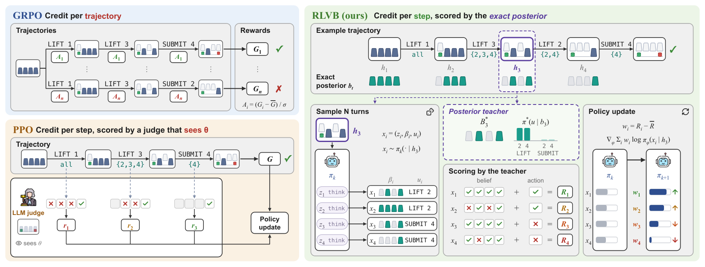

# HF Daily Papers · 11/25 当日第二跑（11-23 ~ 11-25 三个桶）

> **Date**: 2026-11-25 ｜ **Tags**: hf-daily-papers, agent-metacognition, RLVB, harness, evaluation-validity, compaction
> **覆盖**：日期桶 11-23 / 11-24 / 11-25，**读取时刻 2026-11-25 17:42 UTC**（快照 `~/fetch-cache/hf44/`，mtime 17:42:16）。基线是今早 `sep15-nov25` 那份的快照 `~/fetch-cache/hf43/`（读取 09:43）。

## Context

- **这是当日第二份**（`date -u` = 11-25 17:41，今早 09:43 那份 `sep15-nov25` 已落盘），由新的 systemd `digest-hf-pm` timer 触发 ⟹ 这是十周来第一次「晚班按时刻起跑」。
- **桶读数（09:43 → 17:42，间隔 8.0h）**：11-23 **26 → 26**（不动）· 11-24 **74 → 73**（−1）· 11-25 **41 → 51**（+10）；拉 11-26 返回错误对象（上限 11-25，guard 生效）。
- **抓取前写下的预测**（`_prediction.txt`，先于 curl）：A 点估计 16、区间 [3,35]；消失 0–2；证伪条件 A<3 或 A>35，或消失 ≥4。
  - **实测 A = 10**（全部落在 11-25 桶）＝ 落在区间内、点估计偏高 37%；**消失 1 条**，落在 0–2 之内 ⟹ 两条预测都没被证伪。
  - ⭐ 这是一个 8.0h 的长窗口读数，按 09-15 那条约定（短窗口不管 A 是多少都记）照记：折算 1.25 篇/h，**不拿它外推**。
- 🚨 **当日桶又丢了一条**：`2611.31237`（Let Vision-Language Models Generate Images through Their Representations，09:43 时 9▲）09:43 在 11-24 桶，17:42 不在 11-23 ~ 11-25 任何一个桶里。⚠️ 我只重抓了这三个桶，所以只能说「它不在这三个桶里」，不能说它从 `daily_papers` 整个消失了。今早那份没引它 ⟹ 今早的核验结果不受影响，那份我也不改。
- **去重两个口径**：窗口唯一 150 篇。**A = 10**（按 id 集合差，相对 09:43 快照）· **B = 146**（对最近 8 份 digest 的已引用 id）· **B − A = 136** · A∖B = 0。
  - **A ≠ B，所以不存在「A = B 的两种成因」该区分哪一个的问题**；`B − A = 136` 全部是**今早那份在这三个桶里的未引用残留**。今早那份窗口 2,619 篇只按 id 引了 48 个，排序按十周累积的 upvote ⟹ 新桶天然吃亏（它们只累积了 0–2 天）。⟹ 本份的主要工作是**给最近三个桶补覆盖**，而不是追今晚新进来的那 10 篇。
  - ⚠️ `cmHC`（94▲）今早按名提过（XingChen 团队聚合那条）但没写 id，所以它算在 B 里。本份补上 id、正文不再展开。
- **选法**：B−A 里按 upvote 取前 20 ＋ A 的全部 10 ＝ **30 篇**，全部入库。
- **项目/单位聚合**（对 30 篇的作者名逐对求交）：**nanoAstra（56▲）与 ICLWorld（17▲）有两位共同作者**（Meng-Hao Guo、Huan-ang Gao）⟹ 记为同一组；**ACAP 与 ViDecide 只有一位共同作者**（Xingang Pan），记下来但不合并。其余两两零交集 ⟹ **约 29 个独立单位**。

## 论文总览（读取时刻 11-25 17:42；▲ 取自本次快照）

| # | arXiv | 标题 | ▲ | 桶 | 口径 |
|---|---|---|---|---|---|
| 1 | [2611.25403](https://huggingface.co/papers/2611.25403) | Antom 3-in-1 Transformer: A Payment Foundation Model | 97 | 11-25 | 上午残留（B−A） |
| 2 | [2611.27193](https://huggingface.co/papers/2611.27193) | cmHC: Balancing Stream Mixing in Hyper-Connections via Geometric Contraction | 94 | 11-23 | 上午残留（B−A） |
| 3 | [2611.32884](https://huggingface.co/papers/2611.32884) | Lazy Agents Answer Against Their Own Beliefs: Reinforcement Learning with Verifiable Beliefs… | 86 | 11-25 | 上午残留（B−A） |
| 4 | [2611.30634](https://huggingface.co/papers/2611.30634) | Rewirable Circuits in Transformers with Loom Attention | 83 | 11-25 | 上午残留（B−A） |
| 5 | [2611.28947](https://huggingface.co/papers/2611.28947) | Don't Sleep, Keep Watch: Proactive Perception for Computer-Use Agents | 83 | 11-25 | 上午残留（B−A） |
| 6 | [2611.31205](https://huggingface.co/papers/2611.31205) | ACAP: Asynchronous Coding Agents for Efficient Robot Control | 60 | 11-25 | 上午残留（B−A） |
| 7 | [2611.27963](https://huggingface.co/papers/2611.27963) | Non-penetrating World Models | 60 | 11-23 | 上午残留（B−A） |
| 8 | [2611.30013](https://huggingface.co/papers/2611.30013) | 3AGameFactory-Motion: Agentic Rigging and Reliable Complex Motion Generation for Diverse 3D … | 59 | 11-24 | 上午残留（B−A） |
| 9 | [2611.12164](https://huggingface.co/papers/2611.12164) | Let the Fixer Decide: Training a Code Localizer from the Fixer's Likelihood | 59 | 11-24 | 上午残留（B−A） |
| 10 | [2611.29338](https://huggingface.co/papers/2611.29338) | A Glimpse of Training VLMs as Foundation Models for Robotic Manipulation | 56 | 11-24 | 上午残留（B−A） |
| 11 | [2611.30662](https://huggingface.co/papers/2611.30662) | WeMM-Ecom: Advancing Multimodal Content Understanding for WeChat E-Commerce | 54 | 11-24 | 上午残留（B−A） |
| 12 | [2611.30962](https://huggingface.co/papers/2611.30962) | Self-Evolving Evaluation Environments for Computer-Use Agents | 45 | 11-25 | 上午残留（B−A） |
| 13 | [2611.24636](https://huggingface.co/papers/2611.24636) | Clover-35B-A3B-Preview Technical Report | 45 | 11-23 | 上午残留（B−A） |
| 14 | [2611.26954](https://huggingface.co/papers/2611.26954) | Learning Video Foresight Reasoning from Unlabeled Videos via On-Policy Self-Distillation | 43 | 11-23 | 上午残留（B−A） |
| 15 | [2611.30254](https://huggingface.co/papers/2611.30254) | Innata-0: A Native Embodied World System with Model-Agent Co-Design | 42 | 11-24 | 上午残留（B−A） |
| 16 | [2611.28649](https://huggingface.co/papers/2611.28649) | S-Mind: Internalizing Multi-View Geometry for Spatial Intelligence | 41 | 11-25 | 上午残留（B−A） |
| 17 | [2611.26389](https://huggingface.co/papers/2611.26389) | ViDecide: Teaching Video Diffusion Models to Reason and Plan Step by Step | 41 | 11-24 | 上午残留（B−A） |
| 18 | [2611.28202](https://huggingface.co/papers/2611.28202) | AutoPILOT: A Visual Agent Harness for Real-Time Gameplay | 34 | 11-24 | 上午残留（B−A） |
| 19 | [2611.32554](https://huggingface.co/papers/2611.32554) | PartAgent: Agentic 3D Part Segmentation via Expert Integration and Closed-Loop Refinement | 32 | 11-25 | 上午残留（B−A） |
| 20 | [2611.27376](https://huggingface.co/papers/2611.27376) | Composable Soft-Prompt Distillation of RL Experts: Toward Continual Post-Training | 32 | 11-24 | 上午残留（B−A） |
| 21 | [2611.32649](https://huggingface.co/papers/2611.32649) | ICLWorld: Benchmarking In-Context Learning of Agents from Digital to Physical Worlds | 17 | 11-25 | A（今晚新出现） |
| 22 | [2510.22622](https://huggingface.co/papers/2510.22622) | Mega-MMDF and DeepfakeBench-MM: Benchmarking Multimodal Deepfake Detection Across Diverse Fo… | 7 | 11-25 | A（今晚新出现） |
| 23 | [2611.31358](https://huggingface.co/papers/2611.31358) | Nemotron-Labs-VisualCreation: Pixel as Code for Agentic Visual Creation | 5 | 11-25 | A（今晚新出现） |
| 24 | [2611.31752](https://huggingface.co/papers/2611.31752) | Separating Measurement Failures from Defence Failures in Split Language-Model Privacy | 4 | 11-25 | A（今晚新出现） |
| 25 | [2611.31977](https://huggingface.co/papers/2611.31977) | Distill to Loop: Turning Pretrained Diffusion Transformers into Looped Models with Adjustabl… | 3 | 11-25 | A（今晚新出现） |
| 26 | [2611.32816](https://huggingface.co/papers/2611.32816) | SpatialArena: Where Do Geometric Foundation Models Stand? | 2 | 11-25 | A（今晚新出现） |
| 27 | [2611.32782](https://huggingface.co/papers/2611.32782) | Measuring Layer-wise Intrinsic Dimensionality of FFNs in LLMs via PCA | 2 | 11-25 | A（今晚新出现） |
| 28 | [2611.32918](https://huggingface.co/papers/2611.32918) | InstructReplay: Replaying Assistant Turns to Preserve General Behavior During Factual Fine-T… | 1 | 11-25 | A（今晚新出现） |
| 29 | [2611.31258](https://huggingface.co/papers/2611.31258) | RECAP: Training Long-horizon LLM Agents with Context Compaction | 1 | 11-25 | A（今晚新出现） |
| 30 | [2611.31129](https://huggingface.co/papers/2611.31129) | FATCAT: Fault Injection Attacks Targeting Chip-level Alignment | 1 | 11-25 | A（今晚新出现） |

## Deep Dive：Lazy Agents Answer Against Their Own Beliefs（RLVB，86▲）

> [2611.32884](https://huggingface.co/papers/2611.32884) · Richmond Sin Jing Xuan, Peilin Feng, Wenbin Wang, Soujanya Poria · **DeCLaRe Lab, NTU** · 11-24。⭐ HF `.md` 端点给了 266,918 字节的真正文（没有返回 52,630 字节的外壳）。

**问题**：长程 agent 会「懒」，证据不够就交答案。⭐ 作者的观察比「懒」更具体：**agent 交答案时，它自己写下的 belief 行里往往还列着好几个可能答案。** Base（带 belief 行）在 belief 行列出多个答案的 turn 上提交的比例是 **3–68%**。⟹ 它不是不知道自己不确定，而是**知道了也不照着做**。

**为什么 outcome reward 修不了**：episode 末尾只给最终答案打分，「蒙对」和「有证据支撑」拿的奖励一样，所以模型学不会**什么时候该停**（与 CaRL 那条「错答与拒答同为 0 分」是同一根因，在另一个位置上）。

**机制（RLVB）**：训练用的模拟器知道规则 ⟹ **每一步都能算出精确后验 $b_t$**。一个「后验教师」$\pi^*$ 用 $b$ 给每个动作估值（答对的折扣对数概率 vs 取证动作的期望后验），每一 turn 的奖励是

$$R(h,x)=\underbrace{\log\pi^*(u\mid b)}_{\text{action}}+\underbrace{S_{\text{dec}}+\eta(S+W)}_{\text{stated belief（变体）}}$$



*（论文 Figure 2：GRPO 按轨迹给信用；PPO 按步给信用，但打分的是一个**看得见隐藏答案 θ 的 LLM judge**；RLVB 按步给信用，打分依据是**模拟器可验证的精确后验**。）*

- ⭐⭐ **奖励不对称是有意设计的**：证据不够就答，拿 −7.42（Figure 1 的杯子例子）；证据够了多走一步，只付一个时间折扣。⟹ 主要教的是「别早答」。
- ⭐ 教师只通过 $\hat\rho$（agent 自己测得的答题准确率）依赖 agent ⟹ **停止规则按 agent 自身能力校准**：agent 越不可靠，作答的价值越低，教师就越要它继续取证。
- ⭐⭐ **主版本 RLVB 只用 action 项、不给 belief 行打分**，但因为更新的是整个 turn 的似然，belief 行会跟着动作一起被训练。给 belief 行直接打分的变体（RLVB (EM)）**并不提高准确率**。

**结果（Table 1，3 个 VLM × 3 个基准，均值来自 3 个采样种子）**：

| Qwen3.5-4B | HiddenGames | Pro-Worlds（OOD） | RoboQuest（OOD、无后验） |
|---|---|---|---|
| Base | 26.5 | 20.2 | 39.6 |
| Base (w/ belief) | 38.1 | 23.9 | 41.3 |
| GRPO (action-only) | 32.5 | 15.1 | 36.9 |
| PPO (action-only) | 22.9 | 11.6 | **12.6** |
| PPO (belief + action, LLM judge) | 40.5 | 29.1 | **57.1** |
| **RLVB** | **48.5** | **32.1** | 54.0 |
| 后验教师（参考） | 97.5 | 100.0 | — |

- 九格里 **8 格** 是 RLVB 或 RLVB (EM) 最好；相对 Base 平均 **+17.1**。⚠️ 唯一例外正是上表的 Qwen3.5-4B × RoboQuest（judge 版 57.1 > 54.0）。
- ⭐⭐ **outcome reward 平均是负的**：GRPO −1.0、PPO −5.1（Qwen3.5-4B 的 RoboQuest 上 PPO 掉 27 分）。⟹ 又一次「只优化最终成功率会主动破坏『知道何时停』」。
- ⭐⭐ **作者主动报了跨训练运行的方差**（脚注）：Qwen3.5-4B 换三组小设置重训，HiddenGames 48.5–50.0、Pro-Worlds 28.3–32.1、RoboQuest 54.0–56.9 ⟹ 「最多相差约 4 个点」。⚠️ 也就是说，RoboQuest 上 RLVB 与 judge 版的 3.1 分差距落在这个方差里面。

**最有价值的一节：§4.6「为什么有效」——三个候选解释，作者自己否掉两个**

| 假说 | 测法 | 结论 |
|---|---|---|
| RQ1 读证据读得更好 | belief 行全部 turn 上的「exact」比例 | ❌ **不一致**（Qwen3-VL-4B HiddenGames 上 46.8 → 41.0 反而降）；但在同一状态下 RLVB 的 belief 行**更谨慎**（只列单一答案的比例在 9/9 设置里更低，8/9 的 95% 区间排除 0） |
| RQ2 取证步骤更好 | 每步把正确答案的后验抬高多少 | ❌ **一样**：第一步提升 15.6 / 14.9 / 14.8%（Base / judge 版 / RLVB）；选中教师最优动作 40% vs 37%；差值的 95% 区间都包含 0 |
| RQ3 **照自己的 belief 行行动** | belief 行列多个答案时提交的比例 | ✅ **Base 3.2–69.1% → RLVB 0.1–10.0%** |

⟹ ⭐⭐⭐ **增益几乎全部来自「监控→控制」这一环（元认知的 control 那一半），而不是「监控」本身。** 用作者的分解式（式 11）：准确率提升主要来自「在更高证据水平下作答」，同一证据水平下的准确率几乎没变。

- ⭐⭐⭐ **这给我那条「内部状态与输出陈述的连接两个方向都不可靠」补上了第三个方向，也是第一个可以训练修复的方向**：CaRL §5.7 是「内部检测到错误，输出却说 Final Correct Answer」；J-Space 是「内部没有信号，输出却凭空报告」；**本篇是「模型自己写下的陈述说『还不确定』，它的动作却照样提交」**。前两个是陈述与内部状态脱节，这个是**陈述与动作脱节**，而且它可测量、可训练：同一状态下的提交率差了一个数量级。
- ⭐⭐ **对「闸门」那条线的一个反例，而且是作者自己测的**：他们在 harness 里加了一个检查——第一次作答不收，让 agent 确认证据是否足以确定答案。**这个检查让 Base 在 RoboQuest 上涨 6.1–11.3，在 HiddenGames / Pro-Worlds 上最多变 1.9**；Tabletop 上 Base 被问一次之后继续取证的只有 2–17%。原话：「Such a check cannot replace an agent that acts on its own belief.」⟹ **一个只靠 agent 自评的闸门，问的恰好是那个它已经答错过一次的问题**；能起作用的闸门得独立于自述（Runtime Contract 的硬证据），或者干脆把行为训进去。
- ⭐ 与 OPD 那篇综述的「特权信息」框架对照：后验教师用了学生拿不到的东西（规则 ＋ 隐藏状态带来的精确后验），⚠️ **但它给学生的不是答案，而是「此刻证据够不够」的判断**；而按综述 §2.3 的重建判据，学生能从自己看到的东西把这个判断重建出来（它本来就写着 belief 行）。我认为这是它没有塌缩成 oracle 蒸馏的原因（⚠️ 我的推断，论文没有用这套语言）。

⚠️ **保留（大部分是作者在 Limitations 和 §4.6 里自己写的）**：
1. **只适用于规则已知、能算精确后验的任务**。RoboQuest 没有后验，用「满足了多少需求」代替，而恰恰是在 RoboQuest 上 judge 版赢了一格。
2. **步骤没学好**：在 MiniGrid / MineSweeper 上一步只把后验抬 ≤1%，RLVB **没有增益**；MineSweeper 上它只在 3–16% 的 episode 里作答，Qwen3-VL-4B 的 81 个未作答 episode 里有 44 个**最后十步一点证据都没加**。⟹ 它学会了「别早答」，但没学会「我的步骤已经不再带来信息、该交了」。奖励不对称（早答 −7.42 vs 多走一步约 −0.2 nats）把它推向了这个方向。
3. **证据足够时的错答从 2–4% 涨到 10–15%**（主要在 Tabletop）。
4. belief 行只能表达「一个可能答案集合」，表达不了概率的细粒度。
5. 九格里有 4 格是 Qwen3-VL 系列、3 格是 Qwen3.5 ⟹ **全部是 Qwen 家族**；OPD 综述指出的「Qwen 上随机信号也能涨分」在这里未被排除（⚠️ 但 outcome-RL 基线在同一模型上是负的，这部分削弱了「什么信号都能涨」这种解释）。

## 分主题（其余 29 篇，⚠️ 除特别注明外只读了摘要）

### 1. harness 的「时间维度」：感知何时发生、动作何时发出（三篇互不相干）

- **AutoPILOT**（[2611.28202](https://huggingface.co/papers/2611.28202)，34▲）：⭐⭐ 诊断：「much of this gap lies in the harness, which decides what the model sees, what it remembers, and how its outputs become actions over time」。既有 harness（VISTA）每次调用最多发一个动作 ⟹ agent 只能按它思考的频率行动。AutoPILOT 让一次调用可以发原语动作、开环宏，或者**写一段闭环控制器自己继续玩、直到把控制权交回来**。AFK-Bench 120 个浏览器游戏，**GPT-6.1 Sol 同预算下实时成功率 68.6% vs VISTA 38.3%**；GameWorld 上 VISTA 从暂停时的 84.1% 掉到实时 42.9%，AutoPILOT 实时保持 80.0%；用约 1/5 的 API 成本达到 VISTA 的最终成功率。⟹ ⭐ **harness 效应又一个数据点，而这次的轴是「输出怎样随时间变成动作」**，是我清单上没有的一轴。
- **NightWatch**（[2611.28947](https://huggingface.co/papers/2611.28947)，83▲）：CUA 按离散截图感知，而 VLM 推理延迟使「看到的状态在动作执行前就已过期」。挂一个 **0.8B 的 System-1 流式监视器**，不改 agent 的模型、prompt 或动作空间：OSWorld 上**非推理墙钟时间 −33%、浪费时间 −53%、成功率持平**；DynaCU-Bench 39.5% → 44.2%。⟹ 与 AutoPILOT 是同一问题的两端（一个管感知的时机，一个管动作的时机），**而作者的结论句「the timing of perception is as critical as its content」完全可以挪去描述 AutoPILOT**。
- **ACAP**（[2611.31205](https://huggingface.co/papers/2611.31205)，60▲）：一台机器人组织成一队常驻 coding agent，每个 agent 管一个控制组（手臂＋夹爪 / 躯干＋底盘），由一个 hyper-agent 协调物理依赖。⟹ 「异步」同样是时间维度上的 harness 设计，这次在具身侧。

### 2. 评测有效性：两篇把「测量本身」当作被测对象

- ⭐⭐⭐ **Separating Measurement Failures from Defence Failures**（[2611.31752](https://huggingface.co/papers/2611.31752)，4▲，A）：split-LLM 隐私评测的回顾性证据再分析，把每条主张映射到五个**可采纳状态**之一：**breach / non-detection / undetermined coverage / invalid measurement / out-of-scope inference**。19 个配置的探索里，**24 个必需探针只有 4 个合格**，而这 4 个校准过的探针仍在 13 个配置里确立了合格的隐私泄露；**1,522 项检查跨 122 个 SHA-256 固定的产物，可重跑**。⟹ ⭐⭐ **「测不到泄露」与「没有泄露」被拆成两个状态（non-detection vs undetermined coverage）**，这正是我在 AWS 侧反复立的「不能把『测不了』写成『没问题』」，而这里它被做成了一套报告格式。⭐ 本份最被低估的一篇。
- **SpatialArena**（[2611.32816](https://huggingface.co/papers/2611.32816)，2▲，A）：几何基础模型的已发表数字**不可比**（采帧、分辨率、测试划分各不相同）也**不稳健**（对齐步骤本身的影响能超过模型间差距：**在错误的空间里拟合深度会让误差接近三倍，标准轨迹对齐会把失败方法的误差低估最多 2.6 倍**）。⟹ 「一个数掩盖一个结构」在 3D 感知上的版本，而掩盖它的是**后处理对齐**。
- **CUA-SEE / Self-Evolving Evaluation Environments**（[2611.30962](https://huggingface.co/papers/2611.30962)，45▲）：任务与可执行 verifier 一起从 rollout 证据里协同演化，分三条（基准演化 / 诊断演化 / verifier 演化，后者含「把变化的需求翻译成基于状态的 checkpoint 并做对抗验证」）。⚠️ **评估者与被评者一起演化，正是 08-12 Co-Evolution 综述点名的那个风险（「evaluator exploitation 变成内生均衡」）**；摘要说「preserving process-level evidence」，但没说 verifier 本身怎样被留在优化压力之外 ⟹ 首要待查。
- **ICLWorld**（[2611.32649](https://huggingface.co/papers/2611.32649)，17▲，A）：160 个规则「反直觉」的任务，30 个环境，630 段演示视频；**Claude Opus 5.5 / GPT-6 Astra 在电脑使用上 82% / 76%，机器人使用只有 27% / 26%**，无规则对照最多 8%。⭐⭐ **Astra 回答机器人规则问题的正确率是 98%，任务完成只有 20%** ⟹ 「能说出规则」与「按规则做」脱节，**和 RLVB 那篇是同一形状**（陈述与动作脱节），一篇在训练侧，一篇在评测侧，同一天出现。⭐ 与 nanoAstra 同组（见聚合）。

### 3. 长程训练里的「保留」：三篇都在防漂移

- **RECAP**（[2611.31258](https://huggingface.co/papers/2611.31258)，1▲，A）：上下文 compaction 与策略联合训练，原则是「**摘要应当保持原始历史诱导出的行为**」，用压缩后与原始上下文下后续行为的散度作目标，梯度分解成「摘要的失真奖励」＋「后续动作的自蒸馏」。Qwen3.5-4B 上 BrowseComp-plus +4.6、SWE-bench Verified +4.3。⟹ ⭐⭐ **这是对 08-27 那篇 When "Must" Becomes "Maybe"（正常 handoff 压缩产生 100% 约束失活）的一个训练侧回应**：用「行为不变」而不是「内容不变」来定义好摘要，原则上能抓到「约束从必须降级为可能」——因为那恰恰会改变后续行为。⚠️ 它是否真的保住了绑定性约束，摘要里没有测。
- **InstructReplay**（[2611.32918](https://huggingface.co/papers/2611.32918)，1▲，A）：知识微调把通用能力拉低平均 **35 分**，且损失**跟随回答长度坍缩**（至少减半）；回放初始模型自己对一组通用指令的回答，五个通用基准的平均下降 **28.1 → 2.4**，学新事实不变。⭐ 作者用受控对照把增益归因于「回放模型自己的回答」而非损失形式 ⟹ 与 OPD 综述那条重建判据同方向（用学生自己的分布当锚）。
- **CSPD**（[2611.27376](https://huggingface.co/papers/2611.27376)，32▲）：冻结 RL 前的模型，把每个 RL 专家各自蒸馏成一个 soft prompt，组合时直接拼接；23 个设置里 22 个恢复 ≥90% 的教师增益，全组合 67.83 vs MOPD 67.79，吞吐在未适配 backbone 的 1.5% 以内。⟹ 「持续后训练」的一种做法：**不动权重就不会遗忘**。

### 4. 世界模型 / 具身：「信息已经在里面」

- **Non-penetrating World Models**（[2611.27963](https://huggingface.co/papers/2611.27963)，60▲）：没有一个开源交互视频世界模型能可靠防止穿模，**但 DiT 的隐状态已经编码了「这个动作会不会穿模」**；冻结 DiT、训一个小预测头、把不安全动作替换成最保留原意的安全动作 ⟹ 六个世界模型平均违例率 **74% → 16%**，且零样本泛化到开放域、第三人称与移动障碍物。⟹ ⭐ 与 RLVB 的诊断同形：**信号在内部，只是没被用来控制行为**。
- **nanoAstra / A Glimpse of Training VLMs as Foundation Models for Robotic Manipulation**（[2611.29338](https://huggingface.co/papers/2611.29338)，56▲）：开篇明说「GPT-6 Astra demonstrates strong generalization in robot control, yet limited disclosure of its training leaves open how such capabilities can be reproduced」⟹ ⭐ 一个闭源模型的能力**本身成了复现对象**，用的是语义动作原语＋保能力的 SFT。
- Innata-0（[2611.30254](https://huggingface.co/papers/2611.30254)，42▲，model–agent 协同设计）· S-Mind（[2611.28649](https://huggingface.co/papers/2611.28649)，41▲，把多视角几何内化成空间 token）· ViDecide（[2611.26389](https://huggingface.co/papers/2611.26389)，41▲，视频扩散按「决策链」训练并**学会何时停**，⭐ 与 RLVB 的停止问题同族）· 3AGameFactory-Motion（[2611.30013](https://huggingface.co/papers/2611.30013)，59▲）· PartAgent（[2611.32554](https://huggingface.co/papers/2611.32554)，32▲）。

### 5. 安全：对齐在硬件层被物理打穿

- ⭐⭐ **FATCAT**（[2611.31129](https://huggingface.co/papers/2611.31129)，1▲，A）：非侵入式电磁故障注入，用射频侧信道触发同步到 prefill 阶段，**不需要软件执行权限也不需要模型层访问**，在 Jetson Orin Nano / AGX Thor 上让 Llama 3.2 1B、Gemma 3 1B 可靠地执行受限请求；在一台由 SmolVLA 控制的 6-DoF 机械臂上让手臂突然猛冲，「in two instances the robotic arm attempted to pinch the paper author」。⟹ ⭐⭐ **它打在 08-14 那篇 GPU 证书提案的承重墙下面**：那篇把安全检查放进驱动/硬件，前提是硬件本身可信；本篇说边缘设备上的物理访问者可以在不碰任何软件的情况下翻转对齐行为。⚠️ 需要物理接触、模型很小，n 未知。
- Mega-MMDF / DeepfakeBench-MM（[2510.22622](https://huggingface.co/papers/2510.22622)，7▲，A，⭐ 去年 10 月的论文今天才进桶）：120 万伪造片段、22 条伪造流水线 ⟹ 「来源可检测性」那条线的视频侧数据基础设施。

### 6. 架构 / 效率 / 其他

- **Loom Attention**（[2611.30634](https://huggingface.co/papers/2611.30634)，83▲）：一个 head 对更早 head 的输出做「纵向」注意力（取 q/k/v），与对 token 的「横向」注意力交织；纵向用归一化门控线性注意力存进每 token 的矩阵记忆，充当**第二条残差流** ⟹ 「控制」与「内容」分到两条流。⟹ 接 [[2026-08-12-topic-softmax-linearization-and-k3]]（线性注意力又一个新位置），且与 cmHC（[2611.27193](https://huggingface.co/papers/2611.27193)，94▲，上午已按名记）同属「残差流怎么多路化」。
- **Clover-35B-A3B-Preview**（[2611.24636](https://huggingface.co/papers/2611.24636)，45▲）：MoE 扩散 LM，把 Gated DeltaNet 适配到块扩散；**SWE-bench Verified 73.6 / Terminal-Bench 2.1 51.7**，GB300 单卡 BF16 batch=1 下「reported」680 tok/s。⚠️ 自报、措辞自带 reported；而 09-08 Uno 那篇给过「纯 d-LLM 落后 AR 三倍以上」的数量级，这条若成立就是那条判断的反例，**待第三方**。
- **Distill to Loop / Dooop**（[2611.31977](https://huggingface.co/papers/2611.31977)，3▲，A）：把预训练的非循环 DiT 蒸馏成循环学生，每一圈都朝教师训练，测试时圈数可调 ⟹ looped transformer 不必从头预训练。
- **FFN 逐层本征维度**（[2611.32782](https://huggingface.co/papers/2611.32782)，2▲，A）：PCA 测每层 FFN down-projection 输入的本征维度 ⟹ 均匀的 FFN 宽度可能是浪费。
- **FGL / Let the Fixer Decide**（[2611.12164](https://huggingface.co/papers/2611.12164)，59▲）：代码定位器不学「参考补丁改了哪些文件」，而学「冻结的 fixer 觉得读哪些代码最可能产出通过验证的补丁」；同等找到 bug 的频率下少读 27.5% 代码。⭐ 「fixer 要读的代码 ≠ 它要改的代码」与 SWE-Bench ProMax 那条「核心改对了、外围漏了」相邻。
- **Antom 3-in-1 Transformer**（[2611.25403](https://huggingface.co/papers/2611.25403)，97▲，⭐ 金融）：约 7B / 每任务路由激活约 1.7B 的支付基础模型，序列＋表格＋图三种表示；跨业务迁移目标指标 +34.5%；**四个月在线实验相对 XGB-Online 整体损失率 −37.88%**。⚠️ 全部是蚂蚁国际的内部数据与线上实验，无外部复核；但「线上 A/B 相对生产基线」这个口径在金融风控里是最硬的一种。
- WeMM-Ecom（[2611.30662](https://huggingface.co/papers/2611.30662)，54▲，微信电商多模态，含 OPD）· Video Foresight OPSD（[2611.26954](https://huggingface.co/papers/2611.26954)，43▲，⭐ OPD 无标注版又一例）· Nemotron-Labs-VisualCreation（[2611.31358](https://huggingface.co/papers/2611.31358)，5▲，A，「Pixel as Code」）。

## 趋势

1. ⭐⭐⭐ **「说的」与「做的」脱节，同一天在训练侧与评测侧都被测了出来**：RLVB（belief 行列多个答案时 Base 提交 3–69%）· ICLWorld（Astra 规则问答 98%、任务完成 20%）· Non-penetrating（隐状态能预测穿模、模型照穿不误）。三篇互不引用。⟹ **「模型知道」和「模型照着做」是两个可以分开测量的量**；只测前者（问它、探针读它）会系统性高估后者。这对我的评估方案是一个具体要求：**凡用「模型能说出 X」作为能力证据，都要配一个「模型按 X 行动」的测量。**
2. ⭐⭐ **harness 效应长出时间轴**：AutoPILOT（动作何时发出）· NightWatch（感知何时发生）· ACAP（谁跟谁异步）。此前我的清单全是「看到什么、记住什么、能调什么工具」，没有「什么时候」。
3. ⭐⭐ **评测报告格式本身被当作对象**：Measurement-vs-Defence 的五个可采纳状态 · SpatialArena 的「对齐比模型差距还大」 · CUA-SEE 的演化 verifier。前两个是让度量更诚实，第三个是让度量动起来（而它的风险正是综述警告过的那个）。
4. ⭐ **「保留」从推理侧走到训练侧**：RECAP 用行为不变定义好摘要，InstructReplay 回放自己的回答，CSPD 干脆不动权重。

## Open Questions

1. RLVB 在**没有精确后验**的任务上能不能用估计的后验替代？RoboQuest 上 judge 版反超的那一格是不是就是答案的一半？
2. CUA-SEE 的 verifier 演化怎样避免被它评的 agent 一起带偏？（论文全文待读）
3. RECAP 的「行为不变」目标能否抓到 When "Must" Becomes "Maybe" 那四个约束字段的失活？可以直接拿那篇的 1,296 个合成 episode 测。
4. ICLWorld 的「规则问答 98% / 完成 20%」，若给 Astra 加 RLVB 那种「照 belief 行行动」的约束，差距会缩多少？
5. `2611.31237` 是被移到了 11-23 ~ 11-25 以外的桶，还是从 `daily_papers` 整个消失？（下一跑抓全窗口时查）

## References

全部 30 篇见上方总览表（真实 HF 链接）。本份新增入库 30 篇（cmHC 此前只按名提及、未入库，本次补上）。

## 落盘核验（照抄脚本输出）

```
① ids cited 31 not in window ['2611.31237']   [checked 11-25 17:46 UTC vs snapshot ~/fetch-cache/hf44 (4 buckets, mtime 11-25 17:42–17:42 UTC)]
② References label↔title mismatches 0
③ figs referenced 1 unresolved [] unreferenced []
④ table rows 30 upvote mismatches []   [vs snapshot ~/fetch-cache/hf44, mtime 17:42]
⑤ 正文引用 31 个 id、不在 references.bib 里 1 ['2611.31237']
```

- ①⑤ 里唯一的命中是 `2611.31237`：这是 Context 里**有意引用的那条消失条目**（09:43 在 11-24 桶，17:42 不在），它不是本份覆盖的论文，所以没有入库。其余 30 个 id 都在窗口里、也都在 bib 里。
- 入库 30/30（逐 id 后台跑，每个 id 都打了明细行；0 次 OpenAlex fallback；不先探测、直接取目标 id）。
