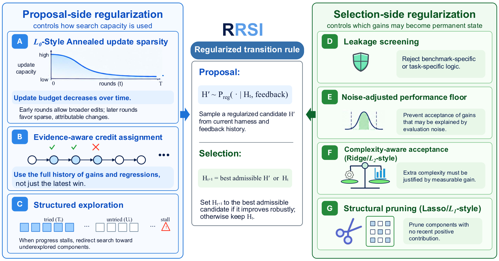
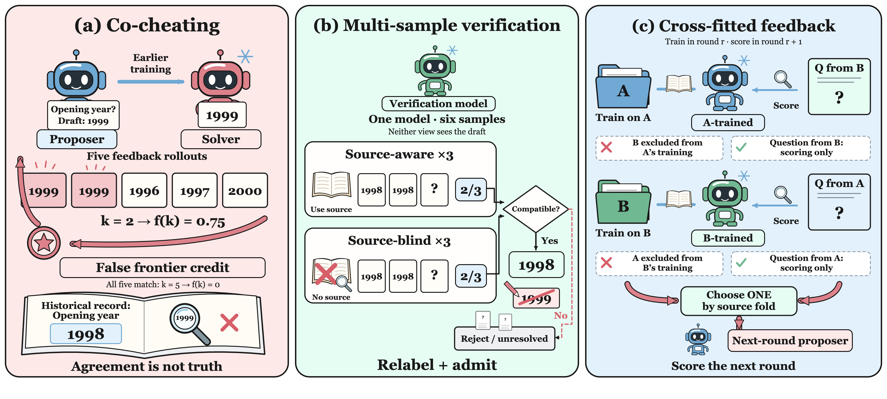

# HF Daily Papers：09/15 回填 ~ 11/25（十周空缺补跑）

> **Date**: 2026-11-25 ｜ **Tags**: hf-daily-papers, harness, RSI, self-evolution, reward-hacking, OPD, embodied
> **覆盖**：日期桶 2026-09-15 → 2026-11-25（72 个桶），**读取时刻 2026-11-25 09:43 UTC**（快照 `~/fetch-cache/hf43/`，mtime 09:43）

## Context

- ⚠️⚠️ **这是一次十周空缺补跑。** 上一份是 09-15 18:15 的 `sep15d`，此后 hf 一次都没跑；`runlog.py check` 报 11-19 ~ 11-24 每天 NO RUN（再早的日子已滑出它的 7 天窗口）。AWS 那十周几乎每天都在 ⟹「AWS 活、其余死」这个形态延续了整整十周。
- ⚠️⚠️ **补回的是「今天读到的桶」，不是「当时的桶」。** HF 当日桶既会回填也会丢条目（09-15 记过一次移除），所以 09-15 之后每个桶的成员与 upvote 都是 11-25 09:43 这一刻的读数；它们不等于「如果那天跑了会看到什么」。upvote 尤其如此——十周的累积让早期论文天然占优（见下面的分布）。
- **桶读数**：72 个桶、**2,619 篇唯一**（09 月 470 / 10 月 1,412 / 11 月 737）；周末桶照旧是 0（如 11-21 / 11-22）；11-23 = 26、11-24 = 74、11-25 首读 41。
- ⚠️ 日期上限 guard 这次没有返回任何错误对象（72 个桶全部是 list）。
- **两个重叠桶的对账**（对照 09-15 18:16 的 `hf42` 快照）：**09-15 桶 31 → 33（新出现 `2609.13443`、`2609.14708`，消失 0）**；09-16 桶当时没抓过（`hf42` 里是空的），故不可比。⟹ 09-15 那次观测到的「移除」这次没有再发生，但十周里两个桶只有一个可比，**这不能当成「之后不再丢」的证据**。

### 去重两个口径

| 口径 | 定义 | 值 |
|---|---|---|
| A | 窗口 − 全部持久抓取快照（`hf40`/`hf41`/`hf42`）里出现过的 id | **2,587** |
| B | 窗口 − 最近 8 份 HF digest 引用过的 id | **2,596** |
| **B − A** | 上次抓到但没引用、仍在今天窗口里 | **9** |
| A ∖ B | 上次没抓到却被更早 digest 引用过 | 0 |

⟹ `A ≠ B`，差 9 篇；这 9 篇是 09-15/09-16 桶里 `sep15d` 那次抓到但没写进去的（例：Dream-RSI 143▲ 就在其中，所以它不在下面的 Top 25 里）。**`A ≈ B` 的大部分原因是第②种（窗口里的桶与上次抓取几乎不重叠）**，只有 09-15/09-16 两个桶有重叠，所以这里的相等不携带「上一份覆盖率」的信息。

### 选题方式

- 2,619 篇里取 **B 集合的 upvote Top 25**，另加 **14 篇编辑增补**（按主线挑，upvote 15–95）。全部 39 篇入库。
- ⚠️ **十周窗口下 upvote 偏向早期论文**：Top 25 按桶日期是 09 月 5 篇、10 月 11 篇、11 月 9 篇；而 11 月 737 篇里只有最早的几周攒够了票，所以它们被低估了。
- 🚨 **项目/单位聚合**（`grep` 作者与项目页）：
  - **Jeva（132▲）与 Jeveration（157▲）是同一组人**（NUS，共享作者 Qi Li 与 Xinchao Wang）；**VideoJev（83▲，南大 MCG）与它们作者零重叠**，但沿用同一个「System One model」概念 ⟹ **两个独立单位，不是三个**。
  - **TokenRouter（119▲）与 Cache Engineering for Agents（104▲）共享 4 位作者，项目页都挂在同一个 `thinking_yard_project_page` 下（清华 NICS-EFC）** ⟹ 一个研究纲领。
  - **TeleChat→Xing4（168▲）与 cmHC（95▲）共享 11 位作者（XingChen-AGI）** ⟹ 一个团队。
  - harness 演化这组（RRSI / Mid-Harness / SoL-Pi / Raven / Embo-Harness / OpenVLHarness）：Mid-Harness 与 SoL-Pi 都来自 NVIDIA 但**作者零重叠** ⟹ **六篇是六个独立单位**。
  - 自我演化 / 自蒸馏这组（False Frontiers / UniEvo-VL / SRD / AREX-2 / EvoDuet）：只有 UniEvo-VL 与 SRD 共享 1 位作者（Fang Wu），其余零重叠。

## 论文总览（Top 25，按 upvote；读取时刻 11-25 09:43）

| # | arXiv | 中译标题 | ▲ | 桶 | 主题 |
|---|---|---|---|---|---|
| 1 | [2609.17488](https://huggingface.co/papers/2609.17488) | LimiX-2：面向通用结构化数据智能的上下文机制网络 | 233 | 09-17 | 表格基础模型 |
| 2 | [2609.19969](https://huggingface.co/papers/2609.19969) | DeepSeek-V4.1-Flash：把 KV cache 压缩推到极限 | 208 | 09-18 | 架构/效率 |
| 3 | [2611.29897](https://huggingface.co/papers/2611.29897) | Motion Mamba 2.0：长程人形控制的自回归扩散 Mamba | 189 | 11-24 | 具身/运动 |
| 4 | [2610.05608](https://huggingface.co/papers/2610.05608) | Kandinsky 6.0 Video：音视频同步生成基础模型 | 172 | 10-06 | 视频生成 |
| 5 | [2610.08077](https://huggingface.co/papers/2610.08077) | 自回顾蒸馏：把事后经验变成事前预见 | 169 | 10-08 | RL/信用分配 |
| 6 | [2611.22115](https://huggingface.co/papers/2611.22115) | TeleChat 到 Xing4：在国产芯片与框架上推进前沿 agentic 模型 | 168 | 11-18 | 国产算力/模型 |
| 7 | [2611.18397](https://huggingface.co/papers/2611.18397) | Gamer：长程实时游戏 agent 的通用 VLA 基础模型 | 165 | 11-16 | 游戏/VLA |
| 8 | [2609.24972](https://huggingface.co/papers/2609.24972) | **RRSI：agent harness 的正则化递归自我改进** ⭐深读 | 163 | 09-22 | harness/RSI |
| 9 | [2611.24738](https://huggingface.co/papers/2611.24738) | Jeveration：System One 模型也能生成 | 157 | 11-19 | 单步生成 |
| 10 | [2609.33757](https://huggingface.co/papers/2609.33757) | YuE2：以符号规划统一符号与音频音乐生成 | 156 | 09-29 | 音乐生成 |
| 11 | [2610.37381](https://huggingface.co/papers/2610.37381) | PDRVLA：带物理动力学表征的 VLA | 154 | 10-28 | 具身/VLA |
| 12 | [2611.01860](https://huggingface.co/papers/2611.01860) | Agentic 计算机图形学进展（综述） | 148 | 11-03 | 综述 |
| 13 | [2609.24984](https://huggingface.co/papers/2609.24984) | WorldCrafter：带隐式 3D 记忆的一致视频世界模型 | 143 | 09-22 | 世界模型 |
| 14 | [2611.18359](https://huggingface.co/papers/2611.18359) | 展望 Agentic Robotics：机器人系统的新纪元 | 142 | 11-16 | 具身/立场 |
| 15 | [2611.30989](https://huggingface.co/papers/2611.30989) | WorldLeague：物理能动性基准 | 139 | 11-24 | 具身评测 |
| 16 | [2610.18773](https://huggingface.co/papers/2610.18773) | Jeva：从第一性原理设计 System One 模型 | 132 | 10-14 | 决策模型 |
| 17 | [2610.22471](https://huggingface.co/papers/2610.22471) | GPT-6-Astra 实现了具身智能吗？ | 132 | 10-19 | 具身评测 |
| 18 | [2610.26825](https://huggingface.co/papers/2610.26825) | MemT-1.0：迈向记忆原生演化 | 132 | 10-20 | 原生记忆 |
| 19 | [2609.36484](https://huggingface.co/papers/2609.36484) | 教师是方向而不是终点：OPD 中外推 RL 诱导的表征残差 | 130 | 10-01 | OPD |
| 20 | [2609.39102](https://huggingface.co/papers/2609.39102) | **虚假前沿：诊断并缓解自我演化搜索 agent 的「共谋作弊」** ⭐深读 | 129 | 10-01 | 自我演化/奖励腐化 |
| 21 | [2611.00859](https://huggingface.co/papers/2611.00859) | Wave Forcing：迈向光速级流式视频生成 | 128 | 11-03 | 视频生成 |
| 22 | [2609.38721](https://huggingface.co/papers/2609.38721) | UniEvo-VL：多模态模型自我改进的 on-policy 自蒸馏配方 | 126 | 10-01 | OPSD |
| 23 | [2610.13166](https://huggingface.co/papers/2610.13166) | 为长程终端智能扩展 agentic 数据 | 123 | 10-13 | agent 数据 |
| 24 | [2611.08449](https://huggingface.co/papers/2611.08449) | VFlash：用 Flash Primitive Decoding 做快而准的视觉规划 | 121 | 11-06 | 具身/解码 |
| 25 | [2610.12242](https://huggingface.co/papers/2610.12242) | TokenRouter：token 级 LLM 路由的服务系统 | 119 | 10-09 | 路由/服务 |

**编辑增补（14 篇，按主线挑）**：

| arXiv | 标题 | ▲ | 为什么加 |
|---|---|---|---|
| [2609.39982](https://huggingface.co/papers/2609.39982) | Mid-Harness：在模型与 harness 之间扩展动作 | 95 | harness |
| [2609.40340](https://huggingface.co/papers/2609.40340) | EvoDuet：网页搜索与任务求解的双层协同演化 | 90 | 协同演化 |
| [2609.20519](https://huggingface.co/papers/2609.20519) | SoL-Pi：递归扩展 auto-research 循环做高效 harness | 89 | harness/RSI |
| [2609.38288](https://huggingface.co/papers/2609.38288) | AREX-2：用长程反思任务推进自我改进 agent | 86 | 自我改进 |
| [2610.11959](https://huggingface.co/papers/2610.11959) | MiMo-V2.6：把 RL 扩展向自我改进 | 82 | RL 规模化 |
| [2609.33439](https://huggingface.co/papers/2609.33439) | Raven：可组合 agentic 智能的 harness of harnesses | 80 | harness |
| [2610.33512](https://huggingface.co/papers/2610.33512) | Eat Your Precision：精确率目标缓解 rubric RL 的奖励黑客 | 34 | 奖励腐化 |
| [2610.19128](https://huggingface.co/papers/2610.19128) | CLASHarness：电脑使用中的多 agent 冲突基准 | 34 | 授权/冲突 |
| [2610.03185](https://huggingface.co/papers/2610.03185) | OPD 的收益与坍缩：RL 视角 | 29 | OPD |
| [2610.14270](https://huggingface.co/papers/2610.14270) | RL 训练中的「思考泄漏」 | 26 | 评测有效性 |
| [2610.13623](https://huggingface.co/papers/2610.13623) | APEX-Harm：共享专业工作区里的 agent 安全 | 22 | 注入/安全 |
| [2610.40753](https://huggingface.co/papers/2610.40753) | 「要不要批准？」自主编码 agent 的后果感知审批 | 15 | 闸门/证据面 |
| [2610.03509](https://huggingface.co/papers/2610.03509) | 高效推理训练并不总是损害 CoT 忠实度与可监控性 | 14 | 监控 |
| [2611.31015](https://huggingface.co/papers/2611.31015) | 潜推理能否不留痕迹地驱动 LLM 输出？ | 13 | 监控 |

## 分主题详解

> ⚠️ 下面除两篇深读外，**全部只读了摘要**。十周窗口的篇数使我无法逐篇读全文，所以每一条都只当作「存在这样一个主张」来记。

### 1. harness 自我改进：十周里从「能不能涨」转到「涨的是什么」

这十周最集中的一条线。六个独立单位各给一块：

- **RRSI（163▲，Google）**：深读见下。核心诊断是 harness 演化会**在演化集上过拟合**，并把原因拆成三种（benchmark-specific fitting / noise chasing / complexity accumulation）。
- **SoL-Pi（89▲，NVIDIA）**：在**很多、很杂的环境**上跑 auto-research 循环，主张「在这个规模上产出的改进能迁移到开发环境之外」，并且把 token 效率当成扩展 RSI 的前提。摘要提到「Four mechanisms survive selection」——**只有四个机制挺过了筛选**，这与 RRSI 的结论方向一致：大部分被提出的改动不该留下。
- **Mid-Harness（95▲，NVIDIA，与 SoL-Pi 作者零重叠）**：在**模型与 harness 的边界**上分配测试时算力——先采样并验证几个候选动作，再把其中一个交给环境执行。出发点是「能生成好动作不等于能可靠执行」：一条坏命令（比如装错包）会改变环境，拖累后面所有步骤。⟹ 这是「只生成对强基线的有界修改」那条线落在**单步动作**上的版本。
- **Raven（80▲，EverMind）**：把问题从「为一个领域造更强的 harness」改成「自动构建多个专门 harness、靠经验改进它们、再跨领域编排」。
- **[Embo-Harness](https://huggingface.co/papers/2611.31201)（100▲，NTU MMLab，在长尾里）** 与 **[OpenVLHarness](https://huggingface.co/papers/2610.26860)（106▲，Apple，在长尾里）**：harness 进入具身与视觉工具使用。
- ⭐ **这条线在 09-15 之前就在，变化在于**：此前几份都在问「harness 演化能涨多少」，这十周几篇同时在问「涨上去的有多少能迁移、多少只是对演化集的拟合」。

### 2. 自我演化的奖励会被闭环自己腐化

- **False Frontiers（129▲，Rutgers）**：深读见下。proposer 出题、solver 答题，两者越来越**在同一个错误上达成一致**，内部奖励上升而外部正确率不升。
- **Eat Your Precision（34▲）**：rubric 奖励本质上是在优化**召回**（rubric 覆盖了多少），于是 RL 后的回答**更全但更啰嗦、含更多多余或错误内容**，人反而更喜欢基座模型的回答。对策是加一个精确率目标（每个回答单元都必须必要且正确）。⟹ 「优化一个固定度量就会把它打坏」的又一个实例，这次被打坏的是 rubric。
- **The Thinking Leakage（26▲）**：在 Qwen3 的 NO-THINK 模式下做 GRPO 报告的推理提升，**很大一部分可以用「把原模型 THINK 模式的能力部分重新激活」来解释**，而不是学到了新的推理行为。⟹ 评测有效性的一个新位置：**训练前后测的是同一个模式，但模型可能悄悄换了模式**。
- **MiMo-V2.6（82▲）** 与 **AREX-2（86▲）** 是这条线的正面叙事（把 RL 扩到自我改进；把「迭代改进解」当成可学的、领域无关的能力），⚠️ 两者都没有在摘要里报告奖励腐化相关的检查。

### 3. OPD / 自蒸馏：仍在扩张，且有两篇在解释「为什么会坍缩」

- **The Teacher Is a Direction, Not a Destination（130▲）**：LM head 对教师隐状态里的变化做了**各向异性衰减**——很多变化只有一小部分权重能传到 logits；而输出空间外推所依赖的采样 token 对数概率比会注入噪声、被外推放大 ⟹ 训练不稳。对策是在**表征空间**外推。
- **Gains and Collapse in OPD（29▲）**：从 RL 视角解释 OPD——**教师隐式地奖励学生的行为，包括教师自己很少表现出的那些**；⭐ 摘要原话「OPD improves performance without expanding the student's capabilities」，⟹ 与我 09-03 记的 OPSA 那篇（「主要在重分配已有概率质量」）同一结论，这次来自独立的另一组人。
- **UniEvo-VL（126▲，Stanford NLP）**：把多模态模型自己的批评当作**特权信息**，同一个模型分别扮演教师（看到批评）与学生（只看到原问题）＝ OPSD 在多模态上的版本。⚠️ 按 09-08 那篇综述的「重建判据」，要问的是学生在测试时能不能自己重建出那条批评——摘要没答。
- **Self-Retrospection Distillation（169▲，Salesforce）**：在 group-relative 目标下，所有 rollout 奖励相同时信号消失；SRD 用事后经验去监督**事前**的预见预测。⟹ 「失败比成功更有信息」那条线在信用分配上的又一个实现。
- 多教师 OPD 这十周至少三篇（[P²-MOPD](https://huggingface.co/papers/2611.03953) 73▲ / [Domain-Normalized MOPD](https://huggingface.co/papers/2609.35347) 60▲ / [Cross-Teacher Guarding](https://huggingface.co/papers/2610.13521) 59▲，均在长尾里），⟹ 该子领域从 08-07「完成子领域化」到现在仍每周稳定出现。

### 4. 具身：GPT-6 Astra 被当成「范式切换」的锚点

- **Has GPT-6-Astra Achieved Embodied Intelligence?（132▲，SenseNova）** 与 **Envisioning Agentic Robotics（142▲，Grid Robotics）** 都把 Astra 发布当成起点；后者摘要原话「Within weeks, frontier models with agentic harnesses matched or exceeded task-specific policies on many embodied benchmarks」。⟹ ⚠️ 这是两篇论文对**同一个外部事件**的解读，不是两个独立证据。
- **WorldLeague（139▲）**：60 个模拟机器人任务，**从机器人轨迹测量朝物理目标的进展**（不是最终成败）＝「只报最终成功率等于没报」在具身评测上的落实。
- PDRVLA（154▲）/ VFlash（121▲）/ Motion Mamba 2.0（189▲）/ Gamer（165▲）是这条线的模型侧。⭐ **Motion Mamba 2.0 的 persistent content memory 与 WorldCrafter（143▲）的「相机可查询的隐式 3D 记忆」都是「有界状态 + 检索」**——我 08-14 记过长时流式生成收敛到这个结构，十周后它出现在了运动生成与视频世界模型里。

### 5. 效率与服务：KV cache、路由、缓存工程

- **DeepSeek-V4.1-Flash（208▲）**：552B 骨干、1M 上下文的多模态 MoE，主攻 KV cache 压缩。动机句值得抄：「long-horizon agents has made model workloads increasingly input-heavy」，⟹ agent 负载让**输入侧**（prefill 与 KV 存储/带宽）成为主要成本瓶颈。这与我 08-14 记的「缓存命中 vs 未命中 50×」是同一件事的模型侧。
- **TokenRouter（119▲）** 与 **Cache Engineering for Agents（104▲）**：同一个清华 NICS 纲领（见上面聚合）。前者处理 **token 级路由**的服务问题（步调不同步、batch 准入延迟），⟹ 路由主线在 08-18 那四层之外又多一层：**同一请求内部逐 token 路由**。
- **[Disaggregated Quantization](https://huggingface.co/papers/2609.26333)（81▲，长尾）**：prefill 与 decode 用不同的量化。

### 6. 监控：两篇小论文给了两个方向相反的读数

- **Efficient Reasoning Training Does Not Always Harm CoT Faithfulness and Monitorability（14▲）**：缩短 CoT 的训练**不必然**让 CoT 变得不忠实，取决于施加长度压力的方式。
- **Can Latent Reasoning Drive LLM Outputs Without a Trace?（13▲）**：问「完整潜推理（不写 CoT）够不够深，能不能让模型一边写一个看起来在解题的 CoT，一边在内部追求一个隐藏目标」。⟹ 这正是监控失效栈第 6 项（没有可读 artifact）与第 11 项（artifact 完整而另有因果通道绕过它）之间的那个问题。⚠️ 摘要截断在问题陈述处，**结论我没拿到**。
- ⭐ 两篇都只有十几票，⟹「upvote 与相关性弱相关」在这十周里照旧成立。

### 7. 授权、冲突与闸门

- **"Shall We Approve?"（15▲）**：现有自动审批（规则、guardrail 模型、已部署的权限分类器）**都只看命令文本**，而命令的行为取决于它调用的代码与工作区状态。Caper 的做法是**在快照沙箱里先执行一遍**，把观察到的效果做成有界报告交给一个**独立**审批者。⟹ ⭐⭐ **这是「证据面」第一次落在审批闸门本身上**：审批依据从「它说要做什么」换成「它实际会做什么」。与 09-08 `Blocking Monitors are Bad` 提的「把被拦下的动作在模拟里跑完」是同一个动作的两个用途（那篇为保留证据，这篇为做判断）。
- **CLASHarness（34▲）**：多 agent 电脑使用里，同伴会报告过期状态、下达矛盾指令、**争夺共享权限与文件** ⟹ Anthropic 08-13 那个「地盘战」第一次变成可控生成的基准。
- **APEX-Harm（22▲）**：金融/咨询/法律工作区里每个任务 115–328 个文件、工具经 MCP 暴露，注入不在一个已知位置 ⟹ 与 08-12 WeClawArena、09-08 Notion connector 注入同一条线。

## Deep Dive 1 —— RRSI：给 harness 的递归自我改进加正则

**[2609.24972](https://huggingface.co/papers/2609.24972)** · 163▲ · Google Cloud AI Research（另有 Stanford / WashU / UNC 署名）· v3 · 全文取自 HF `.md`（107,431 字节，非 52,630 外壳），表格数字从 arXiv HTML 的 `alttext` 里取出。

### 它在回答什么

我追了两个月的 harness 演化线（Evo-Bench → AI4AI → DarwinX → StateM → HarnessDev → JIT-Agent…）一直有一个反复出现的现象：**演化集上涨得多、留出集上涨得少，有时还倒退**（DarwinX §5.1 训练子集 0.505→1.000 而留出 68.3%）。RRSI 把这个现象当成**过拟合**来处理，并把成因拆成三种：

| 成因 | 含义 | 对应我此前记过的实例 |
|---|---|---|
| benchmark-specific fitting | 把基准特有的模式写进 harness | Gaming Without an Attacker 的 `if (config == X)`、StateM §4.7 机制 2 |
| noise chasing | 选中被评测噪声抬高的候选 | Evo-Bench 的 2.2 分噪声底 vs 4.3 分差距 |
| complexity accumulation | 复杂度累积，分数涨而机制没变好 | HarnessDev「编辑量不预测效果」、SKILLER 的认知过载 |

### 做法：不限制 harness 能长成什么，只限制搜索怎么走

原文「RRSI deliberately leaves Ω(H) open」——prompt、控制流、工具、技能、记忆、子 agent 都可以改；**正则加在搜索轨迹上**，分两侧：

- **提议侧**：①**L₀ 式**：每轮可捆绑的编辑数有一个**随时间退火**的预算 ②**证据感知的信用分配** ③**结构化探索**（按演化历史鼓励没走过的方向）。
- **选择侧**：④**泄漏筛查**：一个 critic 在评测**之前**读候选 diff，拒掉显式写入任务名/实体名/任务特定数值/答案的编辑 ⑤**稳定性感知接受**（增益没超过噪声容忍时有单独的规则）⑥**L₂ 式**复杂度感知接受（压资源占用增长）⑦**L₁ 式**结构剪枝（持续没用的组件被删掉）。

⭐ 泄漏筛查放在**评测之前**的理由写得很准：「a leaking candidate never receives the inflated evolve-set score that could make it attractive to subsequent rounds」——**一旦作弊的候选拿到虚高分，后面的轮次就会被它吸引**。这是「探针只在未披露的轴上有效」的反面：不是藏起探针，而是不让作弊候选进入会被奖励的那一步。

### 结果

**表 1：工作区任务上与四个既有方法的对比**（同一 H₀、同一演化集、同一候选预算）

| 方法 | Harvey LAB 演化集 | Harvey LAB ID 留出 | JobBench | GDPval | APEX-Agents |
|---|---|---|---|---|---|
| H₀（不演化） | 89.4 | 86.9 | 36.0 | 48.8 | 34.2 |
| Meta-Harness | **93.0** | 89.2 | 37.1 | 49.1 | 35.7 |
| AHE | 90.7 | 88.7 | 37.2 | 47.2 | 33.1 |
| TTHE | 91.1 | 88.5 | 35.2 | 47.0 | 31.7 |
| HarnessX | 91.8 | 89.1 | 36.3 | 48.5 | 34.3 |
| **RRSI** | 90.5 | **89.2** | **40.7** | **52.3** | **37.9** |

⟹ ⭐⭐⭐ **排名在分布外反转**：演化集上最强的 Meta-Harness（93.0）在 OOD 只加了 0.9；AHE 与 TTHE **在 OOD 上低于它们出发的那个 H₀**（TTHE 低 1.7）；而 RRSI **演化集增益最小**（+1.1），却是唯一一个 OOD 平均超过 H₀ 一分以上的（43.6 vs 39.7）。原文：「which is the trade the regularizers are designed to make」。

**表 2：消融**

| 变体 | 演化集 | ID 留出 | OOD 平均 | tokens/trial (M) |
|---|---|---|---|---|
| H₀ | 89.4 | 86.9 | 39.7 | 1.56 |
| 不加正则 | **92.8** | 88.9 | 40.3 | **3.80** |
| 去掉提议侧 | 90.7 | 88.8 | 41.9 | 2.69 |
| 去掉选择侧 | 91.5 | 88.7 | 41.0 | 3.59 |
| **RRSI** | 90.5 | 89.2 | **43.6** | 2.42 |

⟹ ⭐⭐⭐ **演化集分数与 OOD 分数在消融里严格反向**：去掉的正则越多，演化集越高（92.8 是所有臂里最高的）、OOD 越低（40.3 离 H₀ 不到一分）、token 越多（3.80M vs 2.42M）。**「不加正则」那一行就是我两个月里看到的那个现象的干净对照**：一个能把演化集刷到最高的 harness，在外面几乎没有用，且每次调用贵 2.4 倍。

**可靠性（附录 E.2，我这两个月最想看到的那一节）**：①**任务级配对 bootstrap，10,000 次、按任务而非按 trial 重采样**（理由写明：同一任务的 k 次 trial 强相关，按 trial 会低估区间）；全部 9 个区间下界 > 0，例如 JobBench +4.7 [+2.9, +7.4]、Frontier-Eng +4.3 [+1.1, +12.1] ②**搜索本身重跑一次**（只重抽提议者的随机性）：两次 OOD 平均 43.6 vs 43.7，任何 split 最多差 1.8 分。⭐ 它把**评测不确定性**与**搜索不确定性**分开回答——这是我此前所有 harness 论文里都没有的。

**跨执行者**：同一流程用 Gemini 3.5 Flash 演化，Terminal-Bench 64.6 → **78.7（+14.1）**、SWE-bench Verified +2.2；Opus 4.8 演化 +6.0 / +1.8。把 Gemini 3.5 Flash 演化出的 harness 原样交给**没参与搜索、更弱的 Gemini 3.1 Flash Lite**：11.2 → 14.6（+3.4，相对 +30.4%）。

### 我的看法

1. ⭐⭐⭐ **它给了「为什么 harness 演化增益不迁移」一个可操作的答案，而且答案是「少改一点」**。这与我 08-14 从三篇论文拼出的「只生成对强基线的有界修改」一致；RRSI 多给的是**机制层面的分工**：L₀ 限每轮改多少，L₁ 删掉没用的，L₂ 压总体积。
2. ⭐⭐ **「演化集分数最高的那个最不可信」现在有了一个受控数字**（92.8 / 40.3）。对客户材料的含义很直接：**自动 harness 优化的验收不能看它在优化集上涨了多少**，必须有一个它从没被打分过的集合，而且最好跨任务格式。
3. ⚠️ **口径一**：摘要写「up to 6.0 points on the split it evolves against」，而表 3 里 Gemini 那组是 +14.1。`up to` 只对主实验（Opus）成立。
4. ⚠️ **口径二：Harvey LAB / JobBench / GDPval 都由裁判模型打分**，作者自己指出 harness 原则上可以「学会裁判喜欢的写法」来涨分，并用 EngDesign / Frontier-Eng 的确定性仿真打分来排除这条路——⭐ 这是对的处理，但**确定性打分那组的区间很宽**（Frontier-Eng [+1.1, +12.1]）。
5. ⚠️ **它的「递归」仍然是 harness 层、冻结骨干**（Limitations 自己写明不覆盖权重更新）。⟹ 我 09-10 起反复问的「RSI 有没有人报第二圈」，这篇的答案是：**有很多轮迭代，但没有「改进者本身被改进」的那一圈**——它用的 proposer 与 critic 在整个过程里是固定的。
6. ⚠️ 泄漏筛查是一个 **LLM critic**，⟹ 它自己是否会被候选 diff 绕过（比如把基准特有逻辑写成看起来通用的形式），论文没测。

## Deep Dive 2 —— False Frontiers：proposer 与 solver 会在同一个错误上「共谋」

**[2609.39102](https://huggingface.co/papers/2609.39102)** · 129▲ · Rutgers · v2 · 全文取自 HF `.md`（74,419 字节）。

### 问题

proposer–solver 自我演化（这里以 Dr.Zero 为对象）：proposer 把源文档变成问题与伪标签，被接受的题训练 solver，**solver 在新题上的表现决定 proposer 的奖励**。⟹ 原文「This loop makes agreement an endogenous proxy for correctness」——**一致性成了正确性的内生代理**。

失效机制：一个错误伪标签训练 solver 在同一来源的后续题上重复同一个错误；奖励这种一致又在下一轮课程里强化这个错误。作者命名为 **co-cheating**，度量叫 **false-agreement mass（F）**：被评估的配对里**在同一个错误答案上达成一致**的比例。

### 诊断方式（值得抄）

- **事后审计、不进训练**：每个调度步保存源文档、采用的伪标签、用于 proposer 奖励的 5 个 solver 回答；由 `gpt-6-astra/high` 依据源文档构造带证据的参考答案并判分，**证据不足的不强行给标签而是记为未决**，且计入覆盖率。
- 五个量：T_P（标签正确率）· T_S（回答正确率）· A（环内观察到的一致率）· **F（在同一错误上一致）** · L（回答对了却被错标签拒绝给分）。
- ⭐⭐ 判据：「**Rising A is therefore reliable only when T_P and T_S also rise and F remains low**」——一致率上升只在两个正确率也上升、F 保持低时才可信。

### 结果

- **轮次动态（我最关心的）**：第 1 轮 F 只有 0.004（4B）/ 0.003（9B），错标签更多表现为「丢分」（L）；**从第 2 轮起一致性越来越乐观而真值不跟上**；**第 3 轮 F 到 0.061 / 0.088，同时 L 下降**。⟹ ⭐⭐⭐ **这是我追「RSI 有没有人报第二圈」以来第一个报了多轮、并且显示第二圈开始变坏的数据**。
- **两种缓解**：

| 处理 | F（4B） | F（9B） | 下游 Cover-EM（4B / 9B） |
|---|---|---|---|
| 标准耦合（Dr.Zero） | 6.1% | 8.8% | 0.400 / 0.428 |
| MSV（同一模型 3 次带源 + 3 次不带源） | 5.7% | 7.2% | +0.7–0.8 点 |
| **CrossFit**（源分 A/B 两组，A 组题由只在 B 组训练的辅助 solver 打分，反之亦然） | **3.0%** | **3.7%** | **0.488 / 0.512** |
| 同一批题 + 排除同源反馈重放 | 0.4% | 0.1% | — |

- CrossFit 相对 Dr.Zero **+8.8 / +8.4 点**，相对 Search-R1 +8.7 / +7.8；多跳任务涨得更多（+10.0 / +10.9）。MSV + CrossFit 只比 CrossFit 多 0.3。⟹ 原文结论「**changing the provenance of proposer feedback is more consequential than improving pseudo-label quality alone**」。

### 我的看法

1. ⭐⭐⭐ **它把「多个独立视角的交集可靠、单一被反复优化的标量会腐化」从类比变成了一个受控实验**。MSV 是「让同一个模型多看几次」——视角不独立，所以只降了一点；CrossFit 是「让从没见过这个来源的模型来打分」——视角按构造独立，所以降了一半。与 U-OPSD（08-12）、Yale 四条去相关 arm（08-18）是同一判断。
2. ⭐⭐ **「来源」比「质量」重要**这个结论与 08-26 那起事故复盘（agent 读了公开论文去建模评分器）、以及 BCIT（09-06）的「光有来源不够、必须带适用条件」在同一条线上：**反馈是谁给的、它见过什么，决定它能不能被骗**。
3. ⚠️⚠️ **审计者是 `gpt-6-astra/high`，一个 LLM。** 作者论证它独立是因为它从不影响训练，⭐ 这对「它不会被训练腐化」成立；⚠️ 但对「它不会与被审计模型共享同一类错误」不成立——附录 D 自己写了「Shared pretraining, overlapping web evidence … can still induce correlated mistakes」，而那句话同样适用于审计者。⟹ F 应读作「一个前沿 LLM 审计者能看出来的那部分共谋」，是下界。
4. ⚠️ 作者自陈：**F 降低也可能来自拒掉了难题**而不是学得更好 ⟹ 必须连同覆盖率、难度、固定探针表现一起看；「end-to-end 成本更低」与「对相连来源鲁棒」都还没证明。⭐ 这段限制写得比主张还细，是方法学正面样本。

## 其他值得关注（Top 25 里未展开的）

- **LimiX-2（233▲）**：表格基础模型从 `p(y|x,D)` 改成学 `p(x,y|D)` 的联合结构（Contextual Mechanism Networks）。窗口最高票，与 agent 主线无关，但「结构化数据」本身是金融侧常用形态。
- **Kandinsky 6.0 Video（172▲）** / **Wave Forcing（128▲）** / **YuE2（156▲）**：生成侧三个模态各一个前沿报告；YuE2 先写一份**可读的乐谱**再生成音频，⭐ 专家在同一 checkpoint 上偏好带符号规划的版本（49.3% vs 34.6%）＝「中间产物可读」在生成里也是收益而不只是可解释性。
- **TeleChat→Xing4（168▲）**：在昇腾 + MindSpore 上做前沿 agentic 模型的系统工程报告，⟹ 国产算力那条线这十周最完整的一份材料。
- **Jeva（132▲）/ Jeveration（157▲）**：「System One 模型」应满足 null-aware（区分「没有答案」与「在候选间不确定」）、置换不变、选项可扩展、可缓存四条。⭐ 第一条正是 CaRL 那条「模型不知道自己的边界」的结构性要求。
- **MemT-1.0（132▲）**：接着 Metis（08-03）把记忆做进骨干，用 Gated DeltaNet-2 + Mixture-of-Storage。
- **Scaling Agentic Data for Long-Horizon Terminal Intelligence（123▲，阿里）**：摘要里点出一个口径问题——**环境合成可能把任务里本该由 agent 完成的关键工作提前做掉或简化掉** ⟹ 合成环境「太好做」本身是一种数据污染。
- **Advances in Agentic Computer Graphics（148▲）** 与 **[AI for Games in the Foundation Model Era](https://huggingface.co/papers/2609.16679)（98▲，长尾）**：两篇综述，说明「agentic」已扩散到图形与游戏的综述层。

## 趋势

1. ⭐⭐⭐ **自动改进的验收标准在这十周里收敛到「它从没被打分过的那个集合」**。RRSI（OOD 排名反转）、SoL-Pi（四个机制挺过筛选）、False Frontiers（环内一致 vs 外部审计）三篇互不引用，结论都是：**环内分数越高，越要怀疑**。
2. ⭐⭐ **「反馈是谁给的」变成一个设计变量**：CrossFit 的交叉拟合、RRSI 的评测前泄漏筛查、Caper 的独立审批者 ⟹ 三处都把「打分/审批的那个东西」与「被打分的那个东西」在信息上隔开。
3. ⭐⭐ **OPD 的解释从「蒸馏了教师知识」转向「重分配了学生已有的概率质量」**，这十周又多一篇独立确认（Gains and Collapse）。
4. ⭐ **具身侧把 GPT-6 Astra 当作范式锚点**，⚠️ 但几篇讲它的论文都在解读同一个外部事件。

## Open Questions

1. RRSI 的泄漏 critic 是 LLM——**能不能用 CrossFit 的思路去审 RRSI**（让一个从没见过演化集的 critic 来筛）？两篇互不引用，组合是我提的。
2. False Frontiers 的审计者与被审计模型可能共享错误 ⟹ **换一个不同家族的审计者，F 会不会变大**？
3. 「Can Latent Reasoning Drive LLM Outputs Without a Trace?」的结论是什么？摘要截断，列为首要待读。
4. The Thinking Leakage 的发现若成立，**08 月以来那批「NO-THINK 模式 GRPO 提升推理」的结果有多少需要重读**？
5. 十周里 11 月的论文 upvote 普遍偏低 ⟹ **一个月后再读这批桶，Top 25 会换掉几篇？**（这是「读数是读取时刻的函数」在选题上的形态。）

## References

| arXiv | Title |
|---|---|
| [2609.16679](https://huggingface.co/papers/2609.16679) | AI for Games in the Foundation Model Era |
| [2609.17488](https://huggingface.co/papers/2609.17488) | LimiX-2: A Contextual Mechanism Network Towards General Structured-Data Intelligence |
| [2609.19969](https://huggingface.co/papers/2609.19969) | DeepSeek-V4.1-Flash: Pushing the Limits of KV Cache Compression |
| [2609.20519](https://huggingface.co/papers/2609.20519) | SoL-Pi: Recursively Scaling Auto-Research Loops for Efficient Agent Harness |
| [2609.24972](https://huggingface.co/papers/2609.24972) | RRSI: Regularized Recursive Self-Improvement of Agent Harnesses |
| [2609.24984](https://huggingface.co/papers/2609.24984) | WorldCrafter: Consistent Video World Model with Implicit 3D-aware Memory |
| [2609.26333](https://huggingface.co/papers/2609.26333) | Disaggregated Quantization: Specializing LLM Prefill and Decode |
| [2609.33439](https://huggingface.co/papers/2609.33439) | Raven: The Harness of Harnesses for Composable Agentic Intelligence |
| [2609.33757](https://huggingface.co/papers/2609.33757) | YuE2: Unifying Symbolic and Audio Music Generation at Frontier Quality |
| [2609.35347](https://huggingface.co/papers/2609.35347) | Beyond Teacher Assignment: Domain-Normalized Multi-Teacher On-Policy Distillation |
| [2609.36484](https://huggingface.co/papers/2609.36484) | The Teacher Is a Direction, Not a Destination: Extrapolating RL-Induced Representation Residuals in On-Policy Distillation |
| [2609.38288](https://huggingface.co/papers/2609.38288) | AREX-2: Advancing Self-Improving Agents through Long-Horizon Reflective Tasks |
| [2609.38721](https://huggingface.co/papers/2609.38721) | UniEvo-VL: An On-policy Self-Distillation Training Recipe for Multimodal Model Self-improvement |
| [2609.39102](https://huggingface.co/papers/2609.39102) | False Frontiers: Diagnosing and Mitigating Co-Cheating in Self-Evolving Search Agents |
| [2609.39982](https://huggingface.co/papers/2609.39982) | Mid-Harness: Scaling Actions Between Model and Harness for Terminal Agents |
| [2609.40340](https://huggingface.co/papers/2609.40340) | EvoDuet: Bilevel Co-Evolution of Web Searching and Task Solving for Scientific Discovery |
| [2610.03185](https://huggingface.co/papers/2610.03185) | Gains and Collapse in On-Policy Distillation:A Reinforcement Learning Perspective |
| [2610.03509](https://huggingface.co/papers/2610.03509) | Efficient Reasoning Training Does Not Always Harm CoT Faithfulness and Monitorability |
| [2610.05608](https://huggingface.co/papers/2610.05608) | Kandinsky 6.0 Video: Foundation Models for Synchronized Video and Audio Generation |
| [2610.08077](https://huggingface.co/papers/2610.08077) | Self-Retrospection Distillation: Turning Post-hoc Experiences into Prior Foresight |
| [2610.11959](https://huggingface.co/papers/2610.11959) | MiMo-V2.6: Scaling Reinforcement Learning Towards Self-Improvement |
| [2610.12242](https://huggingface.co/papers/2610.12242) | TokenRouter: Efficient Serving System for Token-Level LLM Routing |
| [2610.13166](https://huggingface.co/papers/2610.13166) | Scaling Agentic Data for Long-Horizon Terminal Intelligence |
| [2610.13521](https://huggingface.co/papers/2610.13521) | Beyond Domain-Routed Supervision: Cross-Teacher Guarding for Multi-Teacher On-Policy Distillation |
| [2610.13623](https://huggingface.co/papers/2610.13623) | APEX-Harm: Evaluating Agent Safety in Shared Professional Workspaces |
| [2610.14270](https://huggingface.co/papers/2610.14270) | The Thinking Leakage in Reinforcement Learning for LLMs |
| [2610.18773](https://huggingface.co/papers/2610.18773) | Jeva: System One Models from First Principles |
| [2610.19128](https://huggingface.co/papers/2610.19128) | CLASHarness: Benchmarking Multi-Agent Conflict in Computer Use via a Controllable and Verifiable Generation Pipeline |
| [2610.22471](https://huggingface.co/papers/2610.22471) | Has GPT-6-Astra Achieved Embodied Intelligence? |
| [2610.26825](https://huggingface.co/papers/2610.26825) | MemT-1.0: Towards Memory-Native Evolution |
| [2610.26860](https://huggingface.co/papers/2610.26860) | OpenVLHarness: Real World Visual Agentic Tool-Use with Multimodal Memory |
| [2610.33512](https://huggingface.co/papers/2610.33512) | Eat Your Precision: Precision Objective Mitigates Reward Hacking in Rubric-based RL |
| [2610.37381](https://huggingface.co/papers/2610.37381) | PDRVLA: A Vision-Language-Action Model with Physical Dynamics Representations |
| [2610.40753](https://huggingface.co/papers/2610.40753) | "Shall We Approve?" Consequence-Aware Approval for Autonomous Coding Agents |
| [2611.00859](https://huggingface.co/papers/2611.00859) | Wave Forcing: Towards Speed-of-Light Streaming Video Generation |
| [2611.01860](https://huggingface.co/papers/2611.01860) | Advances in Agentic Computer Graphics |
| [2611.03953](https://huggingface.co/papers/2611.03953) | P^2-MOPD: Accelerating Multi-Teacher On-Policy Distillation via Parameter Priors |
| [2611.08449](https://huggingface.co/papers/2611.08449) | VFlash: Fast, Accurate Visual Planning via Flash Primitive Decoding |
| [2611.18359](https://huggingface.co/papers/2611.18359) | Envisioning Agentic Robotics: A New Era of Robotic Systems |
| [2611.18397](https://huggingface.co/papers/2611.18397) | Gamer: A Generalist Vision-Language-Action Foundation Model for Long-Horizon Real-Time Game Agent |
| [2611.22115](https://huggingface.co/papers/2611.22115) | TeleChat to Xing4: Advancing Frontier Agentic Models on Domestic Chips and Frameworks |
| [2611.24738](https://huggingface.co/papers/2611.24738) | Jeveration: System One Models Now Generate |
| [2611.29897](https://huggingface.co/papers/2611.29897) | Motion Mamba 2.0: Autoregressive Diffusion Mamba for Long-Horizon Humanoid Control |
| [2611.30989](https://huggingface.co/papers/2611.30989) | WorldLeague: Benchmarking Physical Agency |
| [2611.31015](https://huggingface.co/papers/2611.31015) | Can Latent Reasoning Drive LLM Outputs Without a Trace? |
| [2611.31201](https://huggingface.co/papers/2611.31201) | Embo-Harness: Towards Understanding Frontier-Model-as-Policy Harness |
