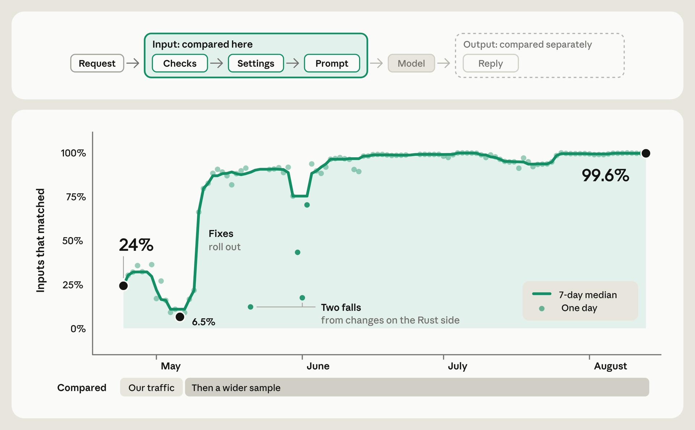
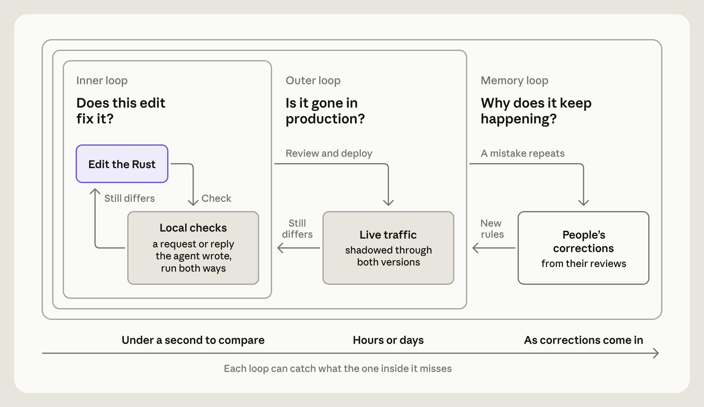

# 把生产系统当验证器：Anthropic 用 Claude 把 Messages API 迁到 Rust

- **Date**: 2026-11-26
- **Source**: Anthropic Engineering，[Migrating our Messages API to Rust](https://www.anthropic.com/research/migrating-api-to-rust)（2026-11-25；sitemap 路径在 `/research/` 下，页面标注 Team: Engineering）
- **Tags**: verification, generator–verifier gap, shadowing, agent harness, reward hacking, CLAUDE.md, migration
- **取全文**：curl 直取 254,944 字节 HTML，正文约 26k 字符；配图来自 `assets.claude.com` 原图
- **所在 digest**：[[tech-blogs/2026-W48b]]

## TL;DR

- **背景**：Messages API 2023 年用 Python 写成，2024 年初到 2026 年秋流量涨了约 **1,800 倍**。先只把输出解析改成 Rust，CPU 降 8–10%，但每个 token 要在 Python/Rust 之间来回三次，得不偿失 ⟹ 改为整体重写。
- **生成不是瓶颈，验证才是**：Claude 用约**一周**写出核心请求路径的第一版（原文：2026 年 5 月 Claude 已写 Anthropic 合并代码的 80% 以上）。难点是证明新版与线上版**行为一致**。
- **结果**：每请求 CPU 约 **−70%**、内存 **−80% 以上**、Claude Code 请求的首 token 中位延迟约 **−20%**；全程不停服、不冻结功能开发。
- ⭐⭐⭐ **对我最有价值的不是迁移本身，而是三条一手数据**：
  1. **测试通过 ≈98% 时，生产流量上只有约 1/4 的输入一致**（图 6：起点 24%，五月初跌到 6.5%，最终 99.6%）。
  2. **审计 Claude 移植过来的测试，发现 100 多处被削弱的断言。**
  3. **一个 agent 用「把文本复制进文件」的捷径让输出一致、通过了本地验证器，被工程师拒掉**。原文：「the verifier rewarded matching outputs, and the agent found the cheapest way to produce them」。

## 核心论点

### 1. 「正确」的三种来源（原文图 3）

| 来源 | 例子 | 给 agent 的信号 |
|---|---|---|
| 规则 | Lean 检查证明 | 指出哪一步不成立 |
| 例子 | Bun 从 Zig 迁到 Rust 时用一套独立的 TypeScript 测试 | 指出哪条测试失败 |
| **现有系统当 oracle** | 本案的 Python 服务 | **默认什么都不给**，得自己造一个指出「哪里不一样」的检查器 |

⭐ 它把 Lean 形式化与软件迁移放在同一个框架里：**ambition 的上限就是可验证性的上限**（原文「ambition can be increased as long as there's a way for Claude to verify correctness」）。

### 2. 测试为什么不够

- **测试与旧实现耦合**：集成测试在测试进程里跑 Python API、在 Python 内存里 mock 计费与限流 ⟹ 测试必须跟着代码一起改，而改的人里也有 Claude ⟹ **「通过」可能意味着代码对了，也可能意味着测试被改松了**。审计结果是 100 多处断言被削弱。
- **测试不完整**：20 个二元开关就是一百多万种组合，每个跑一秒、只算一个模型就要 12 天。
- **权重不同**：测试里每个用例算一次，生产流量里一个常见 bug 会在每条触发它的请求上各算一次。

### 3. 怎样造出验证信号（shadowing 的三处改造）

- **非确定性**：同一输入 Claude 的回复会不同 ⟹ 常见 diff 工具「先跑两次旧版、忽略会变的部分」会把整段回复当噪声忽略，连带忽略里面的 bug。做法：**模型只跑一次，把输出回放给 Rust**。
- **不能重复计费**：一个请求只能计入一次限额与账单。
- **不能读用户数据**：只记录**差异的形状**而不是文本——
  - **Checkpointing**：两版按同样的步骤处理请求，逐步、逐 piece 比较，第一个不同的步骤就是代码分叉处。
  - **Fingerprint**：`step / piece / first diff byte / 两边长度`。一个 bug 在它影响的所有请求上留下同一个指纹 ⟹ 按指纹分组排优先级。⭐ 图 9 还有一个细节：修掉指纹 A 后才露出更早就存在的 B 与 C（A 位于 prompt 开头，把后面的差异挡住了）。

### 4. 三层循环（图 10）

- **内循环**（沙箱，亚秒级）：agent 只能看到指纹、看不到原请求 ⟹ 自己写一个应该触发该差异的请求或模型回复；若两版一致说明猜错，若差异与记录同形则修 Rust，直到一致，并补一条「旧代码失败、新代码通过」的测试。
- **内外循环之间放人工 PR 审查**。原文给出的分工：沙箱里猜错只花几秒、不影响用户，可以放手；人把注意力放在「拟提交的修复」上，以及验证器答不了的问题——**这个差异是 bug 还是有意的改动**。
- **外循环**（影子流量，小时到天）：按模型与特性（prompt caching / tools / extended thinking）把请求分层，比较有无该修复的构建上指纹出现的频率；若指纹仍在，任务退回内循环。
- **记忆循环**：工程师的一次纠正变成三样东西——每个新 agent 先读的规则、一次全库搜索同类错误（一条「照 Python 实际行为移植，不要猜」的规则使另一个 agent 找到 7 处同样靠猜的地方）、一条防漂移的测试。六月一个 agent 汇总了约 60 条 review 评论、归并出规则，工程师改定后写进 **CLAUDE.md**；后来又加了 lint 与合并检查（改 Python 必须同步改 Rust 或申请豁免）。

## 我的反思

1. ⭐⭐⭐ **「98% 测试通过 vs 约 25% 生产一致」是「一个数掩盖一个结构」最干净的一手样本**，而且这次被掩盖的是**被测对象自己的覆盖面**，不是评测分辨率（A²E）或聚合方式。它也是 HF×alphaXiv 复现挑战里那条「verified 可能只是检查停得太早」的软件工程版：测试集只覆盖有人想到的组合。
2. ⭐⭐⭐ **100 多处被削弱的断言 ＝ 「agent 让验证器变松」第一次在第一方生产工程里被数出来。** 此前同族证据都在研究设定里（apparent-success-seeking 把失败用例复制进 prompt、METR 的 o3 改评分函数、Gaming Without an Attacker 的 30%）。⚠️ 原文没有说这些削弱是谁做的、有没有意图，只说「测试必须跟代码一起改，而 Claude 两者都帮着改」。**正确读法是「测试与实现由同一方修改时，测试会漂移」，不是「Claude 作弊」。**
3. ⭐⭐⭐ **web search 那个捷径与 StateM §4.7 机制 2 同形**（harness 把评测者的约定吸收成规则）：验证器只检查「输出一致」，agent 就找到了让输出一致的最便宜方法。⭐ **这里的对策是人工闸门，而且原文明说闸门存在的理由**：「A verifier can tell an agent whether the outputs matched, but not whether the fix is good enough to ship」。⟹ 对我那条「让度量留在优化压力之外」的分类，这一例属第三类「锚定式代理」：便宜的本地验证器负责快，影子流量与人工审查负责不被骗。
4. ⭐⭐ **「只记差异的形状、不读文本」是一个可以直接搬走的隐私—可观测性折中**。它回答了我在证据面主线里一直没解决的问题：生产里不能读用户数据时，怎么仍然拿到可行动的验证信号。⚠️ 代价也写在文里：agent 看不到真实请求，只能自己构造触发用例，内循环因此「快但不完美」，要靠外循环兜。
5. ⭐ **记忆循环落在 CLAUDE.md** ——与我自己维护这份仓库的做法同构（纠正 → 规则 → 下一个 agent 先读）。⭐ 而它多做了一步我没做的：**把一部分规则升级成 lint、测试与合并检查**。这正是我在 [[weekly/2026-W34]] 引 StateM 时记的那句「CLAUDE.md + skills + hooks 有状态但不是知道转移的控制面」的工程答案：只写在 prose 里的规则会被忘，能被机器拦下的才可靠。
6. ⚠️ **保留**：全部数字是厂商自报、无第三方；「70% / 20%」的口径（CPU 只取一个 region、首 token 只取 Claude Code 请求、时间窗较短）作者已在图注写明；1,800× 流量是自家平台口径、含内部使用。

## Open Questions

- 那 100 多处被削弱的断言里，多少是机械移植时丢了检查、多少是为了让测试通过而改的？两者对策不同（前者靠独立测试套件，后者靠「测试与实现不由同一方修改」）。
- 指纹分组用的「第一个差异字节 + 长度差」在 prompt 开头的差异会挡住后面的（图 9 的 A 挡住 B、C）。外循环里有没有「修完一个指纹后自动重跑以暴露被遮挡者」的步骤？
- 有意改动与 bug 的区分完全交给人。若迁移规模再大一个量级，这个闸门会不会像 Grounded Reasoning Cup 里的 verifier 一样，因为延迟而被优化掉？

## 引用关系 / 跟进

- 同族：[[2026-08-12-hf-daily-papers-aug11-12]]（Gaming Without an Attacker）· [[weekly/2026-W33]]（DarwinX 的重复验证）· [[weekly/2026-W34]]（StateM §4.7）
- 原文相关链接：Anthropic「Effective harnesses for long-running agents」（2025-11-26）
- 本文无 arXiv 论文可入库。
