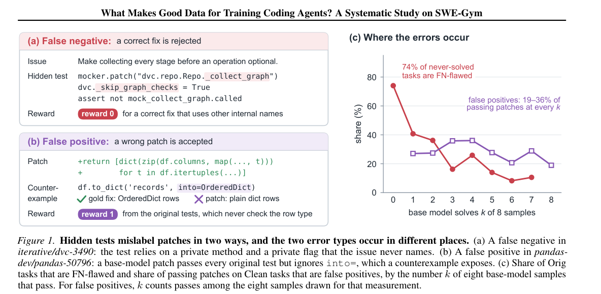
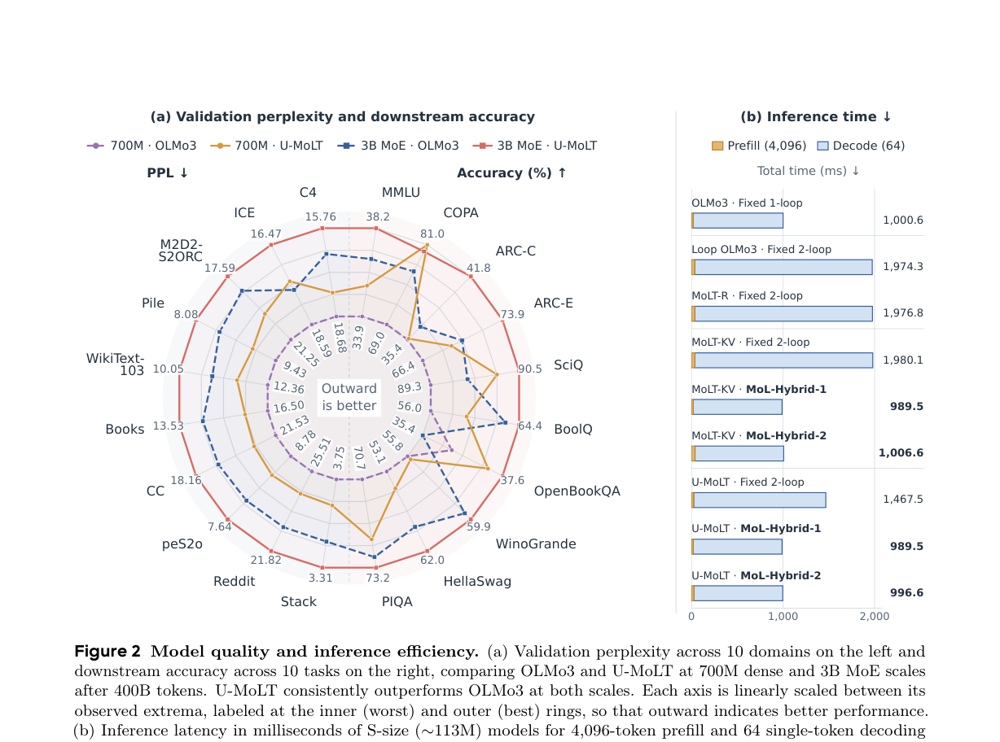

# HF Daily Papers 11/25 回填 + 11/26（当日首跑；奖励标签错 74% 藏在「从未解出」里、循环 Transformer 同日三篇）

## Context

- **运行**：2026-11-26（周四，美国感恩节）07:57 UTC，systemd `digest-hf-am` timer 触发，是今天第一份 hf。上一份是 `2026-11-25-hf-daily-papers-nov25b`（11-25 17:42 快照 `~/fetch-cache/hf44/`）。⚠️ cron prompt 写的「上一份是 09-15 sep15d、空缺十周」已过时，以 `date -u` 与仓库为准；`runlog check` 报的 11-20~11-24 NO RUN 是昨天已补跑过的那段空缺，不是新空缺。
- **读取时刻**：11-26 07:57 UTC，快照 `~/fetch-cache/hf45/`（mtime 07:57）。拉了 11-23 ~ 11-27 五个桶；11-27 返回错误对象（声称上限 11-26T00:00Z，却能取到 11-26 的 35 篇 ＝ 上限提示又一次不准）。
- **桶读数（对照 hf44，10.25 小时）**：11-23 26→26 · 11-24 73→73 · **11-25 51→59（+8）** · **11-26 首读 35** · 消失 0。窗口唯一 **193**。
- **抓取前写下的预测（`_prediction.txt`，07:57）**：11-25 涨到 52–60 ✅（59）· 消失 0–2 ✅（0）· ❌ **11-26 桶 0–15 → 实测 35** · ❌ **A ∈ [3,30]、点 12 → 实测 43**。
  - 两个落空方向相同，且原因可指名：我把「感恩节当天」当成低产的理由，而 HF 当日桶收的是 arXiv 公告批次（11-25 美东晚上发的那一批）＋ 策展，**美国假日影响的是 11-27 之后的批次，不是 11-26 早上已经落进来的那批**。⟹ 又一次「拿一个受上游行为影响的量（假日）去推结构参数」，而这次错在把假日的生效日期搞错了一天。
  - 短窗口规矩照做：本次 10.25h、A=43，与 nov25b 的 7.9h / A=10 一起记，不挑。
- **去重**：A（对 hf44 快照的新 id）= **43**（11-26 桶 35 ＋ 11-25 回填 8）· B（对最近 8 份 HF digest 引用过的 id）= **159** · **B − A = 116** · A∖B = 0。
  - `B − A = 116` 是 11-23~11-25 三个桶里**昨天两份都没引用**的残留（nov25b 取了 B−A 前 20 ＋ A 全部 10）。⚠️ 所以 A 与 B 不相等，不需要区分那两个成因；B−A 很大说明昨天两份对最近三桶的覆盖率仍低（150 篇里引了约 40）。
- **选法**：B 里按 upvote 取 **Top 25**，再编辑增补 **16 篇**（低 upvote 但正中主线：harness×policy 协同演化、test-time RSI、权重空间编程两篇、单侧可验证奖励、长程工程评测等）＝ 总览表 41 行，全部入库。
- **项目/单位聚合**（按作者重叠 grep）：**Sage-Med ⊕ WeightCode ⊕ TT-RSI 有作者交集**（Yingcheng Wu / Zhenfei Yin / Wanli Ouyang，上海 AI Lab 一系）⟹ 「权重空间编程」与「test-time RSI」两条不算两个独立单位的信号；**WeightCode（PKU / Gen-Verse）与 Self-WSP（CMU）作者零重叠**，后者明说是在前者提出的 WSP 上做「自己改自己」＝ 两个独立单位。**三篇循环 Transformer（ByteDance Seed+华科 / NUS / DyLoMo）作者零重叠** ⟹ 三个独立单位。其余几处单名重叠（Bo Wang / Yang Zhang / Hao Chen / Li Luo）是常见姓名，不计。

## 论文总览表（Top 25 ＋ 编辑增补 16；▲ 为 07:57 快照读数）

| # | 论文 | ▲ | 桶 | A | 主题 |
|---|---|---|---|---|---|
| 1 | [PyRUA-Dex: Learning Programmatic Policies for Dexterous Bimanual Manipulation with Coding Agents](https://huggingface.co/papers/2611.33144) | 39 | 11-26 | 新 | 具身 × coding agent |
| 2 | [Sage-Med: Scaling Medical Multimodal Intelligence](https://huggingface.co/papers/2611.34575) | 35 | 11-26 | 新 | 医疗 MLLM |
| 3 | [Embodied AI Fails the Mirror Test: How a Simple Mirror Breaks Robot Policies](https://huggingface.co/papers/2611.33010) | 32 | 11-25 |  | 具身评测有效性 |
| 4 | [VibeVideoAgent: Closing the Perceptual Loop for Code-Driven Video Generation](https://huggingface.co/papers/2611.34237) | 30 | 11-26 | 新 | coding agent 视频 |
| 5 | [MemOnce: A Scalable Memory Architecture for Large Language Models](https://huggingface.co/papers/2611.27973) | 30 | 11-23 |  | 记忆/KV |
| 6 | [Plan4D: Generative Plannable 4D Worlds](https://huggingface.co/papers/2611.26516) | 30 | 11-24 |  | 世界模型 |
| 7 | [LingSante MedGuard Technical Report](https://huggingface.co/papers/2611.25509) | 30 | 11-25 |  | 医疗 guardrail |
| 8 | [World Models as Native Latent Action Models](https://huggingface.co/papers/2611.30898) | 28 | 11-24 |  | 世界模型 |
| 9 | [Improving and Expanding Video Editing Capabilities Without Videos](https://huggingface.co/papers/2611.34941) | 27 | 11-26 | 新 | 视频编辑 |
| 10 | [Mixture-of-Loops Transformer](https://huggingface.co/papers/2611.34923) | 26 | 11-26 | 新 | 循环 Transformer |
| 11 | [Reading the Unreadable: Text-Aware Image Super-Resolution Needs Reasoning](https://huggingface.co/papers/2611.15449) | 26 | 11-23 |  | 图像复原 |
| 12 | [Unlocking the Power of Loops in Pretrained LLMs with Loop Residuals](https://huggingface.co/papers/2611.31094) | 23 | 11-24 |  | 循环 Transformer |
| 13 | [Qwen-Image-HD: Autoregressive Diffusion for High Definition Image Generation](https://huggingface.co/papers/2611.32736) | 22 | 11-25 |  | 图像生成 |
| 14 | [RUIBench: What Makes a Good Robot-Use Interface?](https://huggingface.co/papers/2611.31115) | 22 | 11-24 |  | 具身 harness |
| 15 | [ThinkMorph-SSL: Scaling Interleaved Multimodal Reasoning with Pretext Tasks](https://huggingface.co/papers/2611.32183) | 21 | 11-25 |  | 多模态推理 |
| 16 | [KMed-31B Technical Report](https://huggingface.co/papers/2611.28719) | 21 | 11-25 |  | 医疗 LLM |
| 17 | [Distilling Visual Agents from Limited Interaction Experience](https://huggingface.co/papers/2611.28618) | 21 | 11-24 |  | OPD/视觉 agent |
| 18 | [Beam Model Technical Report](https://huggingface.co/papers/2611.26358) | 21 | 11-24 |  | 开放权重 MoE |
| 19 | [DyLoMo-DiT: Dynamic Looped Mixture-of-Experts Diffusion Transformers](https://huggingface.co/papers/2611.30844) | 20 | 11-26 | 新 | 循环 Transformer |
| 20 | [ViDiHand2: Unifying Video Diffusion Priors and Hand Geometry for 3D Hand Motion Reconstruction in the Wild](https://huggingface.co/papers/2611.30597) | 20 | 11-24 |  | 手部重建 |
| 21 | [What Makes Good Data for Training Coding Agents? A Systematic Study on SWE-Gym](https://huggingface.co/papers/2611.30207) | 19 | 11-24 |  | 奖励标签有效性 |
| 22 | [DiLE: Discrimination-Aware Latent-Space Learning for Universal Multimodal Embeddings](https://huggingface.co/papers/2611.25419) | 19 | 11-24 |  | 多模态嵌入 |
| 23 | [Open Vision Banana: An Open Framework for Unified Visual Perception through Generation in RGB Space](https://huggingface.co/papers/2611.28489) | 18 | 11-24 |  | 统一视觉 |
| 24 | [UUBench: Understanding the Unspoken toward Full-Duplex Multimodal Interaction](https://huggingface.co/papers/2611.30157) | 17 | 11-24 |  | 全双工交互 |
| 25 | [Single-Transformer Latent Diffusion](https://huggingface.co/papers/2611.29064) | 17 | 11-24 |  | 扩散架构 |
| 26 | [RoboEvo^2: Recursive Robot Self-Improvement via Harness-Policy Co-Evolution](https://huggingface.co/papers/2611.34675) | 8 | 11-26 | 新 | harness×policy 协同演化 |
| 27 | [Beyond Self-Consistency: Recursive Self-Improvement at Test Time](https://huggingface.co/papers/2611.30965) | 6 | 11-26 | 新 | test-time RSI |
| 28 | [SEEK: Self-Evolution through Execution Knowledge for Agentic Robot Manipulation](https://huggingface.co/papers/2611.33915) | 10 | 11-26 | 新 | 具身执行记忆 |
| 29 | [Steerable by Design: Conditional Pretraining for Robust Control of Language Models](https://huggingface.co/papers/2611.32199) | 6 | 11-25 | 新 | 可控性/预训练 |
| 30 | [CoT-Proxy: Cross-Format Transfer for Distilling Long-Horizon Policies](https://huggingface.co/papers/2611.33148) | 14 | 11-25 |  | 蒸馏/CoT |
| 31 | [SpecEngineeringBench: Evaluating Coding Agents as Autonomous Specification Engineers](https://huggingface.co/papers/2611.32973) | 13 | 11-25 |  | coding agent 评测 |
| 32 | [WeightCode: Installing New Capabilities into Neural Networks via Weight-Space Programming](https://huggingface.co/papers/2611.25476) | 14 | 11-24 |  | 权重空间编程 |
| 33 | [Self-WSP: Can Language Models Improve Themselves Through Weight-Space Programming?](https://huggingface.co/papers/2611.28833) | 13 | 11-24 |  | 权重空间编程 |
| 34 | [OWE-Bench: A long-horizon benchmark for measuring real-world engineering](https://huggingface.co/papers/2611.30017) | 1 | 11-25 | 新 | 长程工程评测 |
| 35 | [Negative-Only Policy Optimization for One-Sided Verifiable Rewards](https://huggingface.co/papers/2611.17287) | 0 | 11-26 | 新 | 单侧可验证奖励 |
| 36 | [CONCOR: Benchmarking Contrastive Decoding for Visual Hallucination Mitigation Beyond Final-Output Performance](https://huggingface.co/papers/2611.30460) | 2 | 11-26 | 新 | 过程评测 |
| 37 | [EgoUseBench: Benchmarking Computer-Use Agents under Evolving First-Person Contexts](https://huggingface.co/papers/2611.34466) | 9 | 11-26 | 新 | 可穿戴 computer-use |
| 38 | [Coding4Games: Can Modern Coding Agents Play Modern Video Games?](https://huggingface.co/papers/2611.31974) | 13 | 11-25 |  | coding agent 游戏 |
| 39 | [ROAM-Bench: Evaluating Embodied Active Spatial Intelligence through Evidence Verification](https://huggingface.co/papers/2611.33143) | 10 | 11-26 | 新 | 具身评测 |
| 40 | [Model Carving: Training Transformers That Optimize Their Own Topology](https://huggingface.co/papers/2611.27962) | 1 | 11-25 | 新 | 架构/拓扑 |
| 41 | [Beyond the Happy Path: Generalizing Robot World Models from Simulated Failures](https://huggingface.co/papers/2611.33925) | 7 | 11-26 | 新 | 世界模型失败数据 |

## 分主题详解

### 1. 奖励与评测的有效性：今天六篇从不同位置说同一件事——「分数在测的不是你以为的那个东西」

- **[What Makes Good Data for Training Coding Agents?](https://huggingface.co/papers/2611.30207)**（19▲，AMD 等）—— 见 Deep Dive 1。一句话：SWE-Gym 里 9B 基模**从未解出**的任务有 **74%** 带一个拒绝正确修复的测试；按 pass rate 过滤只能拿掉「沉默」的那部分错误。
- **[OWE-Bench](https://huggingface.co/papers/2611.30017)**（1▲，Mercor）—— 26 个领域专家写的长程工程任务（优化 kernel、设计飞机、找地震断层），按速度/成本/精度打分，**分「agent 可以自测的 provided cases」与「隐藏 cases」两套**。最好的 **Claude Fable 5.2 = 54.6%、平均每题 2.11 亿 token**。两条发现：①给更多时间就用更多算力、分数更高，而且**两家曲线形状不同**（GPT-6 Astra 在短时限和等 token 下更高，Fable 5.2 在长时限靠更多 token 拿到最高总分）②⭐ **每个模型在隐藏 cases 上比 provided cases 平均低 18 分（作者叫 deployment gap），而模型自己对隐藏集表现的预估平均高估 21 分**。⟹ 后一个数是「模型不知道自己的边界」在工程任务上的一个干净读数：不只是有缺口，而是**对缺口的自估方向一致地偏乐观**。⚠️ 仅摘要；26 题、未见区间。
- **[NOPO：单侧可验证奖励](https://huggingface.co/papers/2611.17287)**（0▲，NTU）—— 把「cheap check 只能证伪、不能证实」形式化为 **one-sided verifiability**：验证失败是可靠负例，验证通过只是「未被证伪」。做法是**只压低可信的负例、把正例当无标签**。⟹ 与 Deep Dive 1 正好互补：那篇说 SWE 测试的**正例**里 26% 是假阳性、负例里大量是假阴性；NOPO 给的是「当你知道哪一侧可靠时怎么只用那一侧」。⚠️ 它假设负例可靠，而 SWE-Gym 那篇恰好测出 SWE 设定里**负例也不可靠**（74%）⟹ NOPO 的前提在 SWE 上不成立，在单元测试只查「有没有崩」这类 check 上更合适。
- **[CONCOR](https://huggingface.co/papers/2611.30460)**（2▲）—— 对比解码缓解幻觉，作者指出最终任务分数被候选过滤、生成轨迹变化、回答偏置混淆，**改测 ground-truth 与幻觉候选之间的 margin（CGM）** ＝「只报最终成功率等于没报」在解码层的一个实例。
- **[ROAM-Bench](https://huggingface.co/papers/2611.33143)**（10▲，JD）—— 具身主动空间智能，⭐ **用仿真状态与 episode 记录做独立检查，区分「结果对了」与「任务要求被完成了」**；人类 84% 严格成功且每个对的结果都满足检查 ＝「证据面」在具身评测里的又一个落地。
- **[RUIBench](https://huggingface.co/papers/2611.31115)**（22▲，NUS Show Lab）—— 只换 robot-use interface（13 种），**同一前沿 agent 成功率 45% → 81%、微调 4B 13% → 47%** ＝ harness 效应在具身侧的又一个大数；⭐ 并单独报了一个 **verification gap：agent 经常在可观察失败时宣布成功** ⟹ 与 OWE-Bench 那个「高估 21 分」同族，具身版。
- **[Embodied AI Fails the Mirror Test](https://huggingface.co/papers/2611.33010)**（32▲）—— 在场景里放一面镜子，任务目标/成功判定/checkpoint 都不变；五个策略（VLA / World Action Model / agentic）**每种镜子条件都掉分，三种条件平均掉 10.8–56.7pp，镜面桌面最多掉 62.5pp**。⭐ 方法上最好的一步是**对照一块几何相同但不反光的板子**：50–88% 的镜子特有失败发生在没有记录到碰撞的情况下 ⟹ 不是挡路，而是「瞄准反射里的物体」与「把真物体定位错」。真机上 π0.5 与 FastWAM 同向。⟹ 一个很便宜的分布外探针：不改任务、只加一个自然存在的物体，就能看到所有家族同一个盲点。

### 2. 循环 Transformer：同日三个独立单位，而它们修的是同一个瓶颈

Deep Dive 2 写 MoLT。另两篇：

- **[LoopRes](https://huggingface.co/papers/2611.31094)**（23▲，NUS）—— 问题陈述很直接：循环此前要么从头训、要么 finetune 进已有模型只比 SFT 好一点点。做法基于 **Attention Residuals**（⭐ 正是 [[2026-08-12-topic-softmax-linearization-and-k3]] 那份里 K3 用的那个机制）：**每个被循环的层直接 attend 到前几轮的输出**。
- **[DyLoMo-DiT](https://huggingface.co/papers/2611.30844)**（20▲）—— 在扩散 Transformer 里**循环中间层、把省下的参数预算挪给更多专家**，并按 token 动态决定循环次数。
- ⭐ **三篇的共同诊断是「每一轮只通过一条 residual stream 传给下一轮」这件事本身是瓶颈**（MoLT 原话「Repeatedly compressing computation into a single residual stream causes information dilution」）；修法分别是：读前几轮的 KV（MoLT）、读前几轮的输出（LoopRes）、把循环与 MoE 组合（DyLoMo）。⟹ 与我 11-25 那份 tech-blogs 记的「GLM-5.4 是第一个 loop transformer」、09 月「Astra 带火循环 Transformer」放在一起：**循环已经从「一个架构选项」进入「怎么把它做好」的阶段，而三家同一天到达同一个诊断。**
- 同簇相邻：**[MemOnce](https://huggingface.co/papers/2611.27973)**（30▲，南大）只缓存一小部分**末层** hidden state 当记忆、需要时解码回 KV；Qwen3.5-4B 改造后 **1M 上下文下记忆缓存 −1313×、prefill −6.9×、吞吐 ×3.5**（⚠️ 「1313×」比的是什么基线未读）· **[Model Carving](https://huggingface.co/papers/2611.27962)**（1▲，Harvard）给每个子层一个可学习门、让训练自己删组件 · **[Single-Transformer Latent Diffusion](https://huggingface.co/papers/2611.29064)**（17▲）把编码/生成/解码折进一个 DiT。

### 3. Coding agent 被当成「执行者」接到原本不写代码的领域

- **[PyRUA-Dex](https://huggingface.co/papers/2611.33144)**（39▲ 本窗口最高，北大）—— 灵巧双手操作**不要示范**：多个 coding agent 并行探索技能与组合方式，一个蒸馏 agent 把成功尝试压成任务库与一个程序，再在随机化布局里精化。Bench2Dex **72.9**、DexJoCo 全随机化 **81.0%**，均超过所有训练出的策略；真机两只 22-DoF 手，**从乐谱学一首新曲最少 30 分钟**。⟹ 「程序化策略」把可检查性带进了具身：产物是一段可读的程序，而不是一组权重。
- **[VibeVideoAgent](https://huggingface.co/papers/2611.34237)**（30▲，Kling）—— 代码驱动的视频生成，⭐ 诊断准：**程序干净退出 ≠ 渲染出来是对的**（标签重叠、镜头没对准、旁白不同步都不报 runtime error），而把每帧回喂又撑爆长程上下文 ⟹ 训练无关地「闭合感知回路」。＝ 「完成信号不等于结果正确」在生成任务里的版本。
- **[Coding4Games](https://huggingface.co/papers/2611.31974)**（13▲，腾讯 ARC）—— 让 coding agent 从交互里**写出独立运行、不再调用 LLM 的游戏程序**，15 款现代游戏，⭐ **开发与测试分离** ＝ 留出集设计。
- **[SpecEngineeringBench](https://huggingface.co/papers/2611.32973)**（13▲，Tokenwave.AI）—— 100 个实例、78 个仓库，**不给 issue / 测试入口 / 要看的文件**，要求 agent 自己决定测什么、在哪找缺陷。⟹ 与 Deep Dive 1 构成一对：那篇说现有测试会拒绝正确修复、接受错误修复；这篇测的正是「自己写出好测试」的能力。
- **[RoboEvo²](https://huggingface.co/papers/2611.34675)**（8▲）—— **harness 与 policy 递归协同演化**：策略失败引导 coding agent 搜 Code / Code+ICL / Code+Policy 三条路线并固化成技能与路由；验证过的轨迹再反过来监督训练策略（含 Counterfactual Preference Distillation：同一起点的成功修正 vs 失败）。LIBERO-PRO **独立成功率 11.0% → 84.1%、混合 30.4% → 90.5%**，Unitree G1-D 混合 95.0%。⟹ 「改 harness 冻结模型」与「固定 harness 训模型」两条线在具身侧被合成一个循环（WHALE 之后的又一例）；⚠️ 自报、代码「将发布」。
- **[SEEK](https://huggingface.co/papers/2611.33915)**（10▲，NTU）—— 机器人在上下文里学到的执行知识在任务结束时就丢了 ⟹ 跨尝试保留「由当前场景决定动作的程序」而不是回放动作 ＝ 「experience must be filtered before it becomes memory」的具身版。

### 4. 自我改进：两篇「改权重」的，一篇说清了自己的边界

- **[WeightCode](https://huggingface.co/papers/2611.25476)**（14▲，北大 / 上海 AI Lab 一系）—— **权重空间编程**：冻结的 LM 写可执行程序直接读、构造、改一个网络的权重，**不走梯度**。组合命令 0% → 99.8% 精确匹配、新 pickup 动作 0% → 98.4%，ImageNet 上四个权重程序 +8.84~17.62 点且保住干净准确率；⭐ 两条对照做得好：**在五个独立训练的 ViT 上重跑程序保留 83–110% 的增益，而直接复制固定的权重改动增益可忽略** ⟹ 迁移的是「程序」而不是「改动」，与 JIT-Agent 那个「被迁移的对象不同」同形。
- ⭐⭐ **[Self-WSP](https://huggingface.co/papers/2611.28833)**（13▲，CMU）—— 让 Qwen3.5-0.8B **读自己的权重、提一个改动、然后带着改过的权重继续当解题者与编辑者**。GSM8K 11.8% → 62.2%、MATH500 7.0% → 32.2%，**有时只改 16 个参数**，部分情况重复自改仍在涨。⚠️⚠️ **而作者自己写出的那半句更重要：「these gains lack interpretability. The model shows little understanding of the edits it makes, and WSP driven by random search sometimes performs comparably」** ⟹ 随机搜索有时打平 ＝ 它没有排除「这是 0.8B 模型的某个不稳定方向被随便戳一下就恢复」这个解释。⟹ 我追「RSI 第二圈」以来，这是第一篇**在同一份摘要里同时报了多圈增益与「增益可能不来自理解」**的。
- **[TT-RSI](https://huggingface.co/papers/2611.30965)**（6▲，上海 AI Lab）—— 批评自一致性「把早先推理丢掉、而且在训练里会强化错的多数」；做法是每轮以前一份完整解为参考重解（In-Context RSI）＋ 把连续精化蒸馏进权重（In-Weight RSI），**比基模 +13.89%、比最强自一致性方法 +4.79%（同测试时预算）**。⟹ 与 08-12 那个区分（「多条独立 rollout 的交集可靠 vs 单一被反复优化的标量腐化」）方向相反：它主张放弃独立性、让样本互相参考。⚠️ 那会把「多数投票的独立性」这层保护拿掉，摘要没讨论错误会不会在链上累积。

### 5. 蒸馏：教师的 CoT 可以不要

- ⭐⭐ **[CoT-Proxy](https://huggingface.co/papers/2611.33148)**（14▲，Asano 组）—— 长程 agent 蒸馏**只用教师的动作、学生的推理块留空**，再用一个对自己生成样本的 KL 防漂移；⭐ 意外的是**开启 thinking 推理时策略照样迁移**（学生用自己的风格推理、像教师一样行动，作者叫 cross-format transfer）。Qwen3.6-27B → Qwen3-4B 在 AppWorld 7% → 18%；加上放在空推理块之后的**简短推理摘要（CoT-proxy）**到 35%；⭐ **蒸馏闭源 GPT-5.6 Luna 的可见输出与 API 返回的推理摘要：Qwen3-4B AppWorld 7% → 48%、SWE-bench Verified 3% → 28%**。⟹ 两点：①它是 OPSD 综述那个「特权信息只有在学生能自己重建时才安全」的一个侧面——**直接不给学生教师的推理**，于是不存在「预设答案」的问题 ②⚠️ 对「隐藏 CoT 能防蒸馏」这条防线是一个直接的负面数据点：**隐藏 CoT 挡住的只是 CoT，而动作与推理摘要已经够用**（与 08-11 那篇 Stealing Reasoning Traces 是攻防两侧不同的路径）。
- **[Distilling Visual Agents from Limited Interaction](https://huggingface.co/papers/2611.28618)**（21▲）—— 4 条固定轨迹就把 4B 学生的 Navigation 从 49.17% 提到 82.08%、Sokoban 60.16% → 85.55%，**补回与 27B 教师差距的 90% 以上** ＝ OPD「数据过剩、算法不足」那条又一个读数。
- **[KMed-31B](https://huggingface.co/papers/2611.28719)**（21▲，NAVER）—— 按「有没有参考答案 × 反馈是什么形态」把医疗任务分四类、每类一个专家用它的反馈能支撑的奖励训、再合并 ⟹ 与 Deep Dive 1 那句「奖励必须按正确的理由变化」同一判断的工程版。

### 6. 可控性与安全

- ⭐⭐ **[Steerable by Design](https://huggingface.co/papers/2611.32199)**（6▲，MIT，含 Dylan Hadfield-Menell）—— 诊断一句话：**今天的模型用同一个输入通道既装指令又装数据**，于是 jailbreak 与 in-context alignment drift 是同一种失效。做法是**从预训练开始就分开**：一个编码器处理「即将出现的文本」的高层语义特征、经 cross-attention 注入，且**token 流不能写回这个控制通道**；Mancelle-3B 的 steering 强于同级开放模型的 prompt / activation 方法，并扛住黑盒与 soft-prompt 反 steering，400M 受控复现。⟹ 这是「agent 把数据当指令执行」（prompt injection、09-08 那个 Notion connector）在**架构层**的回应，此前我记的对策全在 harness / 闸门层。⚠️ 3B 规模、仅摘要。
- **[LingSante MedGuard](https://huggingface.co/papers/2611.25509)**（30▲，inclusionAI）—— 医疗 guardrail 把「核对临床主张与证据、验算、在适用条件下应用要求」做成判定的一部分 ＝ 证据面进了内容审核。
- **[Beam](https://huggingface.co/papers/2611.26358)**（21▲，Reflection）—— 501.3B 总 / 23.4B 激活 MoE、23.8T token、1M 上下文；**后训练 RL 在 10.5K 张 GB300 上跑 4 周、1 亿+ rollouts，「RL 算力增加时能力持续提升、没有平台迹象」**；自带 1.93B DFlash 2 drafter；⭐ 安全数字成对报：**有害请求拒绝/转向 88.9%、无害请求配合 81.5%** ⟹ 闸门的效用代价被写在同一句里（约 18.5% 无害请求没被正常配合）。

### 7. 其余

世界模型：[Plan4D](https://huggingface.co/papers/2611.26516)（30▲，同时预测 RGB 与稠密 4D 几何）· [World Models as Native Latent Action Models](https://huggingface.co/papers/2611.30898)（28▲，SenseTime，从预训练视频 DiT 直接取 latent action）· [Beyond the Happy Path](https://huggingface.co/papers/2611.33925)（7▲，⭐ **五个动作条件世界模型的物体运动误差最多只比「复制第一帧」的静态基线低 10.4%、两个比它还差** ＝ 又一个「先和平凡基线比」的负面结果，修法是 6.2 万条仿真失败轨迹）。视觉/生成：[Video Editing Without Videos](https://huggingface.co/papers/2611.34941)（27▲，CMU）· [Reading the Unreadable](https://huggingface.co/papers/2611.15449)（26▲）· [Qwen-Image-HD](https://huggingface.co/papers/2611.32736)（22▲）· [ThinkMorph-SSL](https://huggingface.co/papers/2611.32183)（21▲）· [Open Vision Banana](https://huggingface.co/papers/2611.28489)（18▲）· [ViDiHand2](https://huggingface.co/papers/2611.30597)（20▲）· [DiLE](https://huggingface.co/papers/2611.25419)（19▲）。交互：[UUBench](https://huggingface.co/papers/2611.30157)（17▲，全双工「没说出口的需求」）· [EgoUseBench](https://huggingface.co/papers/2611.34466)（9▲，智能眼镜第一人称上下文下的 computer-use，⭐ 要求 agent **重新判断已做的数字动作是否仍然有效**）。医疗：[Sage-Med](https://huggingface.co/papers/2611.34575)（35▲，35B-A3B，⭐ 摘要先给负面结果：现有医疗 MLLM 弱于通用前沿、放大规模主要提升文本而非多模态感知、打开推理也补不上视觉差距）。

## Deep Dive 1：SWE-Gym 的奖励标签——「从未解出」大多是「标错了」

**[What Makes Good Data for Training Coding Agents? A Systematic Study on SWE-Gym](https://huggingface.co/papers/2611.30207)**（19▲，AMD / U. Michigan / Tulane 等；`.md` 端点给了 90,798 字节真内容；表格与图从 PDF 取）

**问题**：RL 训练 coding agent 时，隐藏测试就是奖励标签，而任务集合只拿**参考修复**去检查这些测试。作者问：一个任务作为训练数据好不好，首先取决于它的奖励标签对不对。

**方法要点**：两族 LLM 审计全部 assertion，⭐ **怀疑的错误只有在执行复现之后才算数**（假阴性要执行一个「做了 issue 要求、却被拒」的见证补丁；假阳性要一个反例）；1,087 个审计任务连同每条判定的执行证据一起发布为 SWE-Gym-Verified。

| 量 | 数 |
|---|---|
| 被判 assertion 的任务里带假阴性判定 | 1,091 / 2,001 ＝ 55% |
| 基模（9B）**从未解出**的任务里 FN 有缺陷 | **74%**（两族都确认 68% · PAIChecker 人工标签 61%） |
| 基模**有时解出**的任务里 FN 有缺陷 | 20%（13% · 21%） |
| 通过的补丁里假阳性 | 26.1%（另 37.3% 未定） |
| 按 pass 次数分层的假阳性占比 | 每一层都是 19–36% |

| 训练集（3 seeds，mean ± sd） | Verified-397 | SWE-bench Pro | 平均增益 |
|---|---|---|---|
| Base | 57.2 | 53.8 | – |
| Orig | 60.2 ± 2.1 | 53.5 ± 2.1 | +1.4 ± 0.9 |
| Orig + 丢掉从未解出（pass-rate filter） | 61.3 ± 2.1 | 51.4 ± 3.0 | +0.9 ± 2.5 |
| **Clean（审计后）** | **62.6 ± 1.1** | **56.2 ± 1.3** | **+3.9 ± 1.2** |
| Clean + FP 加固测试 | 62.6 ± 1.0 | 57.3 ± 3.7 | +4.5 ± 2.2 |

**我认为最该记的四件事：**

1. ⭐⭐⭐ **「从未解出」这个难度信号大部分是标签错误。** 任何把 0 pass rate 读成「难」的课程学习或过滤器，作用对象主要是坏标签。而这与我 09-16 记的 Gaming / 假阳性线方向相反：那些是「分数虚高」，这一个是**分数虚低——一个真能力被当成无能力，而且看起来就是「题太难」**。
2. ⭐⭐⭐ **真正训到策略的错误在「有时解出」那一群里，而 pass-rate 过滤器原理上看不见它们。** 从未解出的坏任务占 11.1% 的组却只占 0.9% 的带梯度组（沉默）；有时解出的坏任务贡献 **19.5%** 的带梯度组。丢掉从未解出的任务能去掉 40% 的坏任务，**却只去掉 4% 落在坏任务上的带梯度组**。作者的判据：「A pass rate shows whether a task yields reward, not whether that reward is right」。案例更具体：一个只要求弃用 JSON 字面输入、没给警告文本的 issue，隐藏测试要求逐字复现上游那句警告 ⟹ **GRPO 的 advantage 偏向「复现上游文本」而不是「修好问题」**。⟹ 这是我追了三个月的「优化一个固定度量就把它打坏」在**数据标签层**的形态：不需要模型作弊，标签本身就在奖励记忆上游代码。
3. ⭐⭐ **它报了 seed 方差，而且自己指出了重叠。** 「The runs of Clean and Orig overlap on each benchmark, but averaged over the two benchmarks every Clean run gains more than every Orig run」、留一 run 后差距仍 ≥1.4pp；Clean+FP vs Clean 的差「well within seed-to-seed variation, but three seeds cannot establish that the two sets are equivalent」⟹ 少见地区分了「没测出差异」与「证明了等价」。
4. ⭐⭐ **加固测试的那一半是一个诚实的负面结果，且给了原因**：新测试抓到 25% 的假阳性，held-out 分数看不出变化——⭐ **因为 held-out 基准本身用的是原始测试、同样接受假阳性，所以它在原理上就看不见「写出的错误补丁更少了」**。⟹ 这是本份最该带走的一条方法学判据：**用一个与训练奖励共享同一缺陷的评测去评估「修掉这个缺陷」的效果，结果必然是零**。
   - ⭐ 还有一个时间轴细节：Orig 在 dev-100 上第 30 步达峰（52.5%）、到第 80 步跌到 48.0%，而 Clean 持续到 53.0% ⟹ **差异在训练后半段才出现**，短跑看不到 ＝ OPSD 综述那条「坍缩发生在几百步之后」的数据层同族。

**保留**：单一基模 / scaffold / RL 配方 / 任务源，3 seeds、80 步；Clean 与 Orig 的差异同时来自删除、修复与替换，作者明说分不开；判定是 LLM 判断＋执行，作者只手核了 105 条。⭐ 开放问题是作者自己提的：**不执行、只靠单个 LLM 评级时，Claude 与 GPT 分别在 91% / 95% 的任务上与最终判定一致——这一次评级够不够 RL 用，没测**。

## Deep Dive 2：Mixture-of-Loops Transformer——循环之间该传什么

**[Mixture-of-Loops Transformer](https://huggingface.co/papers/2611.34923)**（26▲，华科 + ByteDance Seed + 多伦多大学；`.md` 55,772 字节；arXiv HTML 未发布故正文与图从 PDF 取，35 页）

**问题**：循环 Transformer 复用共享层换表达力，代价是效率；标准做法是 **loop residual**——每轮输出直接进下一轮。作者认为这同时卡住两件事：表达力（一条 residual stream 被反复压缩 ⟹ 信息稀释）与效率（每个 token 依赖自己上一轮的输出 ⟹ 推理必须逐轮串行）。

**做法**：**Mixture-of-Loops Attention（MoLA）把 KV 当作跨深度、跨轮次可选择复用的记忆**，三种形态——

| 变体 | 跨轮传什么 | 目的 |
|---|---|---|
| MoLT-R | 保留 loop residual ＋ 读同位置的当前轮与上一轮 local KV | 表达力 |
| MoLT-KV | 每轮**从 embedding 重新开始**，只读当前轮 local KV ＋ 上一轮在**更早位置**（j < t）的 memory KV | 效率：消除同位置跨轮依赖，配合 loop forcing 并行训练，解锁 **single-traversal MoL decoding** 且可超出训练时的循环数 |
| U-MoLT | loop-KV 编码器（建记忆）＋ 因果、只做 cross 的解码器（读出） | 折中；未用到的解码器遍历可跳过且不改预测 |

**结果（作者自报）**：400B token 预训练，U-MoLT 在 700M / 1.5B dense 与 3B MoE 上全部超过 OLMo3；**700M 上验证 CE 的 token 效率 1.7×；3B MoE 十个领域困惑度降 0.75、十任务准确率 +2.1pp**；Qwen3.5-0.8B-Base 100B token 续训改造后 11 个领域 CE 全部更低、平均 token 效率 1.4×。推理（图 2b）：

| S-size（~113M）配置 | 4,096 prefill ＋ 64 步 decode 总时间 |
|---|---|
| OLMo3 · 1 轮 | 1,000.6 ms |
| Loop OLMo3 · 固定 2 轮 | 1,974.3 ms |
| U-MoLT · 固定 2 轮 | 1,467.5 ms |
| **U-MoLT · MoL-Hybrid-2** | **996.6 ms** |

**我的看法：**

1. ⭐⭐ **效率那张表只在 ~113M 的模型上测了**，而质量结果在 700M–3B ⟹「与非循环 OLMo3 同延迟」这句应读作「在 113M 上」；更大规模下 KV 记忆的显存与带宽代价没有报。
2. 🚨⭐⭐⭐ **MoLT-KV 的结构恰好就是 09-10 LessWrong 那篇「Recurrent KV-cache sharing may undermine the bounded-depth argument」描述的那种拓扑**：后一轮读前一轮在更早位置留下的 KV ⟹ **每个 token 的循环次数有界，但整条序列上可以累积的不透明串行深度随长度增长**。那篇当时是一个架构论证、对象是 OpenAI 未披露的 Astra 缓存拓扑；今天这是一份**公开、带代码、明说「decoding beyond the training loop horizon」**的实现。⟹ 我在监控失效栈第 6 层（没有可读 artifact）下面一直挂着「Astra 的无 CoT 推理深度」这个读数（09-10 独立复现：串行深度 7.2 vs 4.1 步），⭐ 现在有了可以直接在开放模型上测「不透明串行深度随序列长度怎么增长」的对象。⚠️ 我的连接，论文全文里 `interpretab` / `monitor` 零命中、也没有 Limitations 一节；**它不是安全论文，不该被批评没谈安全**，只是这个架构是那个问题最好的测试床。
3. ⭐ 三篇循环论文的共同诊断（单条 residual 是瓶颈）与苏剑林那份 K3 专题里「AttnRes 让每层直接读前面各层」是同一个方向在两个轴上：**AttnRes 是跨深度，MoLT / LoopRes 是跨轮次**。

## 趋势分析

1. **「分数测的不是你以为的东西」今天同时出现在训练标签、隐藏测试集、具身探针与解码四个位置**：SWE-Gym（74% 的「难题」是坏标签、held-out 评测与训练奖励共享缺陷所以看不见修复）· OWE-Bench（deployment gap 18 分、自估高估 21 分）· 镜子测试（不改任务只加一面镜子掉 10.8–62.5pp）· CONCOR（最终分数被候选过滤混淆）· Beyond the Happy Path（世界模型几乎不比复制首帧好）。⭐ 共同的修法都不是「更好的模型」，而是**换一个与被测缺陷不共享前提的参照**（执行见证、隐藏 cases、非反光对照板、静态基线）。
2. **「agent 说成功了」在两个新领域被单独测出偏差**：RUIBench 的 verification gap（具身）与 OWE-Bench 的自估高估 21 分（工程）⟹ 「不能信自我报告」从软件 agent 扩到具身与工程设计。
3. **循环 Transformer 进入工程化**：三个独立单位同日给出「单 residual 是瓶颈」的同一诊断；加上 MemOnce / Model Carving，架构侧本窗口的重心是「怎么让深度与记忆不随长度线性变贵」。
4. **蒸馏不再需要教师的推理**：CoT-Proxy 只用动作＋API 返回的推理摘要就把 4B 在 AppWorld 上从 7% 提到 48% ⟹ 隐藏 CoT 作为防蒸馏手段的价值要重估。

## Open Questions

1. SWE-Gym-Verified 的「单次 LLM 评级 91% / 95% 一致」够不够当 RL 训练前的廉价审计？若够，这应成为任何 SWE 类 RL 数据集的发布门槛。
2. 用 SWE-Gym 那 484 个带执行反例的假阳性当 verifier 基准，现有 LLM 裁判能抓到几成？
3. MoLT-KV 在 1B+ 规模上「超出训练循环数」解码时，质量是平稳还是退化？其不透明串行深度能否用 09-10 那个 `opaque serial depth` 的操作化去量？
4. OWE-Bench 的「自估高估 21 分」随模型变强是缩小还是扩大？（它与 CaRL「过度自信是过度保守的 6 倍」是否同一个量？）
5. Self-WSP 的「随机搜索有时打平」——在更大的模型上还成立吗？若成立，那些 GSM8K 增益说明的是 0.8B 模型的脆弱性而非自我改进。
6. Steerable by Design 的分离通道在 agent 场景（工具返回内容进数据通道）下是否能直接挡住 prompt injection？3B 之外有没有复现？

## 落盘核验（照抄 `scripts/hf_digest_verify.py` 输出）

① ids cited 41 not in window []（checked 11-26 08:05 UTC vs snapshot hf45 5 buckets mtime 07:58）· ② mismatches 2（LoopRes / TT-RSI 为刻意的方法名短 label）· ③ figs 2 unresolved [] unreferenced [] · ④ table rows 41 upvote mismatches [] · ⑤ 不在 bib 0 []。入库 41/41（2639 → 2680，逐 id 后台，0 次 OpenAlex fallback）。

## References

| 论文 | arXiv |
|---|---|
| [PyRUA-Dex: Learning Programmatic Policies for Dexterous Bimanual Manipulation with Coding Agents](https://huggingface.co/papers/2611.33144) | 2611.33144 |
| [Sage-Med: Scaling Medical Multimodal Intelligence](https://huggingface.co/papers/2611.34575) | 2611.34575 |
| [Embodied AI Fails the Mirror Test: How a Simple Mirror Breaks Robot Policies](https://huggingface.co/papers/2611.33010) | 2611.33010 |
| [VibeVideoAgent: Closing the Perceptual Loop for Code-Driven Video Generation](https://huggingface.co/papers/2611.34237) | 2611.34237 |
| [MemOnce: A Scalable Memory Architecture for Large Language Models](https://huggingface.co/papers/2611.27973) | 2611.27973 |
| [Plan4D: Generative Plannable 4D Worlds](https://huggingface.co/papers/2611.26516) | 2611.26516 |
| [LingSante MedGuard Technical Report](https://huggingface.co/papers/2611.25509) | 2611.25509 |
| [World Models as Native Latent Action Models](https://huggingface.co/papers/2611.30898) | 2611.30898 |
| [Improving and Expanding Video Editing Capabilities Without Videos](https://huggingface.co/papers/2611.34941) | 2611.34941 |
| [Mixture-of-Loops Transformer](https://huggingface.co/papers/2611.34923) | 2611.34923 |
| [Reading the Unreadable: Text-Aware Image Super-Resolution Needs Reasoning](https://huggingface.co/papers/2611.15449) | 2611.15449 |
| [Unlocking the Power of Loops in Pretrained LLMs with Loop Residuals](https://huggingface.co/papers/2611.31094) | 2611.31094 |
| [Qwen-Image-HD: Autoregressive Diffusion for High Definition Image Generation](https://huggingface.co/papers/2611.32736) | 2611.32736 |
| [RUIBench: What Makes a Good Robot-Use Interface?](https://huggingface.co/papers/2611.31115) | 2611.31115 |
| [ThinkMorph-SSL: Scaling Interleaved Multimodal Reasoning with Pretext Tasks](https://huggingface.co/papers/2611.32183) | 2611.32183 |
| [KMed-31B Technical Report](https://huggingface.co/papers/2611.28719) | 2611.28719 |
| [Distilling Visual Agents from Limited Interaction Experience](https://huggingface.co/papers/2611.28618) | 2611.28618 |
| [Beam Model Technical Report](https://huggingface.co/papers/2611.26358) | 2611.26358 |
| [DyLoMo-DiT: Dynamic Looped Mixture-of-Experts Diffusion Transformers](https://huggingface.co/papers/2611.30844) | 2611.30844 |
| [ViDiHand2: Unifying Video Diffusion Priors and Hand Geometry for 3D Hand Motion Reconstruction in the Wild](https://huggingface.co/papers/2611.30597) | 2611.30597 |
| [What Makes Good Data for Training Coding Agents? A Systematic Study on SWE-Gym](https://huggingface.co/papers/2611.30207) | 2611.30207 |
| [DiLE: Discrimination-Aware Latent-Space Learning for Universal Multimodal Embeddings](https://huggingface.co/papers/2611.25419) | 2611.25419 |
| [Open Vision Banana: An Open Framework for Unified Visual Perception through Generation in RGB Space](https://huggingface.co/papers/2611.28489) | 2611.28489 |
| [UUBench: Understanding the Unspoken toward Full-Duplex Multimodal Interaction](https://huggingface.co/papers/2611.30157) | 2611.30157 |
| [Single-Transformer Latent Diffusion](https://huggingface.co/papers/2611.29064) | 2611.29064 |
| [RoboEvo^2: Recursive Robot Self-Improvement via Harness-Policy Co-Evolution](https://huggingface.co/papers/2611.34675) | 2611.34675 |
| [Beyond Self-Consistency: Recursive Self-Improvement at Test Time](https://huggingface.co/papers/2611.30965) | 2611.30965 |
| [SEEK: Self-Evolution through Execution Knowledge for Agentic Robot Manipulation](https://huggingface.co/papers/2611.33915) | 2611.33915 |
| [Steerable by Design: Conditional Pretraining for Robust Control of Language Models](https://huggingface.co/papers/2611.32199) | 2611.32199 |
| [CoT-Proxy: Cross-Format Transfer for Distilling Long-Horizon Policies](https://huggingface.co/papers/2611.33148) | 2611.33148 |
| [SpecEngineeringBench: Evaluating Coding Agents as Autonomous Specification Engineers](https://huggingface.co/papers/2611.32973) | 2611.32973 |
| [WeightCode: Installing New Capabilities into Neural Networks via Weight-Space Programming](https://huggingface.co/papers/2611.25476) | 2611.25476 |
| [Self-WSP: Can Language Models Improve Themselves Through Weight-Space Programming?](https://huggingface.co/papers/2611.28833) | 2611.28833 |
| [OWE-Bench: A long-horizon benchmark for measuring real-world engineering](https://huggingface.co/papers/2611.30017) | 2611.30017 |
| [Negative-Only Policy Optimization for One-Sided Verifiable Rewards](https://huggingface.co/papers/2611.17287) | 2611.17287 |
| [CONCOR: Benchmarking Contrastive Decoding for Visual Hallucination Mitigation Beyond Final-Output Performance](https://huggingface.co/papers/2611.30460) | 2611.30460 |
| [EgoUseBench: Benchmarking Computer-Use Agents under Evolving First-Person Contexts](https://huggingface.co/papers/2611.34466) | 2611.34466 |
| [Coding4Games: Can Modern Coding Agents Play Modern Video Games?](https://huggingface.co/papers/2611.31974) | 2611.31974 |
| [ROAM-Bench: Evaluating Embodied Active Spatial Intelligence through Evidence Verification](https://huggingface.co/papers/2611.33143) | 2611.33143 |
| [Model Carving: Training Transformers That Optimize Their Own Topology](https://huggingface.co/papers/2611.27962) | 2611.27962 |
| [Beyond the Happy Path: Generalizing Robot World Models from Simulated Failures](https://huggingface.co/papers/2611.33925) | 2611.33925 |
| 对照（上一份） [[2026-11-25-hf-daily-papers-nov25b]] | — |
