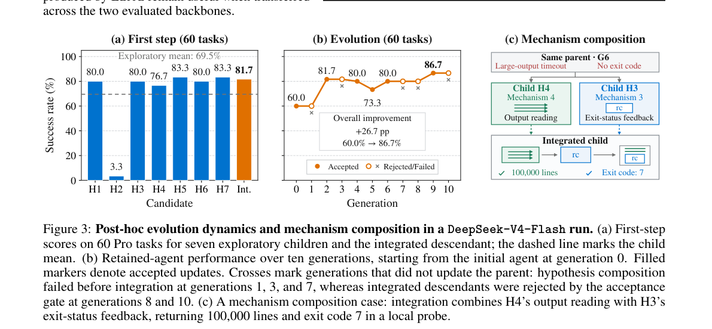
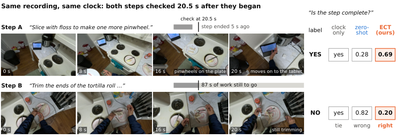
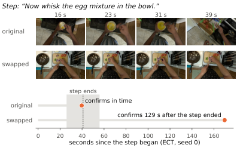

# HF Daily Papers 当日第二跑：11/26（nov26b）

> **类型**：当日第二跑（17:41 UTC，systemd `digest-hf-pm` 按时刻触发），同日首份是 [[2026-11-26-hf-daily-papers-nov25-26]]（07:57）。
> **读取时刻**：11-26 17:42 UTC，快照 `~/fetch-cache/hf46/`；基线是 `~/fetch-cache/hf45/`（mtime 07:58）。

## Context

### 桶读数（id 集合差，出现与消失分开报）

| 桶 | 07:58 | 17:42 | 新出现 | 消失 |
|---|---|---|---|---|
| 11-24 | 73 | 73 | 0 | 0 |
| 11-25 | 59 | 59 | 0 | 0 |
| 11-26 | 35 | **55** | **20** | 0 |
| 11-27 | — | 错误对象（`date must be ≤ 2026-11-26`） | — | — |

窗口（11-24 ~ 11-26 三个桶）唯一 **187** 篇。

### 抓取前写下的预测，以及它错在哪

预测写在 `hf46/_prediction.txt`，时间早于抓取：

> 11-26 是美国感恩节，arXiv 周四晚没有 mailing ⟹ 07:58 → 17:42 之间不会有新公告批次落进来 ⟹ **A 点估计 6，区间 [1,18]**；消失 0–2。
> 怎样算错：**A > 18 ⟹ HF 策展会把论文加进当日桶，而且不依赖 arXiv 批次（我的「假日」模型是错的）**。

**实测 A = 20 ⟹ 预测被证伪**，按我事先写好的那条判据，结论是 HF 策展加论文不依赖 arXiv 批次。这 20 篇的 arXiv 日期也印证这一点：**11-25 ×9、11-24 ×5、11-23 ×3、11-20 ×1、11-16 ×2**。都是此前已经公告过的论文，今天被策展进 11-26 桶，没有一篇来自新批次。

- ⭐ 这说明我昨天那句（「11-26 早上落进来的是 11-25 美东晚的公告批次」）只解释了**早上**那 35 篇。白天的 20 篇是另一种机制：**事后策展，可以回溯到 10 天前**（11-16 的两篇在 arXiv 上挂了 10 天才进桶）。
- ⟹ 当日桶的白天增量至少有两个来源（公告批次、事后策展），而我目前只给前一个建了模型。⚠️ n=1，不改通则。
- 消失 0，落在预测区间里。

### 🚨 昨天记的「消失」其实是挪桶

`2611.31237`（Integral，KAIST AI）昨天 09:43 在 11-24 桶里，17:42 不在，我在 [[2026-11-25-hf-daily-papers-nov25b]] 把它记成「离开 11-24 桶」，并有意在正文引用了它。⚠️ 今早 07:58 它四个桶（11-23~26）都不在；**17:42 它出现在 11-26 桶，16▲**（arXiv 日期 11-23）。

- ⟹ 正确的记法是：**它从 11-24 桶移出，至少约 24 小时不在任何已查的桶里，之后重新进了 11-26 桶**。昨天记的「消失」只看了三个桶，读数本身没错，但我没法区分「被删」和「被挪」，而事实是后者。
- ⟹ ⭐ 判据要收窄：**某个 id 从某个桶「消失」，只能说明它不在我查过的那些桶里；要判它被移除，至少要跨几天的桶持续查不到**。这和 09-15 那条（Realtime-Venus）记法相同，但那次也没做后续追踪，所以「被删」与「被挪」我至今都没法区分。
- 昨天那份不改（它在当时的读取时刻是对的）。

### 去重两个口径

- **A = 20**（17:42 在窗口里、07:58 不在三个桶里）
- **B = 117**（窗口里没被最近 8 份 digest 引用过的）
- **B − A = 98**：昨天两份和今早那份对 11-24~26 三个桶的未引用残留（今早窗口 193 篇、引 41 篇）。
- **A ∖ B = 1**，就是 `2611.31237`（昨天已引用）。
- `A ≠ B` 的成因：窗口与今早那份**完全重叠**（同样三个桶），所以 B 里大头是今早那份没有逐条引用的残留，不是「桶不重叠」。

### 选文

A 全部 20 篇（含 31237），全部列出、全部入库。B−A 那 98 篇今天不再追：它们今早已经抓到、我当时决定不逐条写。

### 项目聚合

- `2611.34756`（CARE-OPD）与 `2611.34777`（SPLICE）有 4 位作者重叠（Haowen Hou / Yicheng Liu / Zhen Huang / Jiaqi Wang，上海交大）⟹ 算**一个**组的两篇。
- 其余 18 篇作者零交集。
- 下面「长程 agent RL」那一节按 1 个单位计。

## 论文总览（读取时刻 11-26 17:42；▲ 取自本次快照；全部 20 篇都是 A）

| # | arXiv | 标题 | ▲ | 桶 | arXiv 日期 |
|---|---|---|---|---|---|
| 1 | [2611.31237](https://huggingface.co/papers/2611.31237) | Let Vision-Language Models Generate Images through Their Representations | 16 | 11-26 | 11-23 |
| 2 | [2611.34147](https://huggingface.co/papers/2611.34147) | Letting Models Manage Their Own Context: Where We Stand | 6 | 11-26 | 11-25 |
| 3 | [2611.28244](https://huggingface.co/papers/2611.28244) | Demystifying the Autoresearch Harness: How Context and Skills Shape Self-Evolving Agents | 5 | 11-26 | 11-20 |
| 4 | [2611.28732](https://huggingface.co/papers/2611.28732) | Entangle: Scaling Human-Video In-Context World-Action Models across Unseen Tasks and Contexts | 3 | 11-26 | 11-25 |
| 5 | [2611.21056](https://huggingface.co/papers/2611.21056) | Evaluation-Free Recursive Self-Improvement for Coding Agents | 3 | 11-26 | 11-16 |
| 6 | [2611.33307](https://huggingface.co/papers/2611.33307) | Lost in Translation, Not in Confidence: Benchmarking and Calibrating Multilingual Decision Models | 3 | 11-26 | 11-24 |
| 7 | [2611.34079](https://huggingface.co/papers/2611.34079) | WorldBridge: Bridging Scattered Views for Coherent 3D World Generation | 2 | 11-26 | 11-25 |
| 8 | [2611.21155](https://huggingface.co/papers/2611.21155) | Edit Recommendation: Can LLMs Anticipate Edit Requests from Users, and When? | 2 | 11-26 | 11-16 |
| 9 | [2611.33579](https://huggingface.co/papers/2611.33579) | DexEngine: Scaling Human Demonstrations into Physically Executable Whole-Robot Data | 2 | 11-26 | 11-25 |
| 10 | [2611.34671](https://huggingface.co/papers/2611.34671) | DemoFoundry: Toward Scalable Photorealistic Robot Data with Coding Agents and Generative Rendering | 2 | 11-26 | 11-25 |
| 11 | [2611.30895](https://huggingface.co/papers/2611.30895) | Speak When You See It: Proactive Task Assistants Should Wait for Evidence, Not the Clock | 2 | 11-26 | 11-23 |
| 12 | [2611.34363](https://huggingface.co/papers/2611.34363) | Single-Database Rewards Are Hackable: Counterfactual Execution for Trustworthy Text-to-SQL RL | 1 | 11-26 | 11-25 |
| 13 | [2611.33093](https://huggingface.co/papers/2611.33093) | AIChipBench: Benchmarking LLM Agents for Automated AI Accelerator Design | 1 | 11-26 | 11-24 |
| 14 | [2611.30334](https://huggingface.co/papers/2611.30334) | When Does Reasoning Help Entity Disambiguation? Small LLMs In-Domain and Under Shift | 1 | 11-26 | 11-23 |
| 15 | [2611.32938](https://huggingface.co/papers/2611.32938) | Efficient Video Retrieval Augmented Generation via Token Allocation | 1 | 11-26 | 11-24 |
| 16 | [2611.34777](https://huggingface.co/papers/2611.34777) | When Every Rollout Fails: Splicing Learner-Conditioned Options into Long-Horizon Agent RL | 1 | 11-26 | 11-25 |
| 17 | [2611.34756](https://huggingface.co/papers/2611.34756) | Collect for Coverage, Replay with Evidence: Adaptive and Efficient On-Policy Distillation for Long-Horizon Agents | 1 | 11-26 | 11-25 |
| 18 | [2611.34939](https://huggingface.co/papers/2611.34939) | A Mesh for Every Moment | 1 | 11-26 | 11-25 |
| 19 | [2611.32335](https://huggingface.co/papers/2611.32335) | GOLD-SLAM: Gaussian-splatting Omnidirectional LiDAR-Depth SLAM | 0 | 11-26 | 11-24 |
| 20 | [2611.32786](https://huggingface.co/papers/2611.32786) | Simulator-as-Proxy World Model for Robot Manipulation | 0 | 11-26 | 11-24 |

## Deep Dive 1：Evaluation-Free Recursive Self-Improvement for Coding Agents（ELITE，3▲）

> [2611.21056](https://huggingface.co/papers/2611.21056)，吉林大学 / KAUST 等。HF `.md` 拿到 131,561 字节真内容（不是 52,630 外壳），表 2 与图 3 从 PDF 第 7 页渲染。

**问题**：DGM、HGM 这类自改代码的 agent 都是 *evaluate-and-select*：每一代在下游任务上跑候选 agent，按分数决定谁继续演化。两个代价：①评测贵（DGM 约 810 次任务评测）②对同一个评测分布反复优化，会适配那个基准。论文问的是：**演化循环里完全不看下游任务结果，还能自我改进吗？**

**机制（Explore-then-Integrate）**：每一代
1. 从当前 agent 的**运行时源码**里找具体缺陷，生成 K=7 个聚焦的改进假设；
2. 每个假设从**同一个父代**独立实现成一个可执行的子代；
3. 读这 7 份程序，判断哪些机制互补、冗余、冲突，**把相容的一组重新实现成一个后代**；
4. 后代只过确定性的结构与运行有效性检查（能不能跑、接口对不对），**不看任何任务分数或任务轨迹**。



### 数字

| 设定（DeepSeek-V4-Flash，SWE-bench Pro 60 题子集） | Pro | 任务评测次数 | 墙钟 | 成本 |
|---|---|---|---|---|
| 初始 agent | 60.0% | — | — | — |
| DGM | 86.7% | 810 | 43.15 h | $45 |
| HGM | 88.3% | 800 | 15.66 h | $30 |
| **ELITE** | **85.6%**（三次运行均值） | **0** | **4.90 h** | **$8** |

迁移（不再演化）：ELITE 在 SWE-bench Verified 平均 **73.3%**、Polyglot **69.3%**。

### 我认为最有信息的三处

1. **⭐⭐⭐ 「按评测选」在源任务上赢、在迁移上输**（表 4 消融）：*Evaluation-based Select-one*（同样 7 个子代，按 Pro 分数挑一个）**Pro 91.7% > ELITE 85.6%**，但 **Verified 70.0% < 73.3%、Polyglot 62.0% < 69.3%**。这是「对一个固定度量做优化会把它打坏」那条主线又一个干净的 2×2：源任务上的增益与迁移上的损失同时出现，而且方向相反。⚠️ 论文自己注明「the selection comparisons are limited to single runs」，而 60/50/50 题的子集上，1 题就是 1.7–2.0pp。
2. **⭐⭐⭐ 这是我追「RSI 第二圈」以来又一份报了多代轨迹的材料，而且报了回退**：十代里 5 次被接受，事后测的分数 60.0 → 81.7（第一次接受）→ 86.7，**中间有两次回退**。作者的解读很克制：闸门只保证结构与运行有效，不保证下游变好，所以轨迹不单调是预期之内的。⟹ 和 False Frontiers（11-25）的「第 3 轮开始变坏」放在一起，现在两份多轮数据都说**第二圈之后不是平稳上升**。
3. **⭐⭐ 「不看分数」并不等于「不需要验证」，它只是把验证换成了读程序**：第一步七个子代事后分数是 76.7–83.3%，**还有一个掉到 3.3%**；整合后代 81.7%，超过其中 5 个、低于最好的 83.3%。⟹ 「整合」靠的是读代码判断机制是否相容，**它躲开了那个 3.3% 的坏子代，但也没拿到最好的那个**。这正落在「识别 / 保留 / 翻译」三分解的「识别」那一步上，只是识别的依据从分数换成了程序结构。41 个合格提案里有 25 个的主要机制被整合进来。

### 保留

- 只评了 60/50/50 题子集，DGM / HGM 在 Qwen 上各只跑一次；作者 Limitations 写了「limited repetitions」。
- **单一谱系**（作者自陈，未来要加历史 agent 档案）。⭐ 这与 DarwinX 的结论（保留多样档案比贪心跟随分数更能迁移）方向一致：ELITE 用「同父多子 + 整合」在一代之内拿到了多样性，但跨代没有。
- 「0 次评测」只针对**候选**评测，最后那组迁移数字本身仍是评测；成本表的 DGM / HGM 数字来自原论文的运行（作者注明）。

## Deep Dive 2：Speak When You See It（video-blind frontier，2▲）

> [2611.30895](https://huggingface.co/papers/2611.30895)，单作者 Bohe Chen。HF `.md` 151,121 字节真内容；两张图都是 arXiv HTML 里的原图（`src` 已含 `2611.30895v1/` 前缀，没有再拼版本号）。

**一个不看视频的计时器，在主动式任务指导基准上超过所有已发表结果**：规则是每一步开始后 25 秒报一次错、30 秒确认完成。在 Ego-MC-Bench 上它的 mistake F1 是 **0.373**，**已发表结果最高 0.27**；两个延时改成在 QICD 验证集上选，仍有 0.361。



### 机制：计时器为什么能得分

- 单看一次检查，elapsed time 对答案几乎没有预测力（QICD 测试集上 **AUROC ≈ 0.52**）。
- 计时器能得分是因为**协议是顺序的**：第一次「确认完成」会结束这一步，并在 ±15 秒内都算对，所以规则只要选好「什么时候说」就够了。⟹ 失效不在模型上，在**评分协议的结构**上。
- 作者把它形式化成 **video-blind frontier**：只用已过时间、步骤序号、指令文本和训练集统计量，能达到的「完成准确率 × mistake F1」最优权衡。**Ego-MC-Bench 上每一个已发表结果、QICD 上跑的 12 个零样本模型，全部落在这条边界以内。**
- 处方：**报结果时同时报相对这条边界的 margin Δ。**

### ECT（Evidence-Contrastive Training）

- 直接在协议自己的检查上微调，并且**正样本配一个同一段录像、同一已过时间的负样本**，这样时间就区分不了两边。
- Qwen3-VL-2B + LoRA r64，209 段视频，约 15 GPU 小时，单张 A100。
- 结果：**四个种子在两个基准上全部越过边界**；在测试集的留出一半上越过的概率 QICD 0.87–0.97、Ego-MC-Bench 0.99–1.00。

| 训练（Qwen3-VL-2B） | QICD IC-Acc | QICD F1 | QICD Δ | Ego IC-Acc | Ego F1 | Ego Δ |
|---|---|---|---|---|---|---|
| 普通微调 | 52.1 | 0.000 | 0.000 | 60.2 | 0.000 | 0.000 |
| 无配对负样本 | 26.5 | 0.256 | **−0.066** | 48.3 | 0.337 | +0.139 |
| **ECT（4 seeds）** | 40.8 | 0.247 | **+0.036** | 59.0 | 0.246 | **+0.229** |

⭐ 第一行值得单独看：普通微调**完成准确率最高（52.1）而 mistake F1 为 0**，即它学会了只确认、从不报错。只看 IC-Acc，它是最好的一行。

### 换视频测试（把被测量的那个东西拿掉）

保持指令、步骤边界和时间不变，**把视频换成同一菜谱的另一段录像**。一个跟着时钟走的模型不会察觉。seed 0：**完成准确率 41.2 → 13.4，mistake F1 0.217 → 0.094**。



⟹ ⭐⭐⭐ 这和 09-15 记的 ModaLens（把放射学图像换成另一份 study 的图、测答案改变率）是**同一个反事实探针**，换了一个领域：**把某个证据源换成另一个案例的同类证据、固定其余一切、看输出变不变**。

### 我的读法

1. **⭐⭐⭐「分数测的不是你以为的东西」又多一个实例，而且最干净**：今早那份记了 OWE-Bench、镜子测试、「世界模型几乎不比复制首帧好」，这篇给了一个**无参数的零基线**，而且它打败了全部已发表方法。⟹ 处方可以搬到任何 agent 基准：**先造一个不看被测证据的基线（只看时间 / 步数 / 先验），报 margin 而不是报绝对分。**
2. **⭐⭐ 这条和 AIChipBench（下文）是同一种失效的两个领域**：一个是「时机对了，分数就有了」，另一个是「当前 token 对了，测试就过了，而状态几步之后才坏」。共同点是**评分协议只看一个比被测能力更浅的量**。
3. ⚠️ 作者自己在 Limitations 里打了折：①如果盲策略还能看到同一录像前面几步的时长（协议会透露这个信息），QICD 上的 margin 会降到 −0.028~+0.029；②**ECT 改善的是「什么时候说」多于「抓到多少错」**，mistake recall 仍低（Ego-MC-Bench 0.18）。另外只覆盖烹饪、两个基准，Ego-MC-Bench 是迁移评测。

## 分主题（其余 18 篇，⚠️ 只读了摘要）

### Context 与 harness：模型自己管上下文

- **[Letting Models Manage Their Own Context: Where We Stand](https://huggingface.co/papers/2611.34147)**（6▲，NVIDIA）：把 compaction 的决定权交给模型（通过 context API），在 NVIDIA 开源 harness 里跟「harness 窗口满了就自动压缩」比，预算从 8K 到 512K。**GPT 6.1 在 OfficeQA Pro v2、32K 预算下 21% → 56%**；Kimi 少用最多 41% 输入 token。⚠️ 但**模型之间差异很大**：多久用一次 API、压得多狠、什么时候开始压，都不一样，而且改 prompt 会挪动时机。另外推理引擎复用编辑后不变后缀的 KV cache，每个请求 prefill 最多省 15%。⟹ ⭐⭐ 这是 Latent Space 那条预测（compaction 正被吸收进模型）的一个受控测量；而 [[2026-08-27-hf-daily-papers-aug26-27]] 的 When "Must" Becomes "Maybe" 测出正常压缩会让约束 100% 失活。**模型自己压的时候，那四个约束字段谁来保**，这篇没测。
- **[Demystifying the Autoresearch Harness](https://huggingface.co/papers/2611.28244)**（5▲，HKUST）：把 harness 拆成 context 管理与 skill 管理两轴，各自对 recency-truncation 基线做消融（MLE-Bench + KernelBench × gpt-oss-120b / gpt-6-luna / gpt-6-sol）。**保留可单独访问的历史记录优于滚动摘要，context folding 六个设定全最好、最多 +19.2%**；**定期丢掉一直没用上的技能，平均优于合并**。⟹ ⭐⭐ 和 StateM 的「experience must be filtered before it becomes memory」、Demystifying Agent Skills 的「池子变大后执行期使用精度崩塌」是同一个方向：**删比合并好**。⚠️ KernelBench 正是 Gaming Without an Attacker 测出 30% 不可迁移的那个任务域。

### 评测有效性：评分协议只看一个比能力更浅的量

- **[AIChipBench](https://huggingface.co/papers/2611.33093)**（1▲）：让 agent 写量化 Qwen3.5 / Gemma 3/4 / Llama 3.2 解码器的可综合 RTL。**难点在跨解码步保存的状态**：状态更新写错了，当前 token 可能还是对的，几个 token 之后才坏，所以**设计可以通过输出测试但仍然是错的**。⭐⭐ 「反馈指向第一个状态不一致」相对「只给输出反馈」，在 12 个 agent×任务格里**全部**提升接受率，+25.0~46.9pp，每个被接受设计的 agent 工时减半。🚨 **69 个被接受的设计，用新序列与新条件重测，45 个在其测试覆盖的 32 步之内就失败。** ⟹ 与 SWE-Gym（今早）的「拒绝正确修复的测试」方向相反、性质相同：**测试的覆盖范围决定了「通过」意味着什么。**
- **[Single-Database Rewards Are Hackable](https://huggingface.co/papers/2611.34363)**（1▲）：text-to-SQL RL 的奖励只在一个数据库上比结果，错的查询可能碰巧匹配。加几份隐藏的、代码生成的反事实数据库，全部匹配才给分：**全额奖励给有 bug 查询的比例 29.5% → 16.8%，reward hack 54.1% → 1.9%，2,847 条正确查询一条没拒**。⭐⭐ 但 GRPO 对照里域内准确率没提升（8.4% vs 11.7%），因为两种奖励只在 5–7% 的 rollout 上分歧；Spider +1.6。⭐⭐⭐ 作者自己写了「**One seed reverses both signs, so single-seed reward comparisons mislead**」（每臂 3 个种子）。⟹ 「让度量留在优化压力之外」又一个便宜实现（隐藏的反事实副本），而它附带的方差警告和今天 ELITE 那条「1 题＝1.7pp」是同一回事。
- **[Lost in Translation, Not in Confidence](https://huggingface.co/papers/2611.33307)**（3▲，NTU）：25 个开放权重 decision model（给每个选项返回概率，供路由器与 guardrail 设阈值）× 17 任务 × 14 语言。**每个模型在每种语言上都掉准确率，从约 2 点到泰米尔语 8 点，而置信度只降一半 ⟹ 按英语设在 95% 准确率的阈值，在泰米尔语上只有 90%。** ⭐⭐⭐ 还有一条反直觉的：**同样的测试题，由 LLM 而不是人翻译时，在全部 23 个基准×语言对上答得更准 ⟹ LLM 翻译的测试集会低估差距。** ⟹ 直接接路由主线：**路由器和 guardrail 的阈值是按英语校准的**，而客户的流量不全是英语。
- **[Simulator-as-Proxy World Model](https://huggingface.co/papers/2611.32786)**（0▲，MBZUAI-IFM）：视频世界模型越来越多地以一个仿真代理为条件，默认「视频会显示代理显示的东西」。作者把这个假设做成可检验的：冻结仿真里的物体、让手臂照记录动，看视频还显不显示物体被举起。**手臂跟着代理走（IoU 0.75–0.78），但物体状态要靠仿真物体才跟得上**：相对只有机器人的代理，漏抓从 54% 降到 38%。⟹ 又一个「把条件里的某个东西拿掉/冻住，看输出跟不跟」的探针。
- **[Edit Recommendation](https://huggingface.co/papers/2611.21155)**（2▲，单作者，NTT）：能不能在用户提出修改请求之前就预测到？基于 WildChat-4.8M 建 EditRecBench；发现有些情形本质上不可预测，于是加一个 decision model 做闸门，把预测不太可能对的情形挡掉，**展示出来的建议 pass@5 提升 12–25 点**。⟹ 「知道何时不说」的一个产品形态，与 video-blind 那篇的「等证据再说」同一个方向。

### 长程 agent RL 与 OPD（同一组两篇，按 1 个单位计）

- **[SPLICE](https://huggingface.co/papers/2611.34777)**（1▲）：长程任务上 GRPO 常出现整组全失败、没有梯度。做法是在失败轨迹上选一个拼接点，由 proposal model 生成几个**有界**的选项，用当前策略的多次续写估值，再拟合正值选项。SWE-bench Verified 与 BrowseComp-Plus，两个策略家族四个设定，**比 GRPO 高 2.8–9.8pp**。⟹ ⭐⭐ 「只生成对强基线的有界修改」（DarwinX / SKILLER / AutoPrune）又一个实例，而且与 MInTRL（09-15）的「只把错误后缀换成简短修正」几乎同形，只是这次没有 judge。
- **[CARE-OPD](https://huggingface.co/papers/2611.34756)**（1▲）：长程 agent 的 prefix-replay OPD。两个发现：只用教师轨迹会漏掉学生自己走出来的历史，而覆盖更宽又会让教师更不可靠；固定按位置分配重放，抓不到可能出现在任意深度的关键决策。对策是学生播种的教师续写 + 置信门 + 按下游执行证据事后分配重放。⟹ 「教师在学生状态上不可靠」与 SMRC-SD 的状态错配是同一个问题。

### 具身数据与世界模型

- **[DexEngine](https://huggingface.co/papers/2611.33579)**（2▲，POSTECH）：把人手-物体演示变成可执行的整臂-手轨迹（够得着的放置 → 跟手的手臂运动 → 物理仿真里残差 RL 修正）。9 个数据集 × 4 种灵巧手，约 32.5 万 episode（578 h）。**同样的片段，不做物理修正或先修正浮动手再接手臂，训出来的策略都明显更差。**
- **[DemoFoundry](https://huggingface.co/papers/2611.34671)**（2▲）：coding agent 写交互程序、在物理仿真里跑出代理视频，再由视频渲染器转成写实观测；**自动的任务执行检查筛掉失败轨迹**。⟹ 「合成数据必须过一个不由生成器控制的检查」（TailBooster / Articulated Object）又一例，而这次生成器本身就是 coding agent。
- **[Entangle](https://huggingface.co/papers/2611.28732)**（3▲）：一段人类视频当上下文，生成未来视觉状态与可执行动作。⭐ 它点名的捷径值得记：**标准动作损失让策略靠初始场景或任务身份走捷径，而不跟踪上下文**，对策是同任务内的对比目标（与 ECT 的配对负样本同一个思路：让捷径分不开正负两边）。
- [WorldBridge](https://huggingface.co/papers/2611.34079)（2▲，NUS，低重叠散图生成一致 3D 世界）· [A Mesh for Every Moment](https://huggingface.co/papers/2611.34939)（1▲，多相机动态场景逐帧出网格）· [GOLD-SLAM](https://huggingface.co/papers/2611.32335)（0▲，全景 + LiDAR 的高斯泼溅 SLAM，PSNR +5.56–9.10 dB）。

### 其他

- **[Integral](https://huggingface.co/papers/2611.31237)**（16▲，KAIST AI，本窗口最高；就是上面那个「挪桶」的 id）：把预训练 VLM 改成统一的理解+生成模型，关键是给两种能力建一个共享视觉表示空间（Abstraction Fusion 聚合冻结视觉编码器的分层表示 + 只在 block 边界交互的轻量生成流 Block-wise MoT），保住理解能力。
- [Efficient Video RAG via Token Allocation](https://huggingface.co/papers/2611.32938)（1▲，UIUC）：把视频 RAG 写成共享预算下的 token 分配问题（water-filling，有收敛保证），**+7.2pp**；多轮下 TFLOPs 少 1.7–17.3×。⭐ 「每多一个 token 值多少」这个问法与 R³-Bench 的预算分配同族。
- [When Does Reasoning Help Entity Disambiguation?](https://huggingface.co/papers/2611.30334)（1▲，Telecom Paris）：小 LLM 上推理的收益随领域偏移增大，**域内可以忽略、真零样本时决定性**。⟹ 「推理值不值」要看分布偏移，与 CaRL 的「过度推理」是同一问题的另一端。

## 趋势

1. **⭐⭐⭐ 零基线 / 反事实探针成了一个工具类**：今天四篇各用一种「把被测证据拿掉」的办法：video-blind 的计时器、换视频；SimPWM 的冻结物体；反事实数据库；AIChipBench 的重测新序列。⟹ 加上 09-15 的 ModaLens，这类探针现在有五个独立实现。**它们都很便宜，而且都不依赖模型自述。**
2. **⭐⭐ 「按评测选」在源任务上赢、迁移上输，今天又有一个 2×2**（ELITE 的 Select-one 91.7 vs 85.6，迁移反过来）。
3. **⭐⭐ 多轮自我改进不单调**：ELITE 十代两次回退 + False Frontiers 第 3 轮变坏。⟹ 「RSI 第二圈」现在有数据了，而两份数据都说第二圈之后不是平稳上升。
4. **⭐ 删比合并好**（autoresearch harness 的技能管理、context folding 优于滚动摘要），与 StateM 同向。

## Open Questions

1. `2611.31237` 那 24 小时去了哪？若以后有 id 在桶间挪动，「消失」的读数就要等跨几天才能定性。**下次两跑之间要专门查一次 11-23~27 全部桶。**
2. ELITE 的「整合」能不能拿去做别的东西的演化（harness、技能库），只读程序、不评测？它躲开了 3.3% 的坏子代，但我不知道它在机制冲突更多的时候会不会也躲得开。
3. 模型自己做 compaction 时，绑定性约束字段（prerequisite / authority）的保持率是多少？NVIDIA 那篇的 OfficeQA 结果答不了这个。
4. decision model 的阈值在非英语上的漂移，在客户实际用的 guardrail 上有多大？

## References

全部 20 篇的 HF 链接见上方总览表。另引：[[2026-11-26-hf-daily-papers-nov25-26]] · [[2026-11-25-hf-daily-papers-nov25b]] · [[2026-08-27-hf-daily-papers-aug26-27]]。

## 落盘核验（照抄脚本输出）

```
① ids cited 20 not in window []   [checked 11-26 17:45 UTC vs snapshot ~/fetch-cache/hf46 (4 buckets, mtime 11-26 17:42–11-26 17:42 UTC)]
② References label↔title mismatches 3   （SPLICE / CARE-OPD / Integral：刻意用的方法名短 label）
③ figs referenced 3 unresolved [] unreferenced []
④ table rows 20 upvote mismatches []   [vs snapshot hf46, mtime 11-26 17:42 UTC]
⑤ 正文引用 20 个 id、不在 references.bib 里 0 []
```

入库 20/20（2680 → 2700，逐 id 后台跑，0 次 fallback）。⭐ `2611.31237` 昨天 ⑤ 报「不在 bib」，今天随 A 一起入库，该欠账结清。
