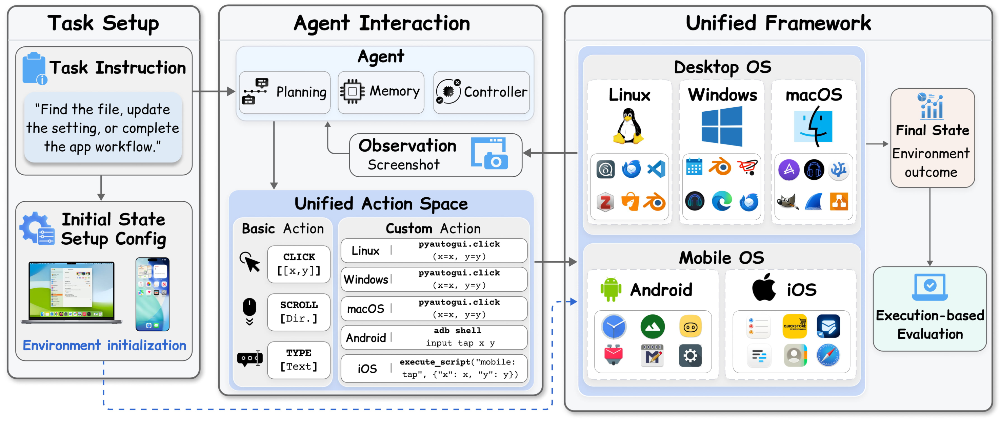
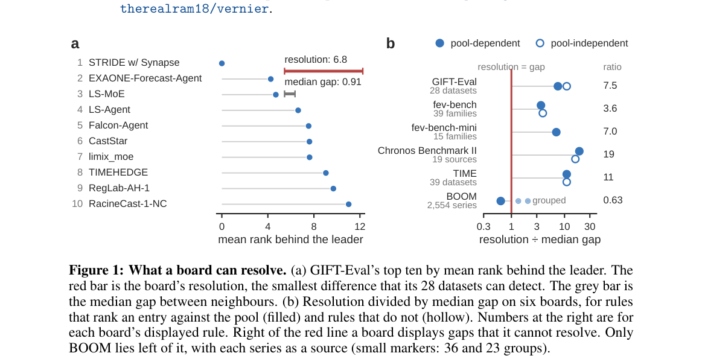

# HF Daily Papers：11/26 隔夜回填 + 11/27（nov26-27）

> **类型**：11-27 当日首跑（07:57 UTC，systemd `digest-hf-am` 触发）。上一份是 [[2026-11-26-hf-daily-papers-nov26b]]（11-26 17:42）。
> ⚠️ cron prompt 里写的「上一份是 09-15 `sep15d`、空缺十周」已过时：十周空缺在 11-25 补跑过了，此后 11-25、11-26 各两份。今天按 `date -u` 和 `runlog check` 判断：**这是正常日更，不是补跑**（`check` 报的 hf NO RUN 是 11-21~11-24，已被 11-25 那份覆盖）。
> **读取时刻**：11-27 07:57 UTC，快照 `~/fetch-cache/hf47/`（全部桶 mtime 07:57）；基线 `~/fetch-cache/hf46/`（11-26 17:42）。

## Context

### 桶读数（id 集合差，出现与消失分开报）

| 桶 | 11-26 17:42 | 11-27 07:57 | 新出现 | 消失 |
|---|---|---|---|---|
| 11-24 | 73 | 73 | 0 | 0 |
| 11-25 | 59 | 59 | 0 | 0 |
| 11-26 | 55 | **60** | 5 | 0 |
| 11-27 | 错误对象 | **16**（首读） | 16 | — |
| 11-28 | — | 错误对象（`date must be ≤ 2026-11-26`，而 11-27 照样取到了 16 篇） | — | — |

窗口取 11-25 / 11-26 / 11-27 三个桶，唯一 **135** 篇。11-24 桶只拿来追踪消失，不进窗口。

### 抓取前写下的预测（`hf47/_prediction.txt`，07:57:58 写，早于抓取）

| 量 | 预测 | 实测 | 结论 |
|---|---|---|---|
| 11-26 桶隔夜增量 | 点 4，[0,15] | **+5** | 落在区间内 |
| 11-27 桶首读 | 点 10，[0,35] | **16** | 落在区间内 |
| A 总数 | 点 14，[2,45] | **21** | 落在区间内 |
| 消失 | 0–2 | **0** | 落在区间内 |

预测的依据是两条：①感恩节（11-26 周四）arXiv 没有晚间 mailing，所以隔夜不会有新的公告批次；②昨天测到 HF 会把几天前已公告的论文事后策展进当日桶（9.7 小时 +20）。事先写好的证伪条件是「11-27 桶 > 35 ⟹ 隔夜其实有公告批次」。

实测四项都在区间内。⭐ 更直接的证据是 arXiv 日期：**11-27 桶 16 篇里 0 篇是 11-26 日期的**（11-25 ×9、11-23 ×4、11-24 ×2、11-21 ×1），11-26 桶隔夜进来的 5 篇是 11-22 ×2、11-20、11-23、11-16 各 1。⟹ 这 21 篇全部是已公告论文的事后策展，没有一篇来自新批次，和「假日无 mailing」一致。

- ⚠️ 区间很宽（11-27 桶 [0,35]），所以「落在区间内」只是没被证伪，不算强证据。真正有信息的是「0 篇 11-26 日期」这条，它是可以错的。
- ⚠️ n=1 个假日。下一个检验点是圣诞（12-25 周五）。
- 短窗口读数照记：11-26 桶 17:42 → 07:57（14.25h）+5。

### 去重两个口径

- **A = 21**（07:57 在 11-24~27 任一桶、而 17:42 不在 hf46 任一桶）。全部 21 篇都在窗口三个桶里。
- **B = 72**（窗口里没被最近 8 份 digest 引用过的）。
- **B − A = 51**：昨天两份对 11-25 / 11-26 两个桶的未引用残留（昨天 nov26b 窗口 187 篇、只引 20 篇）。
- **A ∖ B = 0**。
- `A ≠ B` 的成因：窗口和昨天两份有两个桶重叠，B 里大头是那两个桶的残留。不是「桶不重叠」那种情形。

### 选文

A 全部 21 篇列出、全部入库。B−A 那 51 篇昨天已经抓到、当时决定不逐条写，今天不追。

### 项目聚合

21 篇作者两两求交集：**零交集** ⟹ 21 个独立单位。下面凡说「N 篇」都是 N 个单位。

## 论文总览（读取时刻 11-27 07:57；▲ 取自本次快照；全部 21 篇都是 A）

| # | arXiv | 标题 | ▲ | 桶 | arXiv 日期 |
|---|---|---|---|---|---|
| 1 | [2611.34232](https://huggingface.co/papers/2611.34232) | OS-Omni: Benchmarking Generalist Computer-Using Agents on Long-Horizon Workflows Across Platforms | 81 | 11-27 | 11-25 |
| 2 | [2611.34051](https://huggingface.co/papers/2611.34051) | Stable Gated DeltaNet-2: Understanding and Mitigating Recurrent State Instability | 78 | 11-27 | 11-25 |
| 3 | [2611.34457](https://huggingface.co/papers/2611.34457) | ProxyGenBench: Benchmarking Proxy-Guided Video Generation | 35 | 11-27 | 11-25 |
| 4 | [2611.31619](https://huggingface.co/papers/2611.31619) | What a Forecasting Leaderboard Can Establish: Resolution Reporting for Zero-Shot Time-Series Models | 28 | 11-27 | 11-23 |
| 5 | [2611.34290](https://huggingface.co/papers/2611.34290) | StateWeaver: Multi-Agent Coordination of Story-State Transitions for Long-Horizon Video Generation | 21 | 11-27 | 11-25 |
| 6 | [2611.34693](https://huggingface.co/papers/2611.34693) | ShowNow: Fine-Grained Speculative Streaming for Responsive World Models | 18 | 11-27 | 11-25 |
| 7 | [2611.34852](https://huggingface.co/papers/2611.34852) | DRBench Pro: A Knowledge-Centric Benchmark for Professional Deep Research Agents | 15 | 11-27 | 11-25 |
| 8 | [2611.34813](https://huggingface.co/papers/2611.34813) | Solve Vision with Code: Coding Agents Are Stronger Visual Reasoners Than Video Models | 7 | 11-27 | 11-25 |
| 9 | [2611.32238](https://huggingface.co/papers/2611.32238) | Boundary-Aware Policy Learning for Agent-Orchestrated Robot Manipulation | 5 | 11-27 | 11-24 |
| 10 | [2611.30483](https://huggingface.co/papers/2611.30483) | When an AI agent makes a mistake in a database, what decides the damage? | 3 | 11-27 | 11-23 |
| 11 | [2611.28231](https://huggingface.co/papers/2611.28231) | Evaluating Memanto on DolphinBench for AI Agents | 3 | 11-26 | 11-20 |
| 12 | [2611.34719](https://huggingface.co/papers/2611.34719) | Reading, Not Adapting: Unlocking Frozen Visual Knowledge for AI-Generated Image Detection | 2 | 11-27 | 11-25 |
| 13 | [2611.34782](https://huggingface.co/papers/2611.34782) | Generation as Reverse Encoding | 1 | 11-27 | 11-25 |
| 14 | [2611.32993](https://huggingface.co/papers/2611.32993) | Decision-Native Multimodal Clinical Modeling via Anatomical Grounding and Confidence Calibration | 1 | 11-27 | 11-24 |
| 15 | [2611.29969](https://huggingface.co/papers/2611.29969) | CARE-3D: Reinforcement Learning for Evidence Grounded Agentic Reasoning in Situated 3D Scenes | 1 | 11-26 | 11-23 |
| 16 | [2611.28849](https://huggingface.co/papers/2611.28849) | Guarding with Judgment: Learning to Intervene for Multimodal Safety | 1 | 11-27 | 11-21 |
| 17 | [2611.20844](https://huggingface.co/papers/2611.20844) | DetourBench: Trajectory-Level Evaluation of Interactive Agents with Exact Minimum-Action Bounds | 1 | 11-26 | 11-16 |
| 18 | [2611.31491](https://huggingface.co/papers/2611.31491) | Pretrained Tabular Features and the Measurement of Financial Proximity | 0 | 11-27 | 11-23 |
| 19 | [2611.31155](https://huggingface.co/papers/2611.31155) | So Many Ways to Multiply 3times3 Matrices: A Large Dataset of Rank-23 Schemes | 0 | 11-27 | 11-23 |
| 20 | [2611.29829](https://huggingface.co/papers/2611.29829) | Who Makes the Decision? Auditing an Agentic LLM Pipeline for Illicit Cryptocurrency Transaction Monitoring | 0 | 11-26 | 11-22 |
| 21 | [2611.29259](https://huggingface.co/papers/2611.29259) | Look Back: Reinforcement Learning with Counterfactual World Models | 0 | 11-26 | 11-22 |

## Deep Dive 1：OS-Omni，六个平台、67 步的 computer-use 基准（81▲）

[2611.34232](https://huggingface.co/papers/2611.34232)，Touchstone AI 等。全文取自 HF `.md`（164,662 字节，是真内容，不是 52,630 字节的页面外壳）与 arXiv HTML。

**设定**：Windows / Ubuntu / macOS / iOS / Android / Web 六个平台各 48 题，另有 12 个「桌面 + Android 手机」跨平台工作流，v1 共 300 题，之后按 300 题一波滚动发版。每题有可复现初始化、平台适配器、轨迹日志、**执行式终态评估器**（解析办公文档、读应用数据库、查外部存储），另有一批自建的 service-backed 应用承载账户 / 购物车 / 预算 / 日历 / 消息这类持久状态。单平台任务步数上限之外每步限 180 秒，跨平台工作流 300–650 步、每步 120 秒。人类研究：**平均 67.54 步，OSWorld 是 15.0 步**。

### 主结果（Table 1，成功率 %）

| | Win | Linux | macOS | iOS | Android | Web | 跨平台 | Macro | Micro |
|---|---|---|---|---|---|---|---|---|---|
| 人类 | 78.4 | 74.6 | 79.8 | 75.2 | 72.6 | 76.9 | 83.3 | 77.3 | 76.5 |
| GPT-6-Astra | 66.7 | 89.6 | 50.0 | 33.3 | 77.1 | 87.5 | 58.3 | 66.1 | **67.0** |
| Claude Opus 5.5 | 62.5 | 85.4 | 54.2 | 41.7 | 81.3 | 70.8 | 83.3 | **68.5** | 66.7 |
| Gemini 4 Argon | 58.3 | **95.8** | 39.6 | 18.8 | 66.7 | 81.3 | 50.0 | 58.6 | 59.7 |
| DeepSeek V4.1 Flash | 22.9 | 62.5 | 16.7 | 12.5 | 41.7 | 22.9 | 33.3 | 30.4 | 30.0 |
| GLM-5.3-753B | 6.3 | 68.8 | 8.3 | 10.4 | 8.3 | 45.8 | 16.7 | 23.5 | 24.3 |
| Kimi K3 2.8T | 20.8 | 50.0 | 4.2 | 12.5 | 16.7 | 25.0 | 25.0 | 22.0 | 21.7 |
| Qwen 3.8 Max | 6.3 | 6.3 | 4.2 | 12.5 | 31.3 | 6.3 | 25.0 | 13.1 | 11.7 |
| Qwen 3.8 27B | 0.0 | 0.0 | 2.1 | 6.3 | 0.0 | 0.0 | 0.0 | 1.2 | 1.3 |
| Qwen 3.8 9B | 0 | 0 | 0 | 0 | 0 | 0 | 0 | 0.0 | 0.0 |

### 我读出来的四件事

1. **「谁第一」取决于聚合口径，论文自己说清了。** Macro（七列等权）Opus 5.5 第一 68.5；Micro（300 题等权）Astra 第一 67.0，差 1 题（201 vs 200）。翻转全部来自 12 题的跨平台列：Opus 10/12，Astra 7/12，而 Macro 把这 12 题和每个 48 题的平台列给了同样权重。⟹ 跨平台列每题值 8.3 个百分点，单题方差直接决定头名。这和今天 Deep Dive 2 讲的是同一件事：排名比数据能支持的分辨率更细。论文主动把两个口径都报出来、并解释翻转原因，这一点值得表扬。
2. **平台方差远大于模型间差距。** 人类在七列之间只跨 72.6–83.3，前沿模型在 Linux 上超过人类（Gemini 95.8 vs 人类 74.6），在 iOS 上低 33.5 分（最好的 41.7 vs 75.2）。同一个模型 Gemini 在 Linux 95.8、iOS 18.8，相差 77 分。⟹ 「某模型 computer-use 能力是 X%」不写平台等于没报，这是「收益极不均衡」在**评测**侧的形态（此前那几次 Evo-Bench / AI4AI / DarwinX 都在**增益**侧）。⚠️ 我的猜测是训练分布偏 Linux / 浏览器，论文没有给这个归因。
3. **失败分类里「Persistence」那一类值得抄。** 论文的错误类别表把「做了可见的编辑，但没保存 / 导出 / 发送 / 确认」单列一类，涉及办公套件、图像编辑、邮件、笔记、购物车。它和我从 SWE-Bench ProMax（核心文件改对，外围调用点漏了）、VibeLifeBench（主体做对，跨阶段的连接产物没形成）记的「主体做对了，连接组织漏了」是同一族。⭐ 也说明终态评估器比轨迹相似度评估更有分辨率：屏幕上看着做完了，状态里没有。
4. **开放权重与前沿差距大到需要先排除 harness。** GLM-5.3 在 Linux 68.8、Windows 6.3；Qwen 3.8 Max 总体 13.1，低于 Kimi K3 的 22.0；Qwen 3.8 27B 几乎为零。所有模型共用一套 PyAutoGUI 式离散动作 schema。⚠️ 按 A²E / ProMax 那条教训，开放模型这么低的分数里有多少是「这个动作接口和它们的训练分布不对齐」，这篇没做跨 harness 对照，我判断不了。⟹ 开放模型那几行应读作「在 OS-Omni 默认接口下」。

**保留**：⚠️ 没找到重复次数与区间（只见单个百分数）；每平台 48 题 ⟹ 单题 2.1 个百分点，跨平台 12 题 ⟹ 单题 8.3 个百分点，Macro 的头名差 2.4 分在这个粒度上不显著。⚠️ Touchstone AI 是基准方，不是被测方，这一点比厂商自测干净。

## Deep Dive 2：一个排行榜能确立什么——时间序列零样本榜单的「分辨率」（28▲）

[2611.31619](https://huggingface.co/papers/2611.31619)，Arya Sikder · Sriram Pillutla（两位作者、个人邮箱、workshop 论文）。全文取自 arXiv HTML（保留 `alttext`，数字密度 5.5%），配图从 PDF 第 1 页渲染。

**问题**：时间序列基础模型的证据是它在未见数据集上的分数，而独立公开数据集很少，比较全靠几个公开榜单。没有一个榜单说明它的数据集能检测出多小的差异。作者把这个量叫榜单的**分辨率**，做了一个工具 **Vernier**，只用榜单已公开的逐数据集分数就能算。

**方法**：把榜单当测量仪器。GIFT-Eval 的 97 个配置来自 28 个数据集，同一数据集的配置一起涨跌 ⟹ 独立证据只有 28 份。用 CR2（小簇修正的簇稳健估计）+ Satterthwaite 自由度做配对检验；一对的分辨率定义为「5% 检验、80% 功效能检测出的最小真实差」，即最小可检测效应；榜单分辨率取前十名相邻对的中位数。另做 wild cluster bootstrap 与精确符号翻转检验作复核。附录 A.2 验证了这个检验在 28 个数据集下守得住水平：假阳性率 5.2%，而百分位 bootstrap 是 6–10%。

### 六个榜单（Table 1）

| 榜单 | 条目 | 独立来源 | 分辨率 ÷ 相邻间隔 | 前十相邻对能分开的 | 未重跑却翻转的前十对（依赖池的规则） |
|---|---|---|---|---|---|
| GIFT-Eval | 128 | 28 数据集 | **7.5** | 1/9 | 20（141 次更新） |
| fev-bench | 40 | 39 族 | 3.6 | 0/9 | 2（30 次） |
| fev-bench-mini | 40 | 15 族 | 7.0 | 1/9 | — |
| Chronos Benchmark II | 21 | 19 来源 | **19** | 0/9 | 8（11 次） |
| TIME | 43 | 39 数据集 | 11 | 0/9 | 13（44 次） |
| BOOM | 23 | 2,554 条序列 | **0.63** | **9/9** | — |

### 四个结论，每个都可以直接搬到 agent 评估

1. **GIFT-Eval 前十名的十个位置里不到两个可分辨的台阶。** 分辨率 6.8 个名次，相邻名次间隔中位 0.91。Holm 校正后**没有一对相邻名次能分开**。要把分辨率压到相邻间隔，需要约 **48 倍**的数据集。
2. **在分辨率以下，名次取决于还有谁提交。** 平均名次这种规则拿每个条目和整个池子比，新条目进来会挪动没人重跑过的条目。四个能回放历史的榜单里，依赖池的规则在 226 次更新里的 31 次翻转了 **43 对**没动过的前十名；09-07 那一周 GIFT-Eval 收到三个互不相关单位的提交，Falcon-Agent / CastStar / limix_moe 三者顺序完全倒过来。换成只用条目自己分数的规则（相对季节朴素基线的缩放误差几何平均），这种翻转按构造为 0。
3. **按「层」推荐会改变结论。** GIFT-Eval 前十全是 agentic 流水线（每条序列选或组合多个预测器），**十个里九个没声明复现代码**。按显示的规则，领先层只有 3 个条目；按不依赖池的规则，领先层有 17 个，其中包含带权重发布的 TimesFM-3。⟹ 「该用 agentic 流水线还是预训练模型」这个问题，榜单的证据根本定不下来。
4. **榜单不记录模型拿到多少历史，而这个设置会移动结果。** 70 个配置上把历史从参考值砍到 512 步，TimesFM-2.5 与 Toto 误差升 15.3%、Moirai-2.0 升 6.2%，Holm 校正后都显著，且在预先划出的确认集上复现。另一个未记录设置是采样：Toto 只取一个点预测时与榜单行差 5.5%，用参考 notebook 的 256 条样本中位数则复现到 0.02%。附录给了五项披露清单（历史长度 / 聚合规则 / 评估窗口 / 归一化 / 采样），并指出其中三项由 harness 决定、可以自动采集。

### 我的看法

- ⭐⭐⭐ **这是我那条「不报区间的代价」主线上最完整的一篇方法学正面样本**，因为它不只是报了区间，而是把「榜单能支持多细的排名」做成了一个可以对任何榜单一条命令跑出来的量。此前的零散证据（VibeLifeBench 的 within-task σ=10.0 而七模型全距 12 分；Agentic Transaction 的 63.9 ± 30.9；AIME 30 题一题翻转动 3 分）都是在说同一件事，这篇给了它一个名字和一个算法。
- ⭐⭐ **第 2 条「名次取决于还有谁提交」是我没有的失效类型。** 我记过的排名失真都来自被测对象自己（作弊、污染、harness），这一条来自**旁观者**：你什么都没做，排名因为别人提交而变了。agent 榜单普遍用的 Elo / 平均名次都依赖池，这条直接适用。
- ⭐⭐ **第 4 条是「报 agent 分数不写 harness 等于没报」的时间序列版本**，而它比我此前的版本多走一步：给出了具体该披露哪五个字段。我给秋艳那份交易 agent 评估提意见时缺的正是这种可执行清单。
- ⭐ 「独立证据的数目由来源数决定、不由配置数决定」这条，和 agent 基准里「同一仓库出很多题」完全同构：SWE-Bench ProMax 的 TypeScript 28 题只来自 2 个仓库，我当时判断语言间方差更像在反映对少数代码库的熟悉度。按这篇的口径，那 28 题的有效样本量接近 2。
- ⭐ 披露也规矩：Table 1 的脚注写明 GIFT-Eval 的 20 是按榜单精确 tie-break 算的、按平均并列名次算是 18；快照日期逐个写出。
- ⚠️ 保留：两位作者、无机构；对 agentic 流水线「九个没复现代码」是从榜单元数据读的，不等于代码不存在；我没跑 Vernier。

## 分主题

### 1. agent 闯了祸之后，是谁决定了损失、是谁做了决定（4 个单位）

- ⭐⭐⭐ **[When an AI agent makes a mistake in a database, what decides the damage?](https://huggingface.co/papers/2611.30483)**（3▲，LibreDB）—— 问题问得很准：agent 在生产库上犯错之后，损失由谁决定？**模型、库前面的守卫层、还是数据库引擎本身**。两层**预注册**设计：Layer A 是 22 个固定的典型错误由脚本施加（不涉及模型），4 个关系型引擎 × 5 种权限臂 × 2 种恢复臂 + 引擎原生恢复演练（792 格 / 874 次演练）；Layer B 是一个最小工具调用 agent 由 6 个 4B–12B 开放模型（另一个 35B MoE、约 3B 激活）驱动，在 PostgreSQL / MySQL / SQLite / ClickHouse / Cassandra / MongoDB / Valkey / Kafka / OpenSearch 九个引擎上做含隐患的任务（**9,468 次**），另补 MariaDB / Redis / Elasticsearch 2,916 次。核心结论：**开箱即用时，引擎之间差别不在「一个错误毁掉了什么」，而在「它让你撤销什么」**。⭐⭐ 报告纪律很少见：七个预注册假设里三个满足判据（其中 H2 与 H3 「很大程度上由臂的构造决定」、H4 只在原始度量下成立，作者自己这样说），四个不满足，其中 H5 无信息因为 agent 从来没找到那个凭据；事后分析 S1–S13 明说是探索性、未做多重比较校正；**并报出每一处偏离预注册及其时间**。
  - ⟹ ⭐⭐ 这接上 EvoUndo（09-03，约 33% 的能力提升通不过可恢复性验证）和 Runtime Contract（「数据库写入十分钟内可逆」由快照重放验证）：**可逆性是存储层的属性，不只是 agent 的属性**。对客户材料的直接含义是：评估「agent 能不能碰生产库」时，先问引擎的恢复路径，再问模型。
  - ⚠️ 被测模型全是小开放模型，前沿模型下的错误分布可能不同。
- ⭐⭐⭐ **[Who Makes the Decision? Auditing an Agentic LLM Pipeline for Illicit Cryptocurrency Transaction Monitoring](https://huggingface.co/papers/2611.29829)**（0▲）—— 反洗钱监测里那种「图检测器 + 规则 + RAG + LLM 裁判 + 写合规理由」的流水线，评估通常只看端到端准确率或理由质量，**两者都说明不了是哪个组件做的决定**。作者在 Elliptic++ 上做「决策来源归因」（逐案例的实际因果 + 干预式 Shapley + 上游风险分的中介分析）：**一个确定性的钱包分覆盖规则拿走约 94% 的标记功劳**；一个验证闸门撤销了 LLM 裁判自己的大部分标记，而那些标记落在合法交易上；单测裁判（76 个证据包 × 4 个骨干 × 2 个 prompt）发现它**跟着注入的风险分走**，上下文短到装不下系统提示时干脆不出判定，还会**引用不适用的监管条款，而基于子串的引用检查会放行**。⭐ 把分数藏起来也修不了，因为分数可见时收集的证据已经编码了它。结论那句可以直接引：**「LLM 的理由不应被读作是哪个组件标记了这笔交易的证据」**。
  - ⟹ ⭐⭐⭐ 这是「不能信自我报告」在金融合规里的版本，且多出一层：被不信的不是 agent 关于自己的陈述，而是**流水线里 LLM 写出的那段解释关于整个系统的陈述**。直接接 [[topics/agent/2026-08-10-ppt-review-agentic-trading-eval]] 与 MRM 那条线：独立验证要验证的是「决策来源」，不是「理由读起来合不合规」。
  - ⭐ 「子串引用检查会放行不适用条款」和 09-15 那条「检查器比被测对象更粗」是同一形态，落在合规场景。
- ⭐⭐ **[Guarding with Judgment: Learning to Intervene for Multimodal Safety](https://huggingface.co/papers/2611.28849)**（1▲，人大）—— 把守卫从二元拒答改成**四个动作：allow / warn / review / refuse**，区分「已确立的危险」与「仍需核实的条件」；守卫先分开写出「来源确立了什么 / 什么条件决定帮不帮 / 规则怎么适用」，再拿这三条对照原输入去预测动作。20,126 条训练审计 + JudiBench；对 4B 骨干 Macro-F1 +28pp 以上，MM-SafetyBench 攻击成功率 40.78% → 25.30%。⟹ ⭐ 「闸门的效用代价」那条线（`Safety for Whom?` 的 XSTest 2%→74%、EAL-Bench 授权用例 93.3%→53.8%）一个具体的对策形态：**多出一个「需要人复核」的中间动作，比在「放行 / 拒绝」之间调阈值更能同时压住两类错误**。⚠️ 论文报的是「delivered-answer score」，我没读到它怎么同时计入过度拒答。
- ⭐⭐ **[Boundary-Aware Policy Learning for Agent-Orchestrated Robot Manipulation](https://huggingface.co/papers/2611.32238)**（5▲）—— agent 调度视觉运动策略时，失败常发生在**交接那一刻**：策略只在一组有限的起始状态下可靠，agent 却在区域外调用它。作者叫这个区域 **handoff boundary**，先把它训宽、训清楚、用简单协议告诉 agent，再用成功的系统 rollout 自我改进把它往任务早期扩。RoboTwin 2.0 随机场景 98.4%，比最强基线高 26pp 以上，API 成本 −41.3%、时间 −37.5%。⟹ ⭐ 和 The Handoff Tax（08-31）是同一个「交接」问题在两个位置：那篇是模型之间换手继承轨迹，这篇是 agent 与策略之间交接控制权；两篇都说**交接界面本身是要设计的对象**。

### 2. 「最终分数」之外报什么（4 个单位，含 Deep Dive 2）

- ⭐⭐ **[DetourBench](https://huggingface.co/papers/2611.20844)**（1▲）—— 端点评分分不清「只取了决策需要的证据」和「把环境读了大半」，也分不清「没找到证据」和「差一步停下」。做法是把环境约束到最短路可精确计算：有限、部分可观测的转移系统，单位代价访问，穷举搜索给出全信息最小动作数 L₀ 与可重放见证；从可恢复的终态还能算精确剩余工作 R_T，**不可逆的错误承诺记为「没有有限剩余距离」而不是给一个数**。375 个回合（5 个模型 × 25 题 × 3 次）：成功率 58.7%–96.0%，而条件达成度 0.803–0.890 **给出的模型排序不同**。⟹ 「只报最终成功率等于没报」又一例，⭐ 而它给的那个维度（离最优路径多远）恰好是「失败比成功更耗资源」那条线能用的参照量。
- ⭐ **[DRBench Pro](https://huggingface.co/papers/2611.34852)**（15▲，浙大）—— 深度研究 agent 的评估把「覆盖了哪些研究方向、挖多深」当主目标：从 Wikipedia 建局部知识树，按子图生成查询与证据接地的 rubric，每条 rubric 对应树里一条关系；144 个案例 / 24 个领域 / 44,102 条 rubric，16 个 agent 最好的整体覆盖 57.04%，广度与深度各有长短。⭐ 自报 rubric 判定与人工标注高度一致、排名在测试过的度量配置下稳定 —— 对照 Deep Dive 2，正确的追问是「44,102 条 rubric 来自多少个独立知识树」。
- ⭐ **[ProxyGenBench](https://huggingface.co/papers/2611.34457)**（35▲，腾讯）—— 用 3D 粗模（blockout）引导视频生成，要求同时「保住结构 / 补全缺失并纠正粗模瑕疵 / 把文本图像音频绑到对的实体与事件上」。312 个案例 / 60 个场景，五个生成器用逐案例核验过的 checklist 评。⭐ 两个负面结论：**粗模越细，补全反而越差；结构贴合度高不保证绑定正确** ⟹ 又一个「一个维度好掩盖另一个维度坏」。
- ⭐⭐ **[Solve Vision with Code: Coding Agents Are Stronger Visual Reasoners Than Video Models](https://huggingface.co/papers/2611.34813)**（7▲，CMU）—— 「视频生成模型当视觉推理器」这个范式没和符号路线在同条件下比过。作者给同样的首帧与 prompt、同样的输出规格与**不改动的规则评估器**，让 coding agent 写程序渲染答案视频。VBVR-Pro-Bench 500 题：Codex + gpt-6-astra **0.923**、Claude Code + Fable 5.1 0.894、Gemini CLI + Gemini 3.1 Pro 0.893，各比最强视频模型高 0.22 以上；23 个开放模型里最好的 GLM-5 0.572。⟹ ⭐⭐ 这是 11-26 那份「零基线 / 反事实探针」的同族：**在同一个评估器下换一条完全不同的求解路线，看原范式的优势是否成立**。⭐ 它还区分了「depictive 程序（在图上导航、恢复可迁移方案）」与「propositional 程序（对硬编码值操作）」——后者就是 Gaming Without an Attacker 那种实例指纹的另一种说法，值得追它在 0.923 里占多少。

### 3. 长程 computer-use 与记忆（2 个单位，含 Deep Dive 1）

- ⭐⭐ **[Evaluating Memanto on DolphinBench for AI Agents](https://huggingface.co/papers/2611.28231)**（3▲，Moorcheh.ai）—— DolphinBench 测的是隐式记忆需求（「在团队频道发更新」要从历史推出是哪个频道再写进工具调用），600 个模拟职场任务。Memanto 在 Hermes harness + GPT-6-Luna、每对话最多 6 轮下完成 **503/600（83.83%）**，基准作者报告的最强配置 Mem0 + GPT-5.6-Luna、最多 60 轮是 424（70.67%）；总成本 10.86 vs 最便宜已报运行 61.48，中位延迟 15.32s。⭐⭐ 作者自己划清了口径：**评分用基准自己的裁判，但 agent 模型不同（Luna 6 vs 5.6），所以比的是整套系统** ⟹ 这 13 个百分点里有多少来自记忆系统、多少来自模型代际，这个对照分不开。⚠️ Memanto 是作者自家产品。

### 4. 架构与生成（4 个单位）

- ⭐⭐ **[Stable Gated DeltaNet-2](https://huggingface.co/papers/2611.34051)**（78▲，MemTensor）—— GDN-2 给擦除与写入加了独立的逐通道控制，但长上下文训练会崩。作者追到根因：**擦除时「读方向」与「修改方向」不对称，产生非正规（non-normal）的擦除算子，其方向增益跨 token 累积，即便没有新写入状态也会指数增长**。修法是对称擦除（保证非扩张传播）＋ 衰减调节的残差写入，并证明状态增长有 O(T) 上界、仍可分块并行。约 1.6B 模型：循环设定下 128K RULER 平均 +6.80，混合设定下九个下游平均 +0.62。⟹ ⭐⭐ 直接接 [[2026-08-12-topic-softmax-linearization-and-k3]]：那份专题里 Delta Rule 是「softmax 精确递归长得像 Delta Rule」的那一支，这篇说明给 Delta Rule 加表达力（独立擦写）会引入一个**稳定性**代价，而且根因是线性代数层面的（非正规算子的瞬态增长），不是调参问题。⚠️ 混合设定下只 +0.62，与 09-06 那篇「GDN 抗 4-bit 量化」合读：线性层在混合架构里的价值可能更多在效率与稳定，不在下游分数。
- ⭐ **[ShowNow](https://huggingface.co/papers/2611.34693)**（18▲，NUS Show Lab）—— 交互式世界模型的输入延迟问题：利用回放期间的空闲算力，**在输入到来前投机地准备 1–8 个动作条件下的未来**。单张 H100 上 5B 模型 480p 16fps 带 8 个预备未来；ViZDoom 输入到显示中位延迟 620 → 208 ms，重启空 tick 1.56% → 0.09%。⟹ 投机解码那条线的世界模型版本（猜下一个 token → 猜下一个动作）；⭐ 作者明说视觉保真与长程一致性上有权衡。
- ⭐ **[StateWeaver](https://huggingface.co/papers/2611.34290)**（21▲）—— 长视频生成的多 agent 流程：评审发现的状态差异被翻译成具体的视觉资产需求，确认过的结果和资产状态、故事时间、参考版本绑定，供后续镜头复用；按任务 / 片段 / 修复轮隔离执行上下文。⟹ 「让状态持久、让 agent 短命」在视频生成里的又一例，⭐ 而「确认过的结果才绑定进状态」与 StateM「experience must be filtered before it becomes memory」同一原则。
- **[Generation as Reverse Encoding](https://huggingface.co/papers/2611.34782)**（1▲）—— 用冻结编码器的中间表示做逐级生成目标（先深层语义、再浅层外观、再像素），共享 DiT 骨干；ImageNet 256 训练 5 个 epoch 即 1.96 FID（690M）/ 1.74（1.55B），每阶段单步采样 2.85 FID。

### 5. 其余（7 个单位）

- ⭐⭐ **[Pretrained Tabular Features and the Measurement of Financial Proximity](https://huggingface.co/papers/2611.31491)**（0▲，开普敦大学，单作者）—— 用四个表格基础模型的冻结表示当公司间「金融距离」，放进空间套利定价模型（S-APT，收益在关联公司之间溢出），美股 2011–2025；纳入广泛的 SEC 申报数据后，相对直接用同一批披露算距离的增益**一致为正**。⟹ ⭐ 把基础模型的内部表示当经济测量工具而非黑盒预测器，正对上受监管金融场景对可解释性的要求；可用于同业选择、风险归因、网络资产定价。⚠️ 仅摘要。
- ⭐ **[So Many Ways to Multiply 3×3 Matrices](https://huggingface.co/papers/2611.31155)**（0▲，单作者）—— 公开 62,029 个两两不等价的秩 23 方案（每个有独立的 rank pattern），远多于此前两个集合（17,376 个方案 / 387 种 pattern；15,316 / 568）。方法是梯度下降 + 交替最小二乘 + flip graph 搜索，系数为三元 / 整数 / 有理数。⟹ 「AI 做数学」线旁边的一个纯计算结果：产物本身可机械验证（逐个方案乘一遍即可），这正是那条线上我排序最高的一档。
- **[Look Back: RL with Counterfactual World Models](https://huggingface.co/papers/2611.29259)**（0▲，NYU）—— 不想象全新轨迹，而是在同一环境随机性下改换动作预测结果，用反事实回报作基线把动作效应与运气分开（REINFORCE Look Back，给出无偏与方差缩减条件）。⟹ 与 11-26 那份「反事实探针」同一工具类，这次用在信用分配上。
- **[CARE-3D](https://huggingface.co/papers/2611.29969)**（1▲，昆士兰大学）—— 3D 场景 agent 的 RL：用「返回证据的反事实归因」做证据敏感的信用分配，并用组覆盖采样保住少用工具的探索。⟹ 与 Calling Without Looking（08-13）同一问题：工具调了，证据有没有真的被用。
- **[Decision-Native Multimodal Clinical Modeling（Radev）](https://huggingface.co/papers/2611.32993)**（1▲，浙大）—— CT 决策：器官级特征按查询选取、单次前向直接出候选概率；**反事实校准训练**要求移除目标器官证据时置信度下降、移除无关器官时不该大降。⟹ 又一个「置信度应当对证据敏感」的训练目标，和 ModaLens 的换图审计是同一思路的训练侧。
- **[Reading, Not Adapting（ReMoT）](https://huggingface.co/papers/2611.34719)**（2▲，复旦）—— AI 生成图像检测：不微调骨干，在完全冻结的视觉基础模型上从 RGB 与小波两个视图读出知识，只有 3,074 个可训练参数，八组基准平均 91.2%。⟹ 「来源可检测性」视觉侧一条：不改骨干保住可迁移性，正对 RA-Bench（08-18）测出的「三类检测器家族都不能一致泛化」。⚠️ 仅摘要。

## 趋势

1. **「排名比数据能支持的分辨率更细」今天在两个领域、两个机制上同时出现。** OS-Omni 的头名随 Macro / Micro 口径翻转，翻转全来自 12 题的一列（单题 8.3pp）；Vernier 测出时间序列榜单的前十名不到两个可分辨台阶，且名次会因别人提交而倒过来。⟹ 共同的可操作结论：**报名次之前先报这个名次背后有多少份独立证据**（OS-Omni 是题数，Vernier 是数据源数）。
2. **「谁做了决定 / 谁决定了损失」被拆到组件层去测。** 加密交易监测的审计把约 94% 的标记功劳归到一个确定性规则、而不是 LLM 裁判；数据库那篇把损失归到引擎的恢复路径、而不是模型。⟹ 两篇都在否定同一个默认读法：**系统里 LLM 写出的解释或做出的动作，不等于系统决策的真实来源**。这是「不能信自我报告」从 agent 关于自己，推广到 LLM 关于整个流水线。
3. **交接界面成为设计对象**：机器人里的 handoff boundary、守卫里的「review」中间动作、视频生成里「确认过才绑定进状态」，都是在两个组件之间加一层明确的契约，而不是让一方猜另一方能做什么。
4. **方法学披露的质量本身在上升，至少在今天这批里。** 数据库那篇报出预注册的全部偏离与时间；Vernier 给出检验的假阳性率并按预先固定的规则划确认集；OS-Omni 主动解释两个口径的排名翻转；Memanto 自己说明「比的是整套系统」。⚠️ 按我 08-14 记过的那条自我怀疑：21 篇里我挑了方法学导向的去细读，这个印象带着我的采样偏好。

## Open Questions

1. OS-Omni 的开放模型那几行（GLM-5.3 Windows 6.3、Qwen 3.8 Max 13.1）有多少是动作接口不对齐？要看它们在另一个 harness 下的分数。
2. 拿 Vernier 的口径去算 agent 基准：SWE-Bench Pro / Terminal-Bench / OS-Omni 前十名各有几个可分辨台阶？Vernier 要求逐数据集分数，agent 榜单多数不公开逐题分数，这本身就是答案的一部分。
3. 依赖池的排名规则（Elo / 平均名次）在 agent arena 上的「旁观者翻转」频率是多少？Vernier 引了一篇在语言模型 arena 上量过的工作，我没读。
4. 加密监测那篇：确定性覆盖规则拿 94% 功劳时，LLM 裁判在端到端准确率上的贡献是正是负？若为负，现有「LLM 写合规理由」的方案该怎么向监管解释。
5. 「Solve Vision with Code」里 0.923 中 propositional 程序（硬编码值）占多少？那部分在换首帧后还成立吗？
6. 感恩节无 mailing 这个模型下一次可检验的是圣诞（12-25 周五）：预测 12-26 桶与 12-25 桶不会出现 12-25 日期的论文。

## References

全部 21 篇，HF 链接见上方总览表；均已入 `references/references.bib`（2700 → 2721，逐 id 后台跑，0 次 OpenAlex fallback）。

| arXiv | 标题 |
|---|---|
| [2611.34232](https://huggingface.co/papers/2611.34232) | OS-Omni |
| [2611.34051](https://huggingface.co/papers/2611.34051) | Stable Gated DeltaNet-2 |
| [2611.34457](https://huggingface.co/papers/2611.34457) | ProxyGenBench |
| [2611.31619](https://huggingface.co/papers/2611.31619) | What a Forecasting Leaderboard Can Establish |
| [2611.34290](https://huggingface.co/papers/2611.34290) | StateWeaver |
| [2611.34693](https://huggingface.co/papers/2611.34693) | ShowNow |
| [2611.34852](https://huggingface.co/papers/2611.34852) | DRBench Pro |
| [2611.34813](https://huggingface.co/papers/2611.34813) | Solve Vision with Code |
| [2611.32238](https://huggingface.co/papers/2611.32238) | Boundary-Aware Policy Learning |
| [2611.30483](https://huggingface.co/papers/2611.30483) | When an AI agent makes a mistake in a database |
| [2611.28231](https://huggingface.co/papers/2611.28231) | Evaluating Memanto on DolphinBench |
| [2611.34719](https://huggingface.co/papers/2611.34719) | Reading, Not Adapting |
| [2611.34782](https://huggingface.co/papers/2611.34782) | Generation as Reverse Encoding |
| [2611.32993](https://huggingface.co/papers/2611.32993) | Decision-Native Multimodal Clinical Modeling |
| [2611.29969](https://huggingface.co/papers/2611.29969) | CARE-3D |
| [2611.28849](https://huggingface.co/papers/2611.28849) | Guarding with Judgment |
| [2611.20844](https://huggingface.co/papers/2611.20844) | DetourBench |
| [2611.31491](https://huggingface.co/papers/2611.31491) | Pretrained Tabular Features and the Measurement of Financial Proximity |
| [2611.31155](https://huggingface.co/papers/2611.31155) | So Many Ways to Multiply 3×3 Matrices |
| [2611.29829](https://huggingface.co/papers/2611.29829) | Who Makes the Decision? |
| [2611.29259](https://huggingface.co/papers/2611.29259) | Look Back |
