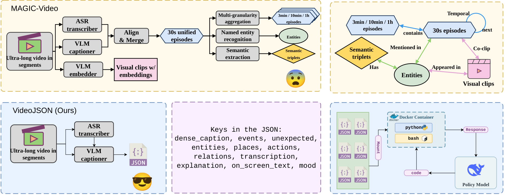
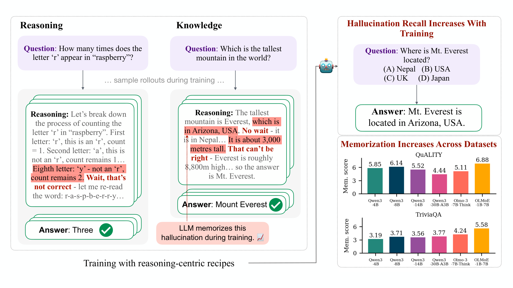

# HF Daily Papers：11/27 隔夜回填 + 11/28（nov27-28）

> **类型**：当日首跑（07:57 UTC，systemd `digest-hf-am` 触发，周六）。上一份是 [[2026-11-27-hf-daily-papers-nov27b]]（11-27 17:41）。⚠️ cron prompt 里「上一份是 09-15 的 sep15d、空缺十周」已过时，按 `date -u` 与 Previous 表判为正常日更。`runlog check` 报的 11-22~11-24 NO RUN 是十周空缺的尾巴，11-25 起已补齐，不再补跑。
> **读取时刻**：11-28 07:57 UTC，快照 `~/fetch-cache/hf49/`；基线 `~/fetch-cache/hf48/`（mtime 11-27 17:41）。

## Context

### 桶读数（id 集合差，出现与消失分开报）

| 桶 | 11-27 17:41 | 11-28 07:57 | 新出现 | 消失 |
|---|---|---|---|---|
| 11-24 | 73 | 73 | 0 | 0 |
| 11-25 | 59 | 59 | 0 | 0 |
| 11-26 | 60 | 60 | 0 | 0 |
| 11-27 | 20 | **22** | **2** | 0 |
| 11-28 | 错误对象 | `[]`（周六） | — | — |

窗口（11-24 ~ 11-28）唯一 **214** 篇。前三个桶与昨晚逐 id 相同 ⟹ 收敛。11-28 返回的是正常空数组，不是错误对象（日期上限提示又一次跟实际不一致）。

### 抓取前写下的预测

写在 `hf49/_prediction.txt`，和抓取在同一条命令里、位于 `curl` 之前（所以文件 mtime 与快照同为 07:57）：

> 11-27 桶点 24、区间 [20,40]；11-28（周六）点 0、区间 [0,10]；A 点 6、区间 [0,25]；消失 0–2。
> 怎样算错：A > 25，或周六桶 > 10。

**实测**：11-27 桶 22（区间内，点估计偏高 2）；11-28 桶 0；**A = 2**（区间内，点估计偏高）；消失 0。两条可证伪项都没被证伪。

- 2 篇新 id 的 arXiv 日期是 11-23、11-25 ⟹ 和前三次读数一样，隔夜增量来自对旧论文的事后策展，不是新的公告批次。感恩节周四次非首读的增量：+20（11-26 下午）· +5（11-26→27 隔夜）· +4（11-27 下午）· **+2（11-27→28 隔夜）**。
- 9.3 小时窗口、A=2，按规矩照记。点估计连续三次偏高，方向一致：我一直在用前一段的增量估下一段，而增量在衰减。

### 去重两个口径

- **A = 2**（07:57 在窗口里、17:41 不在任何一个桶里）
- **B = 88**（窗口里没被最近 8 份 digest 引用过的）
- **B − A = 86**：最近四份 digest 对 11-24~27 四个桶的未引用残留。
- **A ∖ B = 0**。
- `A ≠ B` 的成因：本窗口与昨晚那份几乎完全重叠（多出的 11-28 桶是空的），B 的大头是残留。不是「桶不重叠」也不是「上一份全量引用」。

### 选文与项目聚合

A 全部 2 篇 ＋ B−A 里按主线挑 16 篇（harness / 记忆 / 评测有效性 / 可验证推理 / 训练中的幻觉），共 **18 篇，全部入库**。B−A 剩下的 70 篇主要是 3D/视频生成与具身感知，今天不追。

作者列表两两比对：**18 篇零交集 ⟹ 18 个独立单位**。所以下面「harness 是记忆层」那条共振不是一个项目拆成几篇。

## 论文总览（读取时刻 11-28 07:57；▲ 取自本次快照）

| # | arXiv | 标题 | ▲ | 桶 | arXiv 日期 | 口径 |
|---|---|---|---|---|---|---|
| 1 | [2611.30025](https://huggingface.co/papers/2611.30025) | Damped Atomic Wave Integration Neurons (DAWIN): A Universal Primitive for Continuous-Time Spatiotemporal Learning | 1 | 11-27 | 11-23 | A |
| 2 | [2611.33885](https://huggingface.co/papers/2611.33885) | LayoutRecall: Preserving Appearance in Multi-Round 3D Layout-Controlled Image Editing | 3 | 11-27 | 11-25 | A |
| 3 | [2611.28167](https://huggingface.co/papers/2611.28167) | VideoJSON: A Minimal Harness Beats Purpose-Built Memory for Ultra-Long Video Understanding | 8 | 11-24 | 11-20 | B−A |
| 4 | [2611.26863](https://huggingface.co/papers/2611.26863) | LLMs Memorize Their Own Hallucinations During Post-Training | 6 | 11-24 | 11-19 | B−A |
| 5 | [2611.13730](https://huggingface.co/papers/2611.13730) | Deterministic, Reproducible Inference in Exact Integer Arithmetic, and Verifiable Distributed Inference as Its Consequence | 3 | 11-24 | 11-10 | B−A |
| 6 | [2611.27689](https://huggingface.co/papers/2611.27689) | Embodied-Harness: Towards Recursive Self-Improvement for Robotic Manipulation | 8 | 11-24 | 11-23 | B−A |
| 7 | [2611.31053](https://huggingface.co/papers/2611.31053) | ReWeave: Emergent Physical Task Topologies for Embodied Harness Optimization and Cross-Task Meta-Distillation | 3 | 11-24 | 11-23 | B−A |
| 8 | [2611.28227](https://huggingface.co/papers/2611.28227) | Feedback Shortcut: Speculative Decoding for Latent Feedback Transformers | 5 | 11-24 | 11-20 | B−A |
| 9 | [2611.30627](https://huggingface.co/papers/2611.30627) | From Rewarding What Models Say to How They Think: Attention Process Reward Model for LLM Reinforcement Learning | 5 | 11-24 | 11-23 | B−A |
| 10 | [2611.31595](https://huggingface.co/papers/2611.31595) | LUCID: Statistically Grounded Self-Correction for LLM Reasoning Evaluation | 3 | 11-24 | 11-23 | B−A |
| 11 | [2611.28158](https://huggingface.co/papers/2611.28158) | Measuring and Teaching Language Model Agents to Act on Delayed Consequences | 3 | 11-24 | 11-19 | B−A |
| 12 | [2611.23946](https://huggingface.co/papers/2611.23946) | How Complete Must an Environment Be to Train a Capable GUI Agent? | 3 | 11-24 | 11-18 | B−A |
| 13 | [2611.29150](https://huggingface.co/papers/2611.29150) | Can an Agent Trust Its Own Zoom? Cross-Magnification Provenance Verification for Whole-Slide Images | 4 | 11-25 | 11-22 | B−A |
| 14 | [2611.30488](https://huggingface.co/papers/2611.30488) | Do learned image captioning metrics generalize? Auditing duplicated samples in human-judgment benchmarks | 4 | 11-25 | 11-23 | B−A |
| 15 | [2611.30011](https://huggingface.co/papers/2611.30011) | MORSE: Optimizing Streaming Memory Design via Open-World Auto-Research | 4 | 11-24 | 11-23 | B−A |
| 16 | [2611.29590](https://huggingface.co/papers/2611.29590) | KernelShift: Benchmarking Kernel Optimization Across Evolving Hardware | 4 | 11-24 | 11-22 | B−A |
| 17 | [2611.34331](https://huggingface.co/papers/2611.34331) | Puzzling-Bench: Evaluating Language Models on 23,777 Human-Written Puzzles with Community-Verified Answers | 4 | 11-26 | 11-25 | B−A |
| 18 | [2611.31048](https://huggingface.co/papers/2611.31048) | Distill the Correction, Not the Rewrite: Hindsight Twins for Self-Improving Text-to-Image Models | 5 | 11-24 | 11-23 | B−A |

upvote 普遍很低（最高 8▲）：这是周六首跑、窗口全是前几天的残留，高赞的早已被前几份引走。

## 分主题

### 1. harness 是不是就是「记忆该怎么组织」——四篇各给一个答案

- **[VideoJSON](https://huggingface.co/papers/2611.28167)**（深读）：记忆越简单越好，搜索交给 coding agent 自己写程序。
- **[MORSE](https://huggingface.co/papers/2611.30011)**：流式视频在固定帧预算下要一次决定留什么。它的 harness 自改不只靠编辑器的先验，而是把训练轨迹里的失败**按原因聚类**，再去论文、model card、代码里搜可以搬来的方法或感知模型；选修订分两步：先在留出流上挑答得更好的，再在容差内挑更快的。OVO-Bench 上 Qwen3-VL-8B 平均 0.30 秒、75.1%，比同骨干次优 harness 高 3.1pp。
- **[Embodied-Harness](https://huggingface.co/papers/2611.27689)**：Actor 执行、Reflector 把执行证据转成可复用的操作指引，分层记忆，参数不动。RoboTwin 2.0 / RoboSPA / RMBench 82.4% / 76.7% / 94.4%，真机三任务 96.7%。⚠️ 摘要不给基线对比与重复次数。
- **[ReWeave](https://huggingface.co/papers/2611.31053)**：把 harness 和一个「从交互里长出来的物理任务拓扑」一起优化；拓扑被修订后把旧试验**重新投影**到新理解上，于是能在 159 次失败的开发试验里认出 89% 其实有保留进度。72 个专家单元合并成 44 组共享 harness；LIBERO-PRO 留出 89.00%→98.75%，RoboDojo 25.50%→58.25%；8 个未见任务共享 harness 51.3% vs 直接蒸馏 41.3%，持续学习后 75.0%。

⭐ ReWeave 那个「重新投影旧试验」值得记：它和我在 Evo-Bench 上记的「识别并留住改进」是同一个缺口，但它的做法是**换掉评判旧试验的那把尺子**，而不是重测。失败轨迹里有 89% 含保留进度，说明粗粒度的成败标签会把大部分有用信号判成 0。

### 2. 训练里的幻觉与过程奖励

- **[LLMs Memorize Their Own Hallucinations](https://huggingface.co/papers/2611.26863)**（深读）：结果奖励会把推理链里自己编的假事实一起奖励进权重。
- **[APRM](https://huggingface.co/papers/2611.30627)**：约 46M 参数的过程奖励模型，读 hidden state 与注意力图而不是文本轨迹，用排序与反事实目标训练、周期性更新以应对分布漂移；接到现有 RL 方法上 pass@8 平均 +2.88%。它指出的问题叫 **textual reward aliasing**（文本上一样好的轨迹内部推理可能完全不同）。⚠️ 用内部信号给奖励，就让监控信号直接进了优化回路——按 monitoring lifetime 那条，它作为监控器的寿命会被训练消耗掉，论文摘要没谈这一点。
- **[Hindsight Twins](https://huggingface.co/papers/2611.31048)**：文生图自蒸馏时，critic 改写的 prompt 往往重写整个场景，自教师把「修正」和「顺带加的灯光/布景」一起学了进去。HinT 把 critic 的修订模板填两次（一次填意图修正、一次填观察到的错误），只蒸馏两者的速度差，并对齐槽位外 token 状态。三个模型上 critic 引入的偏差保持在基模水平，12 轮自训练持续改进而对比基线衰退。⭐ 这是「只改该改的」第五个位置（梯度 / 代码编辑 / harness / RL rollout / **文生图自蒸馏**），机制同样是把修改量限制在错的那一格。

### 3. 评测本身可不可信

- **[Do learned image captioning metrics generalize?](https://huggingface.co/papers/2611.30488)**：像素级比对三个最新人类判断集，**Spica 训练集包含约三分之二的 Polaris 测试集，人类评分一模一样**。对 Pearl，重复样本带来的增益只出现在重复样本上，且每个 epoch 都在涨；Kendall τ 可拆成「找出人类评分最低的 caption」和「给其余排序」两项，前者贡献大部分相关性且几近饱和；三个学习型指标在新测试集上排不出一致顺序，冻结特征上做个岭回归就能追平。提出的协议：只用没见过测试样本训练的模型排名、两项分开报、配对检验。⭐ 和 LUCID 一起读：两篇都在说「评估器本身是学出来的，就要像模型一样查污染、报分项」。
- **[LUCID](https://huggingface.co/papers/2611.31595)**：便宜的 LLM 评分员给推理步骤打分有系统偏差。用一小份专家标注集把偏差总结成文字、提示评分员重评；GPT-5-mini 在 PRM800K 上过严，校准差距 7.8pp→0.9pp、误报减半、错误步骤检测 F1 +32%。⭐ 作者自己写清了边界：提示反馈移动的是阈值，**不提升类平衡的区分能力**，所以加了前后检查，对已校准的评分员跳过、无效的轮次回滚。再用 DSL（design-based supervised learning）做去偏回归。这是「裁判要被校准」少见的把「改了什么、没改什么」分开说的例子。
- **[Puzzling-Bench](https://huggingface.co/papers/2611.34331)**：Puzzling Stack Exchange 2014–2026 的 23,777 道题，带作者接受的答案、提示、标签、日期；有 254 题晚于 9 个模型里 6 个的训练截止作污染检查。三个裁判来自两个家族、95–97% 一致、移动任何模型不超过 1.6 分、无同族偏好。最好的 GPT-6.1 在共享 255 题上 74.8%；17 题全军覆没；模型失败**高度相关**，第二名在贪心集成里只贡献 1 题，但九个模型的 oracle 能到 91%；多模态试点里拿掉图片让前两名掉 24 / 35 分。⭐ 「失败高度相关」与我记过的「同质 agent 低方差 → 系统性失效」是同一件事在模型层。
- **[How Complete Must an Environment Be](https://huggingface.co/papers/2611.23946)**：把 GUI 训练环境拆成三维（奖励覆盖 / 数据覆盖 / 功能覆盖）分别调。**只奖励一条参考路径的验证器让成功率降 10.53 点**；删掉任务用不到的记录也降；删掉用不到的功能反而从 51.61% 升到 56.13%——⚠️ 但这个增益全部出现在**没被改动的那些任务**上，按每个 episode 等权就反转、只在被剪的任务上平衡就消失。作者追到原因：不剪时按长度加权会强化绕远路的成功，侵蚀其他任务的技能。⭐ 这是一个「看起来是环境改进，实际是加权方式的副作用」被作者自己拆穿的干净例子，结论里的 MobileGym-Lite（55.48% vs 51.61%）因此要读成「奖励与数据覆盖保持完整」才是承重条件。

### 4. 可验证与可复现的推理

- **[tritify：精确整数推理](https://huggingface.co/papers/2611.13730)**：整条运行时路径用精确整数算术（浮点只留在离线量化与验证用参照里）。三条主张分开验证：跨硬件逐位相同（输出 SHA-256 可复现）；决策与浮点参照一致（OLMoE-1B-7B 与一个 106B MoE 逐层 16 层无「保真悬崖」）；计算可拆到不同指令集、CPU/GPU、联网机器上而输出位不变——GLM-4.5-Air（427 GB 整数码）在三台各自放不下的机器上生成，和单机参照逐位相同。由此得到「可验证分布式推理」：不受信的服务器跑，开源标量 oracle 重算字节。⭐ 作者明确不声称：单设备加速、浮点中间值逐位相等、保密性、以及**对不诚实服务器的保证（列为未来工作）**。
  - ⭐⭐ 这直接接上 09-15 那篇「How Lossless Is Lossless Speculative Decoding」：那篇测出 BF16 下「无损」投机解码只有 45% 轨迹逐 token 相同、FP32 下 100%。我当时记的判据是「无损的第三层是『在你实际用的数值精度下逐 token 相同』，这一层是实现层的」。tritify 是从另一头处理同一个问题：干脆把运行时换成没有舍入歧义的算术，于是「复现」从统计问题变成字节比较。代价（速度）作者主动不报。
- **[Feedback Shortcut](https://huggingface.co/papers/2611.28227)**：把顶层 hidden state 回灌到下一位置输入的「latent feedback」Transformer 会破坏投机解码（验证草稿需要前一位置的真实顶层状态）。用一个从 MTP 头状态映射到替身的轻量投影 + 在后续草稿的验证 pass 里顺带用新算出的状态重评前一草稿（零额外调用）。135M / 780M 上与精确解码上限差 <10⁻⁴ bpb，解码 2.4–2.8×，训练算力 +2%。⚠️ 规模只到 780M。⭐ 这类架构正是监控失效栈第 6 项「不产生 token 的通道」的那一类；本篇让它在推理成本上不再吃亏，等于拆掉它普及的一个障碍。

### 5. agent 在时间轴上的失效

- **[SMB Bench](https://huggingface.co/papers/2611.28158)**：90 天批发模拟器、18 个因果配对任务、859 条前沿轨迹。**16 个前沿模型里只有 3 个跑赢一条固定采购规则**；模型常在笔记里写下正确诊断却没有及时改变后续采购 ⟹「诊断问题、改变行为、改善生意」是三个分开的成就。用 Qwen3.8-27B 训练后更稳定地履行客户保护承诺、减少严重亏损季度，但**利润收益仍不确定**，且履行承诺暴露了早期备货习惯的代价。⭐ 这是 11-25 那份记的「说的与做的脱节」（RLVB：照自己的 belief 行动）第四个实例，场景换成了经营，且作者把「识别延迟效应 / 一致地行动 / 协调周边决策」拆成三层分别测。对 [[topics/agent/2026-08-10-ppt-review-agentic-trading-eval]] 那份材料：「笔记里写对了」不能当成「策略会执行」的证据。
- **[KernelShift](https://huggingface.co/papers/2611.29590)**：99 个来自 ncnn / llama.cpp / Arm SIMD Loops / KleidiAI 的真实 kernel，按 Neon → SVE → SVE2 → SME2 逐代测。成熟扩展上 agent 全面胜过自动向量化（2.4–19.8×）、超过 ncnn（最多 2.74×），但只到 Arm 手调 KleidiAI 的 0.70×；两个 LLM 端到端 prefill 比 llama.cpp 快路径 1.3–1.6×；**SME2 矩阵 tile 这种陌生编程模型上还不能可靠适应**。⭐ 「按硬件代际排」等于把训练截止日之后的新东西做成了测试轴，与「只用截止日后数据防污染」同取向；而 Gaming Without an Attacker 正是在 GPU kernel 上测出 30% 胜利不可迁移，本篇是 CPU 侧且用的是真实仓库，该先问的仍是「胜出的 kernel 是否泛化到测试形状之外」——摘要没答。

### 6. 证据溯源

- **[Can an Agent Trust Its Own Zoom?](https://huggingface.co/papers/2611.29150)**：病理全切片上，agent 放大看到的图像不一定来自它声称的位置。形式化为跨倍率溯源验证（支持/恢复源位置/证据不足就弃权），基准 PyraFault 306 万例；验证器 ZoomTrace 先**独立于声称**估计观察的来源再比对，503,320 测试例 AUPRC 0.969 vs Efficient LoFTR 0.789。接进 agent 工具路径能减少被污染观察与静默失败，但下游准确率提升取决于 agent 与阈值。⭐ 「claim-independent verifier」就是硬/软证据那条承重墙（验证器不读被验证方的自述）在视觉坐标上的实现。

### 其余

- **[DAWIN](https://huggingface.co/papers/2611.30025)**（A）：把空间投影与按经过时间激发的阻尼波耦合成一个闭式演化的连续时间神经元，可替换 MLP/Transformer/GNN 层；11 个参数匹配任务里 9 个胜 Neural CDE；把时间间隔打乱让误差升 58–77% 而无关时间的对照只升 0.06%（⭐ 一个便宜的「模型是否真的用了时间」反事实探针）。⚠️「最高 2,630×」是对自己串行实现的加速，「显存 −97.6%」是相对 Mamba 且限定 tested configurations。
- **[LayoutRecall](https://huggingface.co/papers/2611.33885)**（A）：多轮 3D 布局编辑里把外观存进 3D 框表面的局部坐标、沿目标视角光线取回，配新基准 LayoutLoop。⭐ 又一个「把状态外置到几何索引的持久结构」的视觉侧实例。

## Deep Dive 1：VideoJSON —— 最小 harness 赢过专门搭的记忆图

**来源**：arXiv HTML（HF `.md` 端点返回 55,772 字节的 HF 页面外壳，⚠️ 与此前的判据常数 52,630 不同 ⟹ 外壳大小会变，判据应改成「看开头是不是 `<!doctype html>`」）。UBC / 台中教育大学 / UCSD。

*图 1（原文）：上半是 MAGIC-Video 的多阶段图数据库（多粒度 episode / 实体 / 语义三元组 / 视觉片段），下半是 VideoJSON：每分钟一条 JSON 记录，查询时 policy model 写 Python/Bash 在只读挂载记录的 Docker 容器里跑。*

**做法**：索引阶段 VLM（Qwen-3.8-Flash-Next，1 fps 帧 + ASR 转写）把每 60 秒视频变成一条 JSON，字段有 `dense_caption / events / entities / places / actions / relations / unexpected / transcription / on_screen_text / mood / explanation`。不建小时/天级层次，不建实体表。查询阶段只有两个工具：`exec`（跑程序、返回输出）和 `exec_qa`（跑程序、把输出交给另一个问答调用、只回答案），每题 30 次模型调用预算，默认无原始视频访问。

**主结果**（Table 1，EgoLifeQA 与 Ego-R1-Bench 用 A1_JAKE 子集）：

| 方法 | 模型 | EgoLifeQA | Week | Day | Month | Ego-R1 |
|---|---|---|---|---|---|---|
| MAGIC-Video（作者重跑） | Qwen-3.5-Flash | 68.6 | 26.25 | – | – | 64.0 |
| GEB（并发工作，转引） | Qwen-3.5-Flash | 72.0 | 36.83 | 17.58 | – | 71.3 |
| **VideoJSON** | Qwen-3.5-Flash | 65.8 | 41.50 | 34.75 | 33.15 | 74.0 |
| MAGIC-Video（作者重跑） | DeepSeek V4.1 Flash | 70.4 | 35.00 | – | – | 58.0 |
| **VideoJSON** | DeepSeek V4.1 Flash | **77.4** | **59.75** | **64.75** | **48.39** | **78.0** |

⚠️ 先说一处不符：摘要与结论写「outperforms MAGIC-Video with all four policy models」，而上表里 **Qwen-3.5-Flash 下 VideoJSON 在 EgoLifeQA 上 65.8 低于 MAGIC-Video 的 68.6**。这句话是对「三数据集平均」成立的（图 2），逐数据集并不都成立。

**消融（Table 3，DeepSeek xhigh，每数据集 200 题）是全篇最有用的部分**：

| 设置 | EgoLifeQA | Week | Day | Month | 每题成本（美分） |
|---|---|---|---|---|---|
| 最小 harness | 79.00 | 59.75 | 64.75 | 49.50 | 1.52 |
| + video_qa | 77.00 | 60.50 | 67.25 | 53.75 | 3.57 |
| + 决策 API | 77.00 | 58.50 | 66.25 | 52.25 | 1.58 |
| + 小时级 caption | 78.50 | 59.75 | 64.50 | 51.75 | 1.50 |
| 换成 MAGIC 的索引 | 71.50 | 50.25 | **27.00** | 47.50 | 1.64 |
| 只用 dense caption | 77.50 | 52.00 | 66.50 | 45.00 | 1.58 |
| 只给一个 BM25 工具 | 64.50 | 52.50 | 49.75 | 43.25 | 2.61 |

读法：
- **两个承重件是「agent 自己写搜索」和「结构化字段」**：换成 BM25 工具掉得最多且更贵（返回数据太多）；去掉结构化字段（只留 dense caption）Week −7.75、Month −4.5。
- **加东西几乎不加分**：小时级摘要、决策 API 都在 ±1.5 分内；加原始视频访问在 Month 上 +4.25，但成本翻倍多、EgoLifeQA 反而 −2。
- 用 MAGIC 的图索引配 VideoJSON 的 coding agent，Day 掉到 27.00。⚠️ 作者对 Table 6 里 MAGIC 用新 caption 重建索引后变差的解释是「数据多了图更复杂」，是推测。

**和模型能力一起涨**（图 2）：Qwen-3.5-Flash → DeepSeek，VideoJSON 平均涨 11.58 分，MAGIC-Video 最多涨 5.50 分。但推理强度从 low 到 max，VideoJSON 只在 1.6 分内变动，MAGIC-Video 涨 4.3 分仍低于 VideoJSON 的 low。⭐ 也就是说 VideoJSON 吃的是「模型写代码的能力」，不是「想得更久」——这和 Simon 那条「默认 xhigh 让画一个圆也想 22K token」并读，提示这类任务上推理档位是可以压低的成本项。

**我认为最该记的三点**：
1. **这是「harness 收益随模型变强而增大」的一个干净正例**，方向与我记过的 Latent Space「harness 被吸收进权重、进步表现为能删掉多少」一致：作者的设计信条原话是「put effort into what each record contains and let the model write the search」。复杂的图记忆把「哪种搜索好写」固定死了，模型越强越吃亏。⭐ 与 11-25 那份 RRSI 的结论（不加正则时演化集最高但 OOD 最差、复杂度累积是过拟合的一种）同方向：在记忆层，复杂结构也是一种对特定检索路径的过拟合。
2. **trace 分析给了一个可直接用的数**：`exec_qa` 只占 0.72% 的调用——作者自己说明 harness 还能再删（附录 A 去掉它）。代码里 48.0% 是检索、38.0% 是精读某段时间、4.9% 是格式错误调用；token 里缓存输入占 89.7%（48.3 万），所以每题 1.52 美分强依赖前缀缓存。⚠️ 这个成本是按 DeepSeek 官方峰时价、**假设完美前缀缓存**算的，按我记过的「缓存命中 vs 未命中差 50×」，缓存失效时成本会差一个数量级。
3. **方法学上做得规矩的地方**：附录 B 五次重跑，标准差最大 2.71，且三个数据集上五次里最低的一次也高于 MAGIC-Video 的 DeepSeek 重跑；SFT 实验报了配对 bootstrap 95% CI（Week +8.25 [1.25, 15.25]、**Day +3.25 [−3.00, 9.50] 跨零**、Month +5.38 [1.85, 8.91]），而摘要只写「up to 8.25」。训练数据集是另一个 100 小时直播（与评测零重叠）、用小模型当数据筛选裁判以避免泄漏最终裁判（GPT-5）的偏好。

**保留**：
- 语言口径不对称：VideoJSON 在 EgoLifeQA 上只用中文题面（作者说英文翻译有错，例子很具体），MAGIC-Video 给中英双语；附录 C 双语重跑 77.16 vs 中文 76.84，差异小，这一项基本排除了。
- MAGIC-Video 的 DeepSeek 结果是作者自己重跑的单次结果，没有像自己的方法那样报五次方差。
- Month 用的是验证集（无测试集）。
- 只做了问答，没测「回答时引用的 clip_id 是否真支撑答案」——而 clip_id 被 89.2% 的代码读取，正好可以做这个检查。

## Deep Dive 2：LLMs Memorize Their Own Hallucinations During Post-Training

**来源**：HF `.md` 端点这次给了真内容（145 KB markdown）。Cornell（Atmakuru、Goyal）。

*图 1（原文）：数 raspberry 里有几个 r 时「先错再回溯」是有用的；同一个模板用在「最高的山是哪座」上，推理链里会出现「珠峰在亚利桑那」「约 3000 米」这类随后被收回的假事实，而结果奖励给整条 rollout 正奖励。之后用选择题探测，模型更倾向选「位于美国亚利桑那」。*

**问题**：现在的后训练配方（只看最终答案的结果奖励 + 长推理链 + 注入「提出假设再回溯」的认知行为）是为数学和代码设计的，被直接用到知识任务上。GRPO 的 advantage 只取决于最终答案，推理链里的假事实会跟着正确答案一起被强化。

**测法**：
- 对每道训练题随机取一条答对的 rollout，用 GPT-4.1-mini 抽出一条假事实（对照 QuALITY 原文或检索到的网页判定），这一组叫 HalluSet-train；从不参与训练的题上同样抽一组作对照 HalluSet-heldout，用来扣掉「熵坍缩 / 分布变尖」这类与奖励无关的因素。
- 每条假事实转成四选一（正确选项就是那条幻觉），在 RL 的 8 个等距 checkpoint 上测。记忆分数 m(h) ＝「幻觉出现之后各 checkpoint 的平均召回」−「出现前最后一个 checkpoint 的召回」。
- 另测幻觉在给定问题下的 log-prob，作为更接近自由生成的代理。作者明说 MCQ 准确率不等于自由生成时会说出这条幻觉，他们只看「变化量」与「对照差」。
- 6 个模型（Qwen3-4B/8B/14B/30B-A3B、Olmo-3-7B-Think、OLMoE-1B-7B），两个数据集：QuALITY（闭域，CPT→SFT→RL，从 base 起）与 TriviaQA（开域，从官方后训练 checkpoint 继续），各 3,609 训练题，GRPO 一个 epoch，默认无 KL。

**主结果**（Table 1，记忆分数，越低越好）：

| 模型 | QuALITY Train | Heldout | Δ | TriviaQA Train | Heldout | Δ |
|---|---|---|---|---|---|---|
| Qwen3-4B | 5.85 | 0.89 | 4.96 | 3.19 | −0.70 | 3.89 |
| Qwen3-8B | 6.14 | 0.24 | 5.90 | 3.71 | −0.76 | 4.47 |
| Qwen3-14B | 5.52 | 0.58 | 4.94 | 3.56 | 0.09 | 3.47 |
| Qwen3-30B-A3B | 4.44 | 0.56 | 3.88 | 3.77 | −0.23 | 4.00 |
| Olmo-3-7B-Think | 5.11 | −0.02 | 5.13 | 4.24 | 0.66 | 3.58 |
| OLMoE-1B-7B | 6.88 | 0.55 | 6.33 | 5.58 | 0.14 | 5.44 |
| **平均** | **5.66** | 0.47 | 5.19 | **4.01** | −0.13 | 4.14 |

另外三个数：推理句子里 **25–55% 含假事实**（QuALITY 43.8–54.9%，TriviaQA 26.9–46.2%）；被强化的幻觉之后让模型选「以上都不是」的概率**平均降 7.23%**（Qwen3-30B-A3B 在 QuALITY 上 41.59%→23.95%，降 17.64 点）；加 KL（系数 0.001）只把记忆分数平均降 0.52 点。

**我认为最该记的三点**：
1. **回溯不救**：TriviaQA 上「推理中提出又收回的假事实」与「没收回的」记忆分数只差 −0.18~+0.08 点。原文：「models memorize a hallucination just as strongly after retracting it as when they leave it uncorrected」。⭐ 这对「看 CoT 是否自我纠正」类监控是个不舒服的结论：一条在文本层面「已经被纠正」的推理链，在权重层面仍然留下了那条错误。这是「输出陈述与内部状态脱节」那条线的又一形态，方向是训练侧的。
2. **越难的题越伤**：正确 rollout 越少的题，记忆分数越高。作者给的机制是 GRPO 组内归一化：答对的少，每条答对的 advantage 越大，里面的幻觉被强化得越狠。⭐ 这把 SA-MRPO 那条判据（「组是按什么定义的、组内被标量化掉了什么」）落到了一个新位置：被标量化掉的是推理链里的事实性，而组越小、这个被丢掉的维度挨的梯度越大。和 CaRL 的「过度自信是过度保守 6 倍」也接得上——弃权概率降 7.23% 是同一个方向。
3. **它是 11-26 那份 SWE-Gym 奖励标签审计的「另一半」**：那篇是「奖励本身有缺陷」（测试接受错误修复），这篇是「奖励没缺陷、但它只看答案，于是奖励了答案以外的东西」。两篇都在说 outcome reward 的接触面比它测的东西大。

**保留**：
- 幻觉的抽取与判定、选择题干扰项都由 GPT-4.1-mini 生成，**判错率没有报**；而记忆分数的分子分母都依赖这一步。
- 选择题召回不等于自由生成；log-prob 那条证据只在图 2 里给了趋势，我没拿到数值。
- 我没看到种子数或区间（Table 1 只有单值）；Δ 在 3.5–6.3 点之间、对照接近 0，方向稳定，但量级的不确定性不知道。
- 规模只到 30B-A3B，一个 epoch。论文讨论了过程奖励与事实核查作为对策，但没做实验——并明确说「什么叫一条带回溯的推理链是事实的」本身没有定义。

## 趋势

1. **「记忆/环境越完整越好」被三篇从不同方向否掉**：VideoJSON（加小时摘要、决策 API 都不加分，结构化字段 + 让模型写搜索才承重）· How Complete Must an Environment Be（剪掉不用的功能看起来更好，但增益来自加权副作用；真正承重的是奖励与数据覆盖）· ReWeave（72 个单元合并成 44 组）。共同点是先问「哪个组件承重」，而不是默认往上叠。
2. **学出来的评估器开始被当作模型来审计**：captioning metric 的训练/测试重复（三分之二）、LUCID 对评分员偏差的校准与「只移阈值、不提升区分」的自陈边界、Puzzling-Bench 的三裁判一致性检查。
3. **「诊断对了 ≠ 行为变了」又出现两次**：SMB Bench（笔记里写对诊断却不改采购）与幻觉记忆（文本里已收回、权重里仍记住）。一个是 agent 行为层，一个是训练层。
4. **可复现从统计问题变成字节比较**：tritify 的精确整数运行时，配上 09-15 那篇 BF16 下只有 45% 逐 token 相同的读数，「无损/可复现」这类主张以后应该问「在什么算术上」。

## Open Questions

1. VideoJSON 的 `clip_id` 被近九成代码读取——agent 答案里引用的 clip 有多大比例真的支撑答案？这是一个不需要人工标注就能跑的引证核验。
2. 幻觉记忆那篇的抽取裁判 GPT-4.1-mini 判错率是多少？若把被「收回」的假事实也计入过程奖励的惩罚，回溯模板本身会不会被训没（而它在数学上是有用的）？
3. How Complete Must an Environment Be 的「剪功能」增益在等权下反转——此前有多少环境构造论文的增益其实来自 episode 长度加权？
4. tritify 的速度代价是多少？作者刻意不报，而它决定这条路是诊断工具还是可部署方案（与 09-15 那篇「FP32 修好了但吃掉加速」同一问题）。

## References

| 论文 | 链接 |
|---|---|
| DAWIN | [2611.30025](https://huggingface.co/papers/2611.30025) |
| LayoutRecall | [2611.33885](https://huggingface.co/papers/2611.33885) |
| VideoJSON | [2611.28167](https://huggingface.co/papers/2611.28167) |
| LLMs Memorize Their Own Hallucinations During Post-Training | [2611.26863](https://huggingface.co/papers/2611.26863) |
| tritify（精确整数推理） | [2611.13730](https://huggingface.co/papers/2611.13730) |
| Embodied-Harness | [2611.27689](https://huggingface.co/papers/2611.27689) |
| ReWeave | [2611.31053](https://huggingface.co/papers/2611.31053) |
| Feedback Shortcut | [2611.28227](https://huggingface.co/papers/2611.28227) |
| APRM | [2611.30627](https://huggingface.co/papers/2611.30627) |
| LUCID | [2611.31595](https://huggingface.co/papers/2611.31595) |
| SMB Bench | [2611.28158](https://huggingface.co/papers/2611.28158) |
| How Complete Must an Environment Be | [2611.23946](https://huggingface.co/papers/2611.23946) |
| ZoomTrace / PyraFault | [2611.29150](https://huggingface.co/papers/2611.29150) |
| Captioning metrics 审计 | [2611.30488](https://huggingface.co/papers/2611.30488) |
| MORSE | [2611.30011](https://huggingface.co/papers/2611.30011) |
| KernelShift | [2611.29590](https://huggingface.co/papers/2611.29590) |
| Puzzling-Bench | [2611.34331](https://huggingface.co/papers/2611.34331) |
| Hindsight Twins | [2611.31048](https://huggingface.co/papers/2611.31048) |
