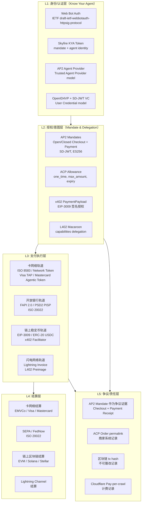
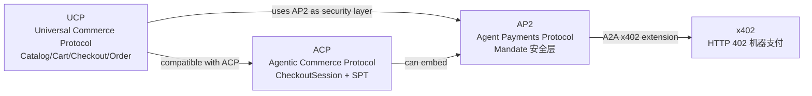
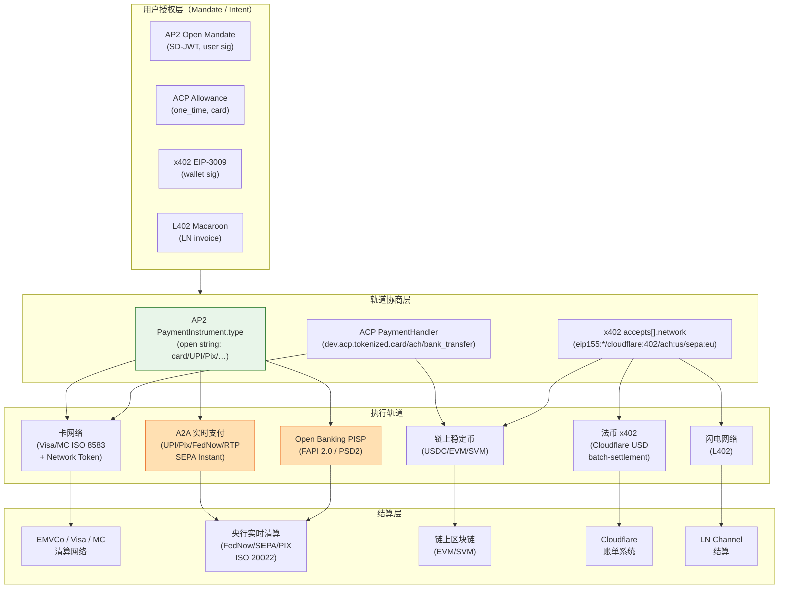

# Agentic Payment 协议综述：AI 代理支付生态的格局与演进

**撰写日期：** 2026-10-19  
**性质：** Survey（综述）  
**覆盖范围：** 截至 2026 年 10 月

---

## TL;DR

2025–2026 年，支付行业在两条平行轨道上应对"AI agent 代替人类完成支付"这一结构性变化：

1. **卡网络/传统金融轨道**：Visa Intelligent Commerce（2025-04-30 正式发布，含 TAP 协议）、Mastercard Agent Pay（2025-04-29 正式发布，已于 2025 年节日季前覆盖全美持卡人），均试图在现有卡轨之上叠加密码学身份与委托授权层。AP2（Google 主导，PayPal 参与，2025-09-16 发布）是跨越卡/A2A/链上的开放 Mandate 框架，Google 与 Mastercard 合作开发的 Verifiable Intent 已于 2026-04-28 捐赠给 FIDO Alliance。核心机制是"Mandate"（授权凭证），以 JWT/SD-JWT + Verifiable Credentials 形式把用户意图固化为可验证、不可抵赖的链下证明。

2. **原生 Web/链上轨道**：x402（Coinbase 发起，现由 x402 Foundation 治理，Linux Foundation 旗下）把 HTTP 402 状态码重新启用为微支付信号，以链上稳定币（USDC 等）为结算层，SDKs 覆盖 TypeScript/Python/Go；**MPP（Machine Payments Protocol）**（Tempo + Stripe 联合撰写，规范仓库 github.com/tempoxyz/mpp-specs，IETF 草案 draft-ryan-httpauth-payment-01）同样基于 HTTP 402，但使用 `WWW-Authenticate: Payment` / `Authorization: Payment` 认证框架（而非 x402 的专属头部），覆盖卡（SPT）+ 多链，支持 charge/session/subscription 三种意图；Cloudflare Pay-per-Crawl 在同一 HTTP 402 语义上构建了爬虫内容授权市场；Lightning Labs L402 以闪电网络 macaroon 做 M2M 授权。

3. **商业编排层**：ACP（OpenAI + Stripe，Apache-2.0，最新版 2026-04-17）为 AI agent → 商家结账定义了完整的 REST/MCP API；UCP（Google、Shopify、Amazon、Microsoft 等 20+ 方联合，2026 年发布）是覆盖目录/购物车/结账/订单的更高层商业协议，将 AP2 作为其安全支付子层。

4. **基础设施层**：Skyfire（KYA token + Agentic Wallet）、Nevermined（Visa 虚拟卡 + x402/MPP 双轨）、Crossmint（稳定币 + Agentic Cards）、Payman（面向银行的 agent 支付引擎）构成 agent 钱包与支付基础设施生态。**AWS Amazon Bedrock AgentCore Payments**（2026-08-19 GA）是首个云原生托管的 agentic payment 执行服务，在基础设施层（而非模型层）强制执行可配置支付上限，通过 x402（含 `upto` scheme）和 MPP 协议连接 Coinbase CDP 和 Stripe Privy 钱包，并通过 AgentCore Observability 实现端到端可观测。中国方面，蚂蚁 Antom（国际）于 2026-01 发布 MCP Server（跨境市场），境内支付宝于 **2026-08-17** 发布 AHA（Agent Hub Access）协议套件，标志中国本地 agentic commerce 生态的规模化启动。

5. **监管里程碑**：**GENIUS Act（P.L. 119-27）**已于 **2025-07-18** 由美国总统签署成法，是美国首部联邦稳定币法律，对 USDC 等支付稳定币发行方设定储备/AML/禁止付息等要求，执行日期不晚于 2027 年 1 月。

**核心结论（推断）**：目前没有任何一个协议能同时覆盖所有场景。最可能的演进路径是分层共存——卡网络轨道处理高价值/需要合规的消费者交易，x402/MPP/L402 处理微支付/M2M 场景，ACP/UCP 作为应用层标准抽象掉底层差异。争议/退款在"人不在场"场景下的法律责任归属，是目前最大的未解决问题。**多轨融合**方面：AP2 的 `PaymentInstrument.type` 是开放字符串字段（已有 UPI 示例），路线图明确包含 UPI/Pix 等实时银行转账；ACP 定义了 `dev.acp.tokenized.ach` 和 `dev.acp.tokenized.bank_transfer` handler 命名空间（尚待实现）；x402 v2 的 `asset` 字段允许 ISO 4217 法币代码，Cloudflare batch-settlement scheme 已以 USD 为结算单位上线，并鼓励非区块链网络用 `ach:us`、`sepa:eu` 等 CAIP-2 格式标识——这表明各协议都在向"轨道无关"方向演进，但绝大多数 A2A 实时支付轨道的 agentic 集成仍处于 roadmap 或早期试点阶段。

---

## 目录

- [A. 背景与基础：传统支付协议栈](#a-背景与基础传统支付协议栈)
- [B. Agentic Payment 核心协议](#b-agentic-payment-核心协议)
  - [B.1 Google AP2 (Agent Payments Protocol)](#b1-google-ap2-agent-payments-protocol)
  - [B.2 OpenAI + Stripe ACP (Agentic Commerce Protocol)](#b2-openai--stripe-acp-agentic-commerce-protocol)
  - [B.3 Coinbase/x402 Foundation x402](#b3-coinbasex402-foundation-x402)
  - [B.4 Visa Intelligent Commerce & TAP](#b4-visa-intelligent-commerce--tap)
  - [B.5 Mastercard Agent Pay](#b5-mastercard-agent-pay)
  - [B.6 其他协议与基础设施](#b6-其他协议与基础设施)
    - [B.6.1 MPP（Machine Payments Protocol）](#b61-mppmachine-payments-protocol)
- [C. 横向分析](#c-横向分析)
  - [C.1 分层框架图](#c1-分层框架图)
  - [C.2 协议对比表](#c2-协议对比表)
  - [C.3 关键技术问题](#c3-关键技术问题)
  - [C.4 学术研究动态](#c4-学术研究动态)
  - [C.5 趋势判断与开放问题](#c5-趋势判断与开放问题)
  - [C.6 多轨支付：协议如何做到 rail-agnostic](#c6-多轨支付协议如何做到-rail-agnostic)
- [D. 附录](#d-附录)
  - [D.1 术语表](#d1-术语表)
  - [D.2 时间线](#d2-时间线)
  - [D.3 参考文献](#d3-参考文献)

---

## A. 背景与基础：传统支付协议栈

### A.1 卡组织网络核心协议

#### ISO 8583

ISO 8583 是银行卡交易报文的国际标准（1987 年首版，最新为 2003 年版）。它定义了 POS 终端、收单行、卡组织、发卡行之间的二进制/ASCII 报文格式，涵盖授权（Authorization）、清算（Clearing）、退款（Refund）等消息类型。每条报文由位图（Bitmap）指示哪些字段存在，核心字段包括：交易金额（DE 4）、卡号（DE 2 / PAN）、交易类型码（DE 3）、商户类别码 MCC（DE 18）、终端 ID（DE 41）等。

对 Agentic Payment 的意义：ISO 8583 的"人在场"假设深入其信任模型。发卡行风险系统基于 IP/设备指纹/3DS 挑战来区分真人与机器。AP2 的 Payment Mandate 设计了一个"AI Agent 存在信号"字段，旨在嵌入 ISO 8583 流程而不改变报文结构本身。

#### EMV 3-D Secure 2.x (3DS2)

EMVCo 3DS2 规范（当前版本 2.3.1，2022 年发布）是持卡人身份验证协议，用于区分"摩擦式"（Frictionless）和"挑战式"（Challenge）流程。与 1.0 版相比，3DS2 传递更丰富的上下文数据（设备指纹、IP、交易历史），让发卡行 ACS 做出更精准的风险决策。

对 Agentic Payment 的意义：当 agent 发起交易，"谁来完成 3DS 挑战"是核心问题。ACP RFC 明确定义了 `authentication_required` 状态和 `authentication_result` 字段，允许 agent 挑起 3DS 流程并把结果回传给商家。AP2 将 3DS 挑战路由回"Trusted Surface"（受信任 UI），确保真人完成验证。

#### EMV 支付令牌化（Payment Tokenization / Network Token）

EMVCo 网络令牌标准（2014 年发布）以 Token（虚拟卡号）替换真实 PAN，令牌被绑定到特定商家、渠道或设备。发卡行/TESS（Token Service System）维护 PAN 到 Token 的映射。

对 Agentic Payment 的意义：AP2 和 ACP 均依赖网络令牌作为 agent 在商家处使用的"受限凭证"——令牌天然可以被限定在某一用途、金额或时间范围，这与 Mandate 的约束机制高度互补。Nevermined 对每个 agent 签发专属的 Visa 虚拟卡即是令牌化的一个实例。

### A.2 ISO 20022

ISO 20022 是金融消息的元数据框架（2004 年首版），基于 XML/JSON，采用"业务组件"建模，覆盖支付指令（pacs）、账户管理（acmt）、现金管理（camt）等报文族。欧洲 SEPA、Swift 网络、美国 FedNow（2023）均采用 ISO 20022。

对 Agentic Payment 的意义：ISO 20022 拥有远比 ISO 8583 丰富的结构化字段，理论上能携带 agent 授权证明（如 Mandate hash）作为附加数据。目前 AP2 文档提到 PayPal 计划"将 Payment Mandate 嵌入 ISO 8583 和 API 流程"，但对 ISO 20022 的具体集成尚未有公开规范。

### A.3 W3C Payment Request API 与 Secure Payment Confirmation (SPC)

**Payment Request API**（W3C 候选推荐草案，2026-06-22 更新版）定义了浏览器层面的统一支付 UI。`PaymentRequest` 对象接收 `methodData`（支付方式列表）和 `details`（金额、商品详情）；`show()` 方法唤起浏览器原生付款界面；`PaymentResponse` 返回令牌或凭证供商家处理。[来源：W3C Payment Request API, https://www.w3.org/TR/payment-request/]

**Secure Payment Confirmation (SPC)** 是对 Payment Request API 的扩展，使用 WebAuthn 将 FIDO2 密钥与特定支付工具绑定，实现"一次触摸完成 3DS 验证"的体验。SPC 生成的签名断言可以作为 Issuer 接受的 SCA 证明。

对 Agentic Payment 的意义：浏览器 Payment Request API 设计上假定用户主动操作 UI，不适合 agent 自主调用。AP2 的"Trusted Surface"概念在本质上类似 SPC 的设计——一个受信任的、不可被 agent LLM 篡改的 UI 层，负责收集用户的最终授权签名。

### A.4 开放银行：PSD2/PSD3 与 FAPI

**PSD2**（欧盟 2018 年正式生效）强制要求银行通过 API 向第三方支付发起服务商（PISP）和账户信息服务商（AISP）开放账户数据。**PSD3**（欧洲委员会 2023 年提案，截至本文写作尚在立法程序中）将进一步完善 API 标准化要求并强化 SCA。

**FAPI（Financial-grade API）**：OpenID Foundation 的 FAPI 2.0（Security Profile + Message Signing）是 PSD2/Open Banking 的实现参考。FAPI 2.0 在 OAuth 2.0 基础上叠加 PKCE、DPoP、mtls 等机制，提供强身份绑定和请求签名。

对 Agentic Payment 的意义：FAPI 的 `sub_jwk`/DPoP 机制提供了一种"agent 代表用户"的 OAuth token 绑定思路。AP2 的 Trusted Agent Provider 模型实际上类似于 FAPI 中的 Agent 作为 OAuth client，持有受限的 access_token 和签名 Mandate。

### A.5 HTTP 402 的历史

HTTP 402 Payment Required 状态码最初在 RFC 1945（HTTP/1.0，1996）中被定义为"保留以供将来使用"。此后二十余年，该状态码从未在标准中获得具体语义——它成为一个著名的"空白支票"。

2021 年前后，Coinbase 工程团队将 402 复活为机器支付信号，发布了 x402 标准的早期草案。2025 年 Cloudflare 进一步在其"Pay-per-crawl"功能中启用 402，赋予爬虫内容授权的商业语义。HTTP 402 从废弃状态码变为 agentic 经济的核心信令机制，是这一领域最具意义的技术史案例之一。

### A.6 链上稳定币支付基础

#### ERC-20 与 transferWithAuthorization（EIP-3009）

EIP-3009（2020 年最终化）在 ERC-20 基础上增加了 `transferWithAuthorization` 方法，允许持有人签名一个"授权对象"（包含 from、to、value、validAfter、validBefore、nonce），由第三方（即 facilitator）代为提交链上交易。这消除了 ERC-20 的两步 `approve` + `transferFrom` 模式，支持"签名即授权"的链下批准。x402 v2 的 `exact` scheme on EVM 正是使用 EIP-3009 作为底层授权机制（`assetTransferMethod: eip3009`）。

#### EIP-2612（permit）

EIP-2612 是另一种签名授权扩展，为 ERC-20 代币增加 `permit` 函数，允许通过 off-chain 签名来批准 `transferFrom`。与 EIP-3009 相比，permit 不直接转账，仍需后续 `transferFrom`；x402 支持将其作为可选的 `assetTransferMethod`。

#### Lightning / L402

L402 协议（Lightning Labs 定义，[docs.lightning.engineering/the-lightning-network/l402](https://docs.lightning.engineering/the-lightning-network/l402)）使用 HTTP 402 + `WWW-Authenticate` 响应头返回一个 Macaroon token 和一个 Lightning 支付发票（Invoice）。客户端支付发票后获得 Preimage，将 `(Macaroon, Preimage)` 组合呈现给服务端即完成验证，无需服务端维护支付状态。其 Macaroon 可被持有人按权限分组委托给子代理，天然适合 multi-agent 场景。L402 当前被 Lightning Loop 等服务实际部署。

---

## B. Agentic Payment 核心协议

### B.1 Google AP2 (Agent Payments Protocol)

#### 发起方与动机

AP2 由 Google 主导，于 2025 年 9 月 16 日发布 v0.1（`CHANGELOG` 记录为 2025-09-16），2026 年 4 月 28 日发布 v0.2（Release of V2）。[来源：github.com/google-agentic-commerce/AP2, CHANGELOG.md]

启动动机见 `docs/overview.md`：现有支付系统假设"人直接操作受信 UI"，agent 破坏了这一假设，导致授权验证、意图真实性、错误处理和责任归属四个核心问题无法用已有机制回答。

#### 架构与角色

AP2 定义五个角色（`docs/ap2/specification.md`，版本 0.2）：

| 角色 | 说明 |
|------|------|
| **Shopping Agent (SA)** | 主要 agent，负责产品发现、组装购物车、执行购买 |
| **Credential Provider (CP)** | 支付凭证来源，验证 agent 有权使用该凭证，并对凭证作用域进行限制 |
| **Merchant (M)** | 商品目录及 Checkout 提供方，对 Checkout 内容承担完整性责任 |
| **Merchant Payment Processor (MPP)** | 处理支付，验证支付凭证已被授权用于本 Checkout 实例 |
| **Trusted Surface (TS)** | 受信任的 UI 表面，负责将 Mandate Content 呈现给用户并获取签名授权；**必须是非 agentic** |

规范明确区分"Agentic 角色"与"Non-Agentic 角色"：Trusted Surface **必须**是非 agentic 的（确定性代码）；Shopping Agent 预期是 agentic 的；Merchant/CP/MPP 可为其中之一。当两个非 agentic 角色直接通信时，标准 Web 安全模型已足够；一旦任一角色引入 LLM，则需要防篡改机制（Mandates）。

#### 授权模型：Mandate 框架

AP2 的核心创新是"Mandate 委托-授权"双阶段框架（`docs/ap2/agent_authorization.md`）：

1. **Mandate Delegation（授权委托）**：用户在 Trusted Surface 上批准 Mandate Content，产生经用户签名的 Mandate，委托给 agent。
2. **Action Authorization（动作授权）**：Verifier（如 Merchant、CP）向 agent 发起挑战，agent 出示 Mandate，Verifier 验证后返回 Receipt。

Mandate 分为 **Open**（未绑定具体动作，携带约束条件）和 **Closed**（已绑定具体动作，如特定 Checkout）两类。

**Mandate 的加密实现**：使用 SD-JWT（Selective Disclosure JWT）格式，`vct` 字段指示类型和版本（如 `mandate.checkout.1`）。Open 与 Closed Mandate 通过 `~~` 分隔符链接为一个字符串。用户签名采用 ES256，key binding 通过 `kb+sd-jwt` 实现。

委托机制有两种模式：
- **User Credential 模式**：通过 OpenID4VP 协议，在 `transaction_data` 字段中传递 Mandate Content，由 Digital Credentials API 完成 FIDO2 绑定签名。
- **Trusted Agent Provider 模式**：agent 提供方作为受信任方，其密钥替代用户密钥签署 Mandate，依赖 Verifier 预先建立与该提供方的信任关系。

#### 两类交易流程

**Human Present（人在场）流程**（`docs/ap2/flows.md`）：

```
Phase 1 (Shopping):
  用户 → SA: 发起购物任务
  SA ↔ Merchant: 组装购物车
  Merchant → SA: 返回 signed Checkout JWT，要求 Mandate
  SA → CP: 获取可用支付工具列表

Phase 2 (Payment):
  SA → Trusted Surface: 提交 Checkout/Payment Mandate Content
  Trusted Surface → 用户: 展示 Mandate Content，请求生物认证/同意
  Trusted Surface: 用 user_sk 签署 Checkout Mandate + Payment Mandate
  Trusted Surface → SA: 返回已签署的 Mandates
  SA → CP: 提交 Payment Mandate，获取 payment token
  SA → Merchant: 提交 token + Checkout Mandate
  Merchant → MPP: 发起支付，附带 checkout_jwt hash
  MPP: 验证 Payment Mandate 与 checkout_jwt 绑定
  MPP → SA/CP/Network: 返回 Payment Receipt
  Merchant → SA: 返回 Checkout Receipt
```

**Human Not Present（人不在场）流程**：用户在离线前签发 Open Mandate（含约束，如价格上限、商家白名单、商品类别）；agent 自主完成购物后，用 `agent_sk` 签署 Closed Mandate，链接至对应的 Open Mandate（通过 `sd_hash`）；Verifier 同时校验 Open 约束已满足 + Closed 绑定有效。

#### Checkout Mandate 约束类型

Open Checkout Mandate 可携带的约束（`docs/ap2/checkout_mandate.md`）：

- `checkout.allowed_merchants`：限定允许的商家列表
- `checkout.line_items`：定义合法的商品集合

Open Payment Mandate 约束（`docs/ap2/payment_mandate.md`）：

| 约束类型 | 核心字段 | 语义 |
|----------|----------|------|
| `payment.agent_recurrence` | frequency, max_occurrences | 控制 agent 重复消费频率与次数 |
| `payment.allowed_payees` | allowed[] | 限定可支付的商家 |
| `payment.allowed_payment_instruments` | allowed[] | 限定可使用的支付工具 |
| `payment.allowed_pisps` | allowed[] | 限定可使用的 PISP |
| `payment.amount_range` | min, max, currency | 限定单笔金额范围 |
| `payment.budget` | max, currency | 累计预算上限（带滚动计数） |
| `payment.reference` | conditional_transaction_id | 绑定特定 Checkout Mandate（防双花） |
| `payment.execution_date` | not_before, not_after | 限定执行时间窗口 |

#### 与 A2A/MCP/UCP/x402 的关系

- **A2A**：AP2 显式设计为 A2A 的支付扩展（Glossary 定义），AP2 Mandate 可通过 A2A 消息传递。
- **MCP**：Glossary 提及 MCP-based endpoints 可充当 Payment Agent 角色。
- **UCP**：AP2 规范明确"AP2 兼容 UCP，`checkout_jwt` 当与 UCP 一起使用时必须为 UCP Checkout 对象"（`checkout_mandate.md`）。UCP 官网将 AP2 列为其安全支付子协议。
- **x402**：AP2 代码仓库包含 `scenarios/a2a/` 目录，A2A x402 扩展由 Google 与 Coinbase 合作开发，具体将 AP2 Mandate 嵌入 x402 流程（详见 B.3）。

#### 生态伙伴与当前状态

- **发布状态**：v0.2（2026-04-28），已上线，Apache-2.0 许可，代码和 spec 完全公开。
- **治理迁移**：Google 在发布 v0.2 的同日宣布把 AP2 **捐赠给 FIDO Alliance**，由其承接所有权，保持平台中立、社区主导；同时宣布与 Mastercard 共同开发的 AP2 兼容标准 **Verifiable Intent**（对用户授权的 agent 操作生成防篡改日志）也一并捐给 FIDO（来源：[Google 官方博客 2026-04-28](https://blog.google/products-and-platforms/platforms/google-pay/agent-payments-protocol-fido-alliance/)；AP2 仓库 `docs/index.md` 亦链接该公告）。v0.2 的重点是正式支持 "Human Not Present" 自主支付（基于用户预授权指令）。
- **已知支持方**：PayPal（2025-09-16 宣布支持，计划将 Payment Mandate 嵌入其 ISO 8583/API 流程），UCP（作为商业层采纳），以及 UCP 成员中多家（Shopify、Amazon、Walmart、Visa、Mastercard、Adyen 为 UCP endorser，但对 AP2 的直接支持程度需单独核实）。
- **局限**：AP2 仅定义 Mandate 安全层，不规定商品目录 API 或 Checkout 细节（依赖 UCP/ACP 等）；"多重重叠 Mandate 的双花防护"问题（`implementation_considerations.md` 提及）尚在设计中；对 KYC/AML 的集成策略未规范化。

---

### B.2 OpenAI + Stripe ACP (Agentic Commerce Protocol)

#### 发起方与动机

ACP 由 OpenAI 和 Stripe 联合发布，首版（`2025-09-29`）与 AP2 同期亮相，随后持续更新至 `2026-04-17`（当前最新稳定版）。[来源：github.com/agentic-commerce-protocol/agentic-commerce-protocol，Apache-2.0，最后更新 Jul 18, 2026]

ACP 的核心定位是"连接买家、AI agent 与商家的完整结账交互模型和开放标准"，不改动商家现有支付基础设施，商家始终是"Merchant of Record"。

#### 版本历程

| 版本 | 发布日期 | 主要变化 |
|------|----------|----------|
| 2025-09-29 | 2025-09-29 | 初始版本：核心 Checkout Session API + Delegate Payment API |
| 2025-12-12 | 2025-12-12 | Fulfillment 增强 |
| 2026-01-16 | 2026-01-16 | Capability Negotiation（能力协商） |
| 2026-01-30 | 2026-01-30 | Extensions、Discounts、Payment Handlers |
| 2026-04-17 | 2026-04-17 | Cart API、Feed API、Orders、Authentication（3DS）、MCP Binding |

#### 架构概述

ACP 是双 API 体系：

1. **Agentic Checkout API**（`POST /checkout_sessions` 等）：由商家实现，AI agent 调用，管理结账会话的完整生命周期。
2. **Delegate Payment API**（`POST /agentic_commerce/delegate_payment`）：由 Payment Provider（如 Stripe）实现，商家/agent 调用，安全获取委托支付令牌。

**MCP Binding**（`docs/mcp-binding.md`，2026-04-17 加入）：在 REST API 之上提供 MCP JSON-RPC 2.0 绑定，agent 可通过 MCP 工具调用（`create_checkout_session`、`complete_checkout_session` 等）替代直接 HTTP 请求，发现通过 `/.well-known/acp.json` 完成。

#### Agentic Checkout API 关键端点

```
POST   /checkout_sessions               → 201 Created，创建会话
POST   /checkout_sessions/{id}          → 200 OK，更新会话
GET    /checkout_sessions/{id}          → 200 OK，获取当前状态
POST   /checkout_sessions/{id}/complete → 200 OK，提交支付、创建订单
POST   /checkout_sessions/{id}/cancel   → 200 OK，取消
```

**关键请求头**：`API-Version: 2026-04-17`（必须）、`Authorization: Bearer <token>`（必须）、`Idempotency-Key: <uuid>`（所有 POST 必须）、`Signature: <base64url>`（推荐，Ed25519/ES256 签名）。

**Checkout Session 状态机**：`not_ready_for_payment → ready_for_payment → in_progress → authentication_required / completed / canceled`

**消息 resolution 字段**：`recoverable`（agent 可通过 API 重试）、`requires_buyer_input`（需买家提供信息）、`requires_buyer_review`（需买家授权）。

**3DS 处理**：当 `status == authentication_required` 时，agent 必须先完成 3DS 验证，再提交 `authentication_result` 到 complete 端点。

#### Delegate Payment API（Shared Payment Token）

`POST /agentic_commerce/delegate_payment`（版本 2025-09-29）核心请求字段：

| 字段 | 说明 |
|------|------|
| `payment_method.type` | 必须为 `card` |
| `payment_method.card_number_type` | `fpan` 或 `network_token` |
| `allowance.reason` | 必须为 `one_time` |
| `allowance.max_amount` | 最大授权金额（integer，minor units） |
| `allowance.checkout_session_id` | 绑定的 Checkout 会话 ID |
| `allowance.expires_at` | 令牌过期时间（RFC 3339） |
| `risk_signals[]` | card_testing 风险信号（score + action） |

成功返回 `{"id": "vt_01J8Z3WXYZ9ABC", "created": "2025-09-29T11:00:00Z", ...}`。返回的 `id` 是 Shared Payment Token（SPT），一次性委托令牌，仅在 allowance 约束内有效。

#### 生态伙伴与状态

- **OpenAI**：ChatGPT 是第一个实现 ACP 的 AI 平台。
- **Stripe**：第一个兼容支付处理商，提供 SPT；Stripe 同为 x402 Foundation TSC 成员。
- **治理**：OpenAI 和 Stripe 共同治理（Founding Maintainers），计划移交中立基金会。
- **TSC**（未发布完整名单，Meta 是新增成员，`changelog/unreleased/add-meta-tsc-member.md`）。
- **局限**：当前凭证类型仅支持 `card`；AP2 密码学证明层未内置；商家发现机制仍在开发；`one_time` 是目前唯一的 allowance reason。


### B.3 Coinbase/x402 Foundation x402

#### 发起方与治理演变

x402 由 Coinbase 团队于 2025 年初发布，2025 年下半年将协议治理移交 **x402 Foundation**（Linux Foundation 旗下）。`coinbase/x402` 仓库现为开发 fork，`x402-foundation/x402` 为主仓库（~6700 星，~2200 fork）。[来源：github.com/x402-foundation/x402，Apache-2.0]

**x402 Foundation TSC 成员**（`TSC.md`）：Coinbase（Erik Reppel）、Cloudflare（Rohin Lohe）、Stripe（Steve Kaliski）。

运营数据（x402.org，截至 2026-10）：**75.41M 交易/月，$24.24M 成交量，94,060 买家，22,000 卖家**，声称生产就绪且通过安全审计。[来源：x402.org]

#### 协议版本 v1 → v2

`specs/x402-specification-v1.md` 保留旧版，`specs/x402-specification-v2.md` 为当前规范（Protocol Version: 2）。Go SDK 路径含 `/v2`，表明 major 版本升级。

v2 核心变化：统一头部名称（`PAYMENT-REQUIRED`/`PAYMENT-SIGNATURE`/`PAYMENT-RESPONSE`）；新增 `upto`、`batch-settlement` scheme；引入 `assetTransferMethod`/`paymentFlow` 显式声明；多链 CAIP-2 标识符；Extensions 机制。

#### 核心数据结构

**PaymentRequired**（服务端返回，base64 编码于 `PAYMENT-REQUIRED` 头）：

```json
{
  "x402Version": 2,
  "resource": { "url": "...", "serviceName": "...", "tags": [...] },
  "accepts": [{
    "scheme": "exact",
    "network": "eip155:84532",
    "amount": "10000",
    "asset": "0x036CbD53842c5426634e7929541eC2318f3dCF7e",
    "payTo": "0x209693...",
    "maxTimeoutSeconds": 60,
    "extra": { "name": "USDC", "version": "2" }
  }],
  "extensions": {}
}
```

**PaymentPayload**（客户端发送，`exact` EVM scheme，底层 EIP-3009）：

```json
{
  "x402Version": 2, "accepted": { /* PaymentRequirements */ },
  "payload": {
    "signature": "0x2d6a...",
    "authorization": {
      "from": "0x857b...", "to": "0x2096...",
      "value": "10000",
      "validAfter": "1740672089", "validBefore": "1740672154",
      "nonce": "0xf374..."
    }
  }
}
```

**SettlementResponse**（结算后返回）：`{ success, transaction, network, payer?, amount? }`

#### 支付 Scheme

| Scheme | 语义 | 适用场景 |
|--------|------|----------|
| `exact` | 固定金额，EIP-3009 签名 | API 调用、内容单次付费 |
| `upto` | 最高授权上限，按实际用量结算 | AI agent 按量计费 |
| `batch-settlement` (EVM) | 链下凭证 + 批量链上结算 | 高频微支付，降低 gas |
| `auth-capture` | 授权后延迟捕获（开发中） | — |

**三种支付流（`extra.paymentFlow`）**：`authorization`（verify→resource→settle，默认）、`upfront`（settle→resource）、`escrow`（settle→resource→settle）。

#### 支持链与生态

SDK 包：`@x402/evm`、`@x402/svm`、`@x402/avm`、`@x402/aptos`、`@x402/stellar`、`@x402/tvm`（TON）、`@x402/hedera`、`@x402/keeta`。框架集成：Express、Fastify、Hono、Next.js、Axios、Fetch、MCP。

Trusted By：AWS、Cloudflare、Stripe、Vercel、Alchemy、Messari、Nansen、QuickNode、World。

#### 状态与局限

- **状态**：已上线（GA），多链支持，数千万级月交易。
- **局限**：目前主要依赖链上稳定币，法币路径不成熟；gas 成本由 facilitator 承担增加运营风险；MiCA/GENIUS Act 等监管对稳定币支付的影响尚不明朗；缺内置 KYC/AML 层。

### B.4 Visa Intelligent Commerce & TAP

#### 背景（已从官方新闻稿核实）

Visa 于 **2025-04-30**（"Visa Global Product Drop"活动）正式宣布 **Intelligent Commerce** 平台，标题"Find and Buy with AI: Visa Unveils New Era of Commerce"。[来源：investor.visa.com，2025-04-30]

初始合作伙伴：Anthropic、IBM、Microsoft、Mistral AI、OpenAI、Perplexity、Samsung、Stripe。

**Visa Intelligent Commerce 主要组件**（截至 2026-10，来源：visa.com/en-us/solutions/intelligent-commerce）：

1. **AI-Ready Cards**：以网络令牌取代卡片明细，提升安全性，确认特定 agent 有权代表消费者操作
2. **Intelligent Commerce Connect**：单一集成入口，跨支付 scheme、令牌提供方和 agent 生态系统（注：原文提及的"Visa Accept"不是官方组件名称，正式名称为"Intelligent Commerce Connect"）
3. **Trusted Agent Protocol（TAP）**：商家识别和互动可信 agent 的框架（GitHub 仓库 `visa/trusted-agent-protocol`，创建于 2025-10-10）
4. **MCP Server**：Visa 推出的 Model Context Protocol 服务器，作为 AI agent 和 LLM 连接 Visa Intelligent Commerce API 的安全集成层
5. **Command Line Interface（CLI）**：供开发者以编程方式在代码环境中完成卡支付
6. **Visa Commercial Solutions**：B2B 场景 agentic commerce 能力

**当前状态**：部署中（非 GA）。官方注："Product is currently in the process of deployment and should be understood as a representation of the potential features of the fully-deployed product."

**稳定币结算**：官方 Intelligent Commerce 材料中未提及稳定币；稳定币支持在 Mastercard Agent Pay for Machines（2026-06-10）中有明确表述。

#### 技术基础：Web Bot Auth / IETF draft-ietf-webbotauth-httpsig-protocol

IETF WG draft `draft-ietf-webbotauth-httpsig-protocol`（替换早期个人草案 `draft-meunier-webbotauth-httpsig-protocol-02`，版本 -00，2026 年 9 月升为 WG 文档）[来源：IETF Datatracker，datatracker.ietf.org/doc/draft-ietf-webbotauth-httpsig-protocol/]是 Visa TAP 的基础协议。

**核心机制**：

- **Signature-Agent 头部**：Structured Fields Dictionary（RFC 9651），每个成员值为含 `https` URI 的字符串，可携带 `type` 参数（`directory`/`jwks_uri`/`cimd`），用于 in-band 密钥发现。
- **必须的签名组件**：`@authority` 或 `@target-uri`（至少一个）+ `signature-agent;key="<label>"`；必须携带参数 `created`、`expires`（推荐 ≤24h）、`keyid`（JWK SHA-256 thumbprint）、`tag="web-bot-auth"`。
- **密钥发现**：
  - `directory` 类型：从 `/.well-known/http-message-signatures-directory` 获取 JWKS
  - `jwks_uri` 类型：直接获取 JWK Set
  - `cimd` 类型：OAuth Client ID Metadata Document

**认证流程**：
1. Agent 用私钥签署请求，发送 `Signature`、`Signature-Input`、`Signature-Agent` 头部
2. Origin（或 Visa 等反向代理）解析头部，从 `Signature-Agent` 指向的 URL 获取公钥
3. 按 RFC 9421 §3.2 验证签名
4. 结果为 verified / invalid / unverified

**OpenAI 已部署**：OpenAI 声明"对所有 Operator 请求进行签名，使网站所有者可以验证其真实来自 Operator"，密钥目录位于 `operator.openai.com`。[来源：Cloudflare 博客，blog.cloudflare.com/web-bot-auth]

#### Visa TAP 架构（已从 GitHub 参考实现核实）

TAP 仓库（`github.com/visa/trusted-agent-protocol`，创建于 2025-10-10，截至 2026-10-14 仍在更新，许可证为 Visa Developer Center Terms of Use，非标准 OSS 许可，需同意 developer.visa.com/terms）包含完整参考实现。

**已核实的技术细节**：

- **签名算法**：Ed25519（推荐）和 RSA-PSS-SHA256，均符合 RFC 9421
- **签名组件**：`@authority`、`@path`、`created`、`expires`、`nonce`、`keyId`、`tag`
- **动态 Tag**：
  - `agent-browser-auth`：agent 处于浏览/产品详情阶段
  - `agent-payer-auth`：agent 处于结账/支付阶段
- **密钥发现**：通过中心化 Agent Registry 服务（`GET /keys/{key_id}`）；Visa 和 Mastercard 分别托管各自密钥目录（与 IETF Web Bot Auth 草案的 `Signature-Agent` Structured Fields `/.well-known/` 端点方案不同——TAP 采用中心化 Agent Registry）
- **消费者识别**：agent 通过 query parameters 向商家传递消费者信息，包括 Payment Account References（PARs，卡档案引用）、loyalty numbers、email、phone 等（需消费者同意）
- **nonce 防重放**：签名必须包含 `nonce` 字段，由 Cloudflare 等中间层检验唯一性

**与 IETF Web Bot Auth 的关系**（来源：blog.cloudflare.com/secure-agentic-commerce，2025-10-24）：TAP 以 Web Bot Auth 为基础协议层（RFC 9421 HTTP Message Signatures），Cloudflare 作为网络层验证者负责：①确认签名头部存在；②从目录拉取并缓存公钥；③检验 `created`/`expires` 时间窗口；④检验 nonce 唯一性；⑤校验 tag 类型；⑥重建 signature base；⑦执行 Ed25519 验签。TAP 密钥发现使用中心化 Agent Registry 而非 IETF 草案的 `Signature-Agent` Structured Fields。

**Cloudflare 合作**：Cloudflare 参与 TAP 和 Agent Pay 的网络层验证服务（同一博客确认："Both Trusted Agent Protocol and Agent Pay leverage Web Bot Auth as the agent authentication layer"）。

**支付容器对象/技术 API**：详细规范位于 developer.visa.com 登录区域（需申请访问权限），未能从一手来源提取，**仍标注"未完全验证"**。

#### Cloudflare Pay-per-Crawl（相关实现）

Cloudflare 于 2025 年 7 月 1 日发布 Pay-per-crawl（私有 beta）[来源：Cloudflare 博客，blog.cloudflare.com/introducing-pay-per-crawl/]，基于 HTTP 402 为内容发布商向爬虫/AI crawler 收费。

**技术流程**：
- 爬虫使用 Web Bot Auth（Ed25519 密钥 + HTTP Message Signatures）注册身份
- 服务端返回 402 + `crawler-price` 头
- 爬虫用 `crawler-exact-price` 接受价格（Reactive 模式），或用 `crawler-max-price` 预先声明预算（Proactive 模式）
- 成功则返回 200 + `crawler-charged` 头，Cloudflare 作为 Merchant of Record 负责计费和结算

Pay-per-crawl **不是** x402 协议，是 Cloudflare 独立实现的 HTTP 402 语义。但 Cloudflare 参与 x402 Foundation TSC，生态有重叠。

### B.5 Mastercard Agent Pay

#### 概览（已从多方来源核实）

Mastercard 于 **2025-04-29** 正式推出 **Agent Pay** 计划，标题"Mastercard Unveils Agent Pay, Pioneering Agentic Payments Technology to Power Commerce in the Age of AI"。[来源：investor.mastercard.com/investor-news/investor-news-details/2025/Mastercard-Unveils-Agent-Pay-Pioneering-Agentic-Payments-Technology-to-Power-Commerce-in-the-Age-of-AI/default.aspx]

**发布时核心组件**：

1. **Agentic Tokens（Agentic 令牌）**：专为 AI agent 签发的 Mastercard 令牌，绑定消费者设定的授权条件（金额、商家范围等），每笔交易绑定特定授权 agent。
2. **Agent 注册与验证**：要求 AI agent 注册并通过验证才能使用网络令牌发起交易。

**发布时合作伙伴**：Microsoft（Azure OpenAI Service、Copilot Studio）、IBM、Braintree、Checkout.com。

**主要里程碑（时间线）**：

| 日期 | 事件 |
|------|------|
| 2025-04-29 | Agent Pay 正式推出，Agentic Tokens + agent 注册 |
| 2025-09-30 | 通过 OpenAI ChatGPT Instant Checkout 可用；Citi、U.S. Bank 持卡人已开通；宣布节日季前（mid-Nov 2025）覆盖全美 Mastercard 持卡人 |
| 2026-01-29 | 宣布已启用美国 issuer 支持 agentic commerce |
| 2026-03-05 | **Verifiable Intent** 开源（与 Google 共同开发，与 AP2/UCP 协议对齐） |
| 2026-04-28 | Google 将 AP2 捐赠 FIDO Alliance；Mastercard 将 Verifiable Intent 贡献给 FIDO Payments Technical Working Group |
| 2026-06-02 | 全部欧洲发行行在网络层启用 Agent Pay |
| 2026-06-10 | **Agent Pay for Machines** 推出：M2M 支付，支持卡、账户、**稳定币**，30+ 参与方含 Adyen、Coinbase、Stripe、Cloudflare |
| 2026-09-30 | **Agent Pay Trust Framework**（五支柱：identity、intent、controls、trusted execution、intelligence）；新增 Cloudflare privacy-preserving data partnership；Skyfire KYA 合作 |

**Verifiable Intent 与 FIDO Alliance**：Mastercard 与 Google 共同开发 Verifiable Intent——为 agent 购买行为提供用户授权的密码学证明；与 AP2（Google）共同于 2026-04-28 捐赠/贡献给 FIDO Alliance Payments Technical Working Group 开展标准化。

**稳定币与 Multi-Token Network**：Agent Pay for Machines（2026-06-10）明确支持稳定币结算（"cards, accounts and stablecoins"）；Mastercard Multi-Token Network（MTN，2023 年推出）是底层多代币互通基础设施。

**全美持卡人覆盖**：已于 2025 年节日季前（mid-November 2025）实现，通过 ChatGPT Instant Checkout 渠道。

**当前状态**：Rolling out（正在扩展中），已有多家银行（Citi、U.S. Bank 等）完成试点或正式部署。Mastercard 官网因 403 Forbidden，无法从 mastercard.com 一手提取详细技术规范；developer.mastercard.com/product/agent-pay/ 返回 404——以上时间线综合来自官方新闻稿引用的行业来源。


### B.6 其他协议与基础设施

#### Universal Commerce Protocol (UCP)

UCP（ucp.dev，Apache-2.0）是覆盖完整商业旅程的开放标准，定位比 AP2/ACP 更高层。[来源：ucp.dev，github.com/Universal-Commerce-Protocol/ucp，~3400 星]

**核心能力层**：
- **Checkout**：购物车管理、税务计算，支持有人/无人场景
- **Identity Linking**：OAuth 2.0 for agent-on-behalf-of-user
- **Order**：webhook 驱动的订单生命周期更新
- **Payment Token Exchange**：PSP 与 Credential Provider 之间的安全令牌交换

**主要合作方（来源：ucp.dev）**：
- 购物：Google、Shopify、Etsy、Wayfair、Target、Walmart、Amazon、Microsoft、Meta、Salesforce、Stripe
- 住宿：Expedia、Booking.com、Marriott、Hilton（草案规范）
- 餐饮：DoorDash、Uber Eats、Toast、Square（即将发布）
- Endorser：Visa、Mastercard、PayPal、Adyen

**与 AP2 的关系**：UCP 将 AP2 作为安全子层，"高级安全模式如 AP2 mandates 和 verifiable credentials"。AP2 `checkout_mandate.md` 规定与 UCP 一起使用时 `checkout_jwt` 必须为 UCP Checkout 对象。

**状态**：购物规范已发布（"latest"），住宿为草案，餐饮"即将推出"。

#### PayPal Agent Toolkit 与 MCP

PayPal 发布了 **Agent Toolkit**（paypal.ai/docs/tools/agent-toolkit-quickstart），并支持远程 MCP 服务器（兼容 OpenAI 和 Anthropic API）。[来源：developer.paypal.com/community/blog]

功能包括：搜索、加入购物车、礼品卡结账、agentic 客服工作流。PayPal 同时宣布支持 AP2，计划将 Payment Mandate 嵌入其 ISO 8583 流程，并已有 Braintree 和 PayPal core 的分层架构映射。

**与 Perplexity 合作（✅ 已核实）**：PayPal 与 Perplexity 于 **2025 年 5 月 14 日**正式宣布合作（"Perplexity Selects PayPal to Power Agentic Commerce"，PR Newswire 302454733）。Perplexity Pro 用户在聊天界面中可直接用 PayPal 或 Venmo 结账，整个流程（支付、物流、发票）在后台自动处理。2025 年 11 月推出"Instant Buy"（黑五前）进一步扩展合作。（来源：investor.paypal-corp.com ✅）

#### L402（Lightning Labs）

L402 协议基于 HTTP 402 + Lightning 发票 + Macaroon 令牌。[来源：docs.lightning.engineering/the-lightning-network/l402]

- **流程**：服务端返回 402 + `WWW-Authenticate: L402 token="<macaroon>", invoice="<lnbc...>"`；客户端支付闪电发票，获得 Preimage；用 `Authorization: L402 <macaroon>:<preimage>` 访问资源。
- **Macaroon 委托**：Macaroon 可携带能力限制（如只读、特定目录），可被持有人分割委托给子 agent，天然支持 multi-agent 场景。
- **已部署**：Lightning Loop、Aperture 反向代理。
- **与 x402 的区别**：L402 基于闪电网络，适合毫秒级/次毫秒级微支付；x402 基于链上 ERC-20，单笔成本更低但有块确认延迟（由 facilitator 吸收）。

#### Skyfire

Skyfire（skyfire.xyz）的 **"Agent Trust Stack"** 包含三层：[来源：skyfire.xyz]

1. **KYA（Know Your Agent）Token**：携带 platform/agent/human principal + user mandate 的可移植身份凭证，声称覆盖超过 60% 的商业互联网。商家通过 `kyapay.org` 接入。
2. **Agentic Wallet**：管理用户信用卡（PCI vault 中令牌化）和 USDC，收集用户 Mandate。
3. **买单流程（"Buy for Me"）**：agent 请求 KYA token → 使用令牌访问商家网站登录 → 用户批准 Mandate（merchant/product/amount）→ 钱包授权令牌化卡片 → checkout。

**合作方**：Visa、Mastercard、Discover、Okta/Auth0、Akamai、F5、HUMAN Security、DataDome、Fastly、Imperva、Experian。  
**状态**：已上线（GA）。

#### Nevermined

Nevermined（nevermined.ai）定位为 "Agentic Payments Infrastructure"，同时支持 x402 和 MPP（Machine Payment Protocol）双轨。[来源：nevermined.ai]

- **Card Delegation（Nevermined Pay）**：每个 agent 获得专属 Visa 虚拟卡，预算上限、过期时间、一键撤销；PCI-D 合规 vault。
- **层次架构**：Metering（计量）→ Access Control → Entitlements（权利策略）→ Settlement（法币/加密/积分）。
- **已上线用例**：Exa 向 agent 出售搜索 key，每次 $7，通过委托卡支付。
- **合规**：ISO 27001、SOC 2 Type II、PCI SAQ-D。
- **合作方**：Visa、Mastercard、PayPal、Braintree、Exa、You.com、AWS、VGS。
- **认可**：Gartner 2026 Cool Vendor（agentic AI for banking）。

#### Crossmint

Crossmint（crossmint.com）是稳定币基础设施提供商，为 AI agent 提供可编程钱包和 Agentic Cards（虚拟卡）。[来源：crossmint.com]

- **许可**：MiCA CASP（西班牙 CNMV）、西班牙 Payment Institution、美国 FinCEN MSB、加拿大 FINTRAC。
- **覆盖**：全部美国州（含纽约）、所有 27 个 EU 国、160+ 国家。
- **差异点**：隐藏链细节（gas fees 由 Crossmint 承担，以法币计费），专注企业和 agent wallet 基础设施。

#### Payman AI

Payman AI（paymanai.com）面向银行和信用合作社的 agentic AI，不是通用 agent 支付协议，而是将 AI agent 集成到核心银行系统的垂直解决方案。[来源：paymanai.com]

- **核心机制**：不可变策略引擎（policy engine）在每个 agent 操作到达核心银行系统前做合规检查；完整审计日志；机构保留 kill switch。
- **状态**：已被美国多家金融机构采用（SOC 2 Type II 认证）。

#### AWS Bedrock AgentCore

**⚠️ 2026-10-20 修正**：本小节原内容存在两处错误，已据 AWS 官方 What's New 核实更正。

AWS Bedrock AgentCore 是 Amazon 于 **2025 年**（**2025-07 preview**，**2025-10 GA**）发布的 agent 托管平台，提供 Runtime（microVM 会话隔离、8 小时执行窗口）、Gateway（MCP/OpenAPI/Lambda 转换）、Identity（OAuth token vault、consent portal）、Policy（Cedar，实时工具调用拦截）、Memory、Observability（OTEL/CloudWatch/X-Ray）、Browser、Code Interpreter 等能力。

**来源（发布时间线）**：  
- preview 2025-07：https://aws.amazon.com/about-aws/whats-new/2025/07/amazon-bedrock-agentcore-preview/  
- GA 2025-10：https://aws.amazon.com/about-aws/whats-new/2025/10/amazon-bedrock-agentcore-available/

**支付能力（已核实：有原生支付能力，GA 2026-08-19）**：**AgentCore Payments** 于 **2026-04** 进入 preview、**2026-08-19 正式 GA**（https://aws.amazon.com/about-aws/whats-new/2026/08/bedrock-agentcore-payments-ga/），是原生内置的 agentic payment 执行能力，并非仅依赖外部 API 调用。

核心特性：
- **支付协议**：x402（v1 + v2，含 `upto` scheme 用于 pay-per-inference 动态定价）和 MPP（Machine Payments Protocol）
- **钱包集成**：Coinbase CDP 和 Stripe Privy（嵌入式稳定币钱包），凭证通过 AgentCore Identity 存储在 Secrets Manager，不暴露给模型层
- **基础设施层支付上限**：PaymentSession 级 `maxSpendAmount` + `currency` + `expiry`，在 agent 推理层之外确定性强制执行
- **Coinbase x402 Bazaar MCP**：通过 AgentCore Gateway 接入 10,000+ pay-per-use x402 端点目录
- **可观测性**：通过 AgentCore Observability（CloudWatch vended logs + X-Ray vended spans）实现端到端支付可见性
- **区域**：us-east-1/2, us-west-2, eu-central-1, eu-west-1/2 及多个欧洲区域, ap-southeast-1（新加坡）, ap-southeast-2（悉尼）；**ap-northeast-1（东京）、ap-east-1（香港）不可用**
- **合作方**：Coinbase（核心钱包 + Bazaar MCP）和 Stripe Privy；Solv Labs 合作案例（AgentCore + Automated Reasoning Checks + Nitro Enclaves 构建可验证、可审计的 agent 支付，2026-08-13）

**原错误标注**（「AgentCore 无内置支付协议，标注"已核实：无原生支付能力"」）反映的是 2026 年 preview 发布前的状态（或调查时间点早于 2026-08-19 GA），已据 GA 事实更正。

#### B.6.1 MPP（Machine Payments Protocol）

**MPP**（Machine Payments Protocol）是由 **Tempo 和 Stripe 联合撰写**的开放标准，用于 HTTP 层的机器对机器支付，使 AI agent 能够为 API 调用、工具调用和内容访问付费。[来源：github.com/tempoxyz/mpp-specs ✅；mpp.dev ✅；docs.stripe.com/payments/machine ✅]

**规范状态**：规范仓库 `github.com/tempoxyz/mpp-specs`（创建于 2026-01-05，许可证 NOASSERTION），核心 HTTP 认证方案已提交 IETF Internet-Draft（`draft-ryan-httpauth-payment-01`，标题"The 'Payment' HTTP Authentication Scheme"，2026-09-18），由 Tempo 的 `paymentauth.org` 维护草案索引。

**HTTP 402 流程**：
1. 客户端请求资源
2. 服务端返回 `402 Payment Required` + `WWW-Authenticate: Payment`（含支付挑战/金额/轨道信息）
3. 客户端完成支付，携带 `Authorization: Payment`（含支付凭证）重发请求
4. 服务端验证后，返回资源 + `Payment-Receipt`

**支付意图（intents）**：
- **Charge**：单次固定金额，用于 API 调用或资源访问
- **Session**：通过预充值通道签发凭证，支持计量/流式计费（最小结算单位 $0.01 USDC）
- **Subscription**：循环扣款（Stripe 和 Tempo 轨道支持）

**支持轨道**（Charge 意图）：Stripe 卡（通过 Shared Payment Token/SPT）、Tempo（USDC.e）、Solana（USDC）、EVM 通用 USDC、Lightning（BTC）、XRPL、Stellar、Hedera、NEAR Intents 等。

**与 x402 的关系**：MPP 与 x402 并行，不互斥。两者都基于 HTTP 402，但核心差异如下：

| 比较项 | MPP | x402 |
|--------|-----|------|
| 认证框架 | `WWW-Authenticate: Payment` / `Authorization: Payment`（HTTP 标准认证框架） | 专属头部 `PAYMENT-REQUIRED` / `PAYMENT-SIGNATURE` |
| 卡支付 | ✅（通过 Stripe SPT） | ❌（仅链上稳定币，Cloudflare scheme 除外） |
| 链上稳定币 | ✅（Tempo/Solana/EVM 等） | ✅（主轨道） |
| 意图类型 | charge / session / subscription | exact / upto / batch-settlement |
| MCP 传输层 | ✅（原生 JSON-RPC + MCP Transport 规范） | ✅（MCP binding，JSON-RPC -32042 错误码） |
| 互操作 | `mppx` SDK 可在同一端点接受 MPP 和 x402 客户端 | x402 Foundation TSC 含 Stripe（已部署 Base/USDC） |

Stripe 文档明确："Machine payments on Stripe works best with the Machine Payments Protocol (MPP) that is able to accept card and stablecoin payments."

**SDK 生态**：TypeScript（mppx，官方）、Python、Rust、Go（Tempo 维护）、Ruby（Stripe 维护）；框架支持 Express、Hono、Next.js、Elysia、Cloudflare Agents、Vercel AI SDK、MCP SDK。

---

#### 中国生态

**支付宝/蚂蚁——Antom MCP Server（国际品牌）（✅ 国际市场已核实）**

蚂蚁集团旗下国际支付品牌 **Antom**（原 Alipay+，面向跨境/海外市场）于 2026 年 1 月正式发布 **Antom MCP Server**，是官方自称"中国首家支持 MCP 协议的支付机构"（来源：[docs.antom.com/ac/mcp/overview](https://docs.antom.com/ac/mcp/overview)，页面时间戳 2026-01-06）。核心信息：GitHub 官方仓库 `alipay/global-alipayplus-mcp`（MIT 许可证），OAuth 端点 `https://mcp.antom.com`，支持 Claude Code、ChatGPT、Cursor、Gemini CLI、Dify、Vercel、Wix；MCP 工具包括 `create_payment`、`query_payment`、`cancel_payment`、`create_refund`、`customs_declare` 等（文档更新 2026-08-14）；访问受白名单管控，需商户管理员开通；文档包含提示注入风险提示。

注意：Antom MCP Server 服务跨境商户，对应 Alipay+ 生态，而非中国境内的"支付宝"App。

**境内支付宝——AHA 协议与全栈 agentic commerce 平台（✅ 2026-08-17 已核实）**

2026 年 8 月 17 日，支付宝在杭州举办首届 AI 生态大会，发布"中国首个全栈 Agent 商业基础设施"及 **AHA（Agent Hub Access）** 多智能体跨端互联互通协议套件（三组件：智能交互标准 + agent 互联互通协议 + 设备感知与执行框架）。平台将商户现有页面、商品目录和服务流程转化为标准 Skills 和 MCP 协议供各类 AI agent 调用。[来源：PR Newswire/Crowdfund Insider，2026-08-17；公司新闻稿]

- "阿宝"（Abao）agent：2026 年 6 月开始邀请测试，已适配超 1 万项服务（交通、餐饮、文旅、政务等 8 大类）
- 生态合作方（20+ 家）：Qwen（通义）、华为、OPPO、vivo、小米、荣耀、比亚迪、吉利、理想汽车、蔚来、阶跃星辰、Rokid 等
- 已接入商户：麦当劳、蜜雪冰城、瑞幸咖啡、高德地图、滴滴、德邦快递、圆通速递、丰巢快递柜
- Ant Group CEO 韩歆毅：预计 agentic commerce 将在 6-12 个月内快速扩展

境内支付宝的 AHA 协议包含 MCP 协议支持；具体协议规范细节（认证机制、Mandate 设计）尚无公开技术文档，**标注"技术规范细节未验证"**。

**微信支付（⚠️ 有开发者 Skill，无 agentic payment 协议）**

微信支付于 2026 年发布"微信支付接入 Skill"（GitHub: `wechatpay-apiv3/wechatpay-skills`，v1.3，2026-10-13，367 ⭐），这是帮助开发者集成微信支付 API 的 AI 开发助手（产品选型建议、示例代码检索、接入质量评估），在 AI IDE（Cursor、Windsurf 等）内运行。[来源：pay.weixin.qq.com/doc/v3/merchant/4019638116，更新 2026-09-17 ✅]

该 Skill **不是** agentic payment 协议——不包含让 AI agent 代用户发起或授权支付的能力。微信支付开发文档无任何 MCP 端点或预授权 agent 支付接口，应与 Antom MCP Server 性质区分。

**银联**

- **银联 × 华为战略合作（✅ 2026-05-07，境内）**：联合发布《AI 行动计划》，聚焦 AI 与金融科技融合，未涉及"智能体支付"具体产品（来源：cn.unionpay.com 官网）
- **银联国际 × 连连数字：AI-agent 跨境支付（✅ 2026-07-27，跨境，公司新闻稿）**：连连数字与银联国际签署合作协议，基于连连 AI-agent 平台与银联国际全球支付网络，初期聚焦 B2B 全球采购和 AI Token 充值的 Human-in-the-Loop agentic payment（来源：PR Newswire/Yahoo Finance，2026-07-27）
- **境内"智能体支付"标准（⚠️ 仍未验证）**：cn.unionpay.com 无相关公告；中国支付清算协会（pcipss.org.cn）DNS 故障，无法访问

**数字人民币 e-CNY（⚠️ 仍未验证）**

ecny.cn 域名 DNS 解析失败；pbc.gov.cn 无 agent 相关内容。

---

## C. 横向分析

### C.1 分层框架图

以下 Mermaid 图描述 agentic payment 的五层架构：



**商业编排层**（跨 L1-L3）：



### C.2 协议对比表

| 维度 | AP2 | ACP | x402 | MPP | Visa TAP | Mastercard Agent Pay | Cloudflare Pay-per-crawl | L402 |
|------|-----|-----|------|-----|----------|---------------------|--------------------------|------|
| **发起方** | Google | OpenAI + Stripe | Coinbase → x402 Foundation | Tempo + Stripe | Visa | Mastercard | Cloudflare | Lightning Labs |
| **开放程度/许可证** | Apache-2.0 | Apache-2.0 | Apache-2.0 | CC0 1.0（规范）；IETF 草案 | Visa Developer Center ToU（非标准 OSS） | 未完全公开 | 商业产品 | MIT（Aperture） |
| **支付轨道** | 卡（已有参考实现）+ UPI/Pix/e-wallet（roadmap 明确，schema 已开放，`type` 为自由字符串）+ 开放银行 PISP（`payment.allowed_pisps` 约束支持） | 卡（Stripe SPT，已 GA）；`dev.acp.tokenized.ach`/`bank_transfer` handler 命名空间已定义但标注"open for extension" | 链上稳定币（EVM/SVM/多链）；`cloudflare:402` scheme 以 USD 法币结算（已上线）；规范鼓励 `ach:us`、`sepa:eu` 等 CAIP-2 标识（实现待定） | 卡（Stripe SPT）+ Tempo（USDC.e）+ Solana + EVM + Lightning + XRPL + Stellar + Hedera 等（✅ 多轨 GA） | Visa 卡网络 | Mastercard 卡网络（+ 稳定币：Agent Pay for Machines，2026-06） | 法币（Cloudflare 计费，USD，已上线） | 闪电网络 |
| **授权凭证类型** | SD-JWT Mandate（W3C VC） | Bearer token + Allowance | EIP-3009/EIP-712 签名 | `WWW-Authenticate: Payment` / `Authorization: Payment`（HTTP 标准认证框架） | HTTP Message Sig（RFC 9421）+ Agent Registry 公钥发现；Tag `agent-browser-auth` / `agent-payer-auth` | Agentic Token（绑定消费者授权条件） | Ed25519 HTTP Sig | Macaroon + Lightning Preimage |
| **Human Present vs HNP** | 两者均支持（设计核心） | 两者均支持（3DS 流程） | 无人在场（M2M 优先） | 无人在场（M2M 优先） | 两者（TAP 重点 HNP） | 两者（ChatGPT Instant Checkout 已 GA） | 无人在场（爬虫场景） | 无人在场（M2M） |
| **微支付能力** | 无限制（取决于底层轨道） | 无（依赖卡网络，有 floor） | 是（稳定币可低至 $0.0001） | 是（Session/Charge 可至 $0.01 USDC；Lightning 亚分钱） | 有限（卡网络 floor） | 有限（卡网络 floor） | 是（按请求计费） | 是（satoshi 级） |
| **争议/退款机制** | Mandate 作为争议证据（框架设计） | 商家系统 + ACP Order | 链上 tx 记录；无标准退款 | `Payment-Receipt`；无标准退款（取决于轨道） | Visa 卡网络退款（现有机制）；Visa Core Rules 已正式承认 agentic transactions | Mastercard Agentic Token 模型下发卡行承担 fraud 责任（令牌合规且符合消费者策略时） | Cloudflare 计费记录（MoR） | 无标准退款 |
| **成熟度** | v0.2，已上线规范，部分支持方 | v2026-04-17，ChatGPT+Stripe GA | v2，GA，75M+ 月交易 | GA（Stripe + Tempo 生产，$36B+ 年化量） | 预览阶段（"deployment in progress"）；TAP 仓库已核实（2025-10-10 创建） | Rolling out；全美持卡人 2025-11 已覆盖；欧洲发行行 2026-06 全面启用 | 私有 Beta | 已部署（Lightning Loop） |
| **KYC/AML** | 框架外（依赖 CP/MPP） | 框架外（依赖 Stripe PSP） | 框架外（依赖 facilitator） | 框架外（依赖 Stripe PSP/Tempo） | Visa 合规体系 | MC 合规体系 | Cloudflare 账户 KYC | 无 |

### C.3 关键技术问题

#### 1. 委托授权与可验证意图

**核心挑战**：agent 的 LLM 输出是概率性的，而支付需要确定性授权。"hallucination"可能导致 agent 购买用户未意图的商品。

**各协议的应对方案**：
- **AP2**：Mandate 框架要求在 Trusted Surface（确定性代码）上获得用户签名，将"意图"固化为加密不可篡改的 SD-JWT；Open Mandate 携带约束（价格范围、商家白名单等）作为 agent 的"操作信封"。
- **ACP**：`requires_buyer_review` 状态强制某些场景需要买家确认；3DS 流程对高风险交易触发人工验证。
- **x402**：无内置意图层，依赖 agent 框架（如 AP2 扩展）在 Extension 字段携带 Mandate。
- **Visa TAP/MC Agent Pay**：（根据生态描述）网络层接收 agent 存在信号，发卡行风控模型相应调整，不强制 Mandate 签名（未完全验证）。

#### 2. Agent 身份认证（Know Your Agent, KYA）

**问题**：商家/PSP/发卡行需要知道"是哪个 agent 代表哪个用户在支付"——既要防止欺诈 agent，也要支持责任追溯。

**技术路径对比**：
- **Web Bot Auth（IETF）**：基于 HTTP Message Signatures + JWKS 目录，建立 operator 级别的密码学身份（如 `operator.openai.com`），粒度到平台，不到 agent 实例。
- **AP2 User Credential 模式**：通过 OpenID4VP `transaction_data`，将 agent 操作与用户的 FIDO2 数字凭证绑定，粒度到用户-agent-动作三元组。
- **Skyfire KYA Token**：JWT 携带 platform + agent + human principal + mandate，粒度最细但依赖 Skyfire 作为可信第三方。
- **x402**：agent 身份仅体现为钱包地址（`from` 字段），没有机构身份信息。

**未解问题**：当前各方案都停留在"谁签发/谁认证 agent"的问题上，缺乏跨平台、去中心化的 agent identity fabric。W3C DID 和 IETF SPIFFE 有潜力但尚未被 agentic payment 领域明确采纳。

#### 3. 责任划分与争议（Chargeback in Human-Not-Present 场景）

这是整个领域最难解决的法律/技术问题。

**争议产生场景**：
- agent"误解"用户意图，购买了错误商品
- prompt injection 攻击导致 agent 执行未授权支付
- 商家欺诈或商品未到货
- agent 软件 bug 导致重复下单

**当前状态**：
- AP2 的 Mandate Receipt 设计为可向网络提交的争议证据，但网络层（Visa/MC）如何将其融入现有 chargeback 流程（Reason Code 体系）尚无公开规范；agent 争议仍适用现有 CNP reason codes（如 Visa 10.4 unauthorized fraud、13.2、13.5），无独立 agentic dispute 类别。
- ACP 将争议处理明确推给商家系统，Order permalink 作为记录依据，和传统电商无本质区别。
- x402 链上 tx hash 提供不可篡改记录，但无退款机制；链上记录仅证明支付发生，不证明意图。
- **Visa**：已更新 Core Rules 正式承认（formally recognize）agentic transactions，但该承认以使用 Visa Intelligent Commerce 规范下的身份验证和令牌为条件；尚未发布独立的 agent 争议 reason code 体系。[来源：BeastInsights 分析，2026-08 ⚠️]
- **Mastercard**：公开的 Transaction Processing Rules 截至 2026-08 仍未包含 agentic 术语；Agent Pay 框架存在于产品程序层而非约束商家的运营规则层。在 Agentic Token 模型下，令牌合规发行且交易符合消费者授权策略时，发卡行承担 fraud 责任。
- **American Express**：2026-04 宣布 **Agent Purchase Protection**，对已注册 agent 的验证交易，Amex 吸收 agent 错误损失（条件性豁免，非全面新制度）。[来源：BeastInsights 分析，2026-08 ⚠️]
- **整体状态**：截至 2026-08，无任何卡组织发布针对 agent 发起交易争议的专属 binding rule；agent 争议仍适用现有 card-not-present 规则框架。

#### 4. Prompt Injection 与恶意支付

**威胁模型**：恶意内容（商家页面、工具调用结果、其他 agent 的消息）注入恶意指令，诱骗 agent 发起意外支付。

**学术研究**（arXiv 2604.15367）："SoK: Security of Autonomous LLM Agents in Agentic Commerce"系统梳理了 agentic commerce 中的攻击面，包括 prompt injection、credential exfiltration、mandate manipulation 等。

**协议层防护**：
- AP2 的 Non-Agentic Trusted Surface 隔离签名流程，LLM 无法直接控制 Mandate 内容的签名。
- ACP 的 `requires_buyer_review` 机制提供最后一道防线。
- x402 无协议级防护，需 agent 框架或沙箱隔离。

#### 5. 微支付与 M2M 经济

**场景**：AI agent 调用其他 AI agent 的 API（M2M），每次调用可能只有 $0.001 甚至更小的费用。卡网络有交易处理成本 floor（通常 $0.20+ 固定费），使微支付经济上不可行。

**解决方案比较**：
- **x402 + 链上 USDC**：理论上可做 $0.0001 级别支付，但链上 gas 成本由 facilitator 承担（EVM 每笔约 $0.01-$0.05），实际 floor 取决于 facilitator 定价。
- **x402 `batch-settlement`**：通过批量结算降低 per-transaction 成本，适合高频场景。
- **L402 + Lightning**：毫秒级、毫分钱级支付，最接近"理想微支付"，但依赖闪电网络流动性和通道管理。
- **预付积分/托管**：Nevermined 的预付计划模型，agent 预充值，内部计量后批量结算，绕过单笔交易成本。

#### 6. 合规：KYC/AML、PSD2 SCA、稳定币监管

**PSD2 SCA**：欧盟 PSD2 强制要求 SCA（Strong Customer Authentication），AP2 通过 Mandate 中的"Dynamic Linking"（绑定金额和收款方）满足 SCA 要求。ACP 通过 3DS 流程集成 SCA。x402 依赖链上签名，不满足传统 SCA 定义（没有"独立渠道"要求），在 EU 法规框架下存在合规风险。

**GENIUS Act（美国稳定币法案，P.L. 119-27）**：GENIUS Act 已于 **2025 年 7 月 18 日**由特朗普总统签署成法（参议院 68-30，众议院 308-122），全称"Guiding and Establishing National Innovation for U.S. Stablecoins Act"，是美国首部全面性联邦稳定币法律。关键条款：(1) 创设 PPSI（许可支付稳定币发行人）类别，银行子公司/OCC 联邦非银/州监管（$100 亿以下）三条路径；(2) 1:1 全额备付，合格资产为现金、保险存款、短期国库券等，不得分数储备；(3) Section 4(a)(11) 明确禁止向持有人支付任何形式利息；(4) AML/BSA 要求；(5) 执行日期不晚于 2027 年 1 月；(6) 2028 年 7 月后美国平台不得提供非 PPSI 稳定币。对 x402 和稳定币 agent 支付的影响：USDC（Circle）具备满足 PPSI 条件的实力，对 x402 生态（Base/USDC）实际冲击较小；GENIUS Act 的 AML/BSA 要求将对 x402 facilitator 的合规义务产生影响（推断）。[来源：P.L. 119-27，https://www.govinfo.gov/content/pkg/PLAW-119publ27/html/PLAW-119publ27.htm]

**MiCA（欧盟加密资产市场监管）**：2024 年 12 月全面生效，对 EMT（如 USDC 欧元版）和 ART 设置发行许可要求。现有发行人的过渡期（Art. 143(3)）已于 **2026 年 7 月 1 日到期**，此后所有稳定币发行人须持有正式 MiCA 授权方可在欧盟运营。Crossmint 已取得西班牙 CNMV 下的 CASP 和 Payment Institution 许可。x402 facilitator 在 EU 部署需审查 MiCA 适用性（尤其是 EMT 分类问题）。[来源：ESMA 官网 ✅]

**KYC/AML**：所有协议（AP2、ACP、x402）均将 KYC/AML 责任推给底层金融参与方（CP/PSP/Facilitator），协议层本身不规定 KYC 流程。这是合理的分工，但在 human-not-present 高风险场景下，"谁负责 KYC agent"的问题仍不清晰。

### C.4 学术研究动态

以下为 arXiv 上相关重要论文（来源：arXiv，经 arxiv-mcp-server 检索，2024-01 至 2026-10）：

#### 核心综述与安全分析

**[2604.15367] SoK: Security of Autonomous LLM Agents in Agentic Commerce**  
作者：Qian'ang Mao 等，发布 2026-04-15（cs.CR, cs.MA）  
系统化梳理自主 LLM agent（如 OpenClaw）在 agentic commerce 中的安全威胁，覆盖链上和链下环境。分析了 prompt injection、credential theft、mandate manipulation、double-spend 等攻击面。是该领域迄今最完整的安全分析框架。

**[2511.15712] Secure Autonomous Agent Payments: Verifying Authenticity and Intent in a Trustless Environment**  
作者：Vivek Acharya，发布 2025-11-08（cs.CR, cs.AI, cs.DC）  
讨论在无信任环境中验证 agent 真实性和意图的方法，提出结合链上证明和密码学授权的框架，与 AP2 Mandate 设计高度相关。

**[2609.00060] A Formal Analysis of Agent Payment Protocols**  
作者：Ke Jiang 等，发布 2026-08-30（cs.CR, cs.AI）  
对 agent 支付协议进行形式化分析，分布用户意图、委托权限、凭证使用、结算等多个层面，是首批对 AP2/ACP/x402 进行形式化安全证明尝试的工作之一。

#### 专项问题研究

**[2606.08790] RAILS: Verification-Native Clearing For Agentic Commerce**  
作者：Adrian de Valois-Franklin 等，发布 2026-06-07（cs.AI, cs.CR, cs.MA）  
提出"agentic clearing problem"——当 agent 未能完成其委托义务时，谁来判定、如何结算？RAILS 提出基于可验证计算的中立清算机制，无需依赖任何单一可信方。

**[2609.35886] Agentic Commerce Bench: Measuring Fraud Detection for Agents That Spend Money**  
作者：Ankit Srivastava、Debjyoti Paul，发布 2026-09-27（cs.CR, cs.AI, cs.CY）  
构建了首个 agentic commerce 欺诈检测基准，分析了"正确身份、正确地址、服务实际交付"但价格欺诈的新型攻击模式，指出传统风控模型对 agent 消费行为的盲区。

**[2609.27452] Issuer-Sovereign Agentic Payments**  
作者：Dishant Sharma 等，发布 2026-09-23（cs.CR, cs.AI, cs.SE）  
提出"发卡行主权"的 agentic payment 模型，将消费规则执行权从外部凭证提供方移回到持卡人银行，论证了为什么 AP2 当前架构依赖外部 CP 可能面临利益冲突和安全风险。

**[2608.00102] Can LLM Agents Price Competitively? A Dynamic Multi-Attribute Auction Benchmark for Agentic Commerce**  
作者：Shimaa Ahmed 等，发布 2026-07-30（cs.AI, cs.MA）  
在已部署 agentic commerce 基础设施背景下，测试 LLM agent 在动态多属性拍卖中的定价能力，探讨 agent 作为买家/卖家参与 agentic market 的经济效率。

**[2508.19932] CASE: An Agentic AI Framework for Enhancing Scam Intelligence in Digital Payments**  
作者：Nitish Jaipuria 等，发布 2025-08-27（cs.AI）  
面向数字支付平台的 agentic AI 反诈框架，与 PayPal、Braintree 等支付系统集成，利用 agent 实时检测社会工程诈骗。

### C.5 趋势判断与开放问题

以下趋势判断为作者基于已收集材料的推断，不代表已核实事实。

#### 趋势 1：协议层级分化正在固化（推断）

2025-2026 年出现了明确的协议分层：应用层（UCP、ACP）、意图/安全层（AP2）、支付执行层（x402、L402、卡网络 token）。这种分层使各层可独立演进，但也增加了集成复杂度。预计 2026-2027 年将出现更多"胶水层"工具，统一封装多协议接入。

#### 趋势 2：卡网络将主导高价值交易（推断）

对于单笔超过 $10 的消费者支付，Visa/Mastercard 通过嵌入 agent 信号（TAP/Agentic Token）而非替换卡网络的方式维持主导地位，可能性更大。AP2 Mandate 的设计恰好兼容现有 ISO 8583 流，减少了网络升级阻力。

#### 趋势 3：x402 成为 M2M 和 API 经济的事实标准（推断）

在 AI agent 调用 API 服务的 M2M 场景，x402 的无账户、即时结算、机器友好特性使其成为有力候选。已有 75M+ 月交易量数据支撑。但稳定币监管和 gas 成本仍是阻碍因素。

#### 趋势 4：KYA（Know Your Agent）将成为新合规范畴（推断）

类比 KYC（Know Your Customer），金融监管机构预计将要求机构建立 KYA 能力——能够追踪是哪个 agent 代表哪个用户发起了支付。Skyfire 的 KYA token、AP2 的 Trusted Agent Provider 模型、IETF Web Bot Auth 都是这一趋势的早期实现。

#### 开放问题

1. **Chargeback 法律框架**：在 HNP 场景下，当 agent 购买了错误商品，用户的 chargeback 权利是否适用？商家会以"有 Mandate 签名"为由抗辩吗？各国消费者保护法如何解释？
2. **Agent 的法律主体资格**：agent 能否作为 PISP（支付发起服务商）运营？现行 PSD2/PSD3 是否需要修订？
3. **多 agent 链条中的责任分配**：当一个 orchestrator agent 调用多个 sub-agent，sub-agent 之一导致错误支付，责任如何划分？
4. **意图的法律效力**：AP2 Mandate 的加密签名能否在传统司法体系中作为有效的合同证据？SD-JWT 有哪些已知的法律认可先例？
5. **Facilitator 中心化风险**：x402 生态虽然协议开放，但 facilitator 实际上是中心化的（多数 agent 使用 x402.org 公开 facilitator），是否会形成新的单点故障？

---

### C.6 多轨支付：协议如何做到 rail-agnostic

本节分析各协议如何在规范层面支持多条支付轨道，以及账户到账户（A2A）实时支付轨道的 agentic 化现状。

#### C.6.1 协议层的多轨抽象机制

**AP2 的多轨抽象（一手来源：AP2 快照 SHA `e1ea56db72a6385bce3e5c1112b3a56ce60acb43`）**

AP2 通过三个设计实现轨道无关性：

1. **`PaymentInstrument.type` 为开放字符串**：`code/sdk/schemas/ap2/types/payment_instrument.json@AP2` 中 `type` 字段声明为 `"type": "string"`，没有 `enum` 约束，允许任意支付工具类型。`docs/ap2/payment_mandate.md@AP2` 的 `payment.allowed_payment_instruments` 约束示例中，同时给出了 `"type": "card"` 和 **`"type": "UPI"`** 两个例子——后者证明规范层已明确设计为可容纳非卡轨道。

2. **`payment.allowed_pisps` 约束**：Open Payment Mandate 可携带 `payment.allowed_pisps` 约束，指定允许使用的支付发起服务商（PISP）列表（`legal_name`、`brand_name`、`domain_name` 三字段），直接对应欧洲 PSD2/PSD3 Open Banking 场景下的第三方支付机构。

3. **明确的路线图**：`docs/index.md@AP2` 载明：
   > *The roadmap includes e-wallets, "push" payments such as real-time bank transfers (e.g., UPI and PIX), and digital currencies, recognizing that many countries do not have real-time banking systems.*

   **这是 AP2 v0.2 一手官方文档对 UPI、Pix 及数字货币的明确路线图承诺。** 当前参考实现（Python/Go/Android 样例）均使用卡轨道。

**ACP 的多轨扩展机制（一手来源：ACP 快照 SHA `7fdd78df677a94dce04c770644b0fbbb1401272b`）**

ACP 通过可扩展的 Payment Handler 机制支持多轨道。关键证据来自 `rfcs/rfc.payment_handlers.md@ACP`：

- `delegate_payment` API 当前已发布规范（`spec/2026-04-17`）的 `PaymentMethodCard.type` 仍固定为 `card`——表明 SPT 机制今日仅支持卡轨道。
- 但 `rfc.payment_handlers.md@ACP` 已定义以下命名空间（标注"open for extension"）：
  - **`dev.acp.tokenized.ach`** — ACH 令牌化（美国 ACH 银行转账）
  - **`dev.acp.tokenized.bank_transfer`** — 通用银行转账
  - **`dev.acp.tokenized.card`** — 现有卡令牌化（已有完整规范）
  - 以及 `com.stripe.link` 等 PSP 专有 handler

- `PaymentHandler` 的 `psp` 字段示例枚举：`stripe`、`adyen`、`braintree`、`checkout`——各家 PSP 可发布自己支持的支付方式，包括 ACH 和 Open Banking。

- `rfc.seller_backed_payment_handler.md@ACP` 已存在（提供无需 delegate_payment 的商家自有支付方案），但该 RFC 自承"无需 API 改变"——尚有实现层合同差距（见 §4.2.10@codex-spec-deep-dive）。

**结论（来自 ACP 一手源码）**：ACP 在命名空间层面已为 ACH 和银行转账预留位置，但完整 handler 规范（config_schema、instrument_schemas、delegate_payment 适配）尚未发布；属于"协议预留扩展点，未填实"。

**x402 的多轨抽象（一手来源：x402 快照 SHA `faa1c694c66a3732aaabbce93bdae140e521a67d`）**

x402 v2 通过两个机制实现轨道无关性：

1. **`asset` 字段双模式**：`specs/x402-specification-v2.md@X` §5.1.2 明确：
   > *Token contract address or ISO 4217 currency code for fiat*

   `asset` 既可填 ERC-20 合约地址，也可填 `"USD"` 等 ISO 4217 代码——后者允许法币结算的 facilitator 在 x402 框架内运营。

2. **非区块链网络 CAIP-2 扩展**：`specs/x402-specification-v2.md@X` §11.1：
   > *Non-blockchain networks are encouraged to follow the CAIP-2 format (e.g., `ach:us`, `sepa:eu`).*

   这意味着 x402 协议设计上预留了 ACH（`ach:us`）、SEPA（`sepa:eu`）等实时支付网络的接入路径。

3. **Cloudflare batch-settlement 的法币实现**：`specs/schemes/batch-settlement/scheme_batch_settlement_cloudflare.md@X` 是唯一已上线的法币轨道实现：使用 `"network": "cloudflare:402"`，`"asset": "USD"`，以 HTTP Message Signatures（RFC 9421）而非区块链签名认证，Cloudflare 作为 Merchant of Record 处理后端结算。**这是 x402 框架内真正运行的非链上、非稳定币轨道。**

   | 比较项 | 链上 EVM exact | Cloudflare batch-settlement |
   |--------|---------------|---------------------------|
   | asset | ERC-20 合约地址（如 USDC） | `"USD"`（法币） |
   | network | CAIP-2 如 `eip155:8453` | `cloudflare:402` |
   | 认证 | EIP-3009/EIP-712 签名 | HTTP Message Signatures (RFC 9421) |
   | 结算 | 链上实时 | Cloudflare 账单系统批量结算 |
   | 上线状态 | GA | GA（Pay-per-crawl, 2025-07） |

**ACP 支付方式协商与 UCP 的多轨支持**

ACP 在 `POST /checkout_sessions` 返回的 CheckoutSession 中携带 `capabilities.payment.handlers[]`，每个 handler 是一个自描述对象（含 `spec`、`config_schema`、`instrument_schemas`）。这使得 UCP 商业层可以透明地下发不同 PSP 提供的不同轨道 handler，agent 按 handler spec URI 下载 schema 后动态适配——理论上实现了应用层的轨道协商（实际部署中只有 Stripe card handler 公开完整规范）。

---

#### C.6.2 PSP/基础设施层的多轨方案

以下 PSP 和 agent 钱包层的信息来源注明：✅ = 官网/官方文档一手来源；⚠️ = 行业报道/二手来源，已标注"未验证"。

**Stripe（✅ docs.stripe.com 一手来源）**

- ACP 是 Stripe 联合主导的协议，`delegate_payment` API 由 Stripe 实现（已 GA）。
- Stripe 作为 x402 Foundation TSC 成员，**同时在官方文档中提供 x402 实现**：Stripe 支持在 Base 网络上接收 USDC x402 付款，settlement 进入 Stripe 账户并以法币结算（来源：docs.stripe.com/payments/machine ✅）。
- **MPP（Machine Payments Protocol）**：Stripe 与 Tempo 共同撰写 MPP 规范（github.com/tempoxyz/mpp-specs ✅）。Stripe 官方文档明确："Machine payments on Stripe works best with the Machine Payments Protocol (MPP)"。SPT（Shared Payment Token）是 MPP 的卡支付轨道凭证，支持卡+多链覆盖（见 B.6.1 节）。
- **Stripe Issuing for Agents**（已确认，docs.stripe.com/issuing/agents ✅）：Stripe 提供面向 AI agent 的发卡服务，可为每个 agent 发行虚拟卡（金额上限、商户类别限制、每次授权/月度上限），并通过 webhook 做实时授权拦截。Issuing 卡可转换为 SPT，在 MPP 或 UCP 结账流程中使用。
- **Bridge（Stripe 子公司）**（bridge.xyz，2024 年收购）：提供稳定币编排 API（发行、兑换、账户、卡）。Stripe 的 agentic 稳定币支付基础设施以 **Tempo 网络**（USDC.e）为默认区块链，而非 Bridge。Bridge 与 ACP 的集成关系：**未经官方文档确认**。
- **Tempo**（tempo.xyz，独立实体）：Tempo 是专为稳定币金融产品打造的区块链，**Stripe 是其客户**（Stripe CEO Collison 称"Tempo is now Stripe's default blockchain for new features"），非 Stripe 孵化产物。Tempo 处于生产运行状态（年化稳定币支付量 $36B+，客户含 DoorDash、Deel）。Tempo 提供 MPP 和 Mercator（agentic 工具路由器）面向 agent 的产品。

**Nevermined（✅ nevermined.ai 官网）**

Nevermined 是目前最明确的"法币 + 稳定币"双轨 agent 基础设施：
- **法币轨道**：为每个 agent 签发专属 Visa 虚拟卡（通过 PCI-DSS SAQ-D vault），支持法币结算，已有 Exa.ai 等实际用例（agent 每次搜索调用 $7）。
- **加密轨道**：通过 x402 和 MPP（Machine Payment Protocol）实现链上支付。
- **合作方**：Visa、Mastercard、PayPal、Braintree、AWS、VGS。

**Crossmint（✅ crossmint.com 官网）**

- 提供"Agentic Cards"（法币结算的虚拟卡）和可编程稳定币钱包，隐藏 gas 费。
- 持 MiCA CASP（西班牙 CNMV）、西班牙 Payment Institution、美国 FinCEN MSB、加拿大 FINTRAC 等多地监管牌照，覆盖 160+ 国家。

**Coinbase（⚠️ 部分未验证）**

- Coinbase 是 x402 的发起方，x402 Foundation 的首席 TSC 成员（`TSC.md@X` 确认）。Coinbase 提供 Base 网络上的 USDC 作为 x402 的主要结算资产。
- Coinbase Commerce 提供商家侧加密收款服务，但其与 ACP/AP2 的正式集成：**未验证**。

**Visa Intelligent Commerce（✅ 主要组件已核实；⚠️ API 技术细节未验证）**

- Visa 于 2025-04-30 正式推出 Intelligent Commerce，组件包括 AI-Ready Cards（令牌化凭证）、Intelligent Commerce Connect、TAP、MCP Server 和 CLI（来源：investor.visa.com ✅）。
- Visa 和 OpenAI 已宣布合作，在 visa.com 主页重点展示。
- Visa Direct（实时推送付款，覆盖 200+ 国家，支持 Faster Payments、RTP、FedNow 等）是 Visa 进入 A2A 实时支付的核心产品。
- Visa Direct + agent 场景的正式协议集成：**未在官方 Intelligent Commerce 文档中找到明确表述**，仍标注"未验证"。

**Mastercard Agent Pay（✅ 时间线和核心特性已核实）**

- Mastercard **Multi-Token Network (MTN)**（2023 年发布）是稳定币/CBDC 互通网络；Agent Pay for Machines（2026-06-10）已明确将稳定币列为结算轨道之一（"cards, accounts and stablecoins"），30+ 初始参与方含 Coinbase、Adyen、Stripe。
- Mastercard 独立开发 Verifiable Intent（与 Google AP2 协议对齐），两者于 2026-04-28 同时捐赠/贡献给 FIDO Alliance（而非 Mastercard 参与 AP2 捐赠），Verifiable Intent 提供密码学证明与 AP2 Mandate 互补。
- Agent Pay 的稳定币支持：**已通过 Agent Pay for Machines（2026-06-10）验证**，官方确认支持"cards, accounts and stablecoins"。

**PayPal（✅ developer.paypal.com；⚠️ 部分）**

- PayPal 于 2025-09-16 宣布支持 **AP2**（Agent Payments Protocol，Google 主导），计划将 Payment Mandate 嵌入其 ISO 8583 和 API 流程（[来源：developer.paypal.com/community/blog/PayPal-Agent-Payments-Protocol/](https://developer.paypal.com/community/blog/PayPal-Agent-Payments-Protocol/) ✅，2025-09-16）。注：PayPal 支持的是 AP2，而非 ACP（Stripe+OpenAI 主导）。PayPal Remote MCP Server 支持 OpenAI 和 Anthropic API，但 PayPal 并非 ACP 联合发起方。
- **与 Perplexity 合作**：PayPal 与 Perplexity 于 **2025 年 5 月 14 日**正式宣布合作（"Perplexity Selects PayPal to Power Agentic Commerce"，PR Newswire 302454733 ✅）。Perplexity Pro 用户在聊天界面中可直接用 PayPal 或 Venmo 结账，整个流程（支付、物流、发票）在后台自动处理，使用 PayPal 令牌化钱包和 Passkey 结账。2025 年 11 月推出"Instant Buy"（黑五前）进一步扩展合作。
- PayPal PYUSD 与 x402/ACP 的正式集成：**未验证**（Stripe x402 不支持 Solana/PYUSD；PYUSD 与任何 agentic 协议的正式集成无官方文档）。
- Venmo：可通过 PayPal agentic 结账通道被动集成（Perplexity 合作中确认），独立 Venmo Agent SDK/API：**未验证**。

---

#### C.6.3 账户到账户与实时支付轨道的 agentic 化

以下涉及各国 A2A 实时支付系统，大多数一手文档访问受限，以下内容严格区分已核实与未验证。

**印度 UPI（⚠️ 部分核实）**

NPCI（国家支付公司）UPI 是全球最成熟的实时 A2A 支付系统（2023-24 年月均 120 亿笔以上）。

- **NPCI + OpenAI + Razorpay agentic 试点（⚠️ 合作方官方来源已核实；NPCI 官网 JS 渲染不可抓取）**：2025 年 10 月 9 日，NPCI、OpenAI、Razorpay 联合启动试点（来源：Razorpay 官方博客，razorpay.com/blog/razorpay-unveils-agentic-payments-on-chatgpt-with-npci... ✅，2025-10-09），支持用户在 ChatGPT 内通过 UPI 完成购物支付；合作银行 Axis Bank + Airtel Payments Bank；首批商户 BigBasket（生鲜）+ Vi（移动充值）。底层机制为 NPCI **UPI Circle + UPI Reserve Pay（SBMD—Single Block Multi Debit 框架）**。Razorpay 于 2026-03-12 正式商业化发布 UPI Reserve Pay（来源：razorpay.com/blog/upi-reserve-pay ✅），已接入 ChatGPT、Gemini、Claude 演示，在 Zepto、Zomato、Swiggy 试点。截至 2026 年 6 月，NPCI CEO Dilip Asbe 确认试点存在但称"尚未大规模推出"（来源：TechCrunch 2026-06-27）。
- **NPCI "Unified Agent Protocol"（⚠️ 未官方确认）**：Reuters 引 3 名知情人士称 NPCI 正在筹备统一智能体协议，允许 AI agent 无需逐笔用户授权完成小额数字支付；NPCI 尚未官方确认。
- **Pine Labs P3P（⚠️ 媒体来源）**：2026 年 6 月，Pine Labs 发布"印度首个基于 UPI 的 agentic payment 协议"P3P，已上生产（来源：Forkast/Yahoo Finance，2026-09-09）。
- **AP2 协议（✅ 已核实，见 C.6.1）**：AP2 schema 已为 `"type": "UPI"` 预留；合作方含 Juspay（印度支付平台）。

**巴西 Pix（✅ 主体已核实；⚠️ agentic 集成未验证）**

Banco Central do Brasil 的 Pix 是另一个成熟的即时支付系统（2026 年 5 月月均超 70 亿笔，用户逾 1.7 亿）。

- **Pix Automático（✅ 已核实）**：BCB 于 **2025 年 6 月**正式上线 Pix Automático，监管依据为 Instrução Normativa BCB nº 508/2024（来源：[bcb.gov.br/estabilidadefinanceira/pix-automatico](https://www.bcb.gov.br/estabilidadefinanceira/pix-automatico) ✅；BCB 管理报告 PDF，最后修改 2026-08-18）。允许用户一次性预授权后，商户按周期自动发起扣款（固定或可变金额），适用于账单、订阅、保险等场景。功能上接近 AP2 HNP 场景所需的"预授权+自动触发"，但 BCB 官方文件未使用"agentic"框架。
- **Pix por Aproximação（✅ 已核实）**：BCB 于 2024 年 8 月发布技术标准，2025 年正式可用；基于 NFC，单笔默认最高 R$500（来源：bcb.gov.br/estabilidadefinanceira/pix-aproximacao ✅）。
- **注意：** 综述早期版本提及的"Pix Garantido"不是 BCB 官方术语——BCB 官方管理报告（2023-2025 全文）中无此名称，BCB 网站搜索返回 404。可能为媒体非正式用语，已删除该术语。
- AP2 路线图明确包含 Pix（见 C.6.1），但当前无 Pix 参考实现；无 BCB、Mercado Pago 或 Nubank 关于 agentic payments 的官方公告。

**欧洲 Open Banking / PSD3（✅ 监管层；⚠️ agent 集成未验证）**

- PSD2 PISP 框架已提供"代理用户发起支付"的法律基础。AP2 的 `payment.allowed_pisps` 约束直接映射 PISP 角色。
- **TrueLayer**：已入选英国 FCA Supercharged Sandbox Cohort 2（2026 年 7 月至 12 月，21 家入选/199 申请，FCA 官网 ✅），该批次测试主题之一为"enabling safer agent-led payments"。TrueLayer 与 ACP/AP2/x402 的正式集成：**仍未验证**（sandbox 参与不等于正式产品发布）。Tink（Visa 旗下）与 agentic payments 的官方集成：**未验证**。
- **Wero**（EPI，欧洲支付发展计划）、Token.io、GoCardless 等欧洲 Open Banking 服务商与 ACP/AP2/x402 的正式集成：**未验证**。
- **SEPA Instant**：x402 规范建议 `sepa:eu` 作为 CAIP-2 网络标识，但无 facilitator 实现。
- **PSD3 / PSR 立法进展**（重要更新）：立法进度已超出"草案"阶段。欧洲议会、理事会与委员会于 **2025 年 11 月 27 日**达成临时政治协议，ECON 于 **2026 年 5 月 5 日**批准最终妥协文本，目前处于法律语言审查阶段，预计 2026 年末至 2027 年初发布于欧盟官报。PSR（条例）经 18 个月过渡期直接适用，PSD3（指令）经成员国 18 个月转化，全面适用预计 **2027 年末至 2028 年初**。PSR 要求银行提供 VRP API（预计纳入），将为 AP2 HNP 场景提供标准化的 Open Banking 授权通道（推断）。（来源：clearingpost.com ⚠️；最终文本来源：EUR-Lex / 欧洲议会）

**美国 FedNow/RTP（✅ 基础设施参数已核实；⚠️ agentic 集成无官方政策）**

- **FedNow 当前交易上限：$10,000,000**（2025 年 11 月生效）。历史：上线时 $500K，2025 年 6 月 24 日升至 $1M，2025 年 9 月 5 日宣布升至 $10M（来源：frbservices.org/news/press-releases/090525-fednow-transaction-limit-increase ✅）。
- **RTP 当前交易上限：$10,000,000**（2025 年 2 月 9 日生效，2024 年 12 月 4 日宣布；BNY 于 2025 年 2 月 10 日完成首笔 $1000 万即时支付验证，来源：theclearinghouse.org ✅）。
- FedNow 和 RTP 均使用 **ISO 20022** 报文（FedNow 从上线起，Fedwire Funds 于 2025 年 7 月 15 日完成迁移）。x402 规范提及 `ach:us` 作为 CAIP-2 格式，但目前无 AP2×FedNow 参考实现。
- **美联储关于 AI agent 的官方表述（✅ 演讲层面）**：理事 Christopher Waller 在 2025 年 8–10 月多次演讲（federalreserve.gov）中称 agentic AI 是支付领域"下一波浪潮"，指其"能自主规划和执行多步骤任务"。**但**：无针对 AI agent 使用 FedNow/RTP 的官方政策文件或技术指南。
- **注意**：frbservices.org 的"FedNow payment agents"文档指"代理金融机构"（On Behalf Of 中介安排），与 AI agent 含义不同，不应混淆。

**新加坡（✅ 官方框架已核实；agent 集成为中期规划）**

- **PayNow Generation 2 Phase 1 报告（✅ 2026-06-25）**：MAS 与新加坡银行公会（ABS）联合发布报告（来源：PayNow Gen2 Phase 1 Report PDF，mas.gov.sg ✅），明确将 agentic commerce 列为五大结构性变化之一，定义所需功能为"预授权消费规则，含商户白名单、交易上限、每日/月限额、有效期和撤销权"。MAS/ABS 承诺 2026 年内启动基础工作，Phase 2 评估可行性。当前立场：视为"较长期选项"，优先建立保障机制。
- **MAS SAFR（2026-07-03）**：MAS 与金融机构联合发布行业白皮书，提出金融领域 AI agent 安全框架，测试用例明确包含"agent-assisted payments and treasury operations"（来源：mas.gov.sg/news/media-releases/2026/... ✅）。
- **MAS Project Orchid / PBM**：MAS 探索数字 SGD，PBM（Purpose-Bound Money）已完成多阶段试点（CPF、SkillsFuture 等），但 MAS 明确"目前无迫切的零售 CBDC 发行需求"；官方页面无任何 AI agent 连接表述。

**中国生态（核实状态已更新，详见 B.6 节）**

- **支付宝**：蚂蚁 Antom（国际，跨境）于 2026-01 发布 MCP Server（已核实 ✅）；境内支付宝于 2026-08-17 发布 AHA 协议套件（已核实 ✅，公司新闻稿），含 Skills 和 MCP 协议支持，AHA 协议技术规范细节**未验证**。
- **微信支付**：2026 年发布开发者 Skill（`wechatpay-skills`，已核实 ✅），但这是开发者工具，非 agentic payment 协议（详见 B.6 节）。
- **银联**：银联国际 × 连连数字 AI-agent 跨境支付（2026-07，已核实 ✅）；境内"智能体支付"标准**仍未验证**。
- **e-CNY、中国支付清算协会行业标准**：**仍未验证**（官网 DNS 故障或地理封锁）。

---

#### C.6.3b MPP 与 x402 的异同（补充说明）

MPP 和 x402 都基于 HTTP 402 Payment Required 语义，但在设计哲学和覆盖范围上有根本差异：

| 比较项 | MPP（Machine Payments Protocol） | x402 |
|--------|----------------------------------|------|
| **HTTP 402 框架** | 使用 HTTP 标准认证框架：`WWW-Authenticate: Payment`（挑战）/ `Authorization: Payment`（凭证）/ `Payment-Receipt`（回执）；与 HTTP 401/Bearer 体系一致 | 专属头部：`PAYMENT-REQUIRED`（Base64 JSON）/ `PAYMENT-SIGNATURE` / `PAYMENT-RESPONSE`；不走标准认证框架 |
| **卡支付** | ✅ 核心轨道（通过 Stripe SPT） | ❌（主轨道为链上稳定币；Cloudflare scheme 是法币但非卡） |
| **稳定币** | ✅（Tempo/Solana/EVM/多链） | ✅（主轨道，EVM/SVM/多链 GA） |
| **意图类型** | charge / session（计量/流式）/ subscription（循环） | exact / upto / batch-settlement |
| **MCP 集成** | ✅ 原生 JSON-RPC + MCP Transport 规范（独立定义） | ✅（MCP binding，JSON-RPC -32042 错误码） |
| **互操作** | `mppx` SDK 可在同一端点同时服务 MPP 和 x402 客户端 | x402 Foundation TSC 含 Stripe（已部署 Base/USDC） |
| **治理** | Tempo + Stripe 联合撰写；IETF 草案 draft-ryan-httpauth-payment-01 | x402 Foundation（Linux Foundation 旗下）；Apache-2.0 |
| **来源** | github.com/tempoxyz/mpp-specs（CC0 1.0）；mpp.dev；paymentauth.org | github.com/x402-foundation/x402（Apache-2.0）；x402.org |

**结论**：MPP 是 x402 的"超集"方向——覆盖范围更广（含卡）、意图类型更丰富（含 session/subscription），但 x402 生态更成熟（75M+ 月交易，x402 Foundation TSC 多方治理）。两者可在同一端点共存（mppx SDK），无需二选一。

---

#### C.6.4 多轨路由与编排：Mermaid 图

agent 在多条轨道之间选择的核心维度：成本（每笔费用）、速度（T+0 vs T+1 vs 即时）、可退款性（卡 chargeback 机制 vs 链上不可逆 vs A2A 有限退款）、微支付门槛、跨境能力、监管合规。



*橙色节点（A2A 实时支付、Open Banking PISP）表示 AP2 路线图已承诺但参考实现尚未完成；绿色节点（AP2 PaymentInstrument.type）表示已有 schema 级支持。*

---

#### C.6.5 轨道对比表

以下对比基于已核实信息；"agentic 协议支持"栏以"✅=已有规范+实现 / 🔶=仅规范/roadmap / ❌=未支持 / ⚠️=未验证"标注。

| 维度 | 卡（Visa/MC） | A2A 实时支付（UPI/Pix/FedNow/RTP/SEPA Instant） | 链上稳定币（USDC/EVM） | 法币 x402（Cloudflare） | 闪电网络（L402） | 平台余额/预付（Nevermined/Crossmint） |
|------|-------------|-----------------------------------------------|----------------------|------------------------|-----------------|--------------------------------------|
| **单笔成本** | 1.5–3.5%（交换费+处理费） | 极低（政策性定价，通常 <$0.01） | Facilitator 吸收 gas（实际 $0.01–$0.05/笔） | HTTP 请求级计费，cents 量级 | 亚分钱（satoshi 级） | 法币：虚拟卡刷卡费率；稳定币：facilitator 定价 |
| **最小金额** | $0.50+（卡网络 floor） | 无实际下限（UPI 单笔最低 ₹1） | $0.0001+（取决于 gas） | 规范无下限（$0.001 可行） | 1 satoshi（$0.0000006） | 取决于虚拟卡 floor（通常 $1+） |
| **结算速度** | T+1（国内）、T+3（跨境） | 秒级（UPI/Pix/FedNow 均在 10s 内） | 链确认时间（Base ~2s；facilitator 可垫付实现即时） | 批量（异步，通常按月计费） | 毫秒级（离线通道内） | 实时（内部计量）；外部结算周期性 |
| **可撤销性/争议** | 强（chargeback 机制，60–120 天窗口） | 有限（部分系统支持退款，无标准 chargeback） | 链上不可逆（facilitator 级退款依赖合约设计） | Cloudflare 账单争议（MoR 机制） | 几乎不可撤销（LN 通道结算） | 取决于虚拟卡（可 chargeback）or 稳定币 |
| **用户不在场时的授权方式** | AP2 Mandate（SD-JWT）+ Network Token | AP2 Mandate（roadmap）；UPI AutoPay（已有 NPCI 规范） | EIP-3009 签名（含 validBefore/validAfter 时间窗） | HTTP Message Sig（一次注册，持续有效） | Macaroon（可预设授权上限） | 预充值余额 + 策略引擎（Payman/Nevermined） |
| **跨境能力** | 强（200+ 国家，外汇汇率） | 弱（多数为国内系统；UPI 有有限跨境试点） | 强（无汇率，全球统一） | 仅 Cloudflare 账户有效（地域限制） | 弱（流动性依赖路由通道） | 稳定币通道跨境强；虚拟卡跨境依赖 Visa/MC |
| **监管复杂度** | 成熟（PCI-DSS、PSD2 SCA、KYC）| 各国法规不同（UPI 受 NPCI 监管；Pix 受 BCB 监管）| GENIUS Act（美）、MiCA（欧），合规负担中等 | Cloudflare 账户 KYC；MoR 承担合规 | 极低（无许可）；大额 AML 缺位 | 多牌照（Crossmint：MiCA+MSB；Nevermined：ISO 27001+SOC2） |
| **代表性 agentic 协议支持** | AP2 ✅（参考实现）; ACP ✅（Stripe SPT GA）; Visa TAP ⚠️; Mastercard Agent Pay ⚠️ | AP2 🔶（roadmap + schema 已开放 UPI 示例）; ACP 🔶（`dev.acp.tokenized.bank_transfer` 命名空间预留）; x402 🔶（`ach:us`/`sepa:eu` 建议格式）| AP2 🔶（数字货币 roadmap）; x402 ✅（EVM/SVM GA，75M+月交易）| x402 ✅（`cloudflare:402` GA）| L402 ✅（已部署 Lightning Loop）| Nevermined ✅；Crossmint ✅；Payman ✅ |

**关键差距总结**

- **A2A 实时支付（UPI/Pix/FedNow）**：AP2 是三大主流协议中唯一在一手文档中明确承诺 UPI/Pix 路线图的协议，schema 层已开放，但无参考实现。ACP 仅有命名空间预留，x402 仅有 CAIP-2 格式建议。
- **可撤销争议机制**：卡轨道的 chargeback 是目前 agent 场景下唯一有成熟法律框架的退款机制；A2A 实时轨道和链上稳定币轨道均缺乏对应的 agentic 争议解决标准（与 C.3 关键技术问题 #3 呼应）。
- **多轨路由决策**：目前没有任何协议规范了"agent 如何在多条轨道之间自动选择"——这是下一个需要标准化的层次（推断：UCP 的 Payment Token Exchange 机制是候选承载层）。

---

## D. 附录

### D.1 术语表

| 术语 | 缩写 | 定义 |
|------|------|------|
| Agent Payments Protocol | AP2 | Google 主导的开放 agent 支付协议，v0.2（2026-04） |
| Agentic Commerce Protocol | ACP | OpenAI + Stripe 的 agent 结账标准，最新 2026-04-17 |
| Agentic Token | — | Mastercard 为 AI agent 签发的专用支付令牌 |
| Agent-to-Agent Protocol | A2A | Google 定义的 agent 间通信协议，AP2 扩展之 |
| Checkout Mandate | — | AP2 中授权 agent 完成特定 Checkout 的 SD-JWT |
| Credential Provider | CP | AP2 中负责支付凭证管理和认证的实体 |
| Delegated Vault Token | DVT | ACP 中 Stripe 签发的一次性委托支付令牌（即 SPT） |
| Dynamic Linking | — | PSD2 SCA 要求，将认证动作绑定到特定金额和收款方 |
| Facilitator | — | x402 中处理链上验证和结算的服务节点 |
| Human Not Present | HNP | agent 在用户不在线时自主完成的支付流程 |
| Know Your Agent | KYA | agent 身份核实能力，类比 KYC |
| Macaroon | — | L402 中基于 HMAC 链的可委托 bearer token |
| Mandate | — | AP2 中用户签名的授权凭证（Open/Closed 两态） |
| Merchant of Record | MoR | 在支付交易中对消费者承担商业和法律责任的商家 |
| Machine Payments Protocol | MPP | Tempo + Stripe 联合撰写的 HTTP 层机器支付协议，规范仓库 github.com/tempoxyz/mpp-specs，IETF 草案 draft-ryan-httpauth-payment-01 |
| Model Context Protocol | MCP | Anthropic 定义的 AI 模型-工具接口协议，ACP/AP2/x402/MPP 均支持 |
| Open Mandate | — | AP2 中未绑定具体动作的 Mandate，携带约束集合 |
| Payment Mandate | — | AP2 中授权特定 Checkout 支付的 SD-JWT |
| Selective Disclosure JWT | SD-JWT | W3C/IETF 标准，允许持有人按需披露 VC 中的字段 |
| Shared Payment Token | SPT | ACP 中 Stripe 颁发的跨平台委托支付令牌 |
| Shopping Agent | SA | AP2 中执行产品发现和购买的 AI agent |
| Trusted Agent Provider | TAP | AP2 中 agent 提供方作为信任锚的授权模式 |
| Trusted Surface | TS | AP2 中必须是非 agentic、受信任的 UI 表面 |
| Universal Commerce Protocol | UCP | 多方联合（Google、Shopify 等）的商业全生命周期协议 |
| Verifiable Credential | VC | W3C 标准，Issuer 签发、Holder 持有、Verifier 验证的可验证声明 |
| x402 | — | Coinbase/x402 Foundation 的 HTTP 402 机器支付协议，v2 |

### D.2 时间线

| 日期 | 事件 |
|------|------|
| 1996 | HTTP 402 Payment Required 在 RFC 1945 中被定义为"保留" |
| 2014 | EMVCo 发布网络令牌标准（Payment Tokenization） |
| 2018 | PSD2 正式生效（欧盟） |
| 2020 | EIP-3009（transferWithAuthorization）最终化 |
| 2021 | Coinbase 早期 x402 草案 |
| 2022 | EMVCo 3DS2 v2.3.1 发布；W3C Payment Request API 最新 Recommendation |
| 2023 | OpenID4VP 规范；FedNow（ISO 20022）上线；UPI 月交易量突破 100 亿笔（NPCI 数据） |
| 2023-10 | Mastercard Multi-Token Network (MTN) 试点发布 |
| 2024 | MiCA 稳定币法规全面生效（欧盟 12 月）；EIP-2612 广泛采用；Stripe 完成 Bridge 收购 |
| 2025-03 | BCB 正式推出 Pix Automático（定期自动扣款功能，Instrução Normativa BCB nº 508/2024；正式上线于 2025-06） |
| 2025-04-29 | **Mastercard Agent Pay** 正式推出（Agentic Tokens + Microsoft/IBM/Braintree/Checkout.com 合作；来源：investor.mastercard.com） |
| 2025-04-30 | **Visa Intelligent Commerce** 正式宣布（AI-Ready Cards / TAP / MCP Server / CLI；来源：investor.visa.com） |
| 2025-05-14 | PayPal 与 Perplexity 宣布合作（"Perplexity Selects PayPal to Power Agentic Commerce"；PR Newswire 302454733） |
| 2025-05 | Cloudflare Web Bot Auth 提案博客发布；IETF draft-meunier-web-bot-auth-architecture 发布 |
| 2025-06 | BCB Pix Automático 正式上线 |
| 2025-07 | Cloudflare Pay-per-crawl 私有 Beta 上线（batch-settlement scheme，USD 法币结算） |
| 2025-07-18 | **GENIUS Act**（P.L. 119-27）由特朗普总统签署成法（参议院 68-30，众议院 308-122），美国首部联邦稳定币法律 |
| 2025-09-16 | AP2 v0.1 发布（Google），ACP v2025-09-29 发布（OpenAI+Stripe）；PayPal 宣布支持 AP2 |
| 2025-09-30 | Mastercard Agent Pay 通过 ChatGPT Instant Checkout 可用；宣布节日季前覆盖全美持卡人 |
| 2025-10-09 | NPCI + OpenAI + Razorpay 联合启动 UPI agentic payments 试点（UPI Circle + UPI Reserve Pay/SBMD） |
| 2025-10-10 | Visa TAP 仓库（github.com/visa/trusted-agent-protocol）创建 |
| 2025-11 | ArXiv 2511.15712 发表（Secure Autonomous Agent Payments）；PSD3/PSR 三方政治协议（2025-11-27） |
| 2025-12-11 | Stripe 发布 Agentic Commerce Suite（低代码多平台 agent 结账） |
| 2025-12-12 | ACP v2025-12-12 发布（Fulfillment 增强） |
| 2026-01 | ACP v2026-01-16（Capability Negotiation）、v2026-01-30（Extensions）发布；Antom MCP Server 正式发布（2026-01-06） |
| 2026-01-05 | MPP 规范仓库（github.com/tempoxyz/mpp-specs）创建 |
| 2026-03-05 | Mastercard Verifiable Intent 开源（与 Google 共同开发，与 AP2/UCP 对齐） |
| 2026-04-15 | arXiv 2604.15367 发表（SoK: Security of Autonomous LLM Agents） |
| 2026-04-17 | ACP v2026-04-17 发布（Cart、MCP Binding、Orders）；x402 Foundation 加入 Linux Foundation |
| 2026-04-28 | AP2 v0.2 发布；Google 将 AP2 捐赠 FIDO Alliance；Mastercard 将 Verifiable Intent 贡献 FIDO Payments TWG |
| 2026-05-05 | 欧洲议会 ECON 批准 PSD3/PSR 最终妥协文本 |
| 2026-06 | UCP 购物规范"latest"发布；arXiv 2606.08790 发表（RAILS）；Mastercard 全部欧洲发行行启用 Agent Pay |
| 2026-06-10 | Mastercard Agent Pay for Machines 推出（M2M，支持卡/账户/稳定币，30+ 参与方） |
| 2026-06-25 | MAS + ABS PayNow Generation 2 Phase 1 报告发布（明确 agentic commerce 为结构性变化） |
| 2026-07 | arXiv 2608.00102 发表（LLM pricing benchmark）；银联国际 × 连连数字 AI-agent 跨境支付合作签署（2026-07-18）并公告（2026-07-27）；MAS SAFR 白皮书发布（2026-07-03） |
| 2026-07-01 | MiCA 现有稳定币发行人过渡期（Art. 143(3)）到期 |
| 2026-08-17 | 支付宝首届 AI 生态大会：发布 AHA（Agent Hub Access）协议套件，"中国首个全栈 Agent 商业基础设施" |
| 2026-09 | draft-ietf-webbotauth-httpsig-protocol-00 升为 IETF WG 文档；arXiv 2609.00060、2609.27452、2609.35886 发表；IETF draft-ryan-httpauth-payment-01（MPP）发布（2026-09-18） |
| 2026-09-30 | Mastercard Agent Pay Trust Framework 发布（五支柱）；新增 Skyfire KYA 合作、Cloudflare privacy-preserving data partnership |
| 2026-10 | 本综述撰写/更新日期；x402 声称 75M+ 月交易量 |

### D.3 参考文献

**一手规范与文档**

1. AP2 GitHub 仓库：https://github.com/google-agentic-commerce/AP2（Apache-2.0；CHANGELOG, docs/ap2/specification.md, agent_authorization.md, checkout_mandate.md, payment_mandate.md, flows.md）
2. ACP GitHub 仓库：https://github.com/agentic-commerce-protocol/agentic-commerce-protocol（Apache-2.0；rfcs/rfc.agentic_checkout.md, rfcs/rfc.delegate_payment.md, docs/mcp-binding.md, changelog/2026-04-17.md）
3. x402 Foundation GitHub 仓库：https://github.com/x402-foundation/x402（Apache-2.0；specs/x402-specification-v2.md, TSC.md）
4. x402 Foundation 官网：https://x402.org
5. Coinbase x402 开发 fork：https://github.com/coinbase/x402
6. UCP 官网：https://ucp.dev
7. UCP GitHub 仓库：https://github.com/Universal-Commerce-Protocol/ucp
8. W3C Payment Request API：https://www.w3.org/TR/payment-request/（候选推荐草案，2026-06-22）
9. IETF draft-ietf-webbotauth-httpsig-protocol：https://datatracker.ietf.org/doc/draft-ietf-webbotauth-httpsig-protocol/
10. L402 文档：https://docs.lightning.engineering/the-lightning-network/l402
11. Cloudflare Web Bot Auth 博客：https://blog.cloudflare.com/web-bot-auth
12. Cloudflare Pay-per-crawl 博客：https://blog.cloudflare.com/introducing-pay-per-crawl/（2025-07-01）
13. PayPal AP2 博客：https://developer.paypal.com/community/blog/PayPal-Agent-Payments-Protocol/（2025-09-16）
14. ACP 官网：https://agenticcommerce.dev
15. Skyfire 官网：https://skyfire.xyz
16. Nevermined 官网：https://nevermined.ai
17. Crossmint 官网：https://crossmint.com

**学术论文（arXiv）**

18. Mao et al., "SoK: Security of Autonomous LLM Agents in Agentic Commerce," arXiv:2604.15367, 2026-04-15
19. Acharya, "Secure Autonomous Agent Payments: Verifying Authenticity and Intent in a Trustless Environment," arXiv:2511.15712, 2025-11-08
20. de Valois-Franklin & Bogdan, "RAILS: Verification-Native Clearing For Agentic Commerce," arXiv:2606.08790, 2026-06-07
21. Jiang et al., "A Formal Analysis of Agent Payment Protocols," arXiv:2609.00060, 2026-08-30
22. Srivastava & Paul, "Agentic Commerce Bench: Measuring Fraud Detection for Agents That Spend Money," arXiv:2609.35886, 2026-09-27
23. Sharma et al., "Issuer-Sovereign Agentic Payments," arXiv:2609.27452, 2026-09-23
24. Ahmed et al., "Can LLM Agents Price Competitively? A Dynamic Multi-Attribute Auction Benchmark for Agentic Commerce," arXiv:2608.00102, 2026-07-30
25. Jaipuria et al., "CASE: An Agentic AI Framework for Enhancing Scam Intelligence in Digital Payments," arXiv:2508.19932, 2025-08-27

**标准文档（参考）**

26. EMVCo 3DS 2.3.1 规范（需注册访问）：https://www.emvco.com/specifications/
27. ISO 20022 标准：https://www.iso20022.org/
28. EIP-3009 transferWithAuthorization：https://eips.ethereum.org/EIPS/eip-3009
29. EIP-2612 permit：https://eips.ethereum.org/EIPS/eip-2612
30. RFC 9421 HTTP Message Signatures：https://www.rfc-editor.org/rfc/rfc9421
31. OpenID4VP 规范：https://openid.net/specs/openid-4-verifiable-presentations-1_0.html
32. FAPI 2.0 Security Profile：https://openid.net/specs/fapi-security-profile-2_0-final.html

**多轨支付一手来源（C.6 节新增）**

33. AP2 `docs/ap2/payment_mandate.md`（payment.allowed_payment_instruments 含 UPI 示例）：https://github.com/google-agentic-commerce/AP2/blob/main/docs/ap2/payment_mandate.md（SHA `e1ea56db`）
34. AP2 `docs/index.md`（路线图含 UPI/Pix/digital currencies 明确表述）：https://github.com/google-agentic-commerce/AP2/blob/main/docs/index.md（SHA `e1ea56db`）
35. AP2 `code/sdk/schemas/ap2/types/payment_instrument.json`（type 为开放 string）：https://github.com/google-agentic-commerce/AP2/blob/main/code/sdk/schemas/ap2/types/payment_instrument.json（SHA `e1ea56db`）
36. ACP `rfcs/rfc.payment_handlers.md`（dev.acp.tokenized.ach / bank_transfer 命名空间）：https://github.com/agentic-commerce-protocol/agentic-commerce-protocol/blob/main/rfcs/rfc.payment_handlers.md（SHA `7fdd78df`）
37. x402 `specs/x402-specification-v2.md` §5.1.2 + §11.1（asset ISO 4217；ach:us/sepa:eu 建议）：https://github.com/x402-foundation/x402/blob/main/specs/x402-specification-v2.md（SHA `faa1c694`）
38. x402 `specs/schemes/batch-settlement/scheme_batch_settlement_cloudflare.md`（USD 法币结算；cloudflare:402）：https://github.com/x402-foundation/x402/blob/main/specs/schemes/batch-settlement/scheme_batch_settlement_cloudflare.md（SHA `faa1c694`）
39. Banco Central do Brasil，Pix Automático 功能说明：https://www.bcb.gov.br/estabilidadefinanceira/pix-automatico（✅ 已核实，上线 2025-06）
40. Nevermined 官网（法币+稳定币双轨 agent 基础设施）：https://nevermined.ai
41. Mastercard Agent Pay 官方新闻稿（2025-04-29）：https://investor.mastercard.com/investor-news/investor-news-details/2025/Mastercard-Unveils-Agent-Pay-Pioneering-Agentic-Payments-Technology-to-Power-Commerce-in-the-Age-of-AI/default.aspx（✅ 一手来源，取代原"bankingnewsai"引用）
42. Visa Intelligent Commerce 官方新闻稿（2025-04-30）：https://investor.visa.com（✅；产品页：visa.com/en-us/solutions/intelligent-commerce）
43. Visa TAP GitHub 仓库：https://github.com/visa/trusted-agent-protocol（✅ 创建 2025-10-10，Visa Developer Center Terms of Use）
44. MPP 规范仓库：https://github.com/tempoxyz/mpp-specs（✅ CC0 1.0，创建 2026-01-05）
45. MPP 官网：https://mpp.dev（✅）
46. MPP 规范索引（IETF 草案）：https://paymentauth.org；IETF draft-ryan-httpauth-payment-01（2026-09-18）：https://datatracker.ietf.org/doc/draft-ryan-httpauth-payment/
47. Stripe 机器支付文档（含 MPP + x402 + SPT）：https://docs.stripe.com/payments/machine（✅）
48. Stripe Issuing for Agents：https://docs.stripe.com/issuing/agents（✅）
49. PayPal + Perplexity 合作新闻稿（2025-05-14）：https://investor.paypal-corp.com/news-and-events/news-details/2025/Perplexity-Selects-PayPal-to-Power-Agentic-Commerce/default.aspx（✅ PR Newswire 302454733）
50. GENIUS Act（P.L. 119-27）：https://www.govinfo.gov/content/pkg/PLAW-119publ27/html/PLAW-119publ27.htm（✅ 2025-07-18 签署）
51. Antom MCP Server 文档：https://docs.antom.com/ac/mcp/overview（✅ 国际市场，2026-01-06）；GitHub 仓库：https://github.com/alipay/global-alipayplus-mcp（✅）
52. 支付宝 AHA 协议发布报道（2026-08-17）：https://www.crowdfundinsider.com/2026/08/298068-alipay-unveils-full-stack-agentic-commerce-infrastructure-in-china/（公司新闻稿 via PR Newswire）
53. 微信支付 Skills 文档：https://pay.weixin.qq.com/doc/v3/merchant/4019638116（✅ 更新 2026-09-17）；GitHub：https://github.com/wechatpay-apiv3/wechatpay-skills
54. 银联国际 × 连连数字 AI-agent 跨境支付（2026-07-27）：https://finance.yahoo.com/technology/ai/articles/lianlian-digitech-unionpay-international-partner-003000728.html（公司新闻稿 via PR Newswire）
55. Razorpay 支付宝 agentic UPI 博客（2025-10-09）：https://razorpay.com/blog/razorpay-unveils-agentic-payments-on-chatgpt-with-npci-indias-first-ai-powered-conversational-payment-experience/（✅ 合作方官方来源）
56. FedNow 交易上限提升公告（2025-09-05）：https://www.frbservices.org/news/press-releases/090525-fednow-transaction-limit-increase/（✅ $10M，2025-11 生效）
57. RTP 交易上限提升公告（2024-12-04）：https://www.theclearinghouse.org/payment-systems/Articles/2024/12/Higher_10_Million_RTP_Network_Transaction_Limit_Empowers_New_Uses_12-04-2024（✅ $10M，2025-02-09 生效）
58. MAS PayNow Gen2 Phase 1 报告（2026-06-25）：https://www.mas.gov.sg/-/media/PNG2-Phase-1-Collaterals_PDDC/PayNow-Gen2-Phase-1-Report_25-June-2026.pdf（✅）
59. MAS SAFR 白皮书（2026-07-03）：https://www.mas.gov.sg/news/media-releases/2026/mas-partners-industry-to-develop-safeguards-for-ai-agents-in-finance（✅）
60. Cloudflare Secure Agentic Commerce 博客（2025-10-24）：https://blog.cloudflare.com/secure-agentic-commerce（✅；TAP + Agent Pay 与 Web Bot Auth 的关系）
61. Visa Direct：https://developer.visa.com/capabilities/visa_direct（⚠️ agentic 集成未验证）
62. ESMA MiCA 官网：https://www.esma.europa.eu/esmas-activities/digital-finance-and-innovation/markets-crypto-assets-regulation-mica（✅）

---

*综述完成日期：2026-10-19；经 2026-10-19 核实轮次更新。本文档引用的 GitHub 内容基于 2026-10 月快照，所有仓库处于主动开发状态，读者宜核实最新版本。*

**核实状态说明**（截至 2026-10-19）：

- **Visa TAP**：技术细节已从 GitHub 仓库（`visa/trusted-agent-protocol`，2025-10-10 创建）直接核实；签名算法、Tag 值、密钥发现机制均有代码证据。developer.visa.com 完整 API 规范仍需注册访问，支付容器对象细节**仍未完全验证**。
- **Mastercard Agent Pay**：核心时间线和产品特性已通过官方新闻稿（investor.mastercard.com）和 FIDO Alliance 公告核实；技术规范因 mastercard.com 403 Forbidden 无法从一手来源提取，**技术细节仍部分依赖行业来源**。
- **中国生态**：蚂蚁 Antom（国际）已核实；境内支付宝 AHA（2026-08-17）已通过 PR Newswire/Crowdfund Insider 核实（公司新闻稿），AHA 协议技术规范细节**未验证**；微信支付 Skills 已核实为开发者工具（非 agentic payment 协议）；银联国际 × 连连数字跨境合作已核实；境内"智能体支付"标准**仍未验证**。
- **GENIUS Act**：已核实为 2025-07-18 签署（P.L. 119-27），原文"2026 年通过"系错误，已更正。
- **UPI**：NPCI+OpenAI+Razorpay 试点已通过 Razorpay 官方博客（合作方来源）核实；NPCI 官方新闻稿因服务器错误未能直接抓取，**NPCI 官方来源仍未验证**。
- **Pix**：Pix Automático 已核实（BCB 官方文档）；"Pix Garantido"不是官方术语，已删除。
- **FedNow/RTP**：交易限额已核实（frbservices.org、theclearinghouse.org）。
- **MPP**：已核实（github.com/tempoxyz/mpp-specs、mpp.dev、docs.stripe.com/payments/machine），已新增 B.6.1 专节和 C.6.3b 对比说明。

---

## 补充：来自 Codex 规范深挖文件的关键核查结果

*注：本节整合自同目录 `2026-10-19-codex-spec-deep-dive.md`，该文件由协作代理通过克隆本地仓库快照（非直接 GitHub 网络访问）完成深度核查。SHA 已固定，详见深挖文件第 1 节表格。与本文其他章节如有出入，以深挖文件记录的克隆证据为准。*

### x402 v1 → v2 线上格式不兼容

深挖文件（XMCP 及 XMigration）核实了 v1/v2 之间的重要头部变化，这与本文 B.3 节描述一致：

| 项目 | v1 | v2 |
|------|----|----|
| 挑战响应位置 | 402 JSON body | 402 `PAYMENT-REQUIRED` header（Base64 JSON） |
| 客户端支付头 | `X-PAYMENT` | `PAYMENT-SIGNATURE` |
| 结算响应头 | `X-PAYMENT-RESPONSE` | `PAYMENT-RESPONSE` |
| 网络标识 | 如 `base-sepolia` | CAIP-2 如 `eip155:84532` |
| 金额字段 | `maxAmountRequired` | `amount` |
| 资源元数据 | 嵌于每个 requirements | 独立 `resource: ResourceInfo` |
| 载荷顶层支付字段 | 顶层 `scheme`、`network` | `accepted: PaymentRequirements` |

**v1 和 v2 不可混用**。TypeScript HTTP client 在 SDK 层保留了对旧结算头的兼容读取，但这是实现层兼容，不代表协议兼容。

### x402 SDK 实际版本（截至 2026-09-29 快照）

- TypeScript：23 个 `@x402/*` 模块，均为 `2.28.0`；另有 6 个 legacy 包（已标记 deprecated）
- Python：`x402==2.25.0`；legacy `1.0.0`
- Go：`v2.28.0`（module `github.com/x402-foundation/x402/go/v2`）；legacy 另有
- Java：`1.0.0-SNAPSHOT`（仅 v1/exact/base-sepolia，未升级到 v2）

**许可证**：根目录 Apache-2.0（Copyright 2026 x402 Foundation）；Python v2 manifest 标注 MIT（与根目录存在差异，深挖文件已注意到但未作法律判断）。

### x402 exact scheme：17 个网络家族（13 个有 TS 实现）

规范覆盖 17 个网络家族；其中 4 个（Canton、Bitcoin Lightning、Starknet、Sui）目前仅有规范，无 TypeScript/Python/Go 参考实现。完整列表见深挖文件 §4.3.10。

EVM exact 有三种 `assetTransferMethod`：EIP-3009、Permit2、ERC-7710——后者目前仅规范，TS dispatcher 尚未实现。

### x402 MCP Transport 具体字段

x402 的 MCP 绑定（`specs/transports-v2/mcp.md`）使用以下 JSON-RPC 字段（非 HTTP header）：

- 挑战：`result.structuredContent = PaymentRequired`（必须与 `result.content[0].text` 同时存在）
- 支付提交：`params._meta["x402/payment"] = PaymentPayload`（重试时附带）
- 结算响应：`result._meta["x402/payment-response"] = SettlementResponse`

TS 类型识别 JSON-RPC `-32042` 错误码，注释引用 SEP-1036，但这只是适配器层兼容，不代表 x402 支付已成为 MCP SEP 的最终规范。

### AP2 旧模型与 v0.2 新模型并存

深挖文件（AP2 快照 SHA `e1ea56db72a6385bce3e5c1112b3a56ce60acb43`，2026-04-29）核实：

- Python SDK 中 `code/sdk/python/ap2/models/mandate.py` **仍保留** `IntentMandate`、`CartMandate`、旧 `PaymentMandate` 类，这些是早期（旧）模型，尚未被正式标注 deprecated。
- v0.2 的新凭证类型（`mandate.checkout.1`、`mandate.payment.1` 等 SD-JWT 格式）仅在 `docs/ap2/` 规范文件中被规范化。
- 根目录 `pyproject.toml` 版本仍为 `version="0.1"`，未随文档版本号更新为 `0.2`。
- DataPart key：旧模型用 `ap2.mandates.IntentMandate` / `CartMandate` / `PaymentMandate`；v0.2 新模型用 `ap2.mandates.CheckoutMandateSdJwt` / `ap2.mandates.PaymentMandateSdJwt`——两者不可互换。

### Visa TAP GitHub 仓库技术细节已核实

2026-10-19 核实轮次通过 GitHub API（api.github.com/repos/visa/trusted-agent-protocol）和 raw.githubusercontent.com 直接获取了参考实现的完整源代码（包括 `agent_app.py`、签名验证模块），主要技术细节已在本文 B.4 节更新。仓库创建于 2025-10-10，截至 2026-10-14 仍在维护。许可证为 Visa Developer Center Terms of Use（非标准 OSS 许可），签名算法为 Ed25519/RSA-PSS-SHA256，Tag 值 `agent-browser-auth`（浏览）和 `agent-payer-auth`（支付）均从代码直接核实。密钥发现采用中心化 Agent Registry（而非 IETF 草案的 `Signature-Agent` Structured Fields），支付容器对象细节仍在 developer.visa.com 登录区域，**未完全验证**。

### Cloudflare batch-settlement scheme

深挖文件（§4.3.10）发现 x402 仓库包含 `specs/schemes/batch-settlement/scheme_batch_settlement_cloudflare.md`，描述了 Cloudflare 专用的批量结算方案（网络标识 `cloudflare:402`）。这说明 Cloudflare 不仅是 x402 Foundation TSC 成员，还在 x402 协议层有专属 scheme 设计，与其 Pay-per-crawl 产品形成更紧密的生态关联。

---

## 修订记录

### 2026-10-19 核实轮次修正内容

本轮核实由四个专项 agent（verify-cards、verify-psp、verify-rtp、verify-china2）及主线程独立确认完成，主要修正如下：

**事实错误更正**：
1. **Mastercard Agent Pay 发布日期**：由"2025 年（具体日期未验证）"更正为 **2025-04-29**，来源更新为官方 investor.mastercard.com 新闻稿（取代原 bankingnewsai 二手引用）。
2. **Visa Intelligent Commerce 发布日期**：补充正式发布日期 **2025-04-30**（"Visa Global Product Drop"活动），来源 investor.visa.com。
3. **GENIUS Act**：由"2026 年通过"更正为 **2025-07-18 签署成法**（P.L. 119-27，S.1582），来源 govinfo.gov。
4. **Stripe Tempo**：由"未验证"更正为已确认的独立实体（非 Stripe-Paradigm 孵化），Stripe 是其客户，Tempo 处于生产运行状态（$36B+ 年化稳定币支付量）。
5. **PayPal + Perplexity 合作日期**：由"细节未验证"更正为 **2025-05-14**（PR Newswire 302454733），覆盖 PayPal 和 Venmo。
6. **Pix Garantido**：删除该术语——BCB 官方管理报告（2023-2025）中不存在此名称，不是官方术语。已替换为 Pix Automático（✅ 2025-06 正式上线）。
7. **PSD3 状态**：由"仍在立法程序"更新为：三方政治协议 2025-11-27 达成，ECON 2026-05-05 批准，目前处于法律语言审查阶段，预计 2026 年末至 2027 年初发布于欧盟官报，全面适用 2027-2028 年。
8. **"Visa Accept"**：该组件名称不存在于 Visa 官方材料，正式名称为"Intelligent Commerce Connect"，已更正。

**新增内容**：
9. **B.6.1 MPP（Machine Payments Protocol）**：新增独立小节，说明 MPP 由 Tempo + Stripe 联合撰写（规范仓库 github.com/tempoxyz/mpp-specs，IETF 草案 draft-ryan-httpauth-payment-01），覆盖 HTTP 402 流程、三种意图类型、多轨支持（卡+多链）、与 x402 的关系。
10. **C.6.3b MPP 与 x402 的异同**：新增对比小节，说明两者均基于 HTTP 402 但认证框架不同（MPP 用 `WWW-Authenticate: Payment`/`Authorization: Payment`；x402 用专属头部），MPP 覆盖卡支付，x402 生态更成熟。
11. **C.2 对比表新增 MPP 列**：补充 MPP 的发起方、许可证、支付轨道、授权凭证、成熟度、KYC/AML 等维度。
12. **C.3 责任划分更新**：补充 Visa Core Rules 已正式承认 agentic transactions（但以 Intelligent Commerce 合规为前提）、Mastercard Agentic Token 模型下发卡行承担 fraud 责任、**Amex 2026-04 宣布 Agent Purchase Protection**（已注册 agent 验证交易由 Amex 吸收损失）。
13. **中国生态重写（B.6 + C.6.3）**：区分蚂蚁 Antom MCP（国际，✅ 2026-01）、境内支付宝 AHA 协议（✅ 2026-08-17，公司新闻稿）、微信支付 Skills（开发者工具，非 agentic payment 协议）、银联国际 × 连连数字跨境合作（✅ 2026-07）。
14. **新加坡段落（C.6.3）**：新增 MAS PayNow Gen2（✅ 2026-06-25，明确 agentic commerce 需求）、MAS SAFR（✅ 2026-07-03，agent 支付安全框架）。
15. **D.2 时间线**：新增 Mastercard 2025-04-29、Visa 2025-04-30、GENIUS Act 2025-07-18、PayPal+Perplexity 2025-05-14、UPI 试点 2025-10-09、PSD3 协议 2025-11-27、Stripe Agentic Commerce Suite 2025-12-11、MPP 规范仓库创建 2026-01-05、Verifiable Intent 开源 2026-03-05、PSD3 ECON 批准 2026-05-05、Mastercard Agent Pay for Machines 2026-06-10、MAS 文件 2026-06-25/2026-07-03、AHA 2026-08-17、IETF MPP 草案 2026-09-18、Mastercard Trust Framework 2026-09-30 等。
16. **D.3 参考文献**：新增编号 41-62（覆盖 Mastercard/Visa 官方新闻稿、MPP 规范、Stripe 文档、PayPal 合作、GENIUS Act、中国生态、UPI 来源、FedNow/RTP 公告、MAS 文件、Cloudflare 博客等），参考文献总数由 42 条扩展为 62 条（含标准文档 26-32）。

**Visa TAP 状态更新**：
17. **从"未完全验证"降级为"大部分已核实"**：通过 GitHub API 和 raw.githubusercontent.com 直接获取 TAP 参考实现（`agent_app.py`、签名验证模块），签名算法、Tag 值、密钥发现机制均有代码证据。developer.visa.com 完整 API 规范仍需注册访问，**支付容器对象细节仍未完全验证**。

**Mastercard 状态更新**：
18. **从"未完全验证"升级为"核心特性已核实"**：通过官方新闻稿确认发布日期（2025-04-29）、合作伙伴（Microsoft/IBM/Braintree/Checkout.com）、全美持卡人覆盖（2025-11）、稳定币支持（Agent Pay for Machines，2026-06-10）、Verifiable Intent 与 FIDO Alliance 捐赠（2026-04-28）。mastercard.com/developer.mastercard.com 技术细节仍无法直接访问，**API 规范细节仍依赖行业来源**。


### 2026-10-20 事实核实修正（AWS AgentCore 专项）

本轮修正由 AWS FSI SA research agent 于 2026-10-20 完成，依据 AWS 官方 What's New、官方文档、官方博客核实。

**修正项：**

1. **AgentCore 平台发布时间**：原文"Amazon 于 2026 年发布的 agent 托管运行时"→ 更正为：**2025-07 preview，2025-10 GA**。
   - preview 来源：https://aws.amazon.com/about-aws/whats-new/2025/07/amazon-bedrock-agentcore-preview/
   - GA 来源：https://aws.amazon.com/about-aws/whats-new/2025/10/amazon-bedrock-agentcore-available/

2. **AgentCore 支付能力**：原结论"AgentCore 无内置支付协议，已核实：无原生支付能力"→ **错误**。**AgentCore Payments 于 2026-04 preview、2026-08-19 GA**，支持 x402（v1/v2/upto scheme）和 MPP，内置基础设施层 spending limit，与 Coinbase CDP 和 Stripe Privy 钱包集成。
   - GA 来源：https://aws.amazon.com/about-aws/whats-new/2026/08/bedrock-agentcore-payments-ga/
   - 文档：https://docs.aws.amazon.com/bedrock-agentcore/latest/devguide/payments.html

3. **TL;DR 第 4 条基础设施层**：新增 AWS AgentCore Payments 为云原生托管 agentic payment 执行服务的描述。

**详细事实底稿**：见 `_aws/aws-services.md`（同目录），包含 AgentCore Payments 架构、API、定价、区域、merchant 侧收款方案、竞争对比（Google/Azure）等完整信息。
