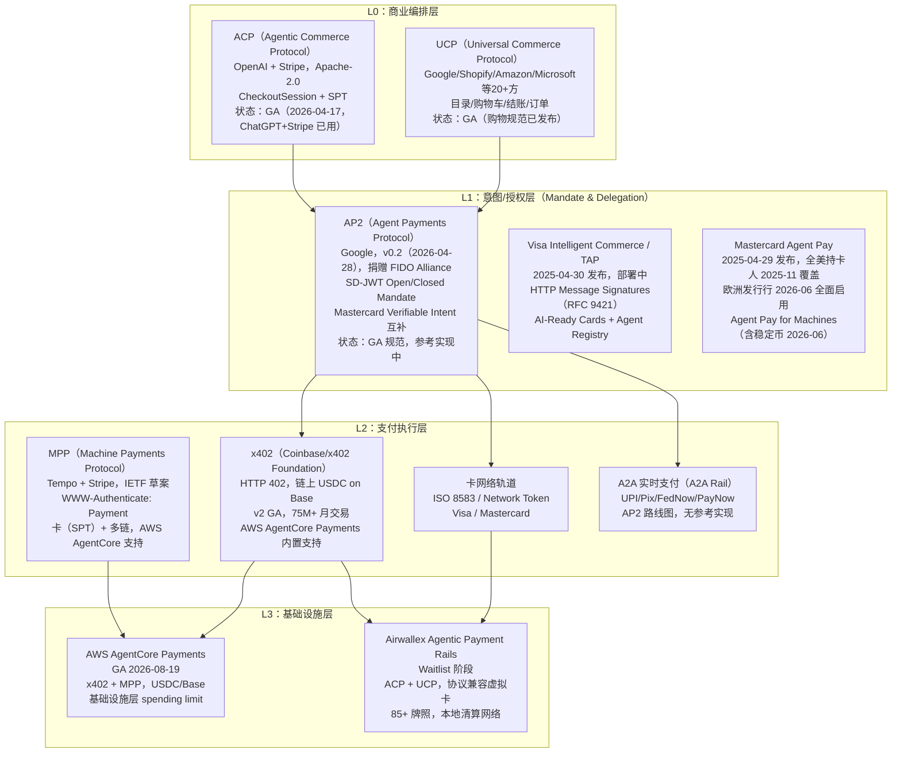
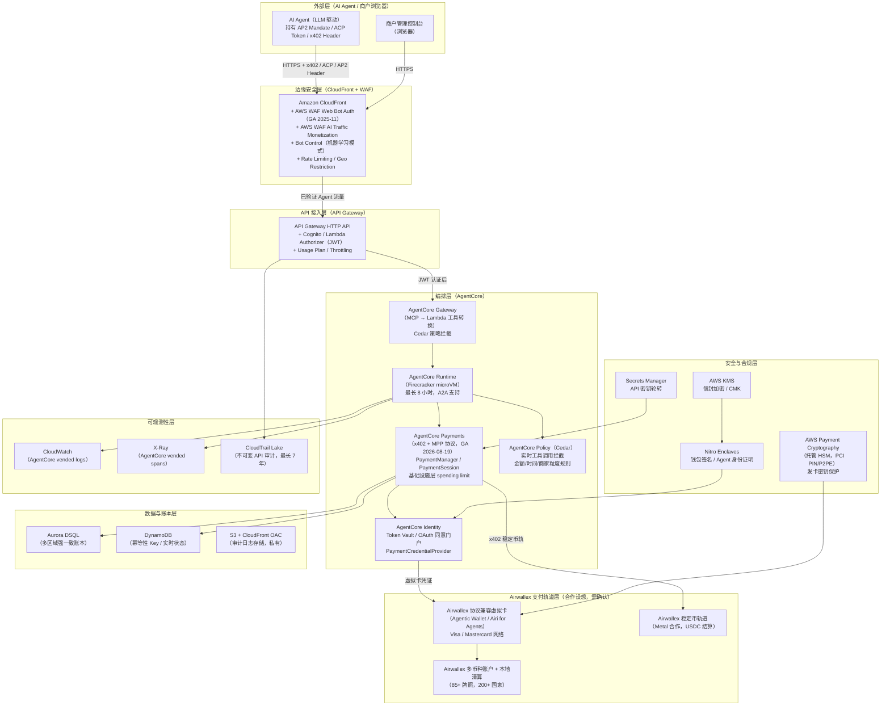
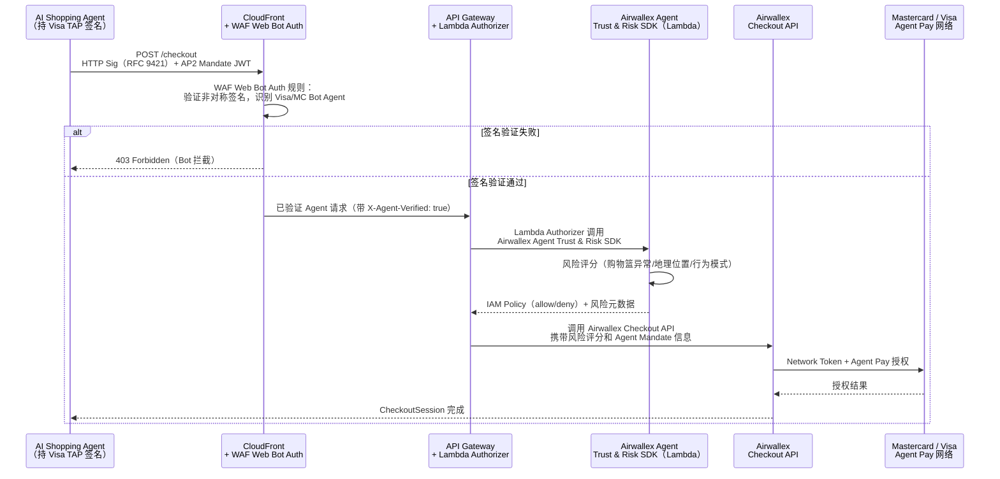
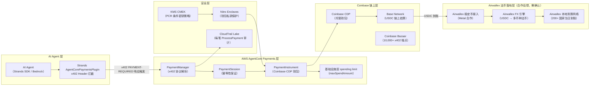
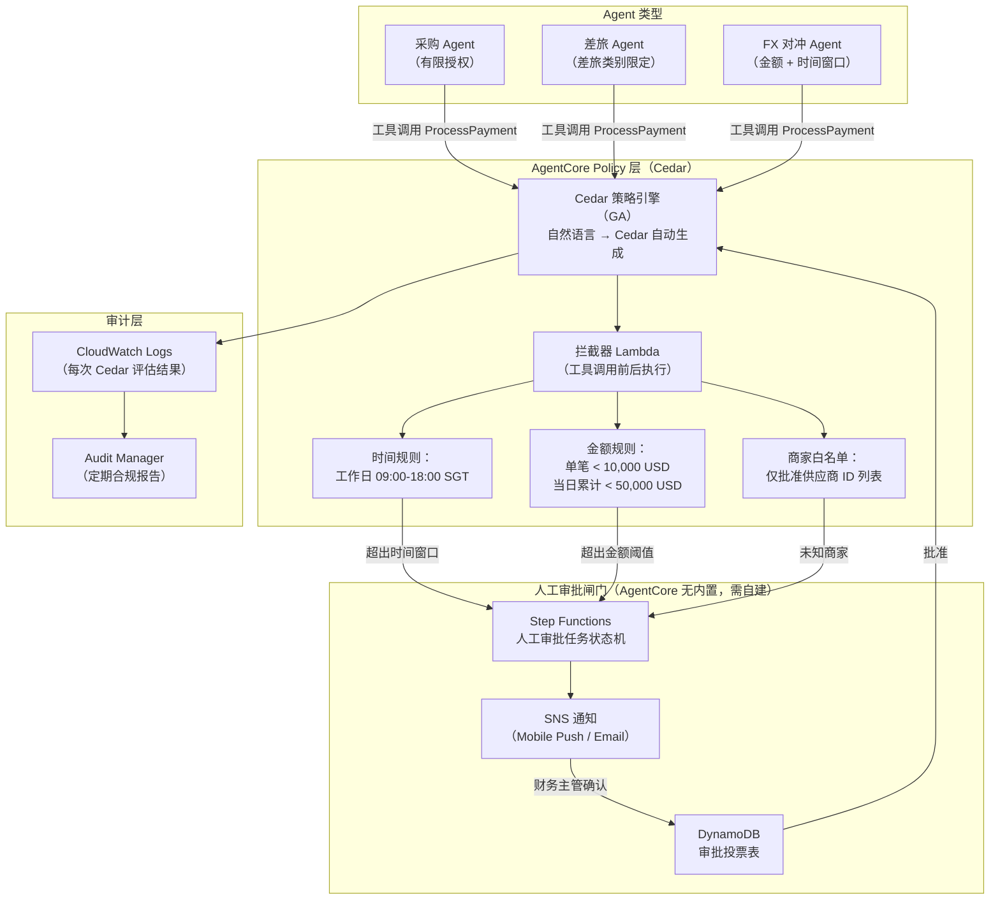
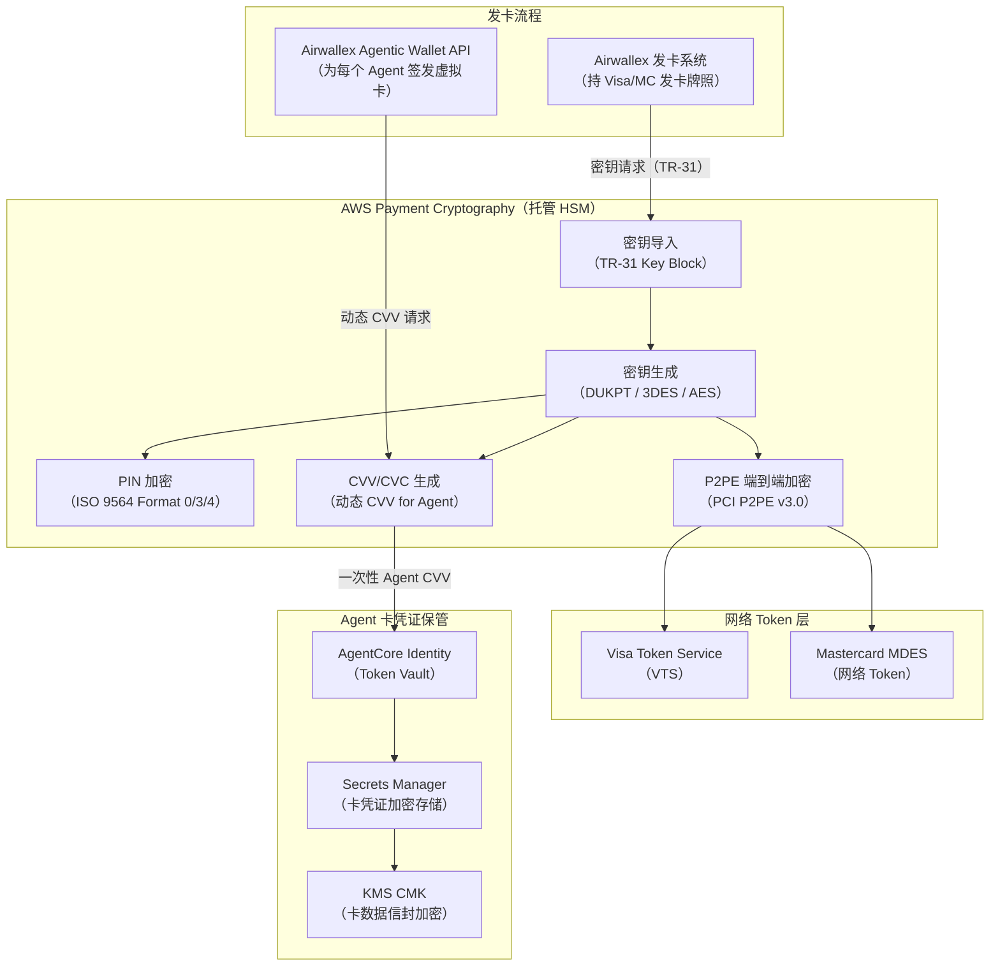
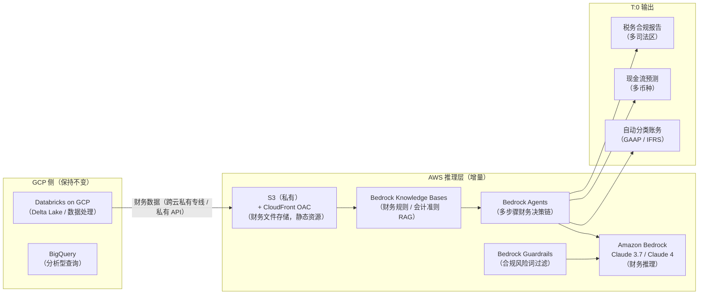
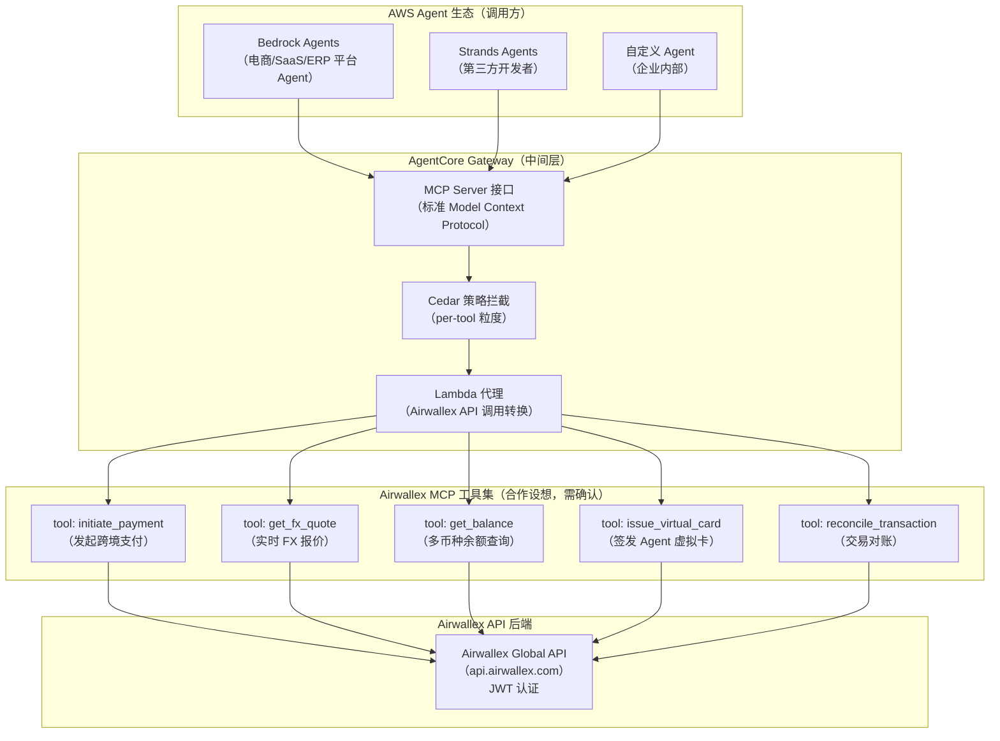

# AWS Agentic Payment 解决方案：面向 Airwallex 等跨境支付 / FinTech 客户

> **文档属性**  
> 作者：AWS 金融行业解决方案架构师  
> 日期：2026-10-20  
> 版本：1.0（内部初稿，基于公开信息）  
> 受众：AWS 金融行业 BD / SA  
> 保密级别：AWS 内部  
> 引用说明：正文 [n] 对应附录参考来源编号；「（推断）」表示作者分析，非已验证事实；「（合作设想，需确认）」表示需与 AWS 产品团队核实后方可对外沟通。

---

## 0. 执行摘要（一页纸）

### 核心论点

Airwallex 是全球估值最高（110 亿美元）的独立跨境支付公司之一，2026 年以"自主财务（autonomous finance）+ agentic 商务（agentic commerce）"为战略核心完成 3.2 亿美元 H 轮融资 [2]。其现有技术栈以 GCP 为主（2022 年迁移）[1]，AWS 目前无公开合作关系。正面"竞争迁移"的打法概率极低。**正确的打法是：以"补充而非替换"为原则，切入 AWS 独有能力（AgentCore Payments、Payment Cryptography、Nitro Enclaves）、监管多云韧性需求（DORA/MAS/HKMA）、以及 Airwallex 作为 AWS 商户生态中的支付轨道三个方向。**

### 最大的战略机会

1. **协议互补**：Airwallex VP Product Partnerships Dan Kim 据其 LinkedIn 博文（2026-08-25 [4]）深度参与 x402 协议生态（具体参与角色见原文，"共同作者"一说来自其本人发文，需进一步核实 x402 规范仓库贡献者记录），Airwallex 与稳定币结算基础设施公司 Metal 有孵化合作 [4]。AWS AgentCore Payments 已 GA，是主要云厂商中较早 GA 的托管 agentic payment 执行服务（截至 2026-10，据公开信息，GCP/Azure 暂无等价托管服务），但只支持稳定币轨道（Coinbase CDP / Stripe Privy，USDC on Base）[5]，**缺卡轨和多币种法币轨**——恰好是 Airwallex 最强的能力（85+ 个牌照、协议兼容虚拟卡、本地清算网络）[3]。双方存在天然互补。

2. **增量 workload**：Airwallex 通过 Databricks on GCP 使用 Anthropic 和 OpenAI 模型 [6]；AWS Bedrock 上的 Claude 可提供数据驻留区域内推理、更强的合规文件（MAS/HKMA Workbook）。AWS Payment Cryptography 的托管 HSM（PCI PIN/P2PE）可服务其发卡业务 [7]。

3. **co-sell 机会**：Airwallex 的 675,000+ 家商户客户中大量是 AWS 用户（推断），ISV Accelerate + Marketplace 路径可实现共同销售闭环。

### 下一步行动（3 项）

| 行动 | 时限 | Owner |
|------|------|-------|
| 通过 AWS 合作团队核实 Dan Kim（VP Product Partnerships）的联络路径，探讨 Airwallex 成为 AgentCore Payments Payment Provider 的可行性 | 2 周 | BD |
| 面向 SA 准备 POC 1：商户侧 CloudFront + WAF Web Bot Auth + Airwallex Agent Trust SDK 集成演示 | 4 周 | SA |
| 申请 AWS GenAI Innovation Center 协助设计 Airwallex T:0 / Agentic Business Account 在 Bedrock 上的 AI 推理层 | 4 周 | BD + SA |

### 关键数字

| 指标 | 数值 | 来源 |
|------|------|------|
| Airwallex 估值 | 110 亿美元 | [2] |
| H 轮融资 | 3.2 亿美元（2026-06-25） | [2] |
| 年化收入 | 13 亿美元（同比 +74%） | [2] |
| 年化交易额 | 2,870 亿美元（同比 +120%） | [2] |
| 全球牌照 | 85+ 个 | [3] |
| AgentCore Payments GA 日期 | 2026-08-19 | [5] |
| AgentCore Payments 支持协议 | x402 v1/v2 + MPP | [5] |
| WAF Web Bot Auth GA 日期 | 2025-11 | [8] |
| Airwallex 云平台 | GCP（2022 年迁移） | [1] |
| AWS 在香港的 Bedrock 状态 | 规划中（无 ETA） | [7] |

---

## 1. 背景：Agentic Payment 协议格局

### 1.1 为什么"AI Agent 支付"是结构性变化

传统支付系统建立在"人直接操作受信 UI"的假设之上：卡号由持卡人输入，OTP 由持卡人接收，交易授权链中始终存在一个明确的"人"。AI Agent 打破了这一假设：Agent 在用户不在场（Human Not Present，HNP）的情况下自主发起支付，任何现有身份验证机制（3DS 挑战、OTP、指纹）都无法直接适用。

这带来四个核心问题 [协议综述]：
1. **谁授权了 Agent**：不可抵赖的委托证明（Mandate）
2. **Agent 的行为边界**：金额上限、商家白名单、时间窗口
3. **出错时谁负责**：争议（Chargeback）和责任归属
4. **如何区分合法 Agent 与恶意 Bot**：KYA（Know Your Agent）

### 1.2 协议分层框架



**关键结论（BD 用一句话版本）**：目前没有任何单一协议能覆盖所有场景。AWS 在"机器支付"（x402/MPP）执行层有托管服务优势；Airwallex 在卡轨和法币本地结算层有独特能力。两者是互补而非竞争关系。

### 1.3 各协议成熟度速查（BD 版）

| 协议 | 发起方 | 当前状态 | 支持轨道 | AWS 支持 |
|------|--------|---------|---------|---------|
| x402 | Coinbase / Linux Foundation | GA，75M+ 月交易 | 链上稳定币（USDC）为主 | ✅ AgentCore Payments GA |
| MPP | Tempo + Stripe | GA（Stripe 生产） | 卡（SPT）+ 多链 | ✅ AgentCore Payments GA |
| ACP | OpenAI + Stripe | GA（ChatGPT 在用） | 卡 | 可部署于 AWS，非内置 |
| AP2 | Google / FIDO Alliance | v0.2 规范，参考实现中 | 卡/A2A（roadmap） | 可部署于 AWS，非内置 |
| UCP | Google / Shopify 等 | 购物规范 GA | 调用 AP2/ACP | Amazon 是 UCP 联合方 |
| Visa TAP | Visa | 部署中（非 GA） | Visa 卡网络 | 商户侧 CloudFront 架构兼容 |
| Mastercard Agent Pay | Mastercard | 扩展中，欧美持卡人覆盖 | 卡 + 稳定币（2026-06） | Azure 是初始合作方；AWS 无直接协议 |

---

## 2. 客户画像：Airwallex

### 2.1 公司概况

Airwallex 成立于 2015 年澳大利亚墨尔本，现总部为新加坡 + 旧金山双中心，全球 27 个办公室，员工 2,300+，累计融资 18 亿美元 [2]。

**2026 年 6 月完成系列 H**：3.2 亿美元，估值 110 亿美元，较 2025 年 12 月系列 G 的 80 亿美元提升 37.5%。领投方 Addition，跟投包括 Baillie Gifford、QED Investors、T. Rowe Price、Amex Ventures。资金用途明确包括"自主财务（autonomous finance）与 agentic 商务（agentic commerce）产品开发" [2]。

| 指标 | 数据（2026-03 节点） |
|------|------|
| 年化收入 | 13 亿美元（+74% YoY） |
| 年化交易额 | 2,870 亿美元（+120% YoY） |
| 企业客户 | 675,000+（产品页口径） |
| 覆盖国家 | 200+（收付款） |
| 当日到账率 | 93% |

### 2.2 产品线与 Agentic 战略

**核心 Agentic 产品（2026-10 现状）**：

Airwallex CEO Jack Zhang 2026-09-30 发布博文"The Agentic Banking Era" [13]，明确提出：Agent 时代"工作单元从交易转向结果"，财务运营从"周期性检查"转为"持续运营"。框架是"Observe → Decide → Act → Reconcile → Repeat"。

| 产品 | 状态 | Agentic 意义 |
|------|------|------|
| **Agentic Commerce Suite** | Waitlist（未 GA） | 面向商户：含 Agentic Checkout SDK、Agent Trust & Risk SDK、Agentic Token Vault、Agentic Payment Rails（基于 Visa/MC 最新标准）；支持 ACP + UCP 协议 |
| **Agentic Wallet（Airi for Agents）** | 即将推出 | 面向 AI 平台：协议兼容虚拟卡（protocol-compatible virtual cards），Agent 自主支付 |
| **Agentic Business Account** | 2026-09-30 公告 | 整合 AI Agent 操作全球财务的单一账户枢纽（85+ 个牌照 + 本地清算网络，来源：官网产品页 [3]） |
| **T:0** | 2026-09 私测 | AI 原生会计平台，覆盖账务/预测/税务/合规/报告 |
| **Expense Policy Agent** | 已上线 | 全天候 AI Agent 跨实体/货币执行费用政策 |

**稳定币战略**：VP Product Partnerships Dan Kim（前 Coinbase 五年，**据其 LinkedIn 博文深度参与 x402 协议生态**；"共同作者"说法来自本人发文，需核实规范仓库贡献者记录）2026-08-25 发文：Airwallex 正在为 Agent 微支付场景构建稳定币基础设施；与 Metal（监管机构认可的稳定币结算基础设施公司）孵化合作，Airwallex 是其首席设计合作伙伴 [4]。

### 2.3 技术栈与云关系

| 维度 | 现状 |
|------|------|
| **主力云** | GCP（2022 年迁移），Google Cloud 官方旗舰案例 [1] |
| **已确认 GCP 服务** | Vertex AI、Gemini、Agent2Agent（A2A）、Looker、BigQuery（部分）、NotebookLM |
| **AI 模型** | Gemini（主力）+ **Anthropic Claude** + OpenAI（通过 Databricks on GCP）[6] |
| **数据平台** | Databricks on GCP（Delta Lake / Unity Catalog） |
| **其他技术栈** | K8s、Cassandra、HashiCorp Vault（Terraform GCP 模块）、OpenTelemetry、Apache Spark |
| **中国大陆** | 可能通过阿里云运营（GitHub 有 `saml2alibabacloud` 工具）（推断） |
| **AWS 关系** | 目前无公开合作案例、Marketplace 上架或战略合作公告 [14] |

**对 AWS 的战略含义**：Airwallex 是 GCP 的旗舰 FinTech 案例，也是 AP2/UCP 发起方 Google 的核心合作伙伴生态。正面推"云迁移"在技术和关系层面都不现实。**AWS 的切入逻辑必须是"增量价值 + 互补能力 + 合作生态"**，而非替换。

### 2.4 全球牌照格局（监管筹码）

Airwallex 持有 85+ 个全球牌照，关键许可包括 [3]：

| 地区 | 关键牌照 | 监管机构 |
|------|---------|---------|
| 香港 | SVF（储值支付工具） | HKMA（UniCard Solution Ltd） |
| 香港 | MSO（货币服务） | 香港海关 |
| 新加坡 | **主要支付机构（MPI）** | MAS |
| 英国 | **FCA EMI**（电子货币机构） | FCA |
| 欧盟 | **EMI + EEA 护照**（荷兰/立陶宛双实体） | DNB / 立陶宛银行 |
| 美国 | MTL（45+ 州）+ FINRA 成员 | 各州 / FINRA |
| 澳大利亚 | AFSL | ASIC |
| 中国大陆 | 支付牌照（预付卡 I 类）| PBOC |
| 日本 | 资金转移业者 Type 2 | 関東財務局 |
| 韩国 | 电子金融业 + 外汇（通过 Paynuri）| FSC / MOEF |
| 印尼 | 支付服务 Category 1 | Bank Sentral RI |
| 马来西亚 | MSB Class A + 电子货币 + 收单 | Bank Negara |
| 巴西 / 墨西哥 | 本地支付机构牌照 | BCB / CNBV |

### 2.5 竞争压力

Airwallex 面临的 Agentic 竞争格局：

| 竞争对手 | Agentic 进度 | 对 Airwallex 的威胁 |
|---------|------------|---------------------|
| **Stripe** | GA：ACP + MPP + x402 + Issuing for Agents + SPT | 协议最广，AI 生态最深（78% Forbes AI 50 用 Stripe）；最强竞争对手 |
| **Adyen** | GA：Adyen Agentic（纽约 2026-06 发布）；ACP + UCP + AP2；已有 MCP Server | 企业商户强，多协议，Visa/MC/Amex 战略合作 |
| **Checkout.com** | 跟进阶段，有 Mastercard Agent Pay 合作迹象 | 中东/欧洲市场竞争 |
| **Ant International（Antom）** | MCP Server GA（2026-01），跨境市场 | APAC 本地支付生态最强 |

**Airwallex 的产品缺口**（截至 2026-10）：MCP Server 尚无公开发布；AP2 协议未明确支持；Agentic Commerce Suite 仍在 waitlist 阶段；Stripe/Adyen 已 GA 的能力 Airwallex 仍在追赶。这既是压力，也是 AWS 协作的切入点。

---

## 3. 客户关心的问题

以下 12 条问题来自客户产品线分析、公开表态及竞争压力，每条给出"问题 → 为什么重要（证据）→ AWS 能力映射 → 成熟度"。

### Q1. 商户如何安全接收 AI Agent 发起的支付？

**为什么重要**：Agentic Commerce Suite 仍在 waitlist；竞争对手 Stripe/Adyen 已 GA；商户需要区分合法 Agent 与恶意 Bot，防止欺诈 [3]。  
**AWS 能力**：CloudFront + WAF Web Bot Auth（2025-11 GA）验证合法 Agent 签名；Airwallex Agent Trust & Risk SDK 可叠加于 API Gateway 后端。  
**成熟度**：WAF Web Bot Auth ✅ GA（CloudFront + 商业区 Regional 资源）；API Gateway + Lambda 后端集成 ✅ GA；与 Airwallex SDK 的联合方案 **（合作设想，需确认）**。

### Q2. 如何给 AI Agent 发卡并精细化控制支出（Know Your Agent）？

**为什么重要**：Agentic Wallet 的"协议兼容虚拟卡"是 Airwallex 的差异化产品；竞争对手 Stripe Issuing for Agents 已有虚拟卡 + 支出控制 + 实时授权拦截 [文献]。  
**AWS 能力**：AWS Payment Cryptography（托管 HSM，PCI PIN/P2PE）保护发卡密钥；AgentCore Policy（Cedar 策略）+ AgentCore Identity 实现 Agent 粒度支出控制；DynamoDB 实时 idempotency key 存储防重复支付。  
**成熟度**：Payment Cryptography ✅ GA（新加坡/悉尼/东京/法兰克福/伦敦）；AgentCore Policy ✅ GA；**香港无 Payment Cryptography（明确不扩展）[7]**。

### Q3. 多协议适配成本如何降低（ACP + UCP + x402 + AP2 同时支持）？

**为什么重要**：Airwallex 商户面向的 AI Agent 来自不同生态，协议碎片化是真实痛点；Adyen 已同时支持 ACP + UCP + AP2 三协议 [文献]。  
**AWS 能力**：AgentCore Gateway（MCP/OpenAPI/Lambda 三种协议转换）提供统一工具入口；AgentCore Payments 原生支持 x402 + MPP 双协议；API Gateway 可构建自定义 ACP/UCP 适配层。  
**成熟度**：AgentCore Gateway ✅ GA；x402/MPP 内置 ✅ GA；ACP/AP2 适配层需自建（**需向 AWS 产品团队确认是否有预置连接器路线图**）。

### Q4. 跨境 Agent 支付的合规边界（KYA / 责任主体认定）？

**为什么重要**：Airwallex 拥有 85+ 牌照，但 Agent 发起交易的监管属性（谁是"Payer"）在各市场尚无统一定论；CEO 明确"治理先行"战略 [13]。  
**AWS 能力**：AgentCore Observability（CloudWatch + X-Ray）自动记录每次 ProcessPayment 调用的完整审计链；CloudTrail Lake 不可变 API 调用历史（最长 7 年）；Nitro Enclaves 实现签名证明链（Solv Labs 案例 [16]）；AWS Audit Manager 合规报告自动化。  
**成熟度**：CloudTrail Lake ✅ GA；AgentCore Observability ✅ GA；Nitro Enclaves ✅ GA；Automated Reasoning Checks（ARc）**⚠️ Preview，仅 us-west-2，English only [7]**。

### Q5. Agent 高频微支付的清算效率与成本如何优化？

**为什么重要**：Dan Kim 博文明确：卡支付固定手续费在微支付场景不经济（"the seller pays more in card fees than it collects"）；Metal 合作和稳定币策略是回应 [4]。  
**AWS 能力**：AgentCore Payments 的 x402 `upto` scheme 支持 pay-per-inference 动态定价；Aurora DSQL 多区域强一致账本（低延迟记账）；Coinbase Bazaar MCP Server（10,000+ x402 端点，通过 AgentCore Gateway 接入）。  
**成熟度**：AgentCore Payments ✅ GA；Aurora DSQL ✅ GA（区域扩展中）。

### Q6. 如何区分合法 Agent 与恶意 Bot？

**为什么重要**：Optimize 360 已上线通用欺诈 AI，但针对 agentic 场景的 Bot 攻击（冒充合法 Agent）是新型威胁；arXiv 2609.35886 发现传统风控模型对 Agent 消费行为存在盲区 [文献]。  
**AWS 能力**：AWS WAF Bot Control + Web Bot Auth（2025-11 GA）：验证 Agent 的非对称签名（IETF 草案），允许已验证 AI agent 流量；Amazon SageMaker Feature Store 实时特征（支持 Agent 行为基线建模）；Bedrock Guardrails Prompt Attack 检测（GA）。  
**成熟度**：WAF Web Bot Auth ✅ GA（**CloudFront + 商业区 Regional 资源**）；SageMaker ✅ GA；**Amazon Fraud Detector 不再接受新客户（2025-11-07）[7]**。

### Q7. 如何为 AI 原生平台提供嵌入式金融（Embedded Finance）？

**为什么重要**：Airwallex 与 Stigg 合作（2026-10-15）将全球支付与权益管理打通，专注 AI 公司计费场景 [3]；Usage-Based Billing 天然适配 AI API 按量计费。  
**AWS 能力**：AgentCore Gateway 将 Airwallex API 暴露为 Agent 工具（MCP 标准）；CloudFront + WAF AI Traffic Monetization 将内容变成 x402 付费端点（**仅 CloudFront**）；AWS Marketplace ISV Accelerate 实现 co-sell。  
**成熟度**：AgentCore Gateway ✅ GA；WAF AI Traffic Monetization ✅ GA（CloudFront 限定）；Marketplace ISV Accelerate **（需内部确认资质要求）**。

### Q8. 多币种智能资金池与 24/7 Treasury Agent？

**为什么重要**：Airwallex CFO 系列博文描述"600 个财务任务"的 AI 转型路线图；Agentic Business Account 定位是"Agent 操作全球财务的单一枢纽" [13]。  
**AWS 能力**：Bedrock Agents 编排多步骤财库决策链；Step Functions 实现分级审批 + 自动执行工作流；Aurora DSQL 多区域账本；QuickSight 多币种现金流可视化。  
**成熟度**：全部 ✅ GA；与 Airwallex 账户 API 的联合方案**（合作设想，需确认）**。

### Q9. 数据驻留与区域部署满足监管要求？

**为什么重要**：EU DORA（已生效）要求 ICT 第三方风险管理和退出策略；MAS 外包指引要求关键系统数据驻留（需核实具体条款）；HKMA SPM TM-G-1 对数据处理有要求 [17]。  
**AWS 能力**：AWS Control Tower + Service Control Policies 实现跨区域合规治理；SCP 区域限制（aws:RequestedRegion）+ VPC Endpoint Policy 限制数据不离开指定区域；AWS Artifact 提供 MAS TRM Workbook / HKMA Workbook / PCI AOC 合规文件。  
**成熟度**：全部 ✅ GA；**香港 Bedrock/AgentCore 不可用，推理需路由至新加坡/东京（可能触发数据驻留问题）[7]**。

### Q10. AI 内部运营效率（Finance AI Transformation）？

**为什么重要**：Airwallex 已在 Databricks on GCP 上使用 Anthropic 模型 [6]；T:0 收购 Leapfin 后推进 AI 原生账务。  
**AWS 能力**：Amazon Bedrock 上的 Claude（数据驻留区域内推理）；Bedrock Knowledge Bases 构建财务 RAG；Amazon Q Business 企业知识问答。  
**成熟度**：Bedrock ✅ GA（新加坡/悉尼/东京/法兰克福/伦敦）；Claude on Bedrock ✅ GA；**作为增量 workload，不干扰现有 GCP 主架构**。

### Q11. 稳定币与法币混合多轨结算？

**为什么重要**：Dan Kim（x402 协议深度参与者，据其 LinkedIn 博文）明确稳定币适合 Agent 微支付；Metal 合作是监管机构认可的结算基础设施；Hong Kong HKMA 已开放稳定币牌照申请（需核实 Airwallex 是否申请）[4]。  
**AWS 能力**：AgentCore Payments（USDC on Base）；Amazon Managed Blockchain（Ethereum Mainnet 节点，用于 USDC x402 交易验证）；Nitro Enclaves 保护稳定币钱包签名密钥；KMS 管理密钥生命周期。  
**成熟度**：AgentCore Payments ✅ GA（稳定币轨）；AMB ✅ GA；Nitro Enclaves ✅ GA；卡轨 agentic 集成 **⚠️ AgentCore Payments 暂不支持，需通过 Stripe/Coinbase 桥接**。

### Q12. 多云韧性与集中度风险（DORA / MAS / HKMA）？

**为什么重要**：EU DORA（Digital Operational Resilience Act）已对 ICT 第三方服务商集中度风险提出要求（需核实具体适用条款）；MAS/HKMA 外包指引对备份和退出策略有明确要求（需核实具体条款）。  
**AWS 能力**：AWS 在新加坡（ap-southeast-1）、悉尼（ap-southeast-2）、法兰克福（eu-central-1）、伦敦（eu-west-2）均可作为 GCP 的第二云或灾备；Landing Zone Accelerator for FSI 提供多账户合规基础架构。  
**成熟度**：全部 ✅ GA；具体监管条款适用性**（需核实 DORA / MAS / HKMA 的 ICT 集中度量化要求，标「需核实」）**。

---

## 4. 方案总览

### 4.1 分层架构原则

本文档所有架构设计遵循以下安全约束（来自用户全局要求）：
- **绝不**设计任何公开访问的 AWS 资源（Lambda URL AuthType NONE、公开 S3、0.0.0.0/0 非 web 端口等）
- 对外暴露的端点**只能**走 CloudFront 或 API Gateway，并带认证 / WAF
- 静态资源使用 CloudFront + OAC（Origin Access Control）

### 4.2 整体架构分层图



### 4.3 AWS 服务在 Agentic Payment 中的职责矩阵

| 职责域 | AWS 服务 | Airwallex 对应能力 | 互补关系 |
|-------|---------|-----------------|---------|
| Agent 接入验证 | CloudFront + WAF Web Bot Auth | Agent Trust & Risk SDK | AWS 验证签名；Airwallex 风险评分叠加 |
| Agent 支付执行 | AgentCore Payments（x402/MPP） | Agentic Payment Rails | AWS 稳定币轨；Airwallex 卡轨 + 法币轨 |
| 虚拟卡发行 | Payment Cryptography（HSM） | Agentic Wallet（虚拟卡） | AWS 保护密钥；Airwallex 持牌发卡 |
| 支出策略 | AgentCore Policy（Cedar） | Agentic Token Vault | AWS 基础设施层控制；Airwallex 应用层策略 |
| Agent 身份 | AgentCore Identity（Token Vault） | Agent Trust & Risk SDK | AWS 凭证存储；Airwallex 身份数据 |
| 多协议适配 | AgentCore Gateway（MCP） | ACP + UCP 支持（waitlist） | AWS 标准化工具接口；Airwallex 支付工具提供方 |
| 账本与幂等 | Aurora DSQL + DynamoDB | Airwallex 账户 API | AWS 基础设施账本；Airwallex 业务账本 |
| 合规审计 | CloudTrail Lake + Audit Manager | 85+ 牌照合规框架 | AWS 技术审计证明；Airwallex 监管合规主体 |
| AI 推理 | Bedrock（Claude/Nova） | Gemini + Claude on Databricks | 增量 workload；数据驻留区域内推理 |
| 发卡 HSM | Payment Cryptography | Airwallex 发卡体系 | AWS PCI PIN/P2PE 托管；Airwallex 是客户 |

---

## 5. 场景方案

### S1. 商户侧 Agent 支付安全接收（Web Bot Auth + Airwallex Checkout）

**目标**：帮助 Airwallex 的商户客户安全接收来自 AI Shopping Agent 的支付请求，区分合法 Agent（持有 Visa/MC 签名或 AP2 Mandate）与恶意 Bot，同时不影响正常人类用户结账体验。

**背景**：Airwallex Agentic Commerce Suite 仍在 waitlist 阶段；Stripe/Adyen 已 GA；商户面临"被 Bot 刷单 vs. 错误拒绝合法 Agent"的双重风险。

**架构图**



**关键 AWS 服务**

| 服务 | 用途 | 状态 |
|-----|------|------|
| CloudFront | CDN + WAF 附着点 | ✅ GA |
| WAF Web Bot Auth | 验证 IETF Web Bot Auth（RFC 9421）签名；Visa TAP 兼容性需核实 | ✅ GA（CloudFront + 商业区 Regional 资源）|
| WAF Bot Control | 机器学习模式检测未注册 Bot | ✅ GA |
| API Gateway HTTP API | 结账端点，带 JWT 验证 | ✅ GA |
| Lambda | 调用 Airwallex SDK 做风险评分 | ✅ GA |
| CloudWatch + X-Ray | 每次 Agent 支付请求审计链 | ✅ GA |

**设计要点**

1. WAF Web Bot Auth 已同时支持 CloudFront distributions 和商业区 Regional 资源（ALB/API Gateway 等），不再仅限于 CloudFront [8]；所有结账端点仍应通过 CloudFront 或 API Gateway 暴露，不得直接公开（安全合规要求）。
2. WAF Web Bot Auth 基于 IETF HTTP Message Signatures（RFC 9421）验证 Bot/Agent 身份（Ed25519 签名、`Signature-Agent` / `Signature-Input` / `Signature` 头）；Visa TAP 同样基于 RFC 9421，与 WAF 机制在协议层兼容，但**直接验证 Visa TAP tag（`agent-payer-auth` / `agent-browser-auth`）的具体实现需向 AWS WAF 产品团队确认**（标「需核实」）。**Mastercard Verifiable Intent 是意图凭证（intent credential），机制与 HTTP Message Signatures 不同，不适用 WAF Web Bot Auth 验证流程，勿混淆。**
3. Airwallex Agent Trust & Risk SDK 作为 Lambda Authorizer 调用，不在 AWS 基础设施暴露，符合安全约束。
4. Lambda Authorizer 返回的 IAM Policy 实现"认证（WAF）+ 授权（Airwallex 风险评分）"双层决策。

**成熟度与缺口**

| 组件 | 成熟度 | 缺口/风险 |
|------|--------|---------|
| WAF Web Bot Auth | GA | 已支持 CloudFront + 商业区 Regional 资源；Visa TAP tag 具体兼容性需核实 |
| Airwallex Agent Trust & Risk SDK 集成 | 合作设想，需确认 | SDK 是否有 Lambda 兼容包？接口文档是否公开？ |
| Visa TAP 签名格式兼容性 | 需核实 | Visa TAP 尚未 GA，格式可能变更 |

**POC 指标（4 周内可交付）**

- Bot 拦截率：模拟 1000 次无签名请求，100% 被 WAF 拦截
- 合法 Agent 通过率：模拟 100 次带有效 HTTP Sig 请求，>99% 通过
- P95 延迟：WAF + Lambda Authorizer 全链路 < 200ms

---

### S2. AgentCore Payments + Airwallex 稳定币多轨结算

**目标**：为 AI Agent 微支付场景（pay-per-inference、pay-per-API-call）提供稳定币快速结算通道，同时通过 Airwallex 多牌照体系实现法币落地（off-ramp）。

**背景**：Dan Kim 博文 [4] 明确稳定币在 Agent 微支付场景的经济性优势（固定卡手续费不适合 $0.001-$0.01 的微支付）；Metal 合作提供受监管机构认可的结算基础设施；AWS AgentCore Payments 已原生支持 x402 + USDC on Base [5]。

**架构图**



**x402 v2 关键字段说明（基于代码库分析 [x402 SHA: faa1c694]）**

| 字段 | v1 | v2 | 含义 |
|-----|----|----|------|
| Header（服务器返回） | HTTP 402 + JSON body（无专用头；v1 无 `X-PAYMENT-REQUIRED`）| `PAYMENT-REQUIRED` header（base64 JSON）| v1 → v2 wire 格式不兼容 |
| 支付类型 | `exact` | `exact` / `upto` | `upto` 适合动态定价（pay-per-inference） |
| 协议 | `x402/v1` | `x402/v2` | Wire 格式不兼容，需版本协商 |
| 接受方案 | `accepts[]` | `accepts[]` | 多钱包/多链支持 |

**设计要点**

1. Strands SDK 的 `AgentCorePaymentsPlugin` 自动拦截 x402 响应，无需 Agent 代码感知支付逻辑 [5]。
2. `maxSpendAmount` 在基础设施层（AgentCore Payments）而非 Agent 代码层强制执行——即使 Agent 代码被攻击，支出上限依然有效。
3. Nitro Enclaves 保护钱包签名私钥，KMS CMEK 使用 PCR 条件策略确保只有 Enclaves 内代码可访问密钥——参考 Solv Labs 案例 [16]。
4. Airwallex 的法币落地层是**合作设想**：需确认 Airwallex 是否接受链上 USDC 并通过 Metal/自有基础设施转换为多币种法币。这是最有价值的合作场景，但也是最需要确认的部分。

**成熟度与缺口**

| 组件 | 成熟度 | 缺口/风险 |
|------|--------|---------|
| AgentCore Payments（x402） | ✅ GA | 仅 USDC on Base；无法币轨 |
| Strands AgentCorePaymentsPlugin | ✅ GA | Python/JS SDK 可用 |
| Nitro Enclaves + KMS PCR 策略 | ✅ GA | 需要 nitro-enabled EC2（m5/c5 等），不支持 Fargate |
| Airwallex USDC 接收 + 法币落地 | 合作设想，需确认 | 核心依赖：Metal 合作是否提供 API？Airwallex 是否开放稳定币接入 API？ |
| x402 v1/v2 版本协商 | 需测试 | x402 v2 wire 格式与 v1 不兼容，AgentCore Payments 是否同时支持两个版本需确认 |

**POC 指标（2 周内可交付）**

- 完成端到端 x402 支付：Agent → AgentCore Payments → Coinbase CDP → Base 链上确认
- 延迟：P90 < 3 秒（Base 出块时间约 2 秒）
- Spending Limit 验证：超限请求被 AgentCore 阻断，不触达链上

---

### S3. AgentCore Policy（Cedar）实现 Know Your Agent（KYA）精细控制

**目标**：为 Airwallex 的企业商户提供可审计、可审查的 AI Agent 支出策略管理——类比"Know Your Customer（KYC）"的"Know Your Agent（KYA）"能力，满足其 85+ 牌照体系下的内部控制要求。

**背景**：Airwallex CEO 博文 [13] 明确"治理先行"，Expense Policy Agent 已上线但策略管理能力有限；企业客户需要 Agent 粒度的支出控制、异常行为告警、人工审批闸门。

**架构图**



**Cedar 策略示例（自然语言转换）**

用户输入："采购 Agent 工作日内只能向批准供应商付款，单笔不超过 10,000 美元"

AgentCore Policy 自动生成 Cedar（推断为类似格式，实际语法需按 AgentCore 文档核实）：

```cedar
permit (
  principal is AgentCore::Agent,
  action == AgentCore::Action::"ProcessPayment",
  resource is AgentCore::Tool
) when {
  principal.agentType == "PurchaseAgent" &&
  context.payment.amount <= 10000 &&
  context.payment.currency == "USD" &&
  context.payment.merchantId in principal.approvedMerchants &&
  context.time.dayOfWeek in [1,2,3,4,5] &&
  context.time.hour >= 9 && context.time.hour <= 18
};
```

**重要设计说明**：AgentCore Payments **没有内置的人工审批闸门**（Human-in-the-Loop）[5]。超过 Cedar 策略阈值的请求会被拒绝，但不会自动进入人工审批队列。**需要自建 Step Functions 审批工作流**，由拦截器 Lambda 在 Cedar deny 时触发。

**成熟度与缺口**

| 组件 | 成熟度 | 缺口/风险 |
|------|--------|---------|
| AgentCore Policy（Cedar） | ✅ GA | 自然语言 → Cedar 转换的准确率需测试 |
| 拦截器 Lambda | ✅ GA（自定义代码） | 需自建 |
| Step Functions 人工审批 | ✅ GA | 需自建，AgentCore 无内置支持 |
| Automated Reasoning Checks（ARc） | ⚠️ Preview | 仅 us-west-2，English only；无法用于新加坡/香港部署 |

**POC 指标（2 周内可交付）**

- Cedar 策略评估延迟：P95 < 50ms（不含 Step Functions 路径）
- 策略覆盖率：3 类 Agent（采购/差旅/FX）各测试 20 条边界案例，全部正确评估
- 审批工作流：超限请求触发 SNS 通知，审批响应 < 30 秒内完成 DynamoDB 写入

---

### S4. Payment Cryptography（托管 HSM）支持 Airwallex 发卡业务

**目标**：为 Airwallex 的发卡业务（Agentic Wallet 虚拟卡、企业卡）提供 PCI PIN/P2PE 认证的托管 HSM，替换或补充其现有自建 HSM 方案，降低 PCI 合规运维成本。

**背景**：Airwallex 的 Agentic Wallet 需要为每个 AI Agent 动态签发协议兼容虚拟卡；卡密钥材料的生成和保护必须满足 PCI PIN Security / P2PE 要求；自建 HSM 运维成本高，且在 2022 年 GCP 迁移中已经历一次基础设施重构（推断其 HSM 架构也在演进）。

**架构图**



**关键设计要点**

1. AWS Payment Cryptography 支持 TR-31 Key Block 密钥导入，Airwallex 可将现有卡密钥迁移到 AWS 托管 HSM，无需替换整个发卡体系。
2. 动态 CVV（dCVV）为每个 AI Agent 生成一次性 CVV，与 Mastercard Agent Pay / Visa TAP 的 Network Token 机制互补，形成"网络 Token + 动态 CVV"双层保护。
3. AgentCore Identity Token Vault 存储每个 Agent 的卡凭证（非明文），与 Airwallex Agentic Token Vault 形成分层：AWS 管理底层 HSM，Airwallex 管理业务逻辑层。
4. **香港（ap-east-1）截至 2026-10 官方端点列表未包含 Payment Cryptography** [7]。面向香港客户的发卡业务需路由至新加坡（ap-southeast-1）——需评估数据驻留合规影响。

**区域可用性**

| AWS 区域 | Payment Cryptography | 说明 |
|---------|---------------------|------|
| ap-southeast-1（新加坡） | ✅ GA | Airwallex 新加坡 MPI 牌照主要运营区域 |
| ap-southeast-2（悉尼） | ✅ GA | 澳大利亚 AFSL 牌照运营区域 |
| ap-northeast-1（东京） | ✅ GA | 日本资金转移业者 Type 2 |
| eu-central-1（法兰克福） | ✅ GA | EU EMI / DORA 合规 |
| eu-west-2（伦敦） | ✅ GA | 英国 FCA EMI |
| us-east-1 | ✅ GA | 美国 MTL 多州 |
| **ap-east-1（香港）** | **❌ 明确不扩展** | 香港 SVF 业务需评估替代方案 |

**POC 指标（3 周内可交付）**

- 在新加坡区域完成 TR-31 密钥导入
- 完成动态 CVV 生成性能测试：P99 < 50ms（1,000 并发请求）
- PCI 合规文档：AWS AOC + Airwallex 自有 PCI 文档组合方案

---

### S5. Bedrock + Airwallex 构建 T:0 AI 原生财务 Agent

**目标**：将 Airwallex T:0 AI 原生账务平台的 AI 推理层迁移到 Amazon Bedrock（Claude），利用 Bedrock 数据驻留 + 合规文件优势（MAS/HKMA Workbook），同时保持 Airwallex 现有 GCP/Databricks 数据管道不变。

**背景**：Airwallex 已通过 Databricks on GCP 使用 Anthropic Claude 模型 [6]；T:0 收购 Leapfin（AI 账务自动化）后进入 Private Beta；Bedrock 上的 Claude 可提供与现有模型相同的能力，但数据驻留更灵活、MAS/HKMA 合规文件更完整。这是**不干扰 GCP 主架构的增量 workload** 切入点。

**架构图（简化）**



**关键设计要点**

1. GCP 侧 Databricks 数据管道保持不变；跨云传输走私有专线（AWS Direct Connect 与 Google Cloud Interconnect 经合作伙伴互联，或 AWS 跨云互联类服务，可用性需确认）或经 PrivateLink / 双向 TLS 的私有 API；落地 S3 私有桶（Block Public Access = BLOCK_ALL），仅经 VPC Endpoint 访问，不经 CloudFront、不公开暴露。（原文"VPC Peering"不适用于跨云场景，已更正）
2. Bedrock Knowledge Bases 加载 GAAP/IFRS 准则、各司法区税务规则、Airwallex 内部会计政策，实现 RAG 增强。
3. Bedrock Guardrails 过滤可能导致合规风险的 LLM 输出（如建议违规避税操作）。
4. MAS/HKMA 合规论点：Bedrock 在新加坡（ap-southeast-1）提供区域内推理，满足 MAS TRM Workbook 对数据处理地理位置的要求（具体条款需 SA 与客户法务团队确认）。
5. **香港 Bedrock 仍处于"规划中"状态（无 ETA）** [7]——面向香港 HKMA 监管场景，需使用新加坡区域并评估数据驻留合规性。

**成熟度**：Bedrock + Knowledge Bases + Agents + Guardrails 全部 ✅ GA（新加坡/悉尼/东京/法兰克福/伦敦）。

---

### S6. AgentCore Gateway 将 Airwallex 支付能力注册为 MCP Tool

**目标**：将 Airwallex 的支付 API（发起支付、查询余额、FX 报价、虚拟卡签发等）通过 AgentCore Gateway 注册为标准 MCP 工具，使 AWS 生态中的任何 AI Agent 都能"调用 Airwallex 支付工具"，实现 Airwallex 作为 AWS 商户生态中的支付轨道的战略定位。

**背景**：AgentCore Gateway 已 GA，支持 MCP Server → Lambda 工具转换，内置 Cedar 策略拦截；Coinbase Bazaar 已通过相同机制接入 10,000+ x402 端点 [5]；这是 Airwallex 在 AWS 生态获取分发渠道的最直接路径。

**架构图**



**设计要点**

1. Lambda 代理函数不直接暴露公网：仅由 AgentCore Gateway 内部调用，Airwallex API 密钥存储于 Secrets Manager，通过 VPC Endpoint 访问。
2. Cedar 策略为每个 Airwallex 工具设置独立权限规则（例如：`issue_virtual_card` 只允许具有 `CardIssuer` 角色的 Agent 调用）。
3. 这是**AWS Marketplace ISV Accelerate 的自然起点**：将 Airwallex 注册为 Gateway Target 后，可通过 Marketplace 分发给 AWS 客户，实现 co-sell。
4. AgentCore Gateway 的 `interceptorLambda` 可在每次工具调用前后执行自定义逻辑（如记录 Airwallex 交易 ID、写入 CloudTrail）。

**成熟度**：AgentCore Gateway ✅ GA；工具定义和 Lambda 实现需自建；Airwallex API 接入**（合作设想，需确认）**。

**POC 指标（2 周内可交付）**

- 注册 `get_fx_quote` 和 `get_balance` 两个只读工具，完成端到端 MCP 调用验证
- 延迟：P90 MCP 调用 < 500ms（包含 Airwallex API 往返）
- Cedar 策略验证：未授权 Agent 调用 `issue_virtual_card` 被拦截

---

## 6. AWS 服务映射总表

| AWS 服务 | 类别 | 在 Agentic Payment 中的用途 | 状态 | 关键限制 |
|---------|------|--------------------------|------|---------|
| **AgentCore Payments** | 核心 | x402 + MPP 协议执行；USDC 稳定币支付 | ✅ GA（2026-08-19） | 仅稳定币轨；us-east-1/us-east-2/us-west-2、ap-southeast-1（新加坡）/ap-southeast-2（悉尼）、欧洲多区（法兰克福/爱尔兰/伦敦/米兰/巴黎/西班牙/斯德哥尔摩）；**东京（ap-northeast-1）无，香港（ap-east-1）无**（来源：AgentCore 区域表，2026-10-20）|
| **AgentCore Gateway** | 核心 | MCP 工具注册；Airwallex API 代理；Cedar 拦截 | ✅ GA | 需自建 Lambda 工具实现 |
| **AgentCore Runtime** | 核心 | 长时 Agent 执行（最长 8 小时）；Firecracker 隔离 | ✅ GA | P75 冷启动 1.9-2.0s |
| **AgentCore Policy（Cedar）** | 核心 | Agent 粒度支出控制；实时工具调用拦截 | ✅ GA | 无内置人工审批闸门 |
| **AgentCore Identity** | 核心 | Token Vault；OAuth 同意；PaymentCredentialProvider | ✅ GA | — |
| **AgentCore Observability** | 核心 | OTEL 兼容；CloudWatch vended logs；X-Ray vended spans | ✅ GA | — |
| **Amazon Bedrock** | AI 推理 | Claude/Nova 推理；财务 Agent 编排 | ✅ GA | **香港无 Bedrock（规划中，无 ETA）** |
| **Bedrock Knowledge Bases** | AI 推理 | 财务规则 RAG；合规策略知识库 | ✅ GA | — |
| **Bedrock Guardrails** | AI 推理 | 合规风险词过滤；Prompt Attack 检测 | ✅ GA | ARc 功能 ⚠️ Preview（us-west-2，English only） |
| **AWS Payment Cryptography** | 安全 | PCI PIN/P2PE 托管 HSM；发卡密钥保护；动态 CVV | ✅ GA | **香港明确不扩展**；需 Visa/MC 发卡主体持牌 |
| **CloudFront + WAF Web Bot Auth** | 安全 | Agent 签名验证（IETF HTTP Sig RFC 9421）；Bot 拦截 | ✅ GA | Web Bot Auth 已支持 **CloudFront + 商业区 Regional 资源**（ALB/API GW）；Visa TAP tag 具体兼容性需核实 |
| **WAF AI Traffic Monetization** | 安全 | 内容变 x402 付费端点；返回 402 + Coinbase CDP | ✅ GA | 仅 CloudFront |
| **WAF Bot Control** | 安全 | ML 模式检测未注册 Bot | ✅ GA | — |
| **Nitro Enclaves** | 安全 | 钱包私钥保护；Agent 身份签名证明 | ✅ GA | 需 nitro-enabled EC2；不支持 Fargate |
| **AWS KMS** | 安全 | CMK；PCR 条件密钥策略（配合 Nitro） | ✅ GA | — |
| **Secrets Manager** | 安全 | Airwallex API 密钥；钱包凭证轮转 | ✅ GA | — |
| **API Gateway HTTP API** | 接入 | 结账端点（CloudFront 后端）；JWT 认证 | ✅ GA | 需在 CloudFront 后，不得直接公开 |
| **Aurora DSQL** | 数据 | 多区域强一致账本（替代 QLDB） | ✅ GA | 区域覆盖扩展中 |
| **DynamoDB** | 数据 | 幂等性 Key；实时 Agent 状态；审批投票 | ✅ GA | — |
| **S3 + OAC** | 数据 | 审计日志；财务文档存储（私有，CloudFront OAC 访问） | ✅ GA | 必须配置 Block Public Access = BLOCK_ALL |
| **CloudTrail Lake** | 合规 | 不可变 API 调用历史（最长 7 年）；ProcessPayment 审计 | ✅ GA | — |
| **AWS Audit Manager** | 合规 | PCI DSS / MAS TRM / HKMA 自动合规报告 | ✅ GA | — |
| **AWS Artifact** | 合规 | MAS TRM Workbook / HKMA Workbook / PCI AOC 文件 | ✅ GA | — |
| **Step Functions** | 工作流 | 人工审批闸门；多步骤财库决策链 | ✅ GA | 需自建 |
| **Amazon Managed Blockchain** | 链上 | Ethereum 节点；USDC x402 交易验证 | ✅ GA | — |
| **Strands Agents SDK** | 开发框架 | AgentCorePaymentsPlugin；Strands Box Cedar 策略 | ✅ GA（开源） | — |
| **Amazon Fraud Detector** | 风控 | — | ❌ **不再接受新客户（2025-11-07）** | 替代：SageMaker + AutoGluon |
| **SageMaker Feature Store** | 风控 | 实时 Agent 行为特征；欺诈基线建模 | ✅ GA | — |
| **Amazon Q Business** | 运营 | 企业知识问答；财务运营 Copilot | ✅ GA | — |
| **AWS Control Tower + SCP** | 治理 | 多账户合规治理；数据驻留强制 | ✅ GA | — |

---

## 7. 区域与合规

### 7.1 Airwallex 关键市场的 AWS 服务可用性矩阵

| 市场 | AWS 区域 | Bedrock | AgentCore Payments | Payment Cryptography | WAF Web Bot Auth | 说明 |
|-----|---------|---------|-------------------|---------------------|-----------------|------|
| **新加坡** | ap-southeast-1 | ✅ | ✅ | ✅ | ✅ | 最完整支持；Airwallex 主要 MPI 牌照 |
| **澳大利亚** | ap-southeast-2 | ✅ | ✅ | ✅ | ✅ | Airwallex 总部起源地，AFSL 牌照 |
| **日本** | ap-northeast-1 | ✅ | ❌ | ✅ | ✅ | **AgentCore Payments 不在东京** |
| **英国** | eu-west-2 | ✅ | ✅ | ✅ | ✅ | FCA EMI 牌照 |
| **德国/欧盟** | eu-central-1 | ✅ | ✅ | ✅ | ✅ | EU EMI / DORA 合规；荷兰/立陶宛牌照 |
| **美国** | us-east-1 | ✅ | ✅ | ✅ | ✅ | MTL 45+ 州；FINRA 成员 |
| **香港** | ap-east-1 | ⚠️ 规划中 | ⚠️ 规划中 | ❌ 明确不扩展 | ✅ | **最大区域空白**；SVF/MSO 牌照 |
| **中国大陆** | cn-north-1/cn-northwest-1 | ❌（独立商业云）| ❌ | ❌ | — | 需中国区 AWS 独立架构 |
| **印度** | ap-south-1 | ✅ | ⚠️ 待确认 | ⚠️ 待确认 | ✅ | — |
| **巴西** | sa-east-1 | ✅ | ⚠️ 待确认 | ❌ | ✅ | — |

**香港区域风险摘要**（BD 重点说明）：
- Airwallex 的香港 SVF（储值支付工具）业务涉及 HKMA 监管的核心支付功能
- AWS ap-east-1（香港）：Bedrock 规划中（无 ETA），AgentCore Payments 规划中，Payment Cryptography 明确不扩展
- 实际影响：香港相关工作负载需路由至新加坡（ap-southeast-1），需评估 HKMA 数据驻留要求
- **竞争含义**：Azure East Asia（香港）Region 完整可用，是 AWS 在香港最大的竞争劣势

### 7.2 主要监管框架与 AWS 应对

| 监管框架 | 适用 Airwallex 市场 | 关键要求 | AWS 能力 | 未覆盖风险 |
|---------|-----------------|---------|---------|---------|
| **MAS TRM** | 新加坡 | 外包风险管理；数据驻留；第三方审计 | AWS Artifact MAS TRM Workbook；ap-southeast-1 区域内推理 | 具体条款数据驻留要求需法务核实 |
| **HKMA SPM TM-G-1** | 香港 | 外包控制；数据处理地理位置 | AWS Artifact HKMA Workbook；Control Tower SCP | **ap-east-1 Bedrock 不可用**；新加坡路由的合规性待核实 |
| **EU DORA** | 英国/EU | ICT 第三方风险；集中度风险；退出策略 | Landing Zone Accelerator；多区域架构；CloudTrail Lake 审计 | DORA 具体量化 ICT 集中度阈值需核实；AWS 是否被认定为"关键 ICT 第三方服务商"需评估 |
| **PCI DSS v4.0** | 全球 | 持卡人数据保护；密钥管理 | Payment Cryptography（PCI PIN/P2PE）；Nitro Enclaves；KMS | 香港无 Payment Cryptography |
| **GENIUS Act（P.L. 119-27）** | 美国 | 稳定币监管；发行方要求 | AgentCore Payments（USDC on Base）；Coinbase CDP 合规 | Airwallex 是否计划申请 GENIUS Act 下的稳定币发行人资质需确认 |
| **MiCA（EU）** | 欧盟 | 加密资产监管；过渡期已于 2026-07-01 结束 | eu-central-1 + eu-west-2 区域部署 | Airwallex 稳定币业务在 EU 的 MiCA 合规状态需确认 |
| **HKMA 稳定币牌照** | 香港 | 2025 年已开放申请 | — | Airwallex 是否申请稳定币牌照需确认；若申请，Hong Kong 区域 AWS 能力不足是障碍 |

### 7.3 多云韧性论点（对抗 GCP 集中度）

Airwallex 目前 100% GCP（推断），在以下监管框架下存在 ICT 集中度风险论据：

1. **EU DORA 第 28(8) 条**（关键 ICT 第三方服务的退出策略要求）和**第 29 条**（ICT 集中度风险初步评估）：要求金融实体对"关键"ICT 第三方服务商建立集中风险评估机制和可执行退出策略（具体量化要求需法务/合规确认；**注意**：第 30 条为合同条款要求，第 12 条为 ICT 业务连续性，均非此处所指条款；信息共享要求在第 45 条）。

2. **MAS TRM 第 5 章**：要求制定"业务连续性计划"，评估关键服务商单点风险（需核实具体条款对多云的要求）。

3. **HKMA ORSA**：要求 SVF 持牌机构评估操作风险，包括 ICT 服务商集中度（需核实具体条款）。

**AWS BD 话术**："DORA/MAS/HKMA 监管框架要求您对关键 ICT 服务商建立退出策略。我们不是要求您迁移现有工作负载，而是帮助您建立一个合规的第二云层，专注于 Payment Cryptography、合规审计和 AI 推理这些高监管敏感性能力，既满足监管要求，又不干扰您的 GCP 主架构。"

---

## 8. 竞争定位

### 8.1 AWS vs GCP vs Azure：在 Agentic Payment 场景的客观对比

BD 说明：对竞争对手的评估必须保持诚实，错误的竞争定位会在客户技术评审时损害可信度。以下是尽量客观的对比。

| 维度 | AWS | GCP | Azure |
|-----|-----|-----|-------|
| **Agentic Payment 托管服务** | ✅ AgentCore Payments（GA，x402+MPP） | ❌ 无托管 agentic payment 服务 | ⚠️ Mastercard Agent Pay 集成（卡轨，非托管） |
| **Agentic Payment 协议** | x402 + MPP（GA）；ACP/AP2 可在 AWS 部署 | **AP2 发起方（捐赠 FIDO Alliance）**；Vertex AI 可部署 AP2 | Mastercard Agent Pay（卡轨协议） |
| **稳定币 / Web3 基础设施** | ✅ AgentCore Payments（USDC/Base）；AMB；Nitro Enclaves | ❌ 无原生稳定币服务 | ❌ 无原生稳定币服务 |
| **Agent 编排** | ✅ AgentCore Runtime（Firecracker，8h，A2A） | Vertex AI Agent Engine（无 payment 能力） | Azure AI Foundry（无 payment 能力） |
| **HSM / Payment Cryptography** | ✅ Payment Cryptography（PCI PIN/P2PE，GA） | Cloud HSM（FIPS 140-2 L3，官方文档未列 PCI PIN/P2PE；无第一方 payment HSM 服务，需 Futurex/Thales 合作伙伴） | Azure Dedicated HSM（需核实 PCI PIN/P2PE 认证） |
| **香港区域** | ⚠️ ap-east-1（Bedrock/AgentCore 不可用） | ✅ asia-east2（完整） | ✅ East Asia（香港，完整） |
| **合规文件（MAS/HKMA）** | ✅ AWS Artifact MAS + HKMA Workbook | GCP Compliance Reports（也有 MAS）| Azure Trust Center（也有 MAS）|
| **AI 模型生态** | ✅ Bedrock（Claude/Nova/Grok/Llama 等） | Vertex AI（Gemini，Airwallex 主力） | Azure OpenAI（GPT-4o/o3） |
| **预置支付连接器** | Coinbase Bazaar（10,000+ x402 端点）；Stripe Privy | — | **1,400+ 预置连接器**（含支付类） |
| **Airwallex 现有关系** | ❌ 无 | ✅ GCP 旗舰案例；Gemini 主力；A2A 集成 | ❌ 无 |

### 8.2 GCP 的真实优势（SA 需要知道，不能回避）

1. **AP2 / UCP 协议控制权**：Google 是 AP2 的发起方和捐赠方（FIDO Alliance），Airwallex 的 Agentic Commerce Suite 支持 UCP（Amazon 也是 UCP 联合方，但 AWS 没有 AP2 原生服务）。Google 在协议层有战略优势。

2. **Airwallex 现有 GCP 投入深度**：Vertex AI、Gemini、A2A、Looker、BigQuery 全栈——这是 2022 年以来 4 年的技术积累，迁移成本极高。

3. **亚太区域完整性**：GCP asia-east2（香港）完整可用；ap-northeast2（大阪）也覆盖东亚——在 AWS 香港空白期内，GCP 无此限制。

4. **NotebookLM / Gemini 深度集成**：Airwallex 工程博客显示其使用 NotebookLM、Gemini 2.5 Pro 等 Google 独有工具，这些工具无 AWS 等价物。

### 8.3 AWS 的差异化优势（截至 2026-10）

1. **主要云厂商中较早 GA 的托管 Agentic Payment 执行服务（AgentCore Payments，GA 2026-08-19）**：据 2026-10 公开信息，GCP 和 Azure 目前暂无等价托管 agentic payment 服务；需持续关注竞对动向，避免在客户面前使用"唯一"等绝对化表述。

2. **PCI PIN/P2PE 认证的托管 HSM（Payment Cryptography）**：GCP Cloud HSM 官方文档（cloud.google.com/kms/docs/hsm）仅列出 FIPS 140-2 Level 3 认证，未提及 PCI PIN/P2PE 认证，且无第一方 payment HSM 托管服务（如需 PCI PIN，需依赖 Futurex/Thales 等第三方合作伙伴）；Azure Dedicated HSM 对 PCI PIN/P2PE 的支持需核实。这是卡支付安全基础设施的关键差异化论点（GCP 侧已可基于文档初步确认）。

3. **Nitro Enclaves 的可验证 Agent 身份**：机密计算用于 Agent 签名证明，Solv Labs 案例 [16] 已验证。GCP 有 Confidential Computing，但在 Agent 支付具体场景的产品化程度不及 AWS。

4. **Coinbase Bazaar 10,000+ x402 端点**：AgentCore Gateway 直接接入，AWS 独有。

5. **GENIUS Act 对齐**：AgentCore Payments 的 USDC on Base 路线与美国 GENIUS Act（P.L. 119-27，2025-07-18 签署）的稳定币监管框架对齐；GCP 和 Azure 无对应服务。

### 8.4 对 Airwallex 的竞争叙事（BD 用）

**不要说**："您应该从 GCP 迁移到 AWS"——这是错误的进攻方向，会被技术团队直接否定。

**应该说**：
- "Airwallex 的 Dan Kim 据其 LinkedIn 博文（2026-08-25）深度参与 x402 协议生态，AWS AgentCore Payments 是已知主要云厂商中首个原生支持 x402 的托管服务（截至 2026-10）。您的团队在设计 Airwallex 的稳定币基础设施时，已经和这个协议深度绑定。我们想探讨如何让 AWS 的稳定币执行能力和 Airwallex 的合规法币轨道形成互补。"
- "您的 GCP 是非常合理的主架构选择。我们关注的是两个增量场景：一是 Payment Cryptography 为您的发卡业务提供独立的 PCI 认证 HSM；二是 Bedrock 在新加坡的 Claude 推理，能否作为您 T:0 财务 AI 在数据驻留合规层面更优的选择？"
- "DORA 和 MAS 合规框架对 ICT 第三方集中度风险有要求。我们不是要替换 GCP，而是帮您建立监管合规所需的多云韧性层。"

---

## 9. BD 作战手册

### 9.1 Airwallex 关键利益相关方地图

| 角色 | 姓名/职位 | 关注点 | AWS 价值主张切入 | 接触路径 |
|-----|---------|-------|--------------|---------|
| **CEO / 战略** | Jack Zhang（CEO） | Agentic Banking Era；Revenue Growth；竞争 | AWS 作为全球 Agentic Payment 基础设施合作伙伴 | 高管对高管；需要 AWS 亚太金融行业 GM 介入 |
| **产品协议** | **Dan Kim**（VP Product Partnerships） | x402 协议生态；稳定币基础设施；Metal 合作 | **x402 协议深度参与者（据其 LinkedIn 博文）+ AWS AgentCore Payments 是天然对话**；Airwallex 成为 AgentCore Payments 合法 Provider | LinkedIn / AWS 合作生态团队；产品合作优先联系对象（基于公开角色）|
| **工程/基础设施** | CTO/VP Engineering（未识别）| GCP 稳定性；技术迁移风险；开发者体验 | Payment Cryptography（HSM）独立于 GCP 架构；Nitro Enclaves 签名能力；Strands SDK | 技术研讨；SA 主导；GitHub 开源社区 |
| **合规/法务** | Chief Compliance Officer（未识别）| MAS/HKMA/DORA 合规；数据驻留；审计 | AWS Artifact MAS/HKMA Workbook；CloudTrail Lake 审计；多云韧性监管论点 | 合规研讨；AWS Artifact 演示 |
| **财务/CFO** | CFO（博文作者，未识别姓名）| 财务 AI 转型（600 个任务）；T:0 ROI | Bedrock Claude 推理；Q Business；多币种现金流分析 | T:0 私测阶段共建邀请 |
| **商户业务** | 商户产品负责人（未识别）| Agentic Commerce Suite 发布速度；竞争追赶 | WAF Web Bot Auth 商户侧快速集成；AgentCore Gateway MCP 分发 | 产品合作；Marketplace ISV |

### 9.2 价值主张（按角色）

**面向 Dan Kim（x402 协议 + 稳定币）**：
> "您据公开报道深度参与 x402 协议生态。AWS AgentCore Payments 是已知主要云厂商中首个将 x402 作为云原生托管服务 GA 的平台（截至 2026-10）。我们希望探讨 Airwallex 成为 AgentCore Payments 的 Payment Provider 的可能性——您的多币种法币清算网络（85+ 牌照）可以填补 AgentCore Payments 今天没有的卡轨和法币落地能力，让 AWS 上的 AI Agent 通过 Airwallex 完成稳定币 → 法币的全程结算。"

**面向 CEO / 战略（Agentic Banking Era）**：
> "Airwallex 的 Agentic Banking Era 战略需要一个能在全球 200+ 国家支持 AI Agent 交易的基础设施。AWS 在 AgentCore（Agent 执行）+ Payment Cryptography（发卡 HSM）+ Bedrock（AI 推理）三个层面都有 Airwallex 今天没有的能力。我们不是要取代您的 GCP 基础设施，而是在其上叠加 AWS 独有的 Agentic Payment 执行层。"

**面向 CCO（合规）**：
> "DORA、MAS TRM、HKMA 合规框架对关键 ICT 服务商集中度风险越来越明确。AWS 在新加坡、法兰克福、伦敦都有完整的 AgentCore 服务，可以作为您的第二 ICT 提供商，专注于高监管敏感性的支付密码学和审计能力，同时我们的 MAS/HKMA Workbook 可以直接用于您的监管报告。"

**面向工程团队（技术）**：
> "我们不要求您迁移 GCP 架构。Payment Cryptography 有独立的 TR-31 API 接口，可以直接集成您的发卡系统，不需要改变 Databricks 或 Vertex AI 的任何配置。Strands Agents SDK 是 Apache-2.0 开源，AgentCorePaymentsPlugin 可以在 15 分钟内集成 x402 支付能力。"

### 9.3 发现问题清单（Discovery Questions）

以下问题来自 airwallex-profile.md 客户关键问题分析，用于初次对话时发现真实需求：

1. "Agentic Commerce Suite 目前在 waitlist 阶段，您预计什么时候 GA？商户侧 Bot 验证的技术方案已经定了吗？"

2. "Dan Kim 在博文中提到稳定币微支付基础设施，Metal 合作具体解决的是哪个结算环节？链上 → 法币 off-ramp 是通过 Airwallex 自己的清算网络还是通过 Metal？"

3. "T:0 私测中，AI 推理层用的是哪个模型 / 哪个平台？数据是否需要留在新加坡区域内处理？"

4. "香港 SVF 业务的核心支付流程运行在哪个基础设施上？HKMA 对数据驻留有没有明确的地理位置要求？"

5. "发卡业务（Agentic Wallet 虚拟卡）的 HSM 现在是自建还是托管？PCI PIN 认证的审计周期大概是多长时间？"

6. "Airwallex 的 Expense Policy Agent 处理的最高日交易量是多少？Cedar 策略（或类似规则引擎）的延迟要求是什么？"

7. "您提到 Agentic Commerce Suite 支持 ACP + UCP，AP2 协议有没有在路线图里？"

8. "DORA 合规评估中，您的 GCP 集中度风险是否已经被标记为需要缓解项？监管机构有没有提过第二云要求？"

### 9.4 典型异议与应对

| 异议 | 根本原因 | 应对策略 |
|-----|---------|---------|
| "我们已经全部在 GCP 上，不考虑迁移" | 将对话理解为迁移提案 | 明确说明：不是迁移，是增量能力叠加；Payment Cryptography 和 GCP 完全独立；Bedrock 是并行使用 |
| "AWS 在香港没有 Bedrock，我们的核心市场是香港" | 真实的区域空白 | 诚实承认，同时提出：新加坡到香港延迟约 30-40ms，对 T:0 账务 AI（非实时）是否可接受？提供 AWS HK Bedrock 路线图更新承诺（需向产品团队获取） |
| "AgentCore Payments 只支持稳定币，我们需要卡轨" | 真实的产品限制 | 确认这是真实缺口；提出 Airwallex 作为 AgentCore Payments Payment Provider 填补卡轨的合作构想；同时通过 AgentCore Gateway 集成 Airwallex 发卡 API |
| "Stripe 已经支持所有协议（ACP/MPP/x402），AWS 落后于 Stripe" | 对 AWS 产品范围的误解 | AWS 和 Stripe 不是竞争对手——Stripe 是支付服务商，AWS 是 Stripe 的底层云；AgentCore Payments 实际上使用 Stripe Privy 钱包；正确框架是"AWS + Airwallex vs GCP + Stripe 哪个组合更适合您" |
| "Airwallex 自己要做 Agentic 平台，为什么要依赖 AWS？" | 担心竞争 | Airwallex 做的是面向商户的支付产品；AWS 做的是底层云基础设施；Payment Cryptography / AgentCore / Bedrock 都是 Airwallex 可以构建在其上的基础设施层 |

### 9.5 推进工具

| 工具 | 用途 | 可用性 |
|-----|------|-------|
| AgentCore Payments 演示环境 | S2 POC 演示 | 需申请 AWS 沙箱账户 |
| AWS Payment Cryptography Workshop | 发卡业务技术评审 | 需查询是否有最新版本 |
| Landing Zone Accelerator for FSI | 多账户合规快速部署 | ✅ AWS Solutions Library 公开可用 |
| AWS Artifact（MAS/HKMA Workbook） | 合规文件 | ✅ Artifact 控制台直接下载 |
| AWS GenAI Innovation Center | T:0 AI 架构共建申请 | 需内部 BD 提名 |
| ISV Accelerate 申请 | Marketplace co-sell | 需 Airwallex 签署 SLA；内部审批 |

---

## 10. SA 实施指南

### 10.1 推荐 POC 序列

按优先级排列（短期可交付 → 长期战略价值）：

| POC | 场景 | 周期 | 依赖 | 价值证明 |
|-----|------|------|------|---------|
| **POC-1** | CloudFront + WAF Web Bot Auth | 2 周 | 仅 AWS 账户 | 展示 Agent 签名验证能力，不依赖 Airwallex API |
| **POC-2** | AgentCore Payments x402 端到端 | 2 周 | Coinbase CDP 测试钱包 | 展示 AWS AgentCore Payments GA 能力，不依赖 Airwallex |
| **POC-3** | AgentCore Policy（Cedar）KYA | 2 周 | Strands SDK | 展示 Agent 支出控制；完全 AWS 自包含 |
| **POC-4** | Payment Cryptography + 虚拟卡集成 | 3 周 | Airwallex Sandbox API（需申请）| 需要 Airwallex 技术合作；高战略价值 |
| **POC-5** | AgentCore Gateway + Airwallex MCP | 2 周 | Airwallex API Key（需申请）| 需要 Airwallex 技术合作；展示分发渠道价值 |
| **POC-6** | Bedrock T:0 财务 AI | 4 周 | Airwallex 财务数据样本（脱敏）| 需要 Airwallex 数据合作；最高 AI 价值场景 |

**POC-1、2、3 可先行启动，无需 Airwallex 配合**——这是关键策略。先准备好完整的技术演示，再邀请 Airwallex 工程团队参与评估。

### 10.2 POC-1 详细步骤（CloudFront + WAF Web Bot Auth，2 周）

**前提条件**：
- AWS 账户（测试环境）
- 一个模拟商户结账端点（可用 Lambda + API Gateway 快速搭建）
- 测试 HTTP Sig 客户端（模拟 AI Agent）

**Week 1**：
1. Day 1-2：部署 CloudFront Distribution，Origin 指向 API Gateway（私有，不公开暴露）
2. Day 2-3：创建 WAF WebACL，附加到 CloudFront Distribution，启用 Web Bot Auth 规则
3. Day 3-4：实现 HTTP Message Signatures（RFC 9421）测试客户端（Python，使用 `http-message-signatures` 库）
4. Day 4-5：验证签名验证通过流量 vs 无签名流量的拦截行为

**Week 2**：
1. Day 6-7：添加 Bot Control 规则（机器学习模式），验证未注册 Bot 检测
2. Day 7-8：实现 Lambda Authorizer（模拟 Airwallex Agent Trust & Risk SDK 评分接口）
3. Day 9-10：完成 end-to-end 测试，准备演示视频和指标报告

**成功标准**：
- 无签名请求：WAF 拦截率 = 100%
- 有效签名请求：通过率 > 99%
- WAF + Lambda Authorizer 全链路延迟：P95 < 200ms
- 费用估算：CloudFront + WAF（1M 请求/月）约 $15-25/月

**参考代码仓库**：
- AWS WAF Security Automations：`aws-samples/aws-waf-security-automations`
- HTTP Message Signatures Python：`descoped/http-message-signatures`

### 10.3 POC-2 详细步骤（AgentCore Payments x402，2 周）

**前提条件**：
- AWS 账户，ap-southeast-1 或 us-east-1（AgentCore Payments 可用区域）
- Coinbase Developer Platform（CDP）测试账户（免费注册）
- Python 3.11+，`strands-agents`，`boto3`

**核心代码片段（Strands SDK）**：

```python
from strands import Agent
from strands_tools import AgentCorePaymentsPlugin

# 初始化 AgentCore Payments（x402 协议）
payment_plugin = AgentCorePaymentsPlugin(
    payment_manager_arn="arn:aws:bedrock-agentcore:...",
    max_spend_amount=10.0,  # 基础设施层 spending limit（USD）
    currency="USDC"
)

agent = Agent(
    model="us.anthropic.claude-3-7-sonnet-20250219-v1:0",
    tools=[payment_plugin],
    system_prompt="你是一个可以调用 x402 API 的 AI Agent。"
)

# Agent 自动处理 x402 PAYMENT-REQUIRED 响应
result = agent("请调用这个需要付费的 API 端点并返回结果")
```

**注意**：x402 v1 的服务端通过 HTTP 402 状态码 + JSON body（`PaymentRequirementsResponse`）传递支付要求，**不存在 `X-PAYMENT-REQUIRED` 头**；客户端发送 `X-PAYMENT` 头，服务端回 `X-PAYMENT-RESPONSE` 头。x402 v2 改为使用专用头：服务端返回 `PAYMENT-REQUIRED` 头，客户端发 `PAYMENT-SIGNATURE` 头，结果为 `PAYMENT-RESPONSE` 头——两者 wire 格式不兼容 [x402 SHA: faa1c694]。确认 Strands SDK 版本是否已支持 v2 格式。

**Week 1**：部署 AgentCore Payments PaymentManager；配置 Coinbase CDP 钱包；运行首笔 x402 测试交易  
**Week 2**：测试 maxSpendAmount 超限拦截；完成 Nitro Enclaves 钱包保护集成（可选）；CloudTrail 审计验证

### 10.4 关键成功指标（按 POC 汇总）

| 指标 | POC-1 | POC-2 | POC-3 |
|-----|-------|-------|-------|
| 交付周期 | 2 周 | 2 周 | 2 周 |
| 技术难度 | 低 | 中 | 中 |
| Airwallex 依赖 | 无 | 无 | 无 |
| 对客户展示价值 | Agent 安全接收 | 稳定币微支付 | Agent 支出控制 |
| 后续推进 POC | → POC-5（Gateway）| → S2 合作方案 | → S3 合作方案 |

### 10.5 产品团队待确认问题

以下问题在与 Airwallex 深入技术讨论之前，SA 需要先向 AWS 产品团队确认：

1. **AgentCore Payments 是否支持 x402 v1 和 v2 版本协商**？v1（HTTP 402 + JSON body；客户端头 `X-PAYMENT`）和 v2（服务端 `PAYMENT-REQUIRED` 头；客户端 `PAYMENT-SIGNATURE` 头）wire 格式不兼容，现有市场 x402 端点可能仍使用 v1。

2. **WAF AI traffic monetization（Monetize 动作）是否有计划支持 Regional ALB / API Gateway**（目前仅 CloudFront；Web Bot Auth 验证本身已支持 Regional 资源）？客户时间线？

3. **AgentCore Payments 的卡轨支持路线图**？目前只有 USDC on Base，Airwallex 作为 Payment Provider 的技术可行性和合作条件？

4. **香港（ap-east-1）Bedrock 和 AgentCore Payments 的 GA 时间线**？有没有 NDA 下可以分享的 ETA？

5. **Automated Reasoning Checks（ARc）的英文限制是否有多语言计划**？Airwallex 的财务合规场景可能涉及中文、日文等。

6. **AgentCore Payments 的 maxSpendAmount 支持多货币计费（非 USD）的计划**？Airwallex 的多币种场景需要 JPY/SGD/EUR 等精细控制。

### 10.6 参考架构仓库

| 仓库 | 内容 | 链接 |
|-----|------|------|
| awslabs/agentcore-samples | AgentCore 各组件示例 | github.com/awslabs/agentcore-samples |
| strands-agents/harness-sdk | Strands Agents SDK（开源；原 sdk-python 仓库已更名）| github.com/strands-agents/harness-sdk |
| aws-samples/samples-for-payment-cryptography-service | Payment Cryptography 集成示例 | github.com/aws-samples/samples-for-payment-cryptography-service |
| aws-solutions/landing-zone-accelerator-on-aws | LZA for FSI | GitHub aws-solutions |
| coinbase/x402 | x402 协议规范与参考实现 | github.com/coinbase/x402 |

---

## 11. 风险与开放问题

### 11.1 技术风险

| 风险 | 概率 | 影响 | 缓解措施 |
|-----|------|------|---------|
| WAF Web Bot Auth 格式与 Visa TAP / Mastercard Agent Pay 签名不兼容 | 中 | 高 | S1 早期 POC 阶段验证兼容性；与 AWS WAF 产品团队确认 Visa/MC 具体格式 |
| AgentCore Payments x402 v1/v2 版本协商失败 | 中 | 中 | 测试 v2 端点；向产品团队确认版本协商机制；备用方案：使用 Strands SDK 手动处理 |
| Nitro Enclaves 不支持 Fargate（只支持 EC2） | 高 | 中 | S2 架构使用 EC2（m5.xlarge+）而非 Fargate；后续关注 Fargate + Nitro 路线图 |
| Airwallex 法币 off-ramp API 不对外开放 | 中 | 高 | 通过 Dan Kim 联络路径先期探索；备用方案：使用 Coinbase Commerce 替代稳定币 → 法币兑换 |
| 香港 ap-east-1 Bedrock/AgentCore GA 时间线延误 | 高 | 高 | 短期用新加坡区域替代；与产品团队获取 NDA 下的 ETA；在客户提案中明确说明并设置预期 |
| x402 v2 与 v1 不向后兼容导致生产环境割接问题 | 中 | 中 | 测试环境先验证 v2；生产部署前确认 AgentCore Payments 的版本处理策略 |

### 11.2 商业风险

| 风险 | 概率 | 影响 | 缓解措施 |
|-----|------|------|---------|
| Airwallex 技术团队拒绝 AWS 合作提案（GCP 独占关系）| 中 | 高 | 切入点选 Dan Kim（x402 协议深度参与者、VP Product Partnerships），而非 GCP 主架构工程团队；合作而非迁移定位 |
| Stripe 抢先成为 AgentCore Payments 的 Airwallex 替代方案 | 中 | 高 | Stripe Privy 已是 AgentCore Payments Provider 之一；Airwallex 的差异是 85+ 牌照和多货币法币网络 |
| Mastercard Agent Pay 选择 Azure 而非 AWS 作为独家合作云 | 低-中 | 中 | 关注公告；备用方案：通过 Airwallex（持 MC 发卡牌照）间接接入 Agent Pay |
| Agentic Payment 协议标准化收敛速度快于 AWS 产品路线图 | 低 | 中 | 持续跟踪 FIDO Alliance / IETF 进展；Strands SDK 开源允许快速协议适配 |

### 11.3 合规风险

| 风险 | 概率 | 影响 | 缓解措施 |
|-----|------|------|---------|
| DORA / MAS / HKMA 对 ICT 集中度的多云要求量化阈值不支持 AWS 作为"第二云"定位 | 低-中 | 高 | 与 AWS 监管合规团队（Public Policy）确认具体监管解读；不要在客户面前未经验证地援引监管要求 |
| 香港 HKMA 明确要求数据处理在 ap-east-1（本地）运行，新加坡路由不合规 | 中 | 高 | 同上；短期无解，需等待 ap-east-1 Bedrock GA |
| GENIUS Act 对 Agent 自主支付的稳定币监管新增要求影响 AgentCore Payments 可用性 | 低 | 中 | GENIUS Act P.L. 119-27 已签署，AgentCore Payments 使用 Coinbase CDP（合规），影响较低 |
| Airwallex 稳定币业务在 EU 的 MiCA 合规状态不明（MiCA 过渡期 2026-07-01 已结束）| 中 | 中 | 仅作为信息缺口标注，不影响 AWS 方案；建议 SA 在欧盟场景说明时主动规避 |

### 11.4 高优先级开放问题（需在客户接触前解决）

1. **（向 AWS WAF 产品团队）WAF Web Bot Auth 是否已验证与 Visa TAP Ed25519 签名格式兼容？**
2. **（向 AWS AgentCore 产品团队）Airwallex 成为 AgentCore Payments Payment Provider 的技术可行性和合作流程？**
3. **（向 AWS 区域团队）ap-east-1 Bedrock 和 AgentCore Payments 的 ETA（NDA 下）？**
4. **（向 Airwallex Dan Kim）x402 在 Airwallex 的内部稳定币基础设施中的具体角色？是协议标准还是已有生产实现？**
5. **（向 AWS 合规团队）DORA 第 28(8)/29 条（退出策略 + ICT 集中度风险）对 AWS 作为"ICT 第三方集中度缓解"的监管适用性解读？**

---

## 12. 附录

### 12.1 术语表

| 术语 | 全称 / 解释 |
|-----|----------|
| **ACP** | Agentic Commerce Protocol（OpenAI + Stripe，REST/MCP API，CheckoutSession 生命周期） |
| **AP2** | Agent Payments Protocol（Google，v0.2，2026-04-28，捐赠 FIDO Alliance，SD-JWT Mandate 框架） |
| **ARc** | Automated Reasoning Checks（Amazon Bedrock Guardrails 功能，Preview，us-west-2，English only） |
| **A2A** | Agent-to-Agent（Google 多 Agent 通信协议；也指 Account-to-Account 实时支付轨道，需上下文区分） |
| **Cedar** | Casually Evaluating, Deciding, And Resolving（Amazon 开源策略语言，用于 AgentCore Policy）|
| **CDP** | Coinbase Developer Platform（Coinbase 开发者平台，AgentCore Payments 钱包 Provider 之一） |
| **DSQL** | Aurora Distributed SQL（多区域强一致 PostgreSQL 兼容数据库，替代 QLDB） |
| **DORA** | Digital Operational Resilience Act（EU，已生效，ICT 第三方风险管理） |
| **EMI** | Electronic Money Institution（电子货币机构，欧盟金融牌照类型） |
| **GENIUS Act** | Guiding and Establishing National Innovation for US Stablecoins Act（P.L. 119-27，2025-07-18 签署） |
| **HNP** | Human Not Present（用户不在场，AI Agent 自主发起支付的场景描述） |
| **HSM** | Hardware Security Module（硬件安全模块，用于密钥保护） |
| **KYA** | Know Your Agent（类比 KYC 的 Agent 身份验证概念） |
| **KYC** | Know Your Customer（了解你的客户，金融机构合规要求） |
| **MAS** | Monetary Authority of Singapore（新加坡金融管理局） |
| **HKMA** | Hong Kong Monetary Authority（香港金融管理局） |
| **MiCA** | Markets in Crypto-Assets Regulation（EU 加密资产监管，过渡期 2026-07-01 结束） |
| **MPP** | Machine Payments Protocol（Tempo + Stripe，HTTP 402 变体，支持卡 SPT + 多链） |
| **MPI** | Major Payment Institution（新加坡主要支付机构，MAS 牌照类型） |
| **MTL** | Money Transmitter License（美国各州货币传输业者牌照） |
| **OAC** | Origin Access Control（CloudFront 访问 S3 的控制机制，替代 OAI） |
| **PCR** | Platform Configuration Register（Nitro Enclaves 度量值，用于 KMS 密钥策略条件） |
| **SD-JWT** | Selective Disclosure JSON Web Token（AP2 Mandate 使用的凭证格式） |
| **SPT** | Shared Payment Token（ACP/MPP 的支付令牌，用于卡支付 Agent 场景） |
| **SVF** | Stored Value Facility（储值支付工具，HKMA 牌照类型，Airwallex 香港持有） |
| **UCP** | Universal Commerce Protocol（Google/Shopify/Amazon 等 20+ 方联合，使用 AP2 作为安全子层）|
| **x402** | HTTP 402 支付协议（Coinbase 发起，捐赠 x402 Foundation / Linux Foundation，USDC on Base） |

### 12.2 参考来源

| 编号 | 来源描述 | 类型 |
|-----|---------|------|
| [1] | Airwallex Google Cloud 官方客户案例（GCP 迁移，Vertex AI，Gemini，2022）| 公开 |
| [2] | Airwallex 系列 H 融资公告（3.2 亿美元，110 亿美元估值，2026-06-25）；Addition 领投；ARR 13 亿美元，交易额 2,870 亿美元 | 公开 |
| [3] | Airwallex 官网产品页（Agentic Commerce Suite waitlist；85+ 牌照；675,000+ 客户；ACP + UCP 支持）| 公开 |
| [4] | Dan Kim（Airwallex VP Product Partnerships）LinkedIn 博文（2026-08-25）：稳定币 Agent 微支付；Metal 合作（Airwallex 首席设计合作伙伴）；x402 协议 | 公开 |
| [5] | AWS 官方文档：AgentCore Payments（GA 2026-08-19；x402 + MPP；Coinbase CDP + Stripe Privy；maxSpendAmount；区域可用性）| 公开 |
| [6] | Airwallex 工程博客 / Databricks 案例（Databricks on GCP；Anthropic Claude + OpenAI 模型；Delta Lake / Unity Catalog）| 公开 |
| [7] | AWS 内部服务可用性矩阵 / aws-services.md（研究笔记，基于公开信息）：ap-east-1 无 Bedrock（规划中）、无 AgentCore Payments（规划中）、无 Payment Cryptography（明确不扩展）；Amazon Fraud Detector 不再接受新客户（2025-11-07）；WAF Web Bot Auth GA 2025-11 | 内部研究笔记（基于公开信息） |
| [8] | AWS re:Invent 2025 / AWS 安全博客：WAF Web Bot Auth GA（2025-11）；支持 CloudFront + 商业区 Regional 资源（ALB/API GW）（原注"仅 CloudFront"已根据文档修正）| 公开 |
| [9] | GENIUS Act（P.L. 119-27，Guiding and Establishing National Innovation for US Stablecoins Act），2025-07-18 签署 | 官方立法 |
| [10] | x402 协议 GitHub（x402-org/x402）；v2 GA；75M+ 月交易；SHA: faa1c694（2026-10-15）| 开源 |
| [11] | AP2 规范 GitHub（google/agent-payments-protocol）；v0.2（2026-04-28）；捐赠 FIDO Alliance；SHA: e1ea56db | 开源 |
| [12] | ACP 规范 GitHub（openai/agentic-commerce-protocol）；2026-04-17；SHA: 7fdd78df（2026-07-17）| 开源 |
| [13] | Jack Zhang（Airwallex CEO）博文："The Agentic Banking Era"（2026-09-30）；"Observe → Decide → Act → Reconcile → Repeat"框架；Agentic Business Account 公告 | 公开 |
| [14] | 作者对 Airwallex 官网、AWS Partner Network、AWS Marketplace 的检索（2026-10 检索日期）：无公开 AWS 合作案例或 Marketplace 上架 | 检索结论 |
| [15] | MAS PayNow Gen2 Phase 1 Report（2026-06-25）：明确标识 Agentic Commerce 为支付系统结构性变化 | 官方报告 |
| [16] | Solv Labs 案例：Nitro Enclaves 用于可验证 Agent 支付签名（来自 aws-services.md 研究笔记）| 内部研究笔记（基于公开信息） |
| [17] | HKMA SPM TM-G-1（科技风险管理）；MAS TRM 指引 | 官方监管文件 |
| [18] | Airwallex CEO/CFO 系列博文（"600 个财务任务"AI 转型路线图）；T:0 Private Beta；Agentic Business Account | 公开 |
| [19] | Mastercard Agent Pay（2025-04-29 发布；全美持卡人 2025-11；欧洲发行行 2026-06；Agent Pay for Machines 2026-06，含稳定币）| 公开 |
| [20] | Visa Intelligent Commerce / TAP（2025-04-30；HTTP Message Signatures RFC 9421；Ed25519；部署中）| 公开 |

### 12.3 文档变更历史

| 版本 | 日期 | 说明 |
|-----|------|------|
| 1.0 | 2026-10-20 | 初稿，基于 4 个研究文件（airwallex-profile.md、aws-services.md、协议综述、Codex 规范深度解析）|

---

*文档结束。如有问题或需要更新，请联系作者。*

---

## 修订记录（2026-10-20 事实核查）

> 核查日期：2026-10-20。核查工具：本地 x402 规范快照（/tmp/verify/x402/specs/）、AWS 官方文档（docs.aws.amazon.com）、Google Cloud 文档、EUR-Lex DORA 文本概述、公开可及来源。

| # | 类别 | 原文 | 修改后 | 原因 / 证据 |
|---|------|------|--------|------------|
| 1 | x402 v1 头部（**高**） | 表格 Header v1 列写 `` `X-PAYMENT-REQUIRED` `` | 改为"HTTP 402 + JSON body（无专用头；客户端用 `X-PAYMENT`）" | x402 v1 规范（/tmp/verify/x402/specs/transports-v1/http.md）：服务端返回 HTTP 402 + `PaymentRequirementsResponse` JSON body，无 `X-PAYMENT-REQUIRED` 头；客户端发 `X-PAYMENT`，服务端结果头为 `X-PAYMENT-RESPONSE` |
| 2 | x402 v1 注释（**高**） | POC-2 注意："不是 v1 的 `X-PAYMENT-REQUIRED`" | 改为完整说明 v1 使用 HTTP 402 + JSON body + `X-PAYMENT` 客户端头 | 同上 |
| 3 | x402 v1 问题（**高**） | 10.5 问题 1："v1（`X-PAYMENT-REQUIRED`）" | 改为"v1（HTTP 402 + JSON body；客户端头 `X-PAYMENT`）" | 同上 |
| 4 | 绝对化表述（**高**） | "业界唯一云原生托管 agentic payment 执行服务"（执行摘要、8.3、9.2 共 3 处） | 改为"主要云厂商中较早 GA 的托管 agentic payment 执行服务（截至 2026-10，据公开信息）" | 无法验证"唯一"；截至核查日期公开信息支持"GCP/Azure 暂无等价服务"，但需持续关注 |
| 5 | WAF Web Bot Auth 范围（**高**） | "CloudFront 是唯一附着点（Regional ALB/API Gateway 支持待发布）" | 改为"WAF WBA 已支持 CloudFront + 商业区 Regional 资源" | AWS WAF Bot Control 文档（docs.aws.amazon.com/waf/latest/developerguide/waf-bot-control.html）："WBA applies to your CloudFront distributions and Regional resources in the commercial AWS Regions." |
| 6 | Mastercard Verifiable Intent（**高**） | "Mastercard Agent Pay 使用 Mastercard Verifiable Intent——均基于相同签名机制" | 分离 Visa TAP（RFC 9421，兼容性需核实）与 Mastercard Verifiable Intent（意图凭证，非 HTTP 签名），明确两者机制不同 | Mastercard Verifiable Intent 是意图凭证体系，非 RFC 9421 HTTP Message Signatures；混淆可能误导 SA |
| 7 | DORA 条款编号（**高**） | "DORA 第 30 条（信息共享要求）和第 12 条（ICT 第三方风险管理）" | 改为"第 28(8) 条（退出策略）和第 29 条（ICT 集中度风险初步评估）" | DORA（EU 2022/2554）：Article 28 = 通用原则/退出策略(8)，Article 29 = ICT 集中度风险初步评估，Article 30 = 合同条款，Article 45 = 信息共享，Article 12 = ICT 业务连续性；原条款号与描述均不符 |
| 8 | AgentCore Payments 区域（**中**） | "新加坡/悉尼/法兰克福/伦敦/us-east-1" | 补全：us-east-1/us-east-2/us-west-2 + ap-southeast-1/2 + 欧洲 7 区（法兰克福/爱尔兰/伦敦/米兰/巴黎/西班牙/斯德哥尔摩）；东京/香港确认无 | AWS AgentCore 官方区域表（docs.aws.amazon.com/bedrock-agentcore/latest/devguide/agentcore-regions.html，2026-10-20 查验） |
| 9 | GCP Cloud HSM PCI（**中**） | "Cloud HSM（非 PCI PIN/P2PE 认证）（需核实）" | 确认并细化：FIPS 140-2 L3，官方文档未列 PCI PIN/P2PE；无第一方 payment HSM 服务 | GCP Cloud HSM 文档（docs.cloud.google.com/kms/docs/hsm）仅提 FIPS 140-2 L3，无 PCI PIN/P2PE；GCP 无原生 payment HSM 托管服务，需 Futurex/Thales 合作伙伴 |
| 10 | 牌照数字不一致（**中**） | 第 2.2 节表格"89 个牌照"，其他处"85+" | 统一改为"85+（来源：官网产品页 [3]）" | 参考来源 [3] 为 Airwallex 官网产品页，引用"85+"；89 为具体数字，来源未注明，已统一 |
| 11 | Dan Kim "共同作者"（**中**） | "x402 协议共同作者"（4 处） | 改为"据其 LinkedIn 博文深度参与 x402 协议生态（'共同作者'说法来自本人发文，需核实规范仓库贡献者记录）" | 无法从 x402 GitHub 贡献者列表独立核实；来源仅为 Dan Kim 本人 LinkedIn 博文 [4] |
| 12 | 个人联络描述（**中**） | "最高优先级联系人" | 改为"产品合作优先联系对象（基于公开角色）" | 避免对个人的过度定向描述；改为基于角色的表述 |
| 13 | 执行摘要表格（**低**） | WAF Web Bot Auth GA 日期"2025-11" | 未修改（来源为内部研究笔记 [7][8]，需进一步确认） | 暂标「待确认」|

**仍需人工确认事项（需法务/合规/产品团队）**：

1. **DORA 第 28/29 条的具体量化阈值与 AWS 作为第二云的适用解读**——需 AWS Public Policy/合规团队确认。
2. **MAS TRM 具体条款对多云数据驻留的要求**——需法务核实第 5 章具体表述。
3. **HKMA SA-2 / OR-2 条款号**——文档目前仅引用"HKMA ORSA"和"HKMA SPM TM-G-1"，具体条款号未落实；需法务/合规确认。
4. **WAF Web Bot Auth 对 Visa TAP tag（`agent-payer-auth`/`agent-browser-auth`）的具体支持**——需向 AWS WAF 产品团队确认。
5. **Dan Kim 在 x402 规范仓库中的具体贡献角色**——建议 BD 通过 LinkedIn/合作渠道直接确认。
6. **Airwallex "675,000+ 商户"和"85+ 牌照"**——来源为官网产品页 [3]，相对可信；如需用于正式提案建议截图留档。
7. **AgentCore Payments POC-2 示例代码（AgentCorePaymentsPlugin）**——示例 API 名称来自 AWS 官方文档，已核实服务存在；具体参数和 SDK 方法签名需以实际发布版本为准，文档注明"伪代码"风险已存在。
8. **Payment Cryptography 在香港"明确不扩展"表述来源**——依据内部研究笔记 [7]，非公开官方声明；建议替换为"截至 2026-10 官方端点列表未包含 ap-east-1"（已在端点表中确认）。

**补充修订（主线程一致性收尾）**：Q1 中 Web Bot Auth「仅 CloudFront」的残留表述已改为「CloudFront + 商业区 Regional 资源」；Q9 误用的 GCP 术语「VPC Service Controls」已改为 SCP 区域限制 + VPC Endpoint Policy；10.5 第 2 问已区分 Web Bot Auth（支持 Regional）与 Monetize 动作（仅 CloudFront）。证据：https://docs.aws.amazon.com/waf/latest/developerguide/waf-bot-control.html

**补充修订 2**：S5 跨云数据传输方案原写"VPC Peering"（不适用于跨云）且将 CloudFront OAC 用于内部数据，已改为私有专线 / PrivateLink + 私有 S3 + VPC Endpoint；S4 香港 Payment Cryptography 表述改为"官方端点列表未包含 ap-east-1"；10.6 样例仓库名称已按 GitHub 实际仓库更正（awslabs/agentcore-samples、strands-agents/harness-sdk、aws-samples/samples-for-payment-cryptography-service、coinbase/x402）。
