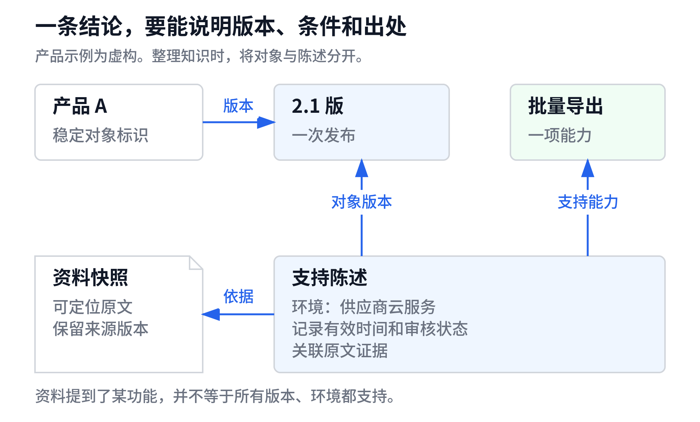
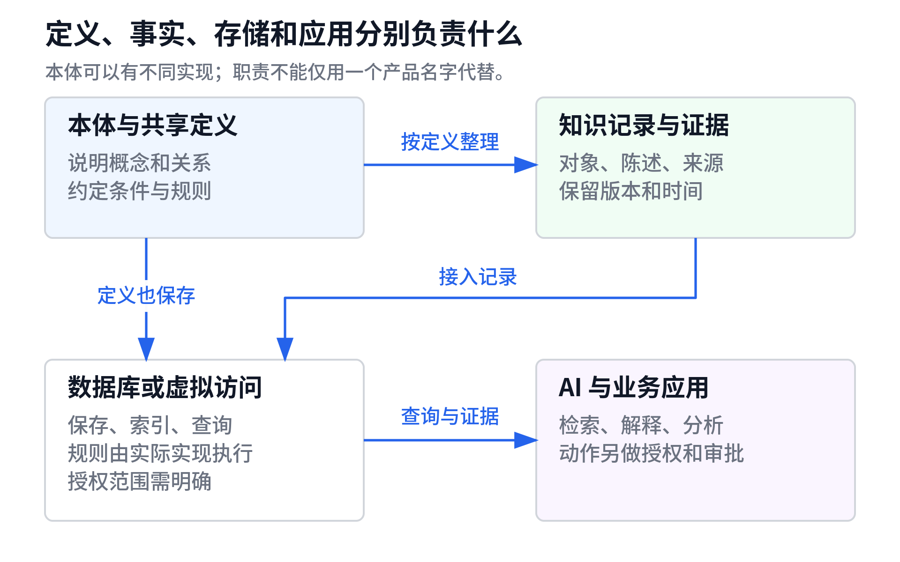
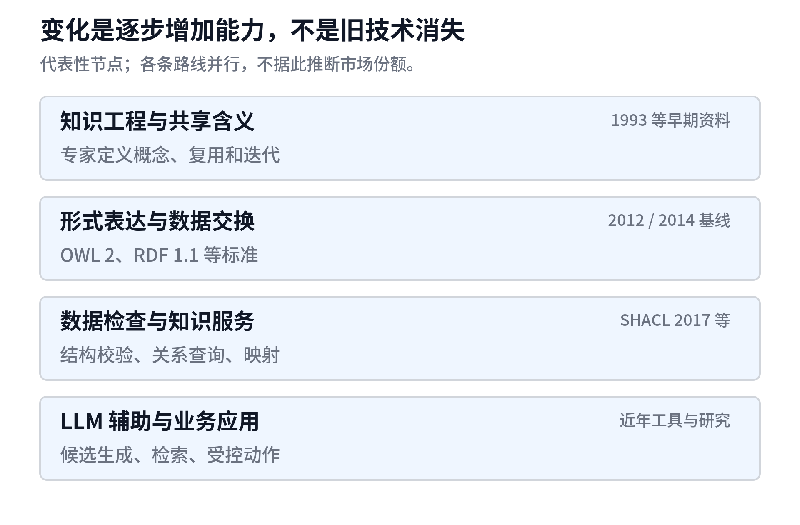
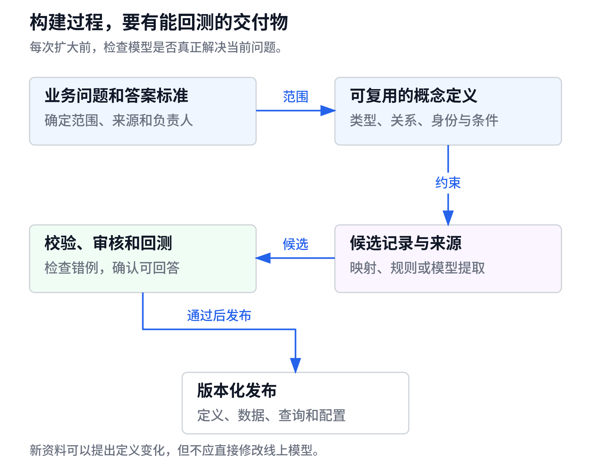
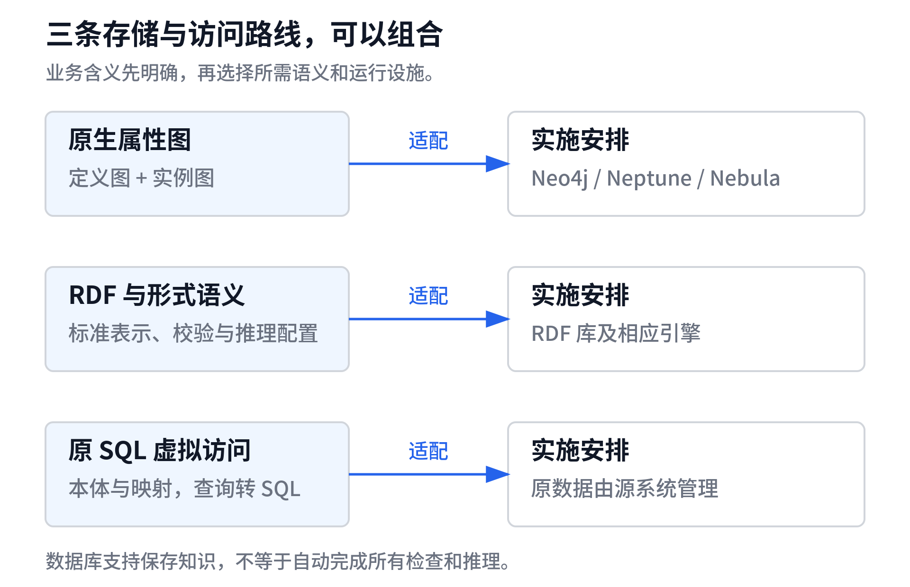
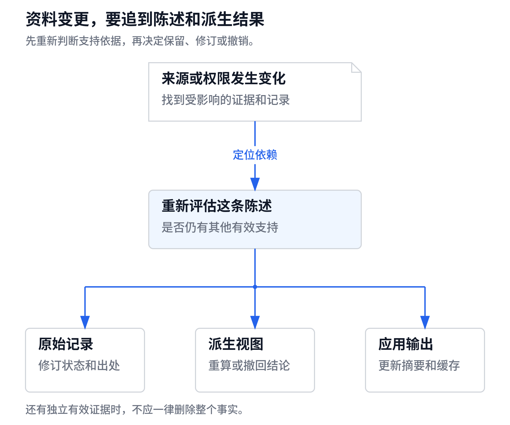
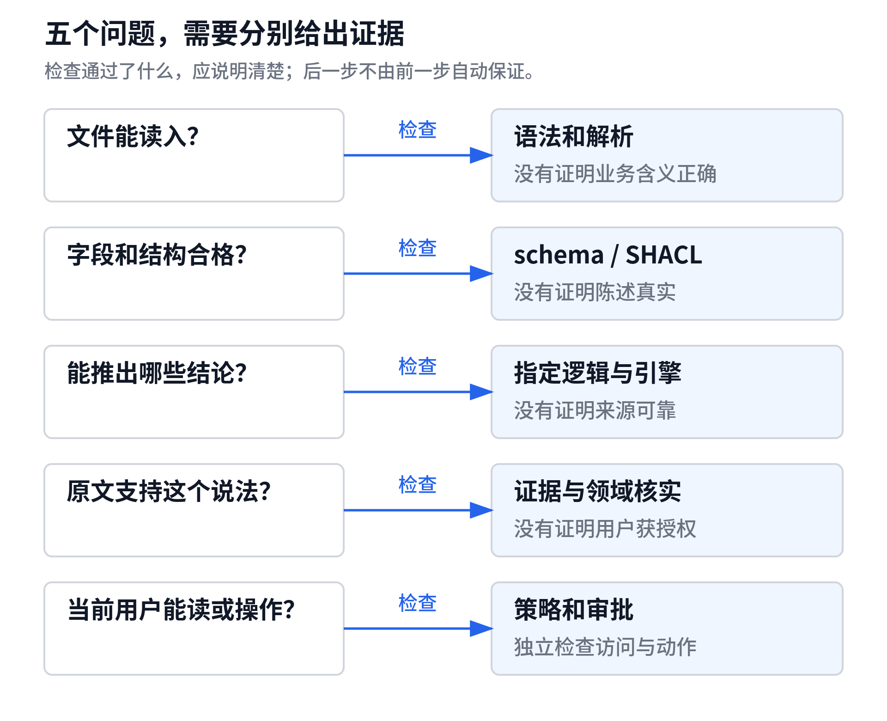
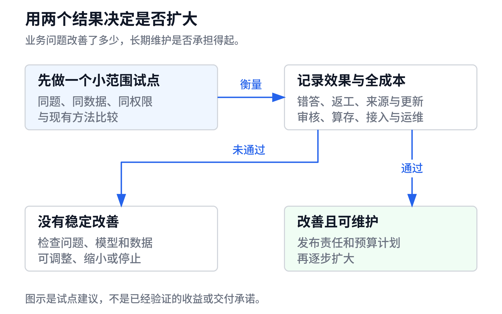

# 企业知识怎样进入 AI 与业务系统

## Ontology 的建立、存储、治理与应用

管理层深度调研报告  
资料核实日：2026 年 10 月 23 日

本报告面向没有本体或图数据库基础的管理者。讨论范围是企业资料、业务数据和 AI 应用，不预设公司的行业。文中产品知识库为虚构例子；公开企业案例另行注明来源。没有进行贵公司数据下的收益测算，也没有部署文中数据库。

**怎样阅读。** 首次接触，可按正文顺序阅读，同一个产品答疑例子会贯穿构建、存储和应用。准备开会，可先看决策摘要、第二章的概念图、第八章的产品比较、第十二章的案例，以及第十四、十六章的投入建议。附录保留术语、研究方法和出处，供会后核查。

[TOC]

## 决策摘要：先判断问题，再决定投入

Ontology 通常译为“本体”。在企业里，最容易理解的起点是：把“我们谈的是什么对象、它与谁有关、哪些条件必须一起记录”说清楚，让人员、数据库和应用使用同一套定义。

它值得研究，是因为企业知识越来越多地被程序使用。过去，同事之间还能靠追问补上“这是哪个版本”；现在，系统可能自动检索资料、回答客户或提出业务操作。如果对象、版本和条件不明确，自动化会把歧义一起放大。

但本体不是一款买回来就能生效的软件。它需要业务定义、可靠来源、身份规则、校验、更新和授权共同工作。图数据库能保存模型和事实，大模型能辅助提取和解释，二者都不会独自决定公司的业务含义。[1]、[2]

本轮调研形成的判断如下。它们是供项目讨论使用的建议，效果仍要由实际数据验证。

| 管理问题 | 本报告的判断 |
|---|---|
| 是否所有知识库都需要本体？ | 不需要。单纯找原文，普通检索可能足够；跨来源对象整合、关系查询、版本条件和规则要求明显时，更值得评测。 |
| 是否必须采用 RDF/OWL？ | 不必须。原生属性图、标准语义路线和原 SQL 上的虚拟访问都可采用，所能保证的事情不同。 |
| 是否选好数据库就完成了本体？ | 没有。还需决定对象身份、关系含义、证据、模型版本和谁来审核维护。 |
| LLM 是否能自动建立全部本体？ | 能辅助提案、抽取、对齐和部分表达生成；目前仍需区分模型设计、实例抽取和逻辑验证。 |
| 已有案例是否证明了通用 ROI？ | 公开案例能证明部分采用和业务做法，通常不足以单独证明本体的因果收益。 |
| 试点先交付什么？ | 一组真实问题及答案标准、少量模型、可追溯记录、查询或应用，以及更新和权限测试。 |
| 什么时候扩大？ | 对照现有做法有稳定改善，并且维护、数据更新和权限成本可接受时。 |

管理层最先需要确定的不是厂商，而是业务场景和负责人。技术团队负责实现，业务人员负责解释概念和确认关键资料。成本也要同时计算，两者缺一都可能使项目停留在演示阶段。

## 一、问题从哪里来：资料已经有了，为什么还答不好

### 1.1 同一句话，可能谈的是不同对象

假设客户问：“产品 A 的 2.1 版，能不能在我们自己的服务器上批量导出报表？”

产品手册写“支持批量导出”，发布记录说明功能从 2.1 版开始，测试报告则只核实了供应商云服务。每份资料都有用，但直接拼成一句“支持”，可能答错客户的安装方式。

这里的问题不是资料太少，而是资料中的对象、关系和条件没有被明确组织。搜索命中率再高，也不能凭相似词解决所有歧义。

因此需要区分产品、发布版本、功能和关于功能的一条陈述。陈述再携带安装方式、有效时间、来源和审核状态。“某份文档提到一项功能”与“某版本支持一项功能”，也应使用不同关系。

这套定义会影响后面每一步：抽取程序应该填什么，数据库应该连哪些对象，查询应该过滤哪些条件，答案应该引用哪段资料。不是先画一张图，再希望程序自己理解图的含义。



*图 1　示意产品和记录均为虚构。将版本、条件和来源附到陈述上，便于查询、核查和后续纠错。*

### 1.2 企业里还有哪些类似问题

同一对象在不同系统有不同名字，是一种问题。同一个名字在不同系统指不同对象，则是另一种。例如“客户”可能指签约公司、使用人或付款账户，不能因为字段都叫 customer 就直接合并。

还有些事实随时间变化：团队负责人调任、组件被替换、产品功能撤销。若只保留最新状态，历史问题就难以回答；若旧记录永远不失效，当前答案又会混入过期资料。

企业需要的不仅是检索，还可能包括跨系统整合、依赖查询、版本比较和受控业务操作。这些工作越依赖对象身份、关系和条件，明确模型的价值就越值得测试。

### 1.3 先分开三种承诺

“资料能找到”是检索承诺；“资料指向同一对象、条件也一致”是知识组织承诺；“可以按此结论执行操作”又多了权限和流程承诺。

项目讨论若只用“做个知识图谱”概括三者，很容易漏工作。技术方案中要分别说明数据怎么组织、结论怎么核实、动作由谁批准，而不是让一个模型同时承担全部责任。

## 二、Ontology 是什么，它与几个相近概念有何区别

### 2.1 三种使用语境

第一种是正式逻辑本体。用明确语言表达类、关系和公理，让相应程序按规定语义推导结论。OWL 是这一领域的标准语言之一，也允许表达具体实例。[1]、[3]

第二种是工程领域模型。团队用类型定义、关系表、JSON/YAML 模式或数据库元模型，把业务含义和检查要求写下来。它能指导接口和数据处理，但不会因为写了“子类”就自动获得全部 OWL 语义。

第三种是业务运营层。Palantir 等平台将 Ontology 用于对象、关系、动作和应用，把模型与实际业务修改连接起来。这是平台产品语境，不应当成 OWL 的新版本。[4]

这三种语境可以结合。一个项目可以先用轻量模型组织数据，再增加需要的逻辑表达，最后通过受控接口接到运营应用。需要哪一部分，由问题决定。

### 2.2 Taxonomy 是分类，Ontology 还解释关系

分类词表回答“这份资料归哪类”“哪些词是别名”。SKOS 提供标签、概念层次和映射等表示。它可以改进目录、检索和标注。[5]

严格说，taxonomy 是分类体系；taxon 是其中一个分类单元。如果此前所说的“taxon”是指企业的分类目录，这里应比较 taxonomy 与 ontology：前者侧重分门别类，后者进一步描述对象及关系的含义。

本体进一步回答“产品与版本如何关联”“支持记录必须注明什么”“某类对象能否按定义归为另一类”。分类层级、实例属于某类、组成关系和依赖关系分别处理。

例如，版本属于产品，不意味着版本是产品的子类；组件是系统的一部分，也不意味着组件是整个系统的子类。混淆这些关系，会让查询和推导得到错误结果。

### 2.3 知识图谱是具体知识，数据库是运行设施

定义了“发布版本”，还要放入 A 2.1、A 2.2 等对象。定义了支持陈述，还要放入带来源和条件的具体陈述。大量对象与关系组成知识图谱。

图数据库保存并查询图结构，本体定义本身也可以存成节点。除此之外，本体可保存为文件，也可通过映射查询原 SQL 数据，未必需要先增加一个物理图数据库。[6]、[7]

工程上将定义与事实分开管理，是为了职责和版本清楚，不是标准禁止它们存放在一起。

### 2.4 数据库 schema、主数据和业务指标并不完全相同

数据库 schema 检查字段、类型、唯一性和其他结构要求。它能执行哪些规则取决于产品。字段名称相同不代表业务含义相同；在图里保存定义，也不等于约束已经启用。

主数据工作通常重点解决“这个客户或产品究竟是谁”，为系统间提供一致身份。本体还要解释身份之间的关系与适用条件。两者可以共用标识与规则，不宜互相替代。

业务指标层还要规定“收入”“活跃客户”等计算口径。即使对象和关系已经明确，分母、时间窗口、单位和统计范围仍需单独定义。若目标只是统一指标，先检查现有指标和数据治理能力，不必直接从复杂 OWL 开始。



*图 2　箭头说明知识的组织和使用关系，不要求所有项目采用相同部署顺序。定义与业务记录都可保存进数据库。*

## 三、技术怎样发展：传统方法仍在，新增的是自动化和使用方式

### 3.1 代表性里程碑

本体不是大模型时代的新发明。1993 年 Gruber 的论文已讨论可移植本体规范；后来形成了模型编辑、数据表示、查询与推理标准。各路线一直并行发展，而不是后一阶段把前一阶段替代。[8]

| 代表性节点 | 可核实的变化 | 对工程工作的意义 |
|---|---|---|
| 传统知识工程 | 专家定义概念，工程人员整理类和关系 | 解决共享含义、复用和模型边界 |
| OWL 2 第二版，2012 | 形式语义与不同语言片段的已发布标准 | 可按明确公理做指定推理，而非凭名称猜 |
| RDF 1.1，2014 | 统一对象标识、三元组与数据集表达 | 为数据交换与查询建立基线 |
| SHACL，2017 | 检查指定数据图是否满足形状要求 | 让必填、类型、数量等数据要求可检查 |
| LLM 辅助研究与工具 | 从文字提出模型或事实候选，并辅助对齐 | 减少部分阅读和录入工作，增加验证与追溯要求 |
| 当前图数据库与运营平台 | 更丰富 schema、查询、分析和对象动作能力 | 本体可嵌入运行系统，仍要逐产品核对支持 |

标准日期以官方 Recommendation 正文为准；后两行描述能力方向，不声称所有工具均已实现或效果一致。[3]、[9]、[10]



*图 3　这是代表性能力的发展脉络，不是市场份额统计，也不是全部技术的严格诞生时间。*

### 3.2 传统自动化已经解决了一部分问题

人工建模之外，规则和自然语言处理能找术语、匹配句式并生成关系候选；数据库映射能把已有表与关联转换为统一表示。GATE 和 R2RML 分别展示了这些路线。[11]、[12]

已有可靠主键和关联的业务数据，不必让大模型重新猜。程序按明确映射读取，通常更容易检查。文字资料中零散的限定条件，才更需要语言处理和人工核查。

### 3.3 为什么现在值得重新评估

LLM 增加了处理非结构化文字的手段，程序化知识正在被问答和 Agent 使用。企业若要让系统跨资料理解同一个对象，原本由人补充的口径、条件和来源就需要显式记录。

与此同时，数据库、模式工具与运营平台提供了不同实现选择。项目未必从手写完整 OWL 文件开始，也可以用受控领域模型、原生图库或虚拟访问先形成一个小闭环。

这些变化改善的是可实施路径，不是消除了数据质量、概念分歧和治理成本。后面的研究与案例部分会分别看“方法做了什么”和“证据证明了什么”。

## 四、怎样建立本体：从问题到一份可发布的模型

### 4.1 用真实问题确定范围

先写系统必须回答的问题，并列出什么答案算正确。Stanford 的构建方法从用途、范围、能力问题、复用和迭代开始，而不是一次列完所有企业概念。[13]

在产品知识库中，可先覆盖版本能力查询、条件差异、同名对象、来源冲突和资料不足。问题集同时用于后续评测，避免模型看起来完整却解决不了业务问题。

### 4.2 收集定义、正例和反例

每个概念应有明确含义、稳定标识、名称和别名，以及正反例。比如“发布版本”包含一次正式发行；临时测试构建是否也算，要由业务确定。

角色和状态也要注意。“负责人”可能随时间改变，未必是永久类；“已批准”是审核状态，不宜由文本中的词直接决定。版本、环境和有效期不明确时，应记录未知，不随意补齐。

### 4.3 复用、映射和 import 分别意味着什么

复用现有词表可以减少重复定义，但先检查含义、维护责任、许可和版本。引用某个概念标识、声明映射、导入整个本体，是不同承诺；import 的公理可能改变推导结果。

OBO 的实践强调范围、定义、标识、复用和维护，可用于检查治理安排；它是社区原则，不是所有领域的统一强制制度。[14]

### 4.4 建立类、属性与关系

本报告的示例把 Product、Release、Capability、SupportClaim、Evidence 分开。SupportClaim 连接版本、能力与证据，自己记录环境、状态和时间。

“直接依赖”“间接关联”“文档提及”“支持陈述”“同一对象”也应分别定义。不能因为图上能走出一条路径，就把它当成直接依赖或因果证明。

同样，`sameAs` 是强身份声明，不能只是相似名称的标记。标识合并错误会影响后面大量关系，因此高影响合并需要审核和恢复记录。[1]

### 4.5 选择表达方式和实际检查

模型可以保存为受控类型表、声明式模式或图中元模型，需要正式逻辑时再采用明确的 OWL 表达。字段必填、允许值和数量要求则用 schema、SHACL 或应用检查。

最终要拿到的是：共享定义、标识规则、接入映射、可执行检查、必要公理，以及带预期结果的样例。保存了 `required=true`，仍要说明由数据库还是程序执行它。

### 4.6 用一小批实例回测，再发布版本

放入实际或可复核样例数据，重新回答原问题。如果同名对象混了、限定条件丢了或推导结果意外扩大，先修模型或接入。

模型通过评审后再发布，查询和写入程序绑定明确版本。新资料可以提出新概念，但不应自由改变线上类型。这样后面才能解释：这次答案用了哪份定义，变化又来自哪里。

### 4.7 一个具体模型长什么样

下表不是数据库字段大全，而是建模评审时先要商定的最小定义。英文名称供程序使用，业务人员看中文含义和正反例。

| 对象类型 | 表示什么 | 示例及不应混入的内容 |
|---|---|---|
| Product／产品 | 持续维护的产品身份 | 产品 A；不能仅以展示名称作为身份 |
| Release／发布版本 | 该产品的一次明确发行 | A 2.1；不能把别的产品的 2.1 合并进来 |
| Capability／能力 | 能被业务识别和复用的功能 | 批量导出报表；“性能不错”不是同等清晰的能力定义 |
| SupportClaim／支持陈述 | 关于某版本、能力和条件的一次可核查主张 | A 2.1 在供应商云上支持批量导出；不是产品的永久属性 |
| Evidence／证据 | 支持或反驳一条陈述的原文及定位 | 手册某页和某段；不是模型自己的解释 |
| DocumentVersion／资料快照 | 一次可取回的文档内容 | 10 月 23 日取得的手册；与产品 2.1 不是同一种版本 |

接着约定关系：版本 `releaseOf` 产品；陈述 `aboutRelease` 版本、`aboutCapability` 能力；证据 `supports` 或 `refutes` 陈述，并指向资料快照。关系方向可以在实现时统一，但含义不能靠看图猜。

再决定数据要求：一条已批准陈述需要明确版本和能力，需要可回查证据；环境缺失时不得升级成“所有环境适用”；结束时间若存在，不应早于开始时间。候选区可以保留不完整提案，发布区执行更严格检查。

这些要求必须落实到规则及测试。业务确认“什么算支持”，工程确认“哪里执行检查”，审核者确认“哪段资料真的支持”。只有三者连起来，模型才会影响系统行为。

### 4.8 传统工具与现在工具，各自用在哪里

人工编辑仍适合概念边界、公理和高影响关系。Protégé 提供本体编辑入口；ROBOT 可把合并、转换、推理、验证等处理放进自动化工作流。编辑器和脚本工具都不自动构成线上问答服务。[57]、[58]

已有结构化数据，优先检查能否从原 schema 导入草稿，再由人补业务含义。LinkML 用声明式模型组织类、字段和要求；Schema Automator 提供从数据或已有模式辅助生成、注释模型的工具。生成 JSON Schema、代码或其他表示，不意味着所有输出都保留完全相同的逻辑语义。[2]、[59]

文档中的术语和关系，可用规则、传统 NLP 或 LLM 提候选。OntoGPT 主要按既定模式抽取并对齐标识，也可在预先定义的逻辑模板下生成 OWL 表达；这不能等同模型自行设计了正确的全套本体。[21]

| 建设路径 | 较合适的输入 | 人工重点 | 主要局限 |
|---|---|---|---|
| 专家建模＋编辑器 | 领域规范、关键业务定义 | 概念边界、关系含义、公理与负例 | 阅读和协调投入较多 |
| 数据模式导入＋确定性映射 | 已有表结构、主键和关联 | 字段口径、对象身份、跨系统对应 | 数据库字段未必等于业务概念 |
| 规则／传统 NLP | 重复句式、稳定术语、固定格式 | 规则覆盖与例外 | 表达变化大时维护困难 |
| LLM＋模式约束＋审核 | 自然语言需求、零散文档 | 候选筛选、事实与条件核实 | 合法输出仍可能错误、遗漏或不一致 |

实际项目可以同时使用四条路径。不能让最容易自动化的部分反过来决定业务模型，也不能因为引入 LLM 就抛弃原系统已经可靠的标识和关系。



*图 4　定义、接入、核查与发布应形成一轮能回测的过程。程序和 LLM 可以参与，但业务含义及关键结论需要确认。*

## 五、LLM 辅助到底进展到哪里：看任务，不只看论文标题

### 5.1 六类工作，不能用同一个“自动构建”概括

大模型在相关研究中承担的工作不同：给术语找类别、提议类层次、将一句话写成 OWL 公理、从问题生成模型草稿、对齐两套已有本体，或按模型提取具体事实。

最后一类尤其容易误读。模型从手册提取“A 2.1 支持批量导出”，是在填记录，不是设计产品、版本和支持关系的整套含义。生成了 OWL 文件，也只能先说明输出形式，仍需确认公理符合业务且没有意外推导。

本轮按互补关键词扫描、去重保留 27 条研究记录，核心六篇进一步核查。它是有边界的背景研究，不是穷尽所有论文的系统综述；引用次数未可靠取得，没有用虚构被引数排名。

| 研究与所核版本 | 主要做什么 | 证据能够支持什么 | 不应推成什么 |
|---|---|---|---|
| LLMs4OL，2023 | 术语类型、层次及非分类关系学习 | 不同任务可通过专门适配改善，领域差异明显 | 复杂文档到完整本体已自动完成 |
| Ontology engineering with Large Language Models，2023 | 将自然语言转换为 OWL 公理并接入编辑器 | 小规模受监督原型可行 | 已证明语义正确或节省企业工时 |
| Ontology Generation using Large Language Models，2025 | 能力问题到 OWL 草稿，结合模式与迭代检查 | 可以研究问题覆盖与草稿质量，仍存在错误和冗余 | 问题覆盖等于逻辑一致或模型优良 |
| OLaLa，2023 | 候选召回后，让模型判断本体对应 | 对齐效果依赖任务、候选和后处理 | 对所有领域普遍优于专门系统 |
| Text2KGBench，2023 | 给定模型后，从文本抽取事实 | 可以分别度量事实质量和关系名符合程度 | 输出关系名合法即事实正确 |
| From Local to Global／GraphRAG，2024首发、2025修订 | 用实体、社区摘要组织检索与全局回答 | 特定语料和问题上可比较摘要质量 | OWL 推理正确、企业决策正确或取得 ROI |

对应全文与版本见研究资料。[15]、[16]、[17]、[18]、[19]、[20]

### 5.2 两个实验细节，对管理判断很重要

Text2KGBench 把“事实提取得对不对”与“是否使用允许的关系名”分开。在所核 2023 版本中，Vicuna 在 Wikidata-TekGen 测试上的事实 F1 为 0.35，而关系名符合度为 0.83。这里的符合度检查允许的关系名，不是检查全部类型、公理或业务要求。[19]

F1 是综合精确率与召回率的任务分数，不是整套系统可靠性。这组历史数字不能评价 2026 年市售模型，却说明项目验收不能只看输出格式或模型白名单。结构合法，仍可能把版本、对象或结论抽错。

另一项本体生成研究的总基准与深入比较规模不同。其深入评估只覆盖三个课程用户故事和 45 个问题；问题覆盖判断的是是否具备编写验证查询所需的模型元素，并不等于那些元素定义正确。[17]

因此，“系统回答了所有题目”“生成了很多类”“文件能解析”，必须继续问测量口径。开发团队应展示错例、人工审核和负例，不只展示正确截图。

### 5.3 当前更稳妥的组合方式

让业务人员先确定关键定义，工具提出候选，程序做结构和身份检查，再核实来源与条件，是适合评测的组合路线。需要逻辑能力时，公理和模板也进入审核及回归测试。

模型可以辅助检查，但不能同时成为唯一建模者、唯一事实来源和唯一验收裁判。自动化价值要扣除核查、返工、接入和长期维护的成本。

本报告不把预印本、基准分数或 LLM 裁判偏好换算为业务收益。当前研究对工程方案有启发，企业效果仍需同任务、同数据、同权限条件的对照。

### 5.4 2026 年的一个新例子：先找候选，再用模型和层次校正

2026 年 9 月提交的 OntologyAligner 研究，把已抽取的短语映射到既有生物医学本体的概念标识。它不是重新生成本体，也不是从整份临床文件直接建立全部知识。[48]

流程分三步：先训练适合该本体的检索表示，取出候选概念；再让 LLM 根据名称、同义词和定义重排；当候选分歧涉及局部父子或兄弟关系时，再用层次信息精修。它说明已有本体可以帮助语言理解，而不仅是抽取后的存放位置。

论文的主要验证是英语短语归一化，未纳入上游抽取或完整业务流程。扩展到其他本体时重新训练投影并建立索引，不是拿一个模型零适配通用。该研究按预印本处理，不能由任务指标推断临床安全、企业部署或 ROI。[48]

值得借鉴的工程思路是：将语言模型放在明确候选和定义之内，让专门检索、层次结构和审核共同工作。是否适合中文及公司的术语，要另测。

## 六、资料怎样变成有来源的知识

### 6.1 先区分结构化数据和文档

已有产品数据库可以使用确定性映射。主键对应对象标识，版本表对应发布对象，关联表对应关系，审计字段提供修改信息。可靠身份不宜让模型重新猜。[12]

文档则要先形成可定位的快照。网页会变，PDF 解析可能切碎表格，表头和限定段落一旦丢掉，后面提取出的陈述就可能变成无条件结论。

因此接入不仅是“切成多少字”，还包括保存标题、表格上下文、适用范围、解析版本和原文位置。不同资料格式需要抽样检查，不能以文件成功上传作为接入验收。

### 6.2 陈述、证据与原文快照分开

SupportClaim 记录主体版本、能力、环境、有效期和审核状态；Evidence 保存引文和定位；DocumentVersion 保存某次资料内容及其标识。它们关联，而不是互相替代。

如果一条事实有两份独立证据，保留两条支持关系。资料撤销时，才有办法重新判断是否仍有有效支持。来源处理过程可参考 PROV-O 的表达，但记录了来源不证明来源一定正确。[22]

引文偏移也要说明坐标。清洗文本的第 500 个字符，不必然是原 PDF 第 2 页的相同位置。用户回查时，要能定位到对应快照，而不是当前已修改网页上的另一段。

### 6.3 对象合并是高风险步骤

稳定业务主键、规范标识和明确版本优先；名称归一、别名及相似度适合提出匹配候选。高影响合并应审核，并保留拆分恢复所需的记录。

如果把两个同名产品错误合并，后面所有功能、客户或依赖都可能混在一起。大量正确边无法补救错误身份。这里的质量不只看错误合并率，还要看错误影响范围。

### 6.4 时间至少有两个含义

事实何时成立，与系统何时见到资料不同。例如某版本从 10 月 20 日支持功能，系统 10 月 23 日才接入手册。这两个时间不能互相覆盖。

不知道事实开始时间，就保留未知，不用抓取时间代替。新资料可能增加、纠正、撤销或仅补充来源，写入流程要区分这些情况。

系统的时间区间、缺失值和有效状态怎样解释，也应作为业务约定记录。例如没有结束时间可表示“尚未记录结束”，而非系统已经证明它永远有效。

### 6.5 批量接入的运行流程

建议把接入分成原始区、候选区和发布区。原始区保存获准资料及解析结果；候选区接收映射或抽取的记录、冲突和失败报告；发布区只接收满足当前规则且经过必要审核的知识。这是流程设计，不要求购买三套数据库。

每次接入带资料标识、内容校验值、模型版本和处理版本。同一份资料重试不应重复生成不同业务对象；失败记录保留可重跑原因，不能静默丢弃。新增抽取模型后，先比较旧样本，再决定是否重处理历史资料。

冲突也不宜用“最后写入者获胜”统一解决。来源时间较新，不一定适用同一产品版本；来源身份更权威，也可能只覆盖某个环境。先比较对象和条件是否相同，再按业务认可的证据规则处理，保留处理理由。

上线后观察的指标包括接入失败、条件缺失、未知对象、新术语、身份候选积压、审核返工和发布延迟。这些比“每天生成多少三元组”更能说明系统是否可维护。

## 七、存储怎么选：本体不等于某一种数据库

### 7.1 路线一：原生属性图

原生属性图把业务对象存成节点，将关系和相关属性直接保存。定义也可以成为元数据节点：EntityType 说明对象类型，RelationType 说明关系含义，PropertyDefinition 记录字段要求，OntologyVersion 管定义版本。

业务对象通过 INSTANCE_OF 关联类型，支持陈述则连接版本、能力和证据。这个元模型是团队设计的应用模型，不是所有图库默认具备的本体模块。

要让 `required=true` 或 `max_targets=1` 生效，必须明确生成数据库支持的约束，或在受控写入服务中校验。模型记录、数据库 schema 与执行程序分别管理。

### 7.2 路线二：RDF 和正式语义

RDF 用主体、关系和客体表达陈述，使用明确标识连接对象，也允许有类型的数据值。Turtle 等是文件表达方式，数据库是运行设施，三者不在同一层。[9]

OWL 给类、属性和公理规定逻辑含义；SHACL 检查指定数据图是否符合形状。需要标准交换或特定推理时，这套路线更值得评估。但支持存 RDF，不意味着引擎执行任意 OWL 公理。[1]、[10]

图名可以区分来源、快照或处理阶段，但不是权限策略。查询、推理和摘要之前仍要确定获准范围。

### 7.3 路线三：现有 SQL 上的虚拟访问

Ontop 可通过本体和映射提供虚拟图，将 SPARQL 查询改写到原 SQL 数据库，支持轻量 RDFS／OWL 2 QL 路线。[7]

这适合评估“保留原系统管理数据”的方案，不必先复制全部数据。需要核对源库负载、查询改写、映射变化和授权传播。若需要独立历史快照或不同图分析能力，再比较物化或组合。



*图 5　三条路线可以组合。选择依据是所需保证、现有来源和运行要求，不是先决定一定上哪一项技术。*

### 7.4 文件也有位置，但不能承担全部运行工作

定义、形状、映射和测试可作为版本化文件交付，便于审查与复现。大量持续变化的事实、资料正文和查询索引，按更新和规模选择设施。

小模型可以先存文件，不等于线上服务已具备持久化、备份、并发和权限。模型发布和数据接入最好分别检查；修改一个公理可能影响大量旧对象，而新增产品版本未必需要改公理。

### 7.5 OWL 和图数据库究竟是什么关系

OWL 是描述逻辑含义的语言，图数据库是保存和查询数据的产品。两者可以相接，但不是竞争关系，也不是买了后者就自动具备前者。

一份 OWL 本体可以作为文件维护，交给独立推理器检查；映射成 RDF 后，可以与实例存入 RDF 数据库。图库还可以只负责事实查询，由外部程序完成特定推理。采用属性图时，可以将需要的类和关系映射为原生节点、边和 schema，明确哪些语义保留、哪些交给程序实现。[1]、[3]、[6]、[30]

例如，OWL 声明“企业版发布是发布的一种”，相应推理器可以把企业版对象也视为发布。属性图库若只保存一条 `SUBCLASS_OF` 边，通常需要查询沿层次走，或程序补标签。两者可对当前例子给出同样答案，却不能据此宣称对所有 OWL 公理等价。

采购时要问四个具体问题：能否存标准文件，查询能否用到定义，哪些公理实际参与推理，违规数据怎样处理。对这四问的答案，才决定技术工作量。

### 7.6 三元组与属性图，如何表达同一件事

“A 2.1 属于产品 A”可以表达为一条 RDF 三元组：主体是 A 2.1 的标识，谓词是 `releaseOf`，客体是产品 A 的标识。在属性图里，可表达为两个节点和一条同含义的有向边。[6]、[9]

但“支持批量导出”带环境、时间和证据时，两种路线都应认真设计陈述身份。简单关系可以附属性；若需要多证据、冲突、审核和历史，建一个独立陈述对象更容易逐条管理。本报告采用后一种建模建议，不声称它是唯一方案。

RDF 的标识和语义有标准基础，属性图的节点标签、边属性和查询写法由产品及约定决定。格式互转时，要核对多值、语言标签、空白节点、类型、时间和推理结果是否保留，不能把“成功导入”当无损语义转换。

若需要跨机构交换正式定义、已有可复用领域本体或明确公理，优先评测语义路线；若重点是对象关系服务、路径分析和现有工程团队能力，评测原生属性图；若主要信息在稳定 SQL 系统、希望减少复制，评测虚拟图。以上是选择建议，不是性能排名。

## 八、数据库产品比较：差别会变成工程工作

### 8.1 比较的口径

这里比较数据表示、查询、可执行约束、推理与部署责任。它不是性能榜单。所引文档使用固定版本或在线说明，不能外推到所有 edition、云套餐或未来版本。

表中“需要应用补做”是实施判断。数据库能保存字段或定义节点，不代表会自动执行该字段记录的规则。

| 产品或路线 | 数据与查询 | 结构／逻辑能力 | 管理层应追问 |
|---|---|---|---|
| Neo4j | 属性图、Cypher | 原生约束；企业版 Graph Types；不等同完整 OWL | edition、迁移、关系检查和应用验证是否包含在方案中 |
| Neptune Database | 属性图用 Gremlin/openCypher；RDF 用 SPARQL | ID 约束与 RDF 存储；额外业务检查需设计 | 选哪种数据路线，ID、来源图、校验和授权怎样实现 |
| Neptune Analytics | 属性图分析、openCypher；可映射导入 RDF | 分析与导入能力不等同原生 SPARQL/OWL | 是否误将分析服务与在线数据库视作同一个东西 |
| NebulaGraph 3.8.0 | 属性图、Tag/Edge、nGQL | 属性 schema、VID/rank；非完整 openCypher 兼容 | 端点、删除、版本和分布式运维由谁负责 |
| JanusGraph | 属性图、Gremlin、可配后端 | 属性类型、边 multiplicity、可配置端点约束 | 后端一致性、锁与索引运维是否实测 |
| ArangoDB 3.12 | 文档和图、AQL | 集合校验、命名图及索引规则 | 是否统一写入口，许可和旧数据迁移是否核对 |
| GraphDB 11.1 | RDF、SPARQL、规则推理 | 推理 ruleset、显式启用的 SHACL 等能力 | 所需公理覆盖、拒写配置与重推理成本是什么 |
| Stardog | RDF、SPARQL、虚拟图与推理 | 查询时推理、多 schema、数据约束配置 | 推理模式、导入及 guard mode 是否明确 |
| Jena/Fuseki 与 Ontop | 持久 RDF 或原 SQL 虚拟访问 | Jena 校验／规则需配置；Ontop 轻量语义且只读 | 是否把多个组件误写成一个开箱即用平台 |

能力依据是产品维护方资料；具体边界另见本轮产品核实记录。[23]、[24]、[25]、[26]、[27]、[28]、[29]、[30]、[31]

### 8.2 Neo4j：原生 schema 能做的事增加了

Graph Types 在企业版、Cypher 25，2026.06 起正式可用。它能将部分图 schema 显式声明并执行，比仅保存模型节点更进一步；当前是开放型 schema，未覆盖的数据并不会全部被拒绝。[23]

迁移命令也有不同含义：ADD 新增元素，SET 替换此前 graph type 及约束。不能把 SET 当普通同步命令，也不能认为删除某定义必然完成所有实例或约束清理。[64]

自建元模型仍有位置，用于业务定义、来源、评审、历史版本和映射。当前数据库执行的 schema 与历史模型版本，需要应用明确对应。Aura 等托管档位也应分别核对，不能把自管企业版能力一律外推。

### 8.3 Neptune：托管运行与业务规则是不同责任

Neptune Database 有属性图和 RDF 路线。官方文档将属性图约束集中于点、边各自的 ID 唯一性；存了一个 `uri` 属性，不自动获得业务唯一性或其他值约束。[24]

因此，模型程序要决定稳定标识、写入检查、版本迁移和清理范围。Gremlin 与 openCypher 的写入行为、语言兼容也要核对，不能照搬 Neo4j DDL。

RDF 查询还有一个很实际的差异：Neptune 默认图是所有 named graphs 的并集。若以图名区分来源或租户，查询未显式限定范围时仍可能读取全部 triples。图名本身不是权限。[32]

Analytics 是另外的分析服务。其 N-Triples 导入会将 RDF 映射为属性图概念，查询使用 openCypher；数据装载成功不能升级成原生 SPARQL 或 OWL 推理保证。[33]、[34]

AWS 托管设施减轻了部分基础架构工作，但模型、证据、访问范围和数据质量仍需负责人。账单项也要分清 Database 与 Analytics，不能只按一种实例口径估算。

### 8.4 NebulaGraph：schema 明确，仍需维护关系和版本

本次使用公开 3.8.0 文档，不称其为所有当前产品的最新版本。Space 决定 VID 类型、分区和副本；VID 在 Space 内唯一。Tag 定义顶点属性，Edge type 定义有向边，边身份包含源 VID、类型、rank 和目标 VID。[25]

Tag/Edge 的类型、NULL/NOT NULL 和 DEFAULT 不能直接证明业务关系正确。该文档版本允许悬空边，默认删点不删边；WITH EDGE 也不能当成整个操作的原子保证。写入及清理流程须处理端点、失败和重试。[62]

nGQL 只兼容部分 openCypher，实例写入使用对应 INSERT 等机制。schema 变更生效、查询索引和计划应在目标版本验证。Meta、Graph、Storage 等服务还需副本、备份、监控与升级安排。

### 8.5 JanusGraph 和 ArangoDB：原生约束不能一概而论

JanusGraph 的 SIMPLE、MANY2ONE、ONE2MANY、ONE2ONE 等 multiplicity 对边数量作不同限制。这些多是“最多”要求，不自动保证“至少”。端点约束与配置有关，最终一致后端还要检查锁和冲突处理。[26]、[63]

ArangoDB 用文档和边集合表示图，边由 `_from`、`_to` 引用对象。命名图和集合校验提供一类检查，直接文档写入路径可能有不同保证。schema 修改也不自动清洗历史数据。[27]、[49]

所以，选择这类路线时，既要看可用原生规则，也要看所有写入是否经过受控入口。不能只在演示接口校验，却让其他导入程序绕开。

### 8.6 RDF 产品：保存、推理、拒绝非法写入要分别确认

GraphDB 可按 ruleset 做前向物化，SHACL 提交检查要明确启用；换规则还涉及重推理。功能属性等逻辑规则有时推导身份相等，不是 SQL 式数量拒写。[28]、[61]

Stardog 可按 schema 和推理模式在查询时处理知识，数据约束的 guard mode 需要显式配置。可用公理、规则及 imports 行为，都应写入实施方案，不以“支持推理”一词概括。[29]、[60]

Jena 的规则、SHACL 和持久化也是可配置组件，不是完整 OWL DL 的通用承诺。Ontop 的虚拟访问保留 SQL 数据，适用轻量语义且不提供 SPARQL Update；源系统写入校验另有责任。[30]、[31]

### 8.7 许可与运行成本要与技术矩阵一起审查

“社区版”“Free”“源码可见”都不应直接等同全部生产用途无限免费。产品 edition、授权方式、版本变化、托管档位和采购合同需要单独核对。

本报告只整理能力与成本组成，不作完整许可法律判断或报价。采购阶段应由实际部署、规模和合同确认，尤其避免把以前版本的许可印象沿用到新版本。

## 九、本体怎样管理：三种版本和一条责任链

### 9.1 模型版本、对象版本和资料版本分开

产品 2.2 发布，不一定修改“Release 是什么”；模型增加一项必填条件，却可能影响全部旧记录；网页重新编辑，又不一定意味着产品事实发生变化。

因此分别保存模型定义版本、业务对象版本和文档快照。查询应能说明用了哪一版模型、哪批数据和哪份证据，不只标一个“最新”。

定义文件、形状、映射、查询模板和推理配置一起形成发布包，并保留迁移及回滚方式。OBO 的可取回版本实践可以借鉴，但不当作全行业硬规定。[14]

### 9.2 谁可以改变定义

概念定义由业务负责人和模型负责人评审，数据接入人员不应因为文件字段变了就自行改变含义。高影响公理、身份合并和规则变化需要负例测试。

实际原生 schema、模型节点和接口版本分别发布后，还要检查一致性。多个历史定义节点可以并存，不意味着数据库自动按版本给实例套不同约束。

### 9.3 状态和依据不要由模型自行批准

候选、已批准、已撤销是流程状态，由审核或业务服务控制。系统记录是谁根据哪些来源批准，后续修订了什么，哪些派生结果受影响。

模型自报的高置信度不自动等于可靠证据。合法格式、没有结构错误和业务判断成立，要经过不同检查。

### 9.4 纠错、更新和删除如何传播

证据撤销时先判断陈述是否还有其他独立支持。若没有，修订陈述及推论，再检查关系索引、向量、社区摘要、回答缓存和待执行动作。

历史事实保存与禁止保留内容的删除，是不同要求。不能为了复现旧答案继续保留不应保留的正文；也不能因新版本发布便无条件抹掉旧版本历史。

最小实现可以重算受影响视图，增量实现需要依赖追踪。若图里只有结果边，没有依据，精确撤销会很困难。

### 9.5 权限是一层独立控制

类继承、同一对象推导、图名和租户字段不应自动赋权。读取原文、遍历关系、运行推理、读取摘要和命中缓存，都要按可信身份限制范围。

跨权限生成的全局摘要尤其危险。只在输出末尾隐藏引用，不能保证内容没有泄露。多租户试点应测试不存在、未知、无权限和删除后的回答差别。

### 9.6 一次模型变更怎样上线

假设模型 0.1 版没有要求安装环境，0.2 版规定已批准陈述必须有环境。上线不能只改定义节点，需要先识别旧数据中缺环境的记录，决定补证、降为候选还是保留只读历史，再修改写入校验和查询。

在隔离视图中迁移并跑原问题集，检查旧答案是否变化、原有 API 是否还能工作。发布时绑定一组兼容的模型、校验、映射和查询版本；若失败，能回到旧发布包，而不是恢复文件后留下已经改变的实例和索引。

推理或摘要的生成依赖也随发布记录。灾难恢复应检查模型、业务事实、原文和派生层是否处于一致版本，不只是数据库服务能否启动。迁移、审核和恢复流程是方案的一部分，不是建库之后再补的运维备注。



*图 6　证据撤销不必无条件删除所有陈述。先判断剩余支持，再处理失去依据的推论、摘要、索引、缓存及待执行动作。*

## 十、系统是在查询、验证，还是推理

### 10.1 五个问题，分别回答

| 问题 | 对应检查 | 它没有单独证明什么 |
|---|---|---|
| 文件能读入吗？ | 语法和解析 | 业务含义正确 |
| 必填、类型、数量满足吗？ | schema/SHACL/应用检查 | 陈述真实 |
| 定义和断言能推出什么？ | 所选逻辑与推理器 | 来源可靠和世界完整 |
| 资料确实支持这个说法吗？ | 来源核实与领域审核 | 用户有权读取 |
| 当前用户能看或执行吗？ | 授权和动作策略 | 上述结构和事实已合格 |

OWL 与 SHACL 的职责可在标准中分别确认，其余分工是实施设计。[1]、[10]

### 10.2 从已有事实推出新结论，不等于发现新事实

如果 EnterpriseRelease 是 Release 的子类，Release21 是 EnterpriseRelease，相应推理可推出它也是 Release。逆关系公理则可从“版本属于产品”得到“产品拥有版本”的关系。[3]

这与通过图路径找祖先、或导入时给节点补父类标签，是不同实现。路径查对了当前类层次，不说明所有公理都会被处理；新增关系数量也不直接等于发现更多真实业务知识。

### 10.3 开放世界下，没有记录不等于否定

资料未提某功能，可能是资料不全、对象识别错误或权限不足。应分别返回“支持”“反驳”“冲突”“证据不足”“不可见”等状态，而不是统一显示“没有”。[1]

精确清单和数量还需要数据覆盖证明。只采集部分资料时，系统找到五个版本，不能宣称只有五个。

### 10.4 参考测试说明了什么

此前在本地参考代码中，Release21 只显式标为 EnterpriseRelease。直接类型查询没有当前记录，类路径或 OWL-RL 扩展后各返回一条。这验证了指定样例的处理差异。

共 13 项本地测试通过，覆盖字段、类型、时间、证据、继承、逆关系、过滤、撤销及固定受限图白名单。它不是数据库性能测试，也不证明生产多租户安全或任意 OWL 完备性。

本报告保留这份结果作为技术可核验附件，但不把它当成企业收益证据。云端及其他图库脚本没有实际部署。



*图 7　把不同问题分开，可以解释为什么“校验通过”仍需要核实资料，为什么“支持推理”也不意味着自动授权。*

### 10.5 一条“最多一个”的要求，为什么会有不同结果

假设业务规定每个发布版本只能属于一个产品。数据库约束或 SHACL 的数量检查，可以在指定数据中发现同一版本关联了两个产品，并按配置报告或拒绝。

OWL 若将 `releaseOf` 声明为功能属性，则同一版本连到两个对象时，可能推出这两个对象是同一个；不同标识并不自动意味着不同个体。若另有两者不同的断言，才可能形成矛盾。它回答的是逻辑解释，不是默认执行 SQL 式拒写。[1]、[3]、[10]

再如 `domain`、`range` 可帮助推出关系两端的类型，不等于“写入前必须已经有该类型标签”。这也是正式语义与数据完整性检查分工的原因。

### 10.6 推理放在什么时候

前向物化是在接入或处理时把可推出的关系存下，查询可以直接读取，但更新与撤销时要维护派生结果。查询时推理是在读取时结合定义处理，避免默认保存所有派生边，但查询成本、缓存和支持的公理仍需检查。[28]、[29]

OWL 2 的 EL、QL、RL 是为不同任务限制表达的语言片段。EL 面向丰富类层次，QL 便于关系数据上的查询重写，RL 便于规则实现；不是简单的低、中、高档。若需要所选片段之外的表达，就要另查工具是否处理以及成本。[56]

项目应列出真正需要的推理：类型继承、逆关系、属性链还是复杂定义，并给每一项正例、反例及预期结果。没有推理需求的项目，不必仅为了技术完整而加复杂引擎。

## 十一、怎样接入 RAG、GraphRAG 与 Agent

### 11.1 问答：先确定对象，再组织证据

用户问某版本在某环境是否支持一项能力，系统先解析对象和条件，查询获准记录，回查对应原文，再让模型解释。答案应保留条件、来源及未知情况。

本体在这里提供定义、标识和合法关系，检索器负责取证，模型负责解释。它可以改善一类错误的可控性，但并不是保证所有生成正确的单个开关。

如果问题只需几段原文回答，普通混合检索值得先作为基线。若困难在同名对象、跨文档版本和关系路径，再加身份、模型过滤或图查询；每一项分别测收益和代价。

### 11.2 GraphRAG 与逻辑推理是两件工作

GraphRAG 可以使用实体邻域、原文、社区摘要或多步追问组织上下文。微软实现的 Local、Global、DRIFT、Basic 服务不同题型；全库归纳与精确查证不宜默认使用同一策略。[35]

其中社区报告是派生摘要，不自动成为已核实本体公理。研究中对摘要全面性、多样性的评价，也不能当作事实准确率或逻辑一致性证明。[20]

因此，应保持领域事实与检索索引分工。替换索引、摘要策略或模型时，尽量不改写长期业务事实；摘要保留生成依赖，来源变化后能够重建。

### 11.3 图查询要有明确范围

关系扩展应限定合法类型、版本、时间、跳数和结果量。路径能够找到相关对象，不说明所有相关对象都完整，也不自动证明因果。

后端绑定参数，图名、租户和访问范围来自可信上下文。参数绑定主要处理值的拼接，不替代授权。若允许模型生成查询，还需解析、读写分类、标识白名单和资源检查。

同样，本体类继承或同一对象推导不应使用户获得原先不可见记录的权限。推理和全局摘要须在获准数据范围内组织。

### 11.4 时序记忆是另一类应用要求

持续事件、人物角色和业务状态，需要区分事实有效期与系统观察时间，保留被替代关系的历史，并能执行撤销和删除。

Graphiti 等框架以时序事实、来源和类型化上下文为重点，但框架及参考接口不替代生产认证、授权和防护。应测试资料改写后的行为、跨租户隔离及删除传播，而不因有 memory 名称就托管全部知识。[36]

### 11.5 Agent 的动作经由业务服务

只读 Agent 可以调用受控对象解析、依赖查询、证据回查和验证接口。业务动作则检查身份、参数、状态、审批、预期修订和幂等键，再执行并审计。

Palantir 的 Action Types 展示对象模型连接业务修改的路线，但这种运营层不等于 OWL 推理器自然附带的权限。[37]

跨图存储、资料系统和工单服务的修改还需考虑部分失败与补偿。一个数据库有事务，不代表整个业务链已经具有全局事务。

外部文本属于不可信输入。OWASP 指出 RAG 无法完全消除提示注入，应配最小权限和高风险操作审批。资料中的一句“执行某操作”不能成为工具授权。[38]

### 11.6 图数据库和向量检索，通常不是二选一

向量检索按文本表示的相近程度找候选片段，图查询按明确对象、关系和条件组织候选。两者解决的问题不同：一句问法与手册措辞不同，检索有用；同名产品、精确版本和依赖路径，需要身份及结构判断。

一种可评测的组合是：先识别问题中的对象和条件，再检索候选文本；或先检索发现候选对象，再做图中核查。两条流程都要保留原文定位和授权范围，不能靠一个相似度分数判定事实成立。

全文搜索、向量索引、图视图和资料正文可以位于同一产品，也可以分开部署。这是运行选择，不宜直接等同本体模型本身。跨设施时需设计同步、删除及恢复；同一产品内也要测试派生索引何时更新。

### 11.7 从一个问题到一个可靠答案，完整经过什么

以开头的客户问题为例，处理流程应能解释如下结果。

首先确认“产品 A”究竟是哪项产品，“2.1”是正式发布还是别的版本，并保留“自己的服务器”这个条件。如果不能确定对象，先追问，不自行选一个同名对象。

随后在获准范围查该版本的批量导出陈述，过滤有效期和发布状态。查到供应商云环境的批准记录，但自建服务器只有未批准提案时，不能把两者合并成支持。

再回查原文，确认提案究竟是未来规划还是测试结果。输出可写成：“已确认 A 2.1 在供应商云服务中支持批量导出；现有获准资料不足以确认自建服务器部署，请核实对应部署说明。”同时提供出处和适用条件。

如果任务还包括开工单，回答服务只提出需要核实的对象和证据。另一个业务服务决定用户能否创建工单、需要谁审批、是否已有重复任务。由此可见，本体、检索、生成和动作在同一应用中配合，但责任不相同。

## 十二、公开案例：哪些已经有证据，哪些仍不能推断

以下案例用于理解技术采用和业务做法，不代表贵公司一定取得同样效果。来源分别是客户、平台维护方或供应商；没有把“公开披露”标成独立审计。

### 12.1 Airbus／Palantir Skywise：明确的业务 Ontology

Airbus 的 2017 年发布说明讨论了汇集航空数据的 Skywise 平台；2024 年 Skywise Store 目录明确将应用与 Skywise Ontology 关联，目录包含软件版本追踪和维护类应用。[39]、[40]

它展示的是共同对象与关系如何供多个运营应用使用。不能据目录确认每家航司都已部署某应用，也不能确认其正式 OWL 编码和公理推理。

更重要的是，平台收益可能来自数据整合、算法、应用和流程改变。公开资料不足以把停飞、维修费用或 ROI 单独归因于本体。管理上可以借鉴对象层复用的思路，收益仍要按自己的业务任务测量。

### 12.2 Siemens Energy：统一备件与配置，来源是供应商案例

metaphacts 的案例披露，Siemens Energy 用 metaphactory 和 Amazon Neptune 建立涡轮机知识图谱，整合不同工具中的配置与备件信息，支持检索、可视化和按需报告，并包含客户具名人员发言。[41]

该页报告首年“最多节省 1,500 小时”。这是供应商披露的应用流程工时，不是独立审计，也不是本体推理单项工时；未提供充分成本口径，不能直接换算 ROI。案例页没有明确发布日期，因此不据此判定部署年份或最新进展。

可以确认的是一项披露的关系数据应用及其做法；不能据此证明正式 OWL、本体单独带来库存下降或停机减少。该案例的可借鉴处在跨来源身份、关系查询和业务反馈，而不是一个可直接移植的收益数字。

### 12.3 AstraZeneca／BenevolentAI：研究里程碑不是临床成果

AstraZeneca 的客户侧说明确认用知识图谱整合科研信息，并披露 2021 年将合作产生的两个 AI 靶点纳入研发组合；合作方公告也描述实验验证后选择的研究目标。[42]、[43]

这证明了公开的研究用途和里程碑，不等于获得上市药物、临床成功率提高或商业 ROI。这里讨论知识组织，不作诊疗或疗效建议。

AWS 另有 2018 年公告列其为 Neptune 预览参与方。不能把两个不同材料拼成“上述药研生产系统采用 Neptune”的技术架构证据；正式 OWL 的采用也未由这些材料证明。[44]

### 12.4 Open Targets／EFO：有正式本体，也有维护代价

维护方的 2019 年说明披露，用 EFO 统一疾病概念，并沿层次整合证据；EFO 仓库公开 OWL 文件，并说明查看推导分类需要相应推理器。[45]、[46]

这是本轮正式本体采用较明确的例子。但平台的间接关联增加，不等于新增实验发现或已验证靶点；本体发布迁移后的数字变化也不能单独证明因果收益。

同份维护说明还坦承公共本体合并会重复、外部定义持续演进，且需定制适合应用的分类视图。这使它成为维护成本的一手提醒：复用本体不是一次 import 结束，更新与映射要持续负责。

### 12.5 从案例可以得出的结论

可以确认，本体、知识图谱与运营模型确实进入了不同应用。但术语口径、语言、推理方式及披露效果并不一样。

公开案例适合帮助选问题、理解架构和识别维护工作。若要确定贵公司的价值，需要同任务基线、效果口径、完整成本和可重复的现场数据。

| 案例 | 技术采用证据 | 结果证据 | 不足以证明 |
|---|---|---|---|
| Skywise | 客户/建设方目录明确业务 Ontology | 应用目录及部分历史试点披露 | 正式 OWL、各航司部署、单独 Ontology ROI |
| Siemens Energy | 供应商案例，含客户发言，明确 KG/Neptune | 供应商自报流程工时 | 独立收益审计和正式 OWL 推理 |
| AstraZeneca | 客户侧 KG 描述及合作公告 | 研究目标选择里程碑 | 特定生产库、临床成功或上市收益 |
| Open Targets | 维护方及 OWL 仓库 | 版本和关联范围变化 | 新实验发现、因果 ROI 或线上全部推理方式 |

## 十三、投入怎么估：把人工和持续维护算进去

### 13.1 一次性建设工作

范围和问题定义、术语梳理、复用评审、标识设计、来源接入、映射或抽取、校验、模型审核、查询与界面、安全、测试、部署与迁移，都是工作项。

如果已有高质量结构数据，部分接入可简化；如果大多是扫描 PDF、名称冲突和条件分散，解析、核实与身份工作会增加。不能只按“多少节点”估全项目。

### 13.2 持续费用

持续来源变化、模型版本、审核返工、索引与摘要重建、推理、查询、备份、监控、删除及权限维护，应进入运行预算。

托管服务承担部分设施工作，自管方案另含后端、副本和维护。许可、支持和部署档位也要按实际合同确认。工具免费不等于运营零成本。

### 13.3 测算表先留输入，不虚构报价

本报告没有贵公司的资料规模、查询量、人员单价或部署要求，也不提供未经核实的金额。建议按下表归集：

| 成本项 | 需要的输入 | 怎样形成估算 |
|---|---|---|
| 资料接入 | 格式、页数/体量、变更频率 | 解析、清洗、映射和异常处理工作 |
| 模型与审核 | 概念/关系数、歧义、高影响事实比例 | 业务和工程评审、抽样、返工工时 |
| 抽取与索引 | 模型调用、输入输出、重建比例 | 调用/算力、嵌入及派生处理 |
| 数据设施 | 存储、并发、可用性、副本、备份 | 许可或服务、算存、网络与运维 |
| 在线应用 | 查询量、路径、重排、生成、时延要求 | 单请求处理及峰值容量 |
| 治理与安全 | 权限层次、删除、审计、恢复要求 | 开发、测试、持续监控及演练 |

```text
总成本 = 建设与接入 + 模型与审核
       + 数据与索引设施 + 在线处理
       + 持续更新、安全与运维
```

AWS Neptune 等公开价格页能说明计费组成，但真实估算还需地区、模式和用量；不要把 Analytics 与 Database 的费用模型混算。[47]

### 13.4 收益也要按相同范围量

可以记录查证时间、重复工作、错误与返工、覆盖的问题、更新时间和实际任务完成率。先测现有方法，再测新方法。

省下的时间只有在对应任务和采用范围内确认，不能自动折成可兑现现金收益；全平台指标也不能直接归因于本体。费用测算是预算模板，不是投资回报承诺。

## 十四、试点怎么验收，什么时候继续、缩小或停止

### 14.1 选择能测量的窄场景

挑资料可获得、业务负责人可参与、问题重复且错误可判断的场景。产品版本能力、组件依赖或备件配置等都是候选方向，不是对贵公司行业的预设。

固定问题和答案标准，包含正确、错误、未知、冲突、旧版本及无权限情况。调参与最终评测分开，避免只对示范题优化。

### 14.2 分阶段交付

| 阶段 | 交付 | 继续的依据 |
|---|---|---|
| 最小知识闭环 | 范围、定义、可靠记录、来源和查询 | 能回答真实问题，主要歧义已识别 |
| 工程化知识服务 | 接入、校验、版本、权限、更新与恢复 | 错误可定位，运行和维护可承担 |
| AI及动作应用 | 受控检索、回答、时序或审批动作 | 比基线有稳定改善且风险可接受 |

时间与人力取决于接入、资料质量、授权和领域参与，不给所有企业同一个固定周数承诺。

### 14.3 指标要分层

抽取质量看实体、关系和条件；身份质量看错误合并与拆分；检索看能否找到支持证据；答案看版本适配、引用支持和拒答；运行看更新、删除、授权、时延和恢复。

人工评分适合开放式归纳，但需统一标准与复核。LLM 裁判可辅助，不能成为唯一真值。小样本的一个百分比，不足以宣布整体可靠。

### 14.4 放大之前至少过几个测试

改写一份资料、撤销一条证据、增加一个版本、制造一次同名冲突、撤销一项权限，再检查原文、图、摘要、缓存和动作计划。

只有新增正常数据的演示，无法说明真实运行成本。若基线已经足够、身份无法可靠解决、或维护代价超过改善，可以缩小到词表与检索，也可以停止本体扩展。



*图 8　这是管理建议，指标阈值需要业务确定，不是已实现收益或跨企业交付承诺。*

### 14.5 如何证明增加本体确实有用

建议在同一问题集、资料范围和权限下逐项比较，不只比较“旧搜索”与全部新系统。一个可行设计是：原有流程；混合检索加问答；再增加对象身份与条件过滤；最后增加必要的图路径、推理或社区摘要。

每次只增加有明确用途的能力，记录正确答案、证据支持、未知处理、查证时间和全成本。这样才能看出改善来自检索、身份、定义、推理还是摘要，避免把整个系统的变化都记在本体名下。

评测题应由业务人员依据原文和实际要求确认，其中一部分不参与调参。报告除了总体分数，还展示高影响错例和不同题型：精准事实、跨文档条件、全局归纳、历史状态和无权限问题，不宜用一个平均数掩盖关键失败。

上线门槛由业务风险决定。本报告不提供适用于所有行业的“准确率 95% 即可上线”规则；应约定哪些错误绝不能放行、哪些可以转人工、怎样发现及恢复。

## 十五、主要失败方式：为什么有些项目难以持续

一种情况是先追求全企业的大模型，却没有固定问题和负责人。概念很多，应用无法判断该查什么，也不知道哪个变化应批准。

另一种是将抽取结果直接发布，或按相似名称合并身份。错误会被推论、摘要和自动动作放大。使用高置信度输出也不能替代来源和语义核对。

还有项目仅保留结果，不记录条件和证据；来源改了以后，没人知道哪些内容要撤销。图越来越大，却越来越难信任。

安全失败也可能来自派生层：跨租户推理、全局社区摘要、旧回答缓存或未经验证的自由查询。只过滤原文并不足够。

资源判断上，不能只预算图库和模型费用，却没有定义评审、清洗、审核、维护和恢复人员。公开案例中，这些工作经常是实际系统的一部分。

管理上较有效的应对，是把范围、发布、写入、核实、授权和更新责任明确到服务与人员；再用真实问题和故障测试检验，不把某个产品名当作全部保证。

## 十六、给管理层的实施建议与会议讲解顺序

### 16.1 先批准什么

建议先批准一个范围明确的试点，而不是先做全公司知识改造或大型采购。需要业务负责人、可使用的资料、验收问题，以及技术和安全人员参与。

试点要交付定义、来源、查询、错误和维护报告，不只交一个聊天页面。数据库和语言由必须实现的保证来选择，产品采购在工作量与运行要求明确后确认。

### 16.2 会议怎么讲

先拿一个日常问题说明为什么单独文档容易漏条件，再展示对象、版本、陈述与来源。接着说明旧方法与 LLM 的分工，讲清数据库只是实现选择。

然后用公开案例分别说明采用与收益证据，再讨论我们怎样测自己的结果。最后把决定落到问题范围、负责人、验收口径和扩大条件。

不要从 OWL 缩写、数据库排名或模型分数开场；这些是后续回答具体技术疑问的资料，而不是老板理解项目的第一步。

### 16.3 本报告的判断范围

本报告提供公开资料研究、方法比较和试点建议，不确认贵公司数据质量、实际授权、采购条件或业务 ROI。小型参考测试证明部分技术样例可运行，不等于企业应用已验收。

研究与产品会继续变化。应固定所用模型、文档与引擎版本，留下出处和测试结果，再进行变更；能够持续解释和修订知识，比一次生成许多节点更重要。

### 16.4 把责任落实到人，而不是落到一个术语

| 责任 | 需要谁参与 | 必须交付什么 |
|---|---|---|
| 业务定义与范围 | 业务负责人、领域专家 | 术语、正反例、问题与答案口径 |
| 模型与发布 | 模型负责人、工程人员 | 定义、检查规则、版本、迁移及回归结果 |
| 来源与接入 | 数据负责人、资料维护者 | 来源权限、快照、映射、更新与失败处理 |
| 应用与运行 | 应用、平台和安全人员 | 查询/API、授权、监控、删除和恢复测试 |
| 效果评测 | 业务验收者及独立复核者 | 基线、错例、实际任务结果与全成本 |

小团队可由同一人承担多个岗位，不必照表新设五个部门。重要的是每项工作有人决定、有人执行、有人复核；不能把无人维护的模型交给 AI 自行长期补全。

## 附录 A：术语速查

| 术语 | 在本报告中怎样理解 |
|---|---|
| Ontology／本体 | 对象、关系及必要公理的明确描述；工程和平台语境的范围会不同 |
| Taxonomy／分类体系 | 按类别或层次组织概念；taxon 是一个分类单元 |
| 类／类型 | 一类对象，例如发布版本；不是某个具体版本 |
| 实例／对象 | 某个具体成员，例如产品 A 的 2.1 版 |
| 公理 | 按指定逻辑具有明确含义的陈述，可参与相应推理 |
| Schema／模式 | 数据结构和可执行要求；不自动决定完整业务含义 |
| 知识图谱／KG | 用对象及关系组织的具体知识，也可包含模型定义 |
| RDF | 用三元组和数据集组织数据的标准模型，不是一款数据库 |
| IRI | 明确标识对象、概念或关系的国际化标识符；并非所有标识都必须是网页 |
| Turtle／TriG | RDF 的文字表达格式；TriG 可表达数据集中的图 |
| RDFS | 类、属性、子类等基础描述与语义 |
| OWL | 描述类、属性和公理的标准语言；不是默认的必填字段校验 |
| SHACL | 按指定形状检查数据图，给出符合性报告 |
| SPARQL | 查询 RDF 图及数据集的语言 |
| 属性图／LPG | 用节点、边及其属性组织数据的图模型 |
| Cypher／Gremlin／nGQL／AQL | 不同图产品采用的查询语言，不能直接当作相同接口 |
| 虚拟知识图 | 用模型与映射查询原有数据，不一定先物理复制为图 |
| 推理／蕴涵 | 按所选语义从定义和断言推出结论，不等于现实中发现了新事实 |
| 物化 | 将计算或推导结果保存，查询时可直接读取 |
| 来源／provenance | 谁、何时、根据什么资料或处理产生记录 |
| 能力问题／CQ | 模型必须能支持回答的具体问题，用来界定范围和回测 |
| RAG | 先取相关资料，再结合资料生成回答的一类方法 |
| GraphRAG | 使用图组织检索及上下文的一类方法，不等同 OWL 推理 |
| Agent | 可规划或调用工具执行任务的程序；动作权限需单独控制 |
| TCO／总拥有成本 | 建设、调用、维护、设施、安全等整个使用期成本 |

## 附录 B：调研方法、标准状态与验证范围

### B.1 本轮怎样取证

方法部分优先采用 W3C、Stanford、OBO 和项目维护方材料；产品部分读取对应厂商或开源维护方正文，记录版本、edition 与配置边界；案例部分区分客户资料、维护方资料和供应商披露。

研究部分以本体学习与对齐、知识抽取与 OWL、生成与 GraphRAG 等互补关键词扫描，通过 DOI、arXiv ID 去重，保留 27 条记录。六篇核心论文核查全文，另补核一篇 2026 年研究全文，总计七篇。它是任务导向的深度背景调研，不是 PRISMA 系统综述，也不声称覆盖全部论文。

论文的模型、语料、指标和样本规模分别保留。预印本不当作已经同行评审；研究靶点不当作临床成果；厂商工时披露不当作独立审计；产品文档不当作现场性能或部署证明。未可靠取得被引数，元数据中保留空值。

所列来源在资料核实日可用于支持相应论述，在线文档可能继续变化。固定版本材料与当前在线文档分开，目标部署仍须核对实际安装版本。报告没有做全市场产品穷举、商业合同审核或贵公司数据实测。

### B.2 2026 年标准进展，不能按系列一概而论

| 规范及所核正文版本 | 日期 | 页首状态 | 本报告的处理 |
|---|---|---|---|
| OWL 2 第二版 | 2012-12-11 | Recommendation | 已发布语义基线 |
| RDF 1.1 Concepts | 2014-02-25 | Recommendation | 已发布数据模型基线 |
| SHACL | 2017-07-20 | Recommendation | 已发布验证基线 |
| RDF 1.2 Concepts | 2026-04-07 | Candidate Recommendation Snapshot | 候选推荐阶段，不当作最终推荐 |
| RDF 1.2 Semantics | 2026-09-24 | Candidate Recommendation Draft | 候选草案，不概括成整个系列已发布 |
| RDF 1.2 Turtle | 2026-10-07 | Working Draft | 在研格式文档，兼容性逐实现确认 |
| SPARQL 1.2 Query | 2026-10-11 | Working Draft | 在研查询文档，不直接套到现有产品 |
| SHACL 1.2 Core | 2026-10-14 | Working Draft | 在研验证文档，不外推其全部扩展 |

旧基线见 [1]、[3]、[9]、[10]；新版本见 [50]、[51]、[52]、[53]、[54]。候选推荐和工作草案都不等于最终 Recommendation。正文页首与部分出版历史索引有日期差异，详见材料包的标准核实附录；这里保留带日期正文口径，不推测差异原因。

### B.3 参考代码做到了什么

材料包另有 `technical-example`，保存 RDF／OWL、SHACL、查询和本地测试。已有执行记录：13 项测试，0 失败、0 错误；授权示例视图 86 条三元组，OWL-RL 扩展后 330 条，SHACL 符合，当前条件查询返回预期记录。

没有运行 Neo4j DDL、Graph Types、Fuseki/TDB2 服务、Ontop 映射或 HTTP API；没有测试并发、数据库性能、生产授权或备份恢复。受限图白名单只是测试样例，不是完整多租户实现。

附录 C 是另外编写的最小阅读示例，与执行记录中的对象名称不同；不能把那 13 项测试套到附录 C 或全部数据库方案。它用于解释代码在做什么，不是生产部署脚本。

## 附录 C：技术细节的最小示例

这一附录供需要了解实现的读者查阅。老板不必读代码才能理解正文；它说明“定义”和“运行检查”如何分别落到系统。

### C.1 用 RDF 记录对象与条件

下面使用虚构标识，`ex:` 是缩写，`a` 表示对象的类型。Turtle 的一个主语可以连续列多个关系和值。[9]

```turtle
@prefix ex: <https://example.org/ontology-demo/> .

ex:ProductA a ex:Product .
ex:ReleaseA21 a ex:Release ;
    ex:releaseOf ex:ProductA ;
    ex:version "2.1" .

ex:Claim01 a ex:SupportClaim ;
    ex:aboutRelease ex:ReleaseA21 ;
    ex:aboutCapability ex:BatchExport ;
    ex:environment "vendor-cloud" ;
    ex:status "approved" ;
    ex:hasEvidence ex:Evidence01 .

ex:BatchExport a ex:Capability .
ex:Evidence01 a ex:Evidence .
```

它明确：支持陈述针对一个版本、一个能力，并限于供应商云环境。示例省略了证据正文、定位、时间和权限，不能据此生成最终客户答案。“已批准”在真实系统里由流程服务写入，不由抽取模型自行指定。

### C.2 用 SHACL 检查发布版本只连一个产品

下面的形状要求：每个按 SHACL 类匹配规则属于 Release 的对象，`releaseOf` 正好有一个值，并且该值属于 Product。类匹配也涵盖沿数据图中已有子类链确定的实例，不要求先物化直接类型；这不是任意 OWL 推理。检查的是传给验证器的数据，不证明产品关系在现实中正确。[10]

```turtle
@prefix ex: <https://example.org/ontology-demo/> .
@prefix sh: <http://www.w3.org/ns/shacl#> .

ex:ReleaseShape a sh:NodeShape ;
    sh:targetClass ex:Release ;
    sh:property [
        sh:path ex:releaseOf ;
        sh:minCount 1 ;
        sh:maxCount 1 ;
        sh:class ex:Product
    ] .
```

如果添加第二个产品，按该形状会报告数量违规。独立调用验证器可产生报告；若要违规事务自动拒写，需数据库支持并正确配置，或把检查接入写入服务。只把形状存进库里并不一定执行它。

### C.3 查询时，要把条件写进要求

下面用 SPARQL 只查版本、能力、环境和状态都匹配的陈述。[55]

```sparql
PREFIX ex: <https://example.org/ontology-demo/>
SELECT ?claim ?evidence
WHERE {
  ?claim a ex:SupportClaim ;
      ex:aboutRelease ex:ReleaseA21 ;
      ex:aboutCapability ex:BatchExport ;
      ex:environment "vendor-cloud" ;
      ex:status "approved" ;
      ex:hasEvidence ?evidence .
}
```

把环境改为自建服务器时，这份最小数据没有匹配记录。正确解释是“该数据中没有匹配陈述”，不是“功能一定不支持”。真实后端还需限定获准数据图、有效时间和证据可见性，绑定可信参数并控制资源。

属性图可以用同样对象和陈述节点实现这条要求，但改用该产品的查询语言与约束。本体含义保持一致，不代表代码或引擎保证相同。完整的双路线文件及已执行/未执行状态见材料包的技术示例。

## 附录 D：参考资料

以下数字与正文引用对应。标准和产品资料以维护方为主；案例来源性质及研究版本在正文注明。更细的子页面、实验口径和元数据保存在配套研究底稿。

### 定义、标准与构建方法

- [1] W3C，OWL 2 Web Ontology Language Primer，第二版，2012。
- [2] LinkML，项目与声明式模型说明。
- [3] W3C，OWL 2 Direct Semantics，第二版，2012。
- [4] Palantir，Ontology overview，平台业务语境。
- [5] W3C，SKOS Primer，2009。
- [6] Neo4j，Graph database concepts。
- [7] Ontop，Virtual Knowledge Graph concepts。
- [8] Gruber，A Translation Approach to Portable Ontology Specifications，1993。
- [9] W3C，RDF 1.1 Concepts and Abstract Syntax，2014。
- [10] W3C，Shapes Constraint Language（SHACL），2017。
- [11] GATE，GATE Tutorial 2010，传统规则及语言处理。
- [12] W3C，R2RML：RDB to RDF Mapping Language，2012。
- [13] Noy 与 McGuinness，Ontology Development 101，Stanford。
- [14] OBO Foundry，Principles overview，社区构建与治理原则。
- [21] OntoGPT，Custom templates，抽取与 OWL 模板边界。
- [22] W3C，PROV-O，2013。
- [55] W3C，SPARQL 1.1 Query Language，2013。
- [56] W3C，OWL 2 Profiles，第二版，2012。
- [57] Stanford，Protégé，模型编辑工具。
- [58] OBO，ROBOT，自动化本体工作流。
- [59] LinkML，Schema Automator introduction。

### 研究论文：所核全文版本

- [15] LLMs4OL: Large Language Models for Ontology Learning，arXiv:2307.16648v2，2023。
- [16] Ontology engineering with Large Language Models，arXiv:2307.16699v1，2023。
- [17] Ontology Generation using Large Language Models，arXiv:2503.05388v1，2025。
- [18] OLaLa: Ontology Matching with Large Language Models，arXiv:2311.03837v1，2023。
- [19] Text2KGBench: A Benchmark for Ontology-Driven Knowledge Graph Generation from Text，arXiv:2308.02357v1，2023。
- [20] From Local to Global: A Graph RAG Approach to Query-Focused Summarization，arXiv:2404.16130v2，2024 首发，2025 修订。
- [48] OntologyAligner: Ontology-Aligned Retrieval and Hierarchy-Guided Large Language Model Reranking for Biomedical Ontology Normalization，arXiv:2609.10055v1，2026-09-09。

### 数据库、访问与应用

- [23] Neo4j，Graph types，Enterprise／Cypher 25，2026.06 GA。
- [24] AWS，Neptune compatibility with Neo4j，schema 约束范围。
- [25] NebulaGraph，Data model，公开 3.8.0。
- [26] JanusGraph，Schema and Data Modeling。
- [27] ArangoDB，Schema Validation，3.12。
- [28] GraphDB，Reasoning，11.1。
- [29] Stardog，Inference Engine。
- [30] Apache Jena，Reasoners and rule engines。
- [31] Ontop，FAQ，查询与写入边界。
- [32] AWS，Neptune SPARQL standards compliance，默认图范围。
- [33] AWS，Neptune Analytics：Using RDF data。
- [34] AWS，Neptune Analytics：Querying your graph。
- [35] Microsoft GraphRAG，Query overview。
- [36] Graphiti，项目仓库与时序知识说明。
- [37] Palantir，Action Types overview。
- [38] OWASP，LLM01 Prompt Injection。
- [47] AWS，Amazon Neptune Pricing，仅用于费用组成。
- [49] ArangoDB，Graphs，3.12，命名图与接口保证。
- [60] Stardog，Data Quality Constraints，guard mode。
- [61] GraphDB，SHACL validation，11.1。
- [62] NebulaGraph，DELETE VERTEX，3.8.0。
- [63] JanusGraph，Eventually-Consistent Storage Backends。
- [64] Neo4j，Set graph types，替换语义。

### 公开案例

- [39] Airbus，Airbus launches Skywise，2017。
- [40] Airbus，Skywise Store Apps Catalog，2024。
- [41] metaphacts，Smart turbine spare parts management at Siemens Energy，案例页未注明发布日期。
- [42] AstraZeneca，Data science and AI，客户侧科研说明。
- [43] BenevolentAI，Second major collaboration milestone，2021 研究靶点公告。
- [44] AWS，Amazon Neptune is now generally available，2018，仅作历史预览参与证据。
- [45] Open Targets，EFO3: a community-driven ontology to advance clinical discoveries，2019。
- [46] EMBL-EBI／EFO，公开 OWL 仓库与维护说明。

### 2026 年在研标准：固定日期正文

- [50] W3C，RDF 1.2 Concepts，2026-04-07，CR Snapshot。
- [51] W3C，RDF 1.2 Semantics，2026-09-24，CR Draft。
- [52] W3C，RDF 1.2 Turtle，2026-10-07，Working Draft。
- [53] W3C，SPARQL 1.2 Query，2026-10-11，Working Draft。
- [54] W3C，SHACL 1.2 Core，2026-10-14，Working Draft。

[1]: https://www.w3.org/TR/owl2-primer/ "OWL 2 Primer"
[2]: https://linkml.io/ "LinkML"
[3]: https://www.w3.org/TR/owl2-direct-semantics/ "OWL 2 Direct Semantics"
[4]: https://www.palantir.com/docs/foundry/ontology/overview "Palantir Ontology overview"
[5]: https://www.w3.org/TR/skos-primer/ "SKOS Primer"
[6]: https://neo4j.com/docs/getting-started/appendix/graphdb-concepts/ "Graph database concepts"
[7]: https://ontop-vkg.org/guide/concepts.html "Ontop concepts"
[8]: https://doi.org/10.1006/knac.1993.1008 "Gruber 1993"
[9]: https://www.w3.org/TR/rdf11-concepts/ "RDF 1.1 Concepts"
[10]: https://www.w3.org/TR/shacl/ "SHACL"
[11]: https://gate.ac.uk/wiki/quick-start/GATE-Tutorial-2010-Gate4.0.pdf "GATE Tutorial 2010"
[12]: https://www.w3.org/TR/r2rml/ "R2RML"
[13]: https://protege.stanford.edu/publications/ontology_development/ontology101-noy-mcguinness.html "Ontology Development 101"
[14]: https://obofoundry.org/principles/fp-000-summary.html "OBO Foundry Principles"
[15]: https://arxiv.org/pdf/2307.16648v2 "LLMs4OL"
[16]: https://arxiv.org/pdf/2307.16699v1 "Ontology engineering with Large Language Models"
[17]: https://arxiv.org/html/2503.05388v1 "Ontology Generation using Large Language Models"
[18]: https://arxiv.org/pdf/2311.03837v1 "OLaLa"
[19]: https://arxiv.org/pdf/2308.02357v1 "Text2KGBench"
[20]: https://arxiv.org/html/2404.16130v2 "From Local to Global"
[21]: https://monarch-initiative.github.io/ontogpt/custom/ "OntoGPT custom templates"
[22]: https://www.w3.org/TR/prov-o/ "PROV-O"
[23]: https://neo4j.com/docs/cypher-manual/current/schema/graph-types/ "Neo4j Graph types"
[24]: https://docs.aws.amazon.com/neptune/latest/userguide/migration-compatibility.html "Neptune compatibility and schema constraints"
[25]: https://docs.nebula-graph.io/3.8.0/1.introduction/2.data-model/ "NebulaGraph 3.8.0 Data model"
[26]: https://docs.janusgraph.org/schema/ "JanusGraph schema"
[27]: https://docs.arango.ai/arangodb/3.12/concepts/data-structure/documents/schema-validation/ "ArangoDB 3.12 Schema Validation"
[28]: https://graphdb.ontotext.com/documentation/11.1/reasoning.html "GraphDB 11.1 Reasoning"
[29]: https://docs.stardog.com/inference-engine/ "Stardog Inference Engine"
[30]: https://jena.apache.org/documentation/inference/ "Jena inference"
[31]: https://ontop-vkg.org/guide/troubleshooting/faq "Ontop FAQ"
[32]: https://docs.aws.amazon.com/neptune/latest/userguide/feature-sparql-compliance.html "Neptune SPARQL compliance"
[33]: https://docs.aws.amazon.com/neptune-analytics/latest/userguide/using-rdf-data.html "Neptune Analytics RDF data"
[34]: https://docs.aws.amazon.com/neptune-analytics/latest/userguide/query.html "Neptune Analytics query"
[35]: https://microsoft.github.io/graphrag/query/overview/ "GraphRAG query overview"
[36]: https://github.com/getzep/graphiti "Graphiti"
[37]: https://www.palantir.com/docs/foundry/action-types/overview/ "Action Types"
[38]: https://genai.owasp.org/llmrisk/llm01-prompt-injection/ "OWASP Prompt Injection"
[39]: https://www.airbus.com/en/newsroom/press-releases/2017-06-airbus-launches-skywise-aviations-open-data-platform "Skywise launch"
[40]: https://aircraft.airbus.com/sites/g/files/jlcbta126/files/2024-06/20240701%20Skywise%20Store%20-%20Apps%20Catalog.pdf "Skywise Store Apps Catalog"
[41]: https://metaphacts.com/smart-turbine-spare-parts-management-at-siemens-energy "Siemens Energy case"
[42]: https://www.astrazeneca.com/r-d/data-science-and-ai.html "AstraZeneca Data science and AI"
[43]: https://www.benevolent.com/news-and-media/press-releases-and-in-media/benevolentai-achieves-second-major-collaboration-milestone-novel-idiopathic-pulmonary-fibrosis-target-selected-astrazenecas-port/ "BenevolentAI collaboration milestone"
[44]: https://aws.amazon.com/about-aws/whats-new/2018/05/amazon-neptune-is-now-generally-available/ "Neptune 2018 announcement"
[45]: https://blog.opentargets.org/efo3-a-community-driven-ontology-to-advance-clinical-discoveries/ "EFO3 maintenance and application"
[46]: https://github.com/EBISPOT/efo "EFO repository"
[47]: https://aws.amazon.com/neptune/pricing/ "Neptune pricing components"
[48]: https://arxiv.org/pdf/2609.10055v1 "OntologyAligner v1"
[49]: https://docs.arango.ai/arangodb/3.12/graphs/ "ArangoDB 3.12 Graphs"
[50]: https://www.w3.org/TR/2026/CR-rdf12-concepts-20260407/ "RDF 1.2 Concepts CR Snapshot"
[51]: https://www.w3.org/TR/2026/CRD-rdf12-semantics-20260924/ "RDF 1.2 Semantics CR Draft"
[52]: https://www.w3.org/TR/2026/WD-rdf12-turtle-20261007/ "RDF 1.2 Turtle Working Draft"
[53]: https://www.w3.org/TR/2026/WD-sparql12-query-20261011/ "SPARQL 1.2 Query Working Draft"
[54]: https://www.w3.org/TR/2026/WD-shacl12-core-20261014/ "SHACL 1.2 Core Working Draft"
[55]: https://www.w3.org/TR/sparql11-query/ "SPARQL 1.1 Query"
[56]: https://www.w3.org/TR/owl2-profiles/ "OWL 2 Profiles"
[57]: https://protege.stanford.edu/ "Protégé"
[58]: https://robot.obolibrary.org/ "ROBOT"
[59]: https://linkml.io/schema-automator/introduction.html "Schema Automator"
[60]: https://docs.stardog.com/data-quality-constraints "Stardog Data Quality Constraints"
[61]: https://graphdb.ontotext.com/documentation/11.1/shacl-validation.html "GraphDB 11.1 SHACL validation"
[62]: https://docs.nebula-graph.io/3.8.0/3.ngql-guide/12.vertex-statements/4.delete-vertex/ "NebulaGraph 3.8.0 DELETE VERTEX"
[63]: https://docs.janusgraph.org/advanced-topics/eventual-consistency/ "JanusGraph eventually consistent backends"
[64]: https://neo4j.com/docs/cypher-manual/current/schema/graph-types/set-graph-types/ "Neo4j Set graph types"
