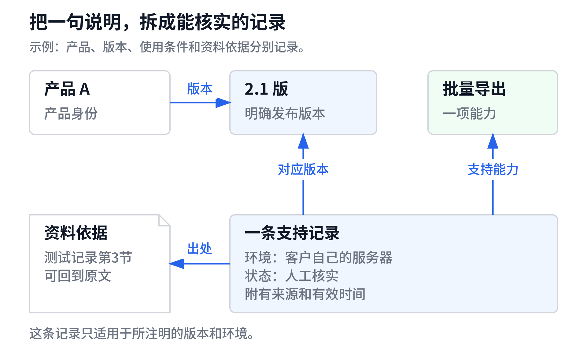
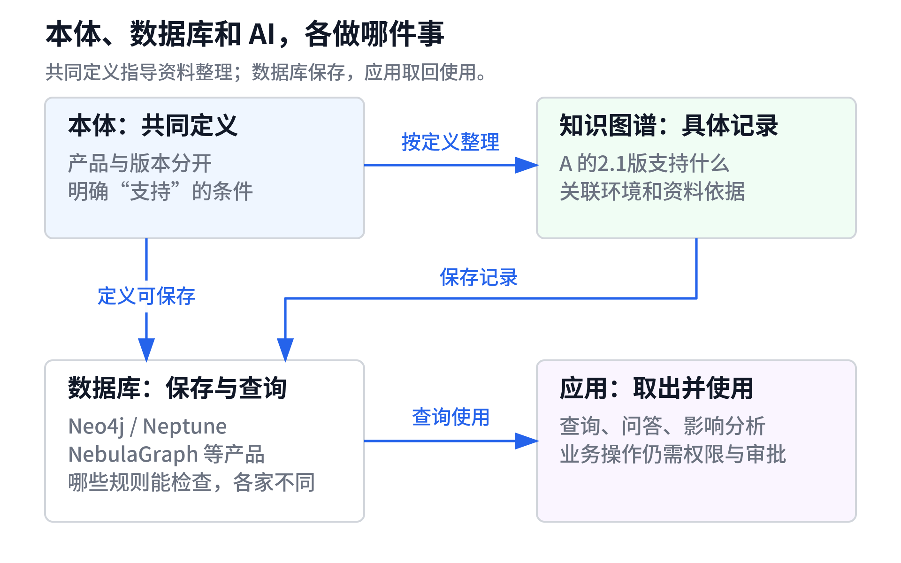
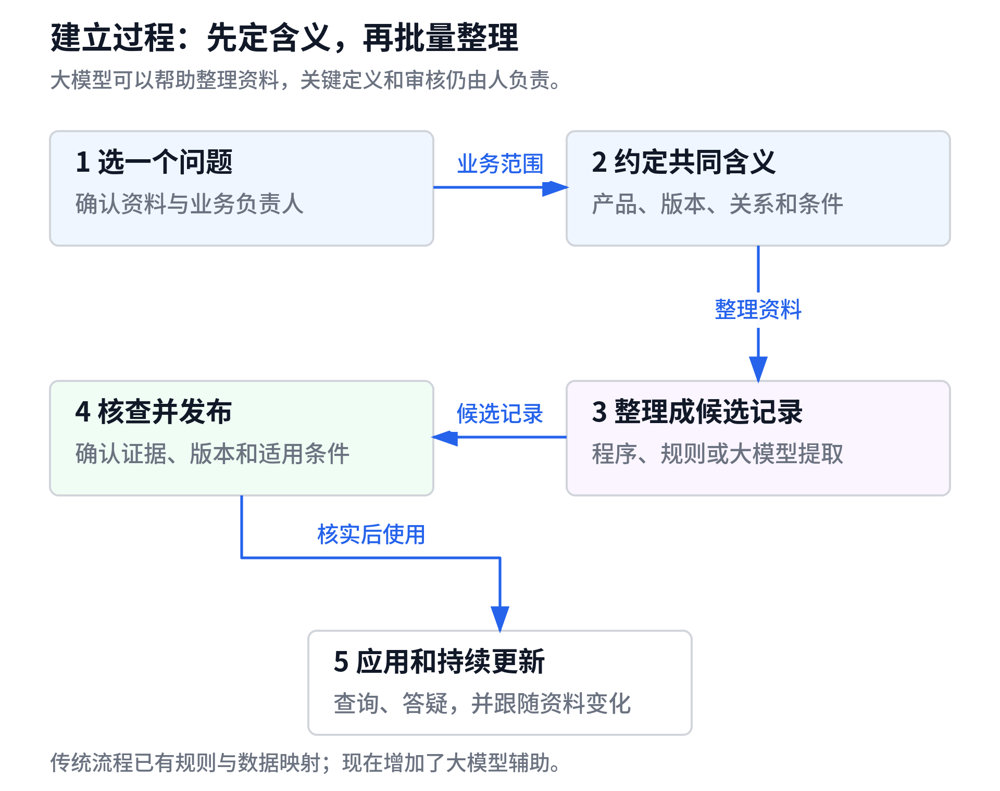
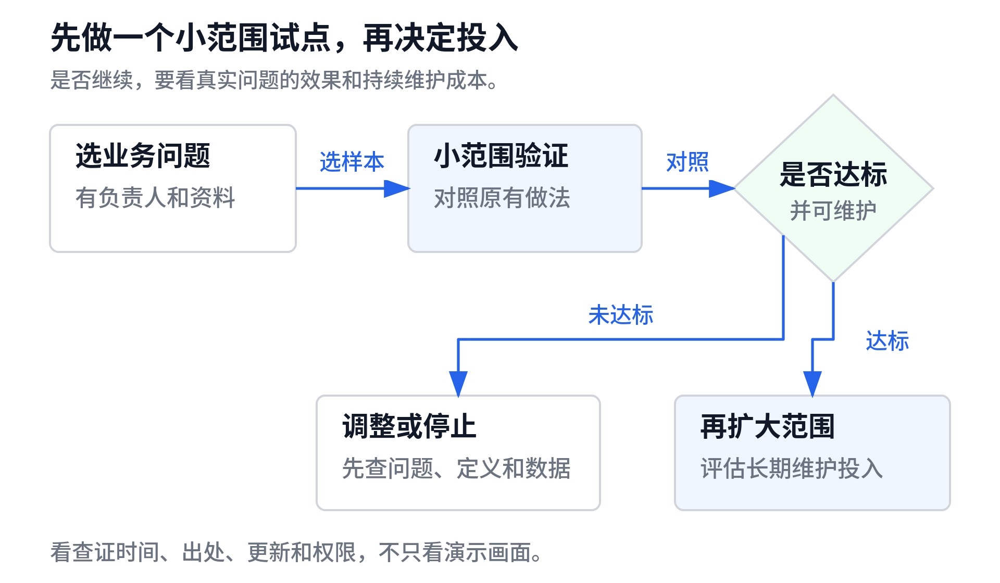

# 企业资料怎样变成可查证的知识

## 关于 Ontology 的管理层说明

2026 年 10 月 23 日

### 先看一个日常问题

假设客户问：“产品 A 的 2.1 版，能不能在我们自己的服务器上批量导出报表？”

产品手册写着“支持批量导出”，发布记录说明这项功能从 2.1 版开始提供，测试报告则注明只核实了某种安装方式。单独看其中一份资料，都可能回答得不完整。

公司需要先约定：产品和版本分开记录；“支持”必须附带适用条件；每条说法都能查到出处。再按这些定义整理资料，查询时才知道应该找哪些记录。

这就是 Ontology 在企业知识库中的一种用途。中文通常叫“本体”，这里可以先理解为**一套供人员和系统共同使用的业务定义**。它说明有哪些对象、彼此是什么关系，以及记录这些关系时要遵守什么要求。[1]

*图 1　产品与资料均为虚构示例。结论只适用于记录中注明的版本和环境。*

在这个例子里，要让查询程序分清版本、安装方式和证据。例如，供应商云服务上的功能，不一定适用于客户自己安装的软件。资料不足时，系统应当能回答“还没有足够依据”。

<!-- pagebreak -->

## 本体、数据库和大模型，各负责哪件事

本体先把业务含义说清楚。知识图谱再记录具体对象及关联，例如哪个版本支持什么、依据来自哪里。数据库保存并查询这些记录，应用取回它们用于页面展示、答疑或业务处理。

*图 2　这是职责说明。实际系统中，本体定义和具体记录都可以保存进数据库。*

Neo4j、AWS Neptune、NebulaGraph 等产品提供了不同的存储和查询方式。它们怎样检查数据、怎样被应用调用、怎样部署维护，都有差别。选择时要看现有系统和实际需求。[3]、[4]、[5]

但买哪款数据库，不会替公司决定“客户”“产品版本”或“支持某能力”的业务含义。这些定义需要业务负责人参与。

大模型可以阅读资料、提取候选信息，并解释查到的结果。资料本身有错、对象认错或条件漏掉时，答案仍然可能错。共同定义帮助系统按明确条件找信息，不能替代来源核实。

<!-- pagebreak -->

## 以前怎样建立，现在多了什么

本体并非大模型出现后才有。传统做法是由熟悉业务的人解释概念，工程人员整理成程序能处理的定义，再用实际问题检查结果。

过去也已有自动化：程序按固定规则从文字中找信息，或把原系统的记录转换成知识记录，减少逐条录入。[2]、[7]、[8]

现在可以加入大模型，让它批量读资料，先整理出产品名称、版本、功能和条件，供人核实。遇到同一件事的多种叫法，它也可以帮助找对应；原数据库已有准确记录的，直接读取往往更容易检查。

*图 3　自动化可以增加，但定义和审核仍要有人负责。*

例如，模型提取到“A 2.1 支持批量导出”，还要核对原文是否只适用于预览版，是否限定安装方式，两个名称是否指同一产品。引用的那句话可能没错，漏掉上下文条件却仍会答错。

发布后的知识还需要维护。新版本、资料纠错和权限变化出现时，对应记录、摘要和缓存要跟着更新。否则，原文已经改了，机器人仍可能使用旧答案。

<!-- pagebreak -->

## 哪些业务值得尝试

### 经常查资料，而且答案带条件

产品答疑、版本对比、设备维护等工作，经常需要把多份资料拼在一起。如果员工反复确认“哪个版本、什么环境、依据在哪”，可以选一类问题尝试这种组织方式。

预期改善应落到具体工作上：查证时间有没有减少，版本或条件是否还会混用，别人能否沿引用复核答案。现阶段不能仅凭一段流畅回答就认定项目有效。

### 变更时，需要知道相关对象和负责人

如果系统已经记录服务、组件和负责团队的关系，变更时可以查询可能相关的对象。这有助于整理检查名单，但路径关联不等于故障一定传播，真实影响仍需结合版本和运行条件确认。

进一步接入业务操作时，模型可以提出“创建变更评审单”。实际执行要由业务服务检查权限、当前状态、审批和重复提交，再留下审计记录。理解对象关系，不会自动赋予模型操作权限。

### 哪些问题它不能单独解决

如果来源数据本来就错误、没有人确认关键定义，整理成图以后问题仍然存在。如果资料已经容易找到，普通检索也能稳定解决问题，增加本体未必值得。

还要考虑持续维护。谁负责修订定义？谁确认冲突资料？原文撤销后，哪些答案和缓存需要改？这些工作应当计入项目，而不是留到上线后再找人。

涉及敏感数据和业务动作时，资料里写了一句“执行这个操作”，不应就让系统照做。即使 AI 先查资料再回答，也不保证排除这类干扰。限制操作权限、保留必要审批，仍是业务系统的责任。[6]

<!-- pagebreak -->

## 怎么开始，管理层需要决定什么

建议先选一个高频、范围明确、资料可获得的业务问题做试点。用一批真实资料和固定问题，与现有做法比较。暂时不以全公司知识或自动执行复杂业务作为起点。

*图 4　是否扩大，由业务结果和可维护性决定，不由演示是否好看决定。*

管理层首先需要确定一个业务负责人，让他有时间解释概念、确认资料和评审结果。技术人员可以做整理、存储、查询及校验，但无法独自决定全部业务含义。

验收时重点看：查证是否更省时；答案是否准确保留版本和条件；出处能否复核；资料修改后能否及时纠正；权限能否覆盖记录、引用和缓存。

如果这些方面有可重复的改善，再评估扩大范围需要多少接入、审核和维护工作。没有改善时，先查问题选得是否合适、定义和资料是否可靠，也可以停在更简单的检索方案。

目前已有小型技术参考示例，不是已经上线的业务系统，也未验证贵公司实际数据下的成本与收益。投入规模应等试点结果出来后再确定。

<!-- pagebreak -->

## 附：技术讨论中可能听到的几个名字

| 名称 | 在这份说明里的意思 |
|---|---|
| Ontology／本体 | 把业务对象、关系和规则定义清楚 |
| 知识图谱 | 具体对象及关系的知识记录，可关联条件和证据 |
| 图数据库 | 保存对象及其关系，方便沿关系查找的软件 |
| RDF | 一种标准的知识表示方法，用明确标识记录对象、关系和数据值 |
| OWL | 描述概念和关系的语言，可以配合程序按逻辑推导结论 |
| 大模型 | 帮助处理语言、提取候选或解释结果的工具 |
| RAG | 回答前先找相关资料，再交给模型作答 |

这些技术不必一次全部采用。可以从共同定义和可靠资料开始，根据实际问题选择数据库、查询、推理或大模型应用。

### 资料依据与阅读范围

这份说明根据配套技术稿整理，重点帮助管理层理解用途与投入判断。代码、数据库差异、标准版本及实际测试记录，另有技术说明供实施团队查阅。

主要一手资料：

- [W3C：OWL 2 Primer][1]
- [Stanford：Ontology Development 101][2]
- [Neo4j：图数据库概念][3]
- [AWS：Amazon Neptune FAQ][4]
- [NebulaGraph：公开 3.8.0 文档][5]
- [OWASP：提示注入风险][6]
- [W3C：关系数据库到知识表示的映射][7]
- [GATE：早期术语提取工具示例][8]

图示为自绘说明图，不代表真实产品能力或项目收益；数据库示例未作跨产品部署及性能验证。

[1]: https://www.w3.org/TR/owl2-primer/ "W3C OWL 2 Primer"
[2]: https://protege.stanford.edu/publications/ontology_development/ontology101-noy-mcguinness.html "Ontology Development 101"
[3]: https://neo4j.com/docs/getting-started/appendix/graphdb-concepts/ "Neo4j graph concepts"
[4]: https://aws.amazon.com/neptune/faqs/ "Amazon Neptune FAQ"
[5]: https://docs.nebula-graph.io/3.8.0/1.introduction/1.what-is-nebula-graph/ "NebulaGraph 3.8.0"
[6]: https://genai.owasp.org/llmrisk/llm01-prompt-injection/ "OWASP Prompt Injection"
[7]: https://www.w3.org/TR/r2rml/ "R2RML"
[8]: https://gate.ac.uk/sale/talks/gate-course-jun14/module-6-applications/termraider.pdf "TermRaider"
